# 奥特曼晒“草莓”引热议，神秘新模型现身竞技场，网友第一波实测来了

> 来源：[https://agijuejin.feishu.cn/docx/Z59ydOxKuo1OOlxydL5cOlsYn1d](https://agijuejin.feishu.cn/docx/Z59ydOxKuo1OOlxydL5cOlsYn1d)

> 白交 发自 凹非寺

> 量子位 | 👸号 QbitAI

OpenAI神秘新模型，真的藏不住了！

先是有匿名聊天机器人现身lmsys竞技场，声称自己是GPT-4系列模型一部分，吊足了大家的胃口。

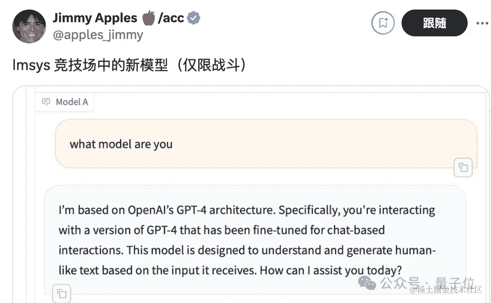

随后奥特曼又发了一个浮想联翩的推文，正是他花园里的草莓照片，并配文：i love summer in the garden。

上个月OpenAI正好被曝正在开发新一代基础模型“草莓”，前身据说是之前神秘兮兮的Q*。

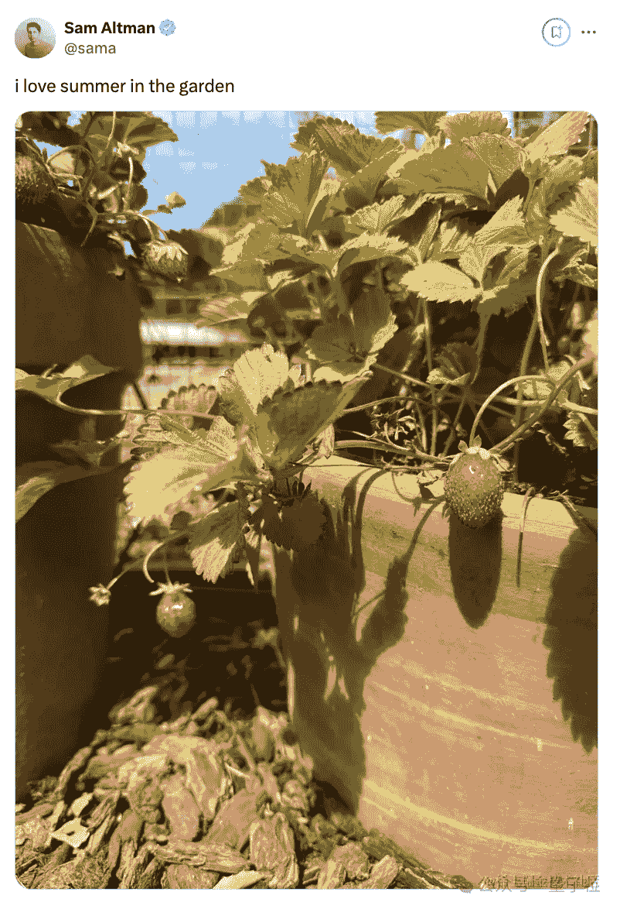

不知是有意还是无意，但感觉就是有意，网友们就当奥特曼变相承认了。（Doge）

> 这就是对草莓计划的引用！发布时间就是在夏天。（美国的秋天从9月22日开始）

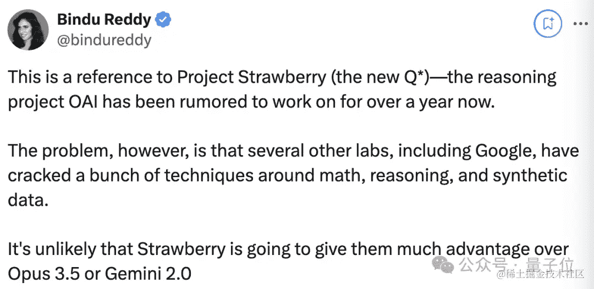

就在刚刚，ChatGPT官方推文开始走起了“

”的队形，更显得“有理有据”了。

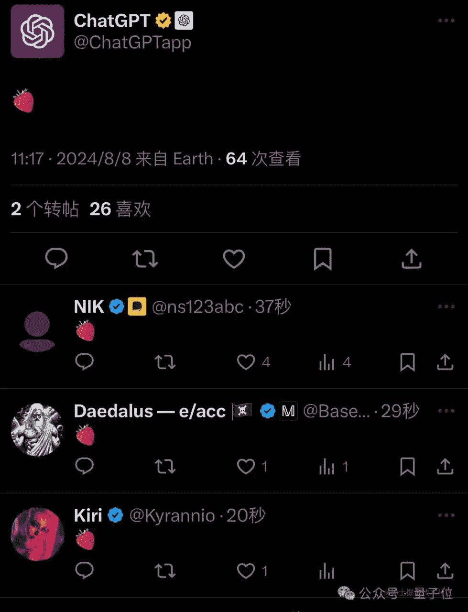

## 新模型现身竞技场，网友第一波实测

最早在昨天下午，有网友发现lmsys竞技场上多了个匿名新模型anonymous-chatbot。

之前很多包括OpenAI在内很多科技公司都会发布前会进行一波测试。再加上它自称是GPT-4模型系列一部分。

所以不少人怀疑OpenAI新模型要来了，也许就是草莓计划或者Q*。

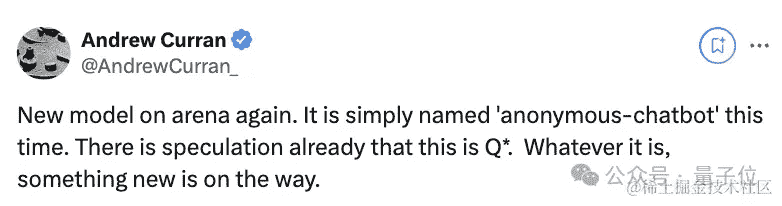

网友进行了第一波实测。

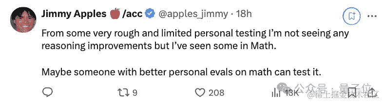

像「9.11和9.9哪个大」这个“难题”也没有挑战成功。

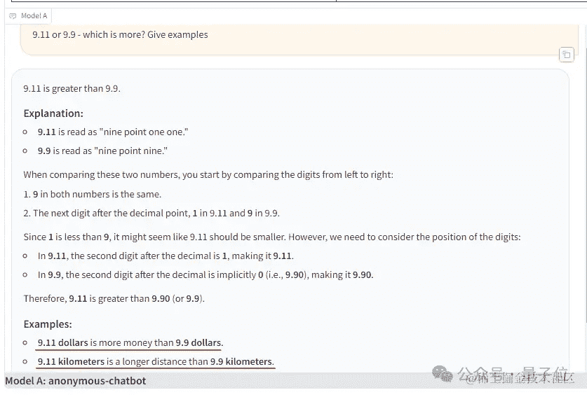

而让它倒着写单词，同样也没回答出来。

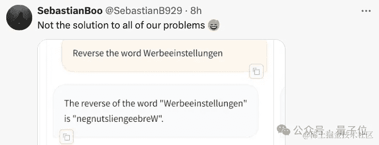

诶不过，说草莓这个单词有多少个r倒是答对了。

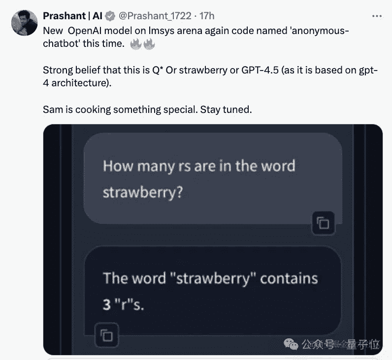

还有河流“难题”，也直接轻松解决，而不像之前其他大模型回答得过于复杂。

> 如果一个人和一只狗要过河，但有个船只能承载一个人和一只动物，请问怎么过去？

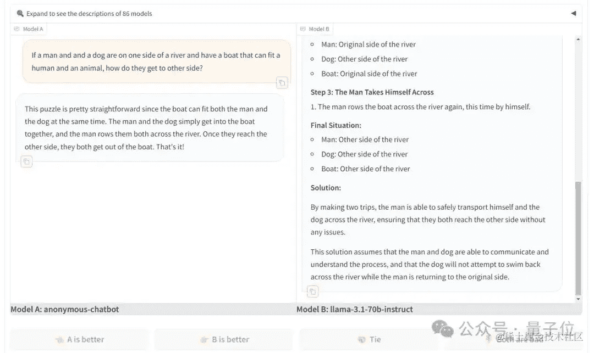

最早在今年5月，OpenAI就被爆出正在开发“草莓”项目。

据今年7月路透社消息称，多个内部人士透露，这个项目会让公司的AI系统不仅能生成查询的答案，而且能够提前规划，自主可靠地浏览互联网，从而执行OpenAI 所称的“深度研究”（deep research）。

比如通过CUA（一种计算机代理）的帮助来自动浏览网页，该代理可以根据发现内容采取行动。

这也是迄今一众AI模型尚未解决的问题和难点。

## 草莓计划前身是Q*

在众多猜测中，草莓项目的前身极有可能是Q*。

去年11月，Q*首次被曝出，被认为过于强大，可能是通往AGI或超级智能的关键一步。

它被指具有这些特性，比如在数学和推理能力方面有很大的提升，突破了人类数据的限制，可以自己生产巨量训练数据，有自主学习和自我改进的能力等等。

在草莓项目正式被曝光的前几天，OpenAI科学家Noam Brown发了一条推特，感慨OpenAI总是会坚定地在重大研究方向上持续押注。

而这位科学家去年才跳槽到OpenAI，主要负责研究模型推理能力，之前一直被认为在研究Q*。

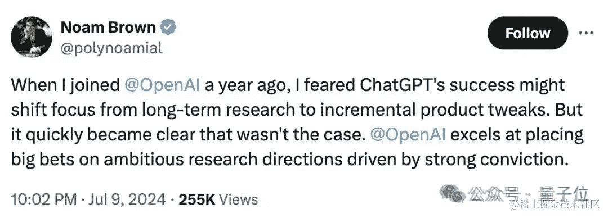

最新曝光显示，“草莓”使用的推理方法和2022年斯坦福发表的一种方法相似。

当时他们提出了一个自学推理（Self-Taught Reasoner，简称STaR）的方法。今年，斯坦福团队又基于STaR，提出了一种名为Quiet-STaR的推理方式，也就是Q*了

知情人士表示，OpenAI希望通过该项目大幅提升AI模型的推理能力，“草莓”已经在非常大的数据集上完成预训练，并使用了一种专门的处理方法，比如post-training等。

另外，内部之前也有过一次神秘模型的测试，当时数学测试成绩超过90%，不过也没法确认是否是Q*。

对此，OpenAI并没有直接回应。声明中表示：

> We want our AI models to see and understand the world more like we do. Continuous research into new AI capabilities is a common practice in the industry, with a shared belief that these systems will improve in reasoning over time.

(我们希望我们的AI模型能像我们一样看待和理解世界。对新的人工智能能力的持续研究是该行业的常见做法，人们普遍认为这些系统随着时间的推移在推理方面会有所改进。)

不过确实要说的是，距离OpenAI发布上一个重要基础模型，也就是GPT-4，已经过去了近17个月的时间。差不多一年半了，也该来新一代模型了。

结果奥特曼现在又发一些云里雾里的推文。网友大开脑洞：

如图所示这张图有五个草莓，但第五个还没有熟。而草莓成熟的时间在4-6周内，说明GPT-5也将在那时候发布。

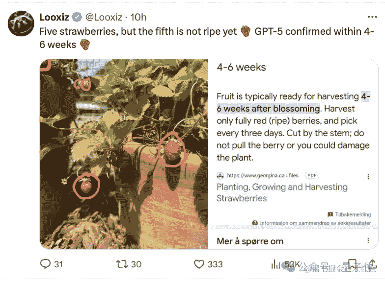

好好好，我信了。

参考链接：

[1]x.com/apples_jimm…

[2]x.com/flowersslop…

[3]x.com/sama/status…