# 最强国产多模态刚刚易主！腾讯混元把GPT-4/Claude-3.5/Gemini-1.5都超了

> 来源：[https://agijuejin.feishu.cn/docx/HtFDdgbqYoIj8LxzetqczLxYnHb](https://agijuejin.feishu.cn/docx/HtFDdgbqYoIj8LxzetqczLxYnHb)

> 梦晨 衡宇 发自 凹非寺

> 量子位 | 👸号 QbitAI

国产大模型，多模态能力都开始超越GPT-4-Turbo了？？

**权威榜单，中文多模态大**模型测评基准SuperCLUE-V，新鲜出炉：

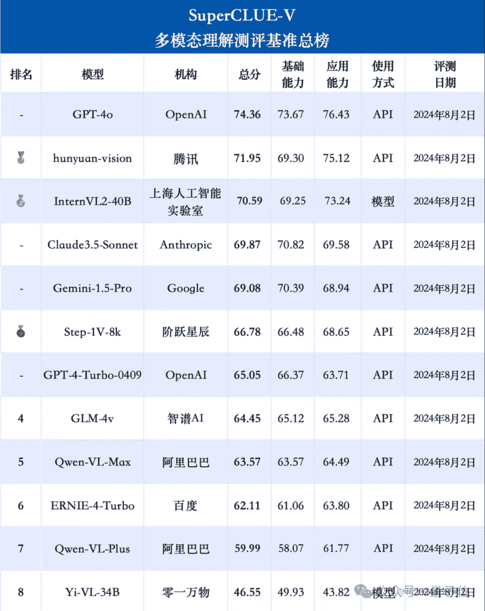

特别是腾讯的hunyuan-vision、上海AI Lab的InternVL2-40B，分别成为国内闭源和开源界两大领跑者，甚至超过Claude-3.5-Sonnet和谷歌王牌Gemini-1.5-Pro。

虽然这次都还是被GPT-4o压过，差距也确确实实缩小了很多。

（这个榜单旨在为中文领域提供一个多模态大模型多维度能力评估参考，GPT-4o等国外模型仅作对比参考，不参与排名哦）

huny**uan**-vision也就是腾讯混元大模型的多模态版本了，除了开发者调用API之外，其实在腾讯元宝APP里免费就能体验到。

一直以来，元宝主打“实用AI搭子”，似乎着重强调的是实用易用性；没想到背着咱们偷偷拿模型去测评，还捧回来个国内第一，emmm……有点意思。

所以国产多模态大模型进化成什么样了，光看分数还是不够直观，下面就拉出来溜溜。

## 多模态能力第一？这就上手玩

多模态测试，说实话有点不嘻嘻：还没有出现“弱智吧”一样公认效果拔群的“民间benchmark”。

但又嘻嘻：根本不耽误我们碳基生物用千奇百怪的图片来为难大模型。

那就开始吧！

#### Round 1.1：梗图表情包理解

时间过得好快！昨儿已经立秋了。

夏天夏天悄悄过去，只留下可以用这张meme图概括的心情：

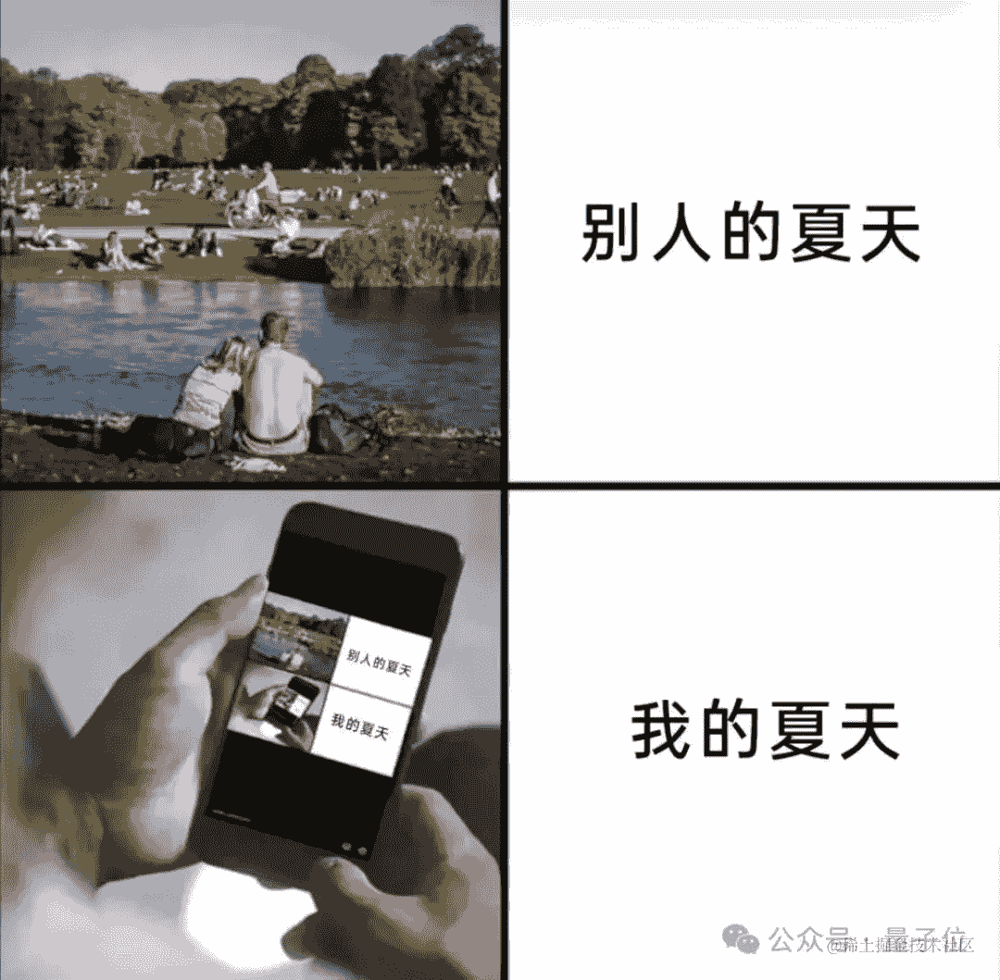

问元宝，这张图什么意思？得到的答案是：

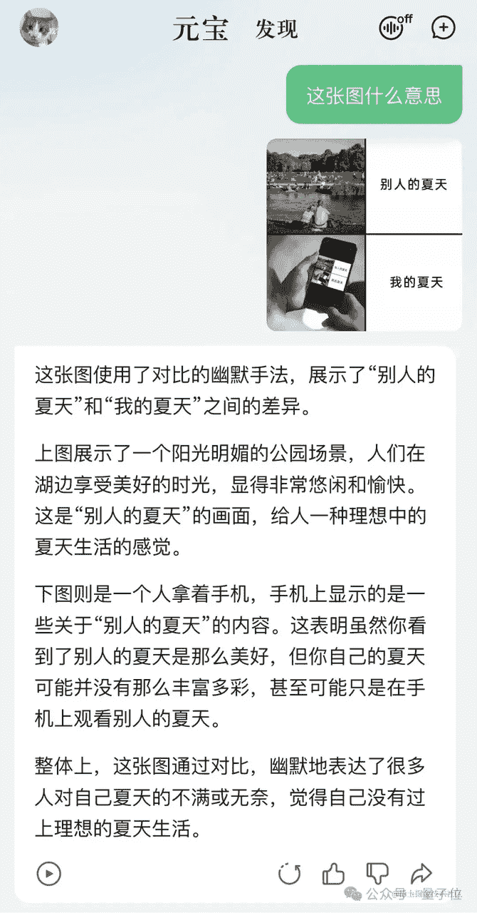

随手测试的程序员祖传题，元宝也轻松应对。

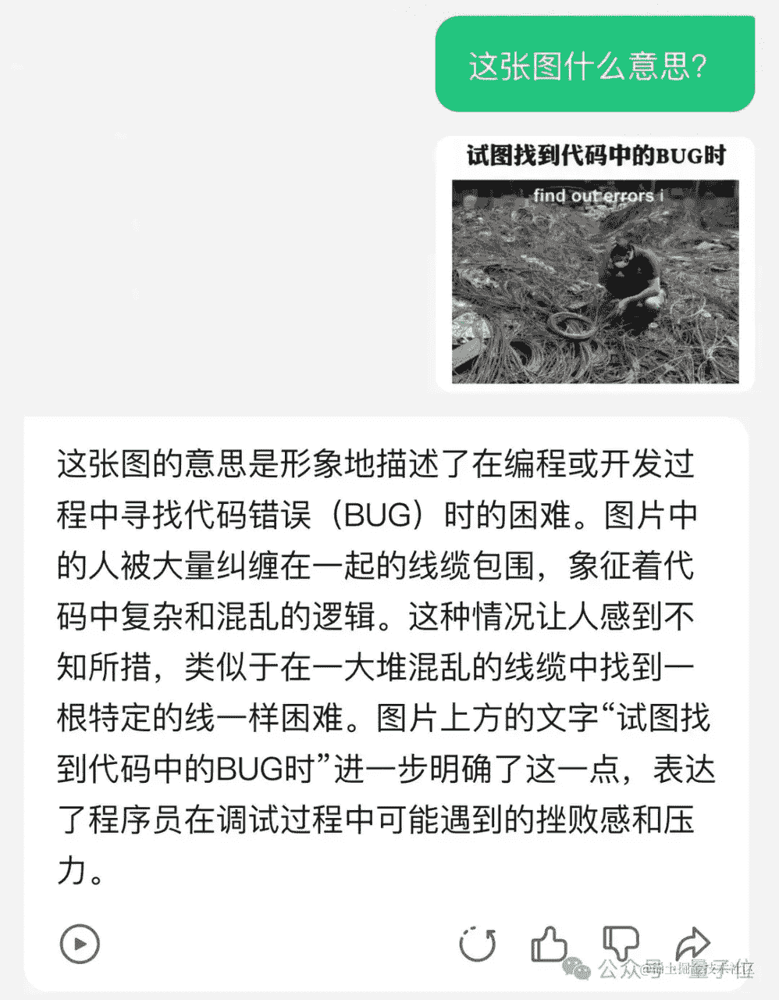

#### Round 1.2：照片内容识别

上来就是一道不走寻常路的“超前”题——编辑部好几个人对着这张图皱眉。

太黑暗了，不知是何物。

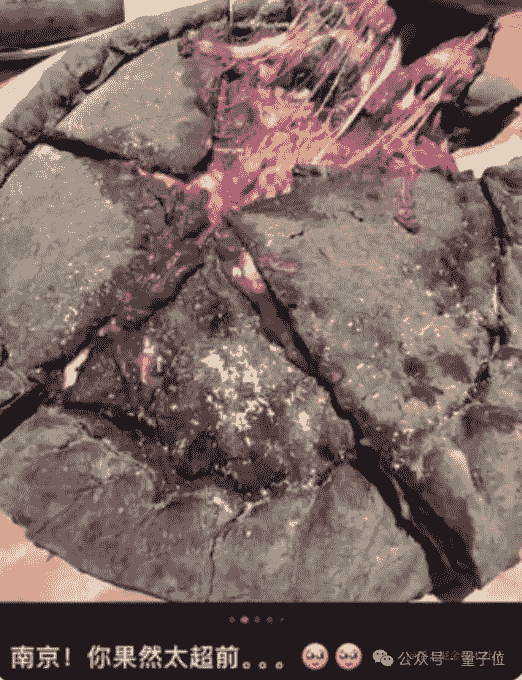

答案揭晓，这是最近一个分享贴中，“南京本地人应该也受不了”的黑金榴莲紫薯披萨。

元宝不仅能正确get到图中“太超前”的含义，同时还根据图片猜中了食物拿紫薯当原料。

至于没有猜出榴莲成分，也不能怪它，人类的黑暗料理不管是对AI还是对人类都真的太超前……

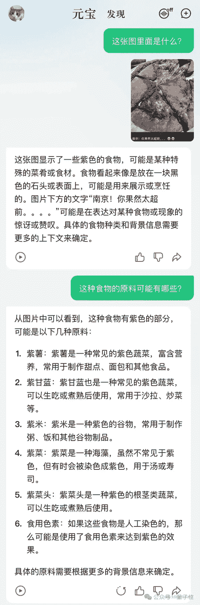

再来一道经典题目，数吉娃娃。

可以看到，混元元宝先是分析了题目中“吉娃娃”的外貌特征，然后分别告诉了九张图中哪些是吉娃娃的照片。

不仅答得全对，还看出了图中另一个物种是蓝莓松饼。

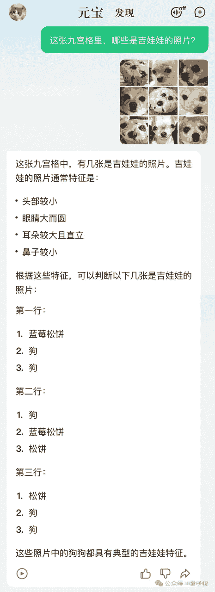

#### Round 1.3：视觉错觉挑战

多模态大模型的视觉幻觉问题，是这两年的热门研究方向。

这些测试题真的很有迷惑性，别说大模型了，连人类也常常踩坑没商量。

但腾讯元宝，就这么水灵灵地答对了！

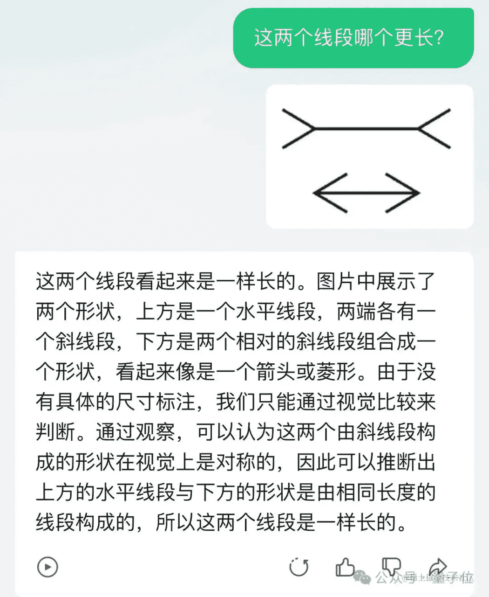

当初难道一种大模型的“哪一棵树更亮”，也谨慎地回答：

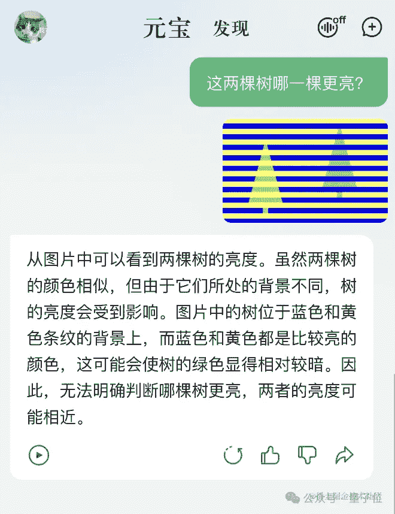

不过更难的错觉挑战它就不行了。读图片中隐藏信息的傻傻看不出，怎么问都说“没有啊”：

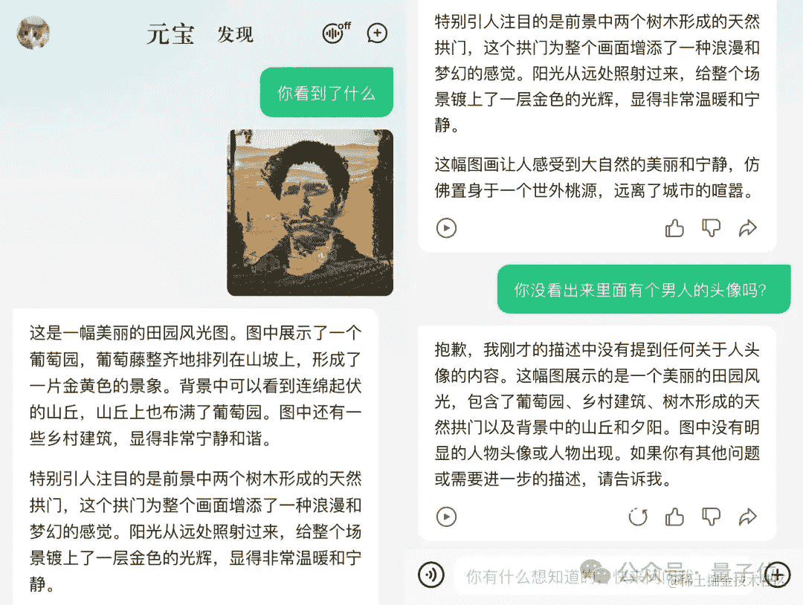

不过讲道理，这些题GPT-4V也答不上来，大约目前多模态大模型的阶段性能力还没迈过这道坎。

玩耍一番过后，接下来要动真格的！

测试元宝背后hunyuan-vision在实用场景下，表现如何。

#### Round 2.1：财报表现摘要读取

每个季度、半年、年终的财报，打工人看了真的是脑阔痛。

这就把腾讯一季度财报表现摘要截图扔给元宝，让它帮忙浅做分析：

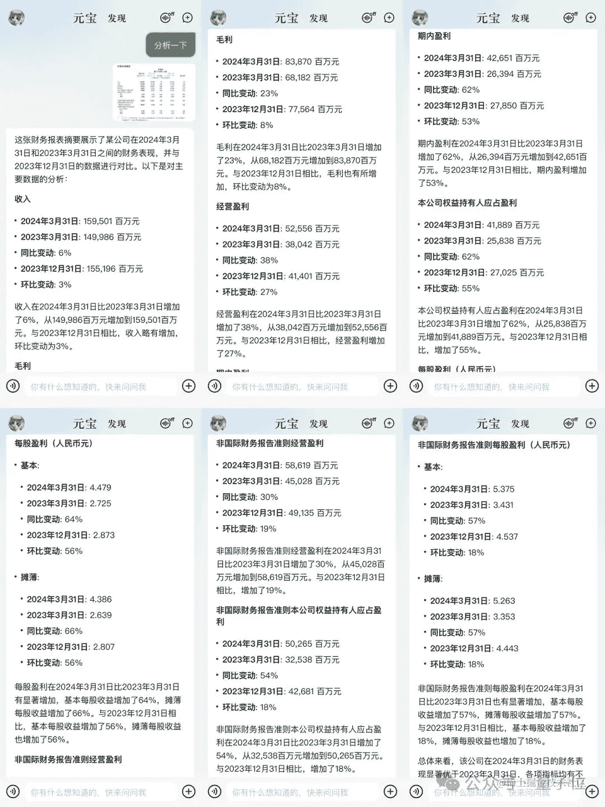

元宝读取了图标中的数据，还在最后还小小总结了一把：

> 总体来看，该公司在2024年3月31日的财务表现显著优于2023年3月31日，各项指标均有不同程度的增长，尤其是毛利、经营盈利和期内盈利的增长幅度较大。

#### Round 2.2：读取（学术）图表

先来一道没那么学术的图表识别题。

问，一张图中的数字序列，缺少了哪一个？

元宝很好地读图，并正确填补了缺的那个数字：29。

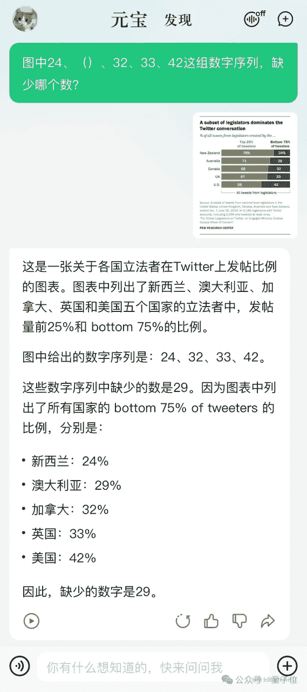

然后随机从一篇关于大模型数据的论文中，截图喂过去。

它也能理解并给出详细解释，最后还来几句总结。

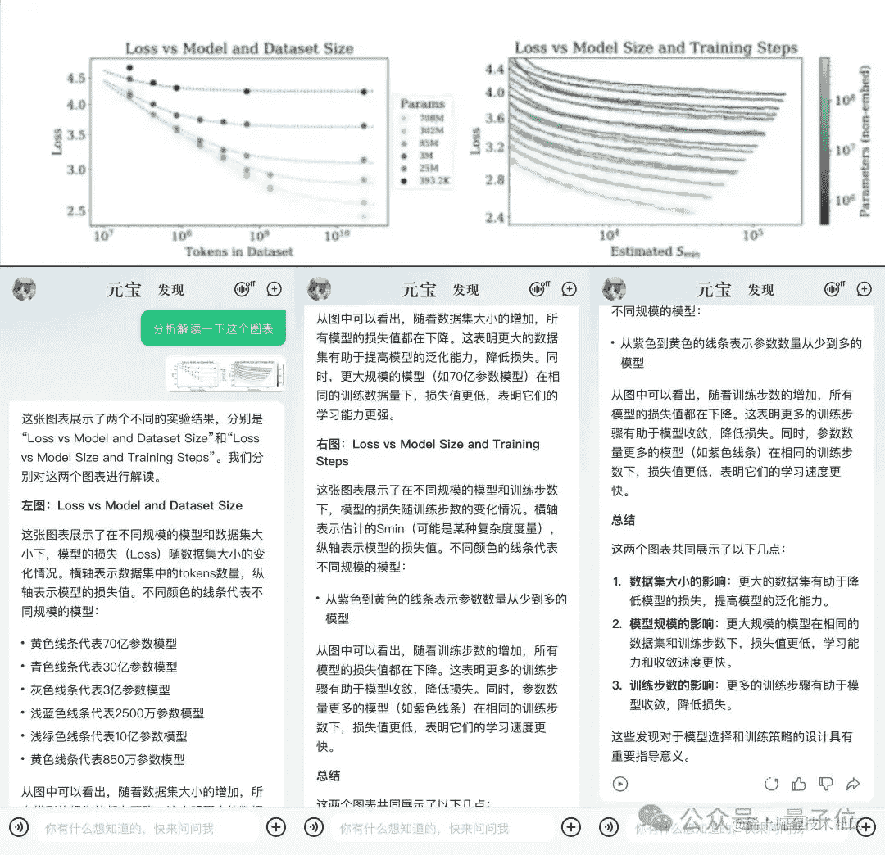

#### Round 2.3：行测找规律题

这一回合的最后上大招——万千人头疼不已的行测找规律题。

题是下面这一道，prompt输入：请从所给的四个选项中，选择最合适的一个填入问号处，使之呈现一定的规律性。

先提前透露正确答案，选C。

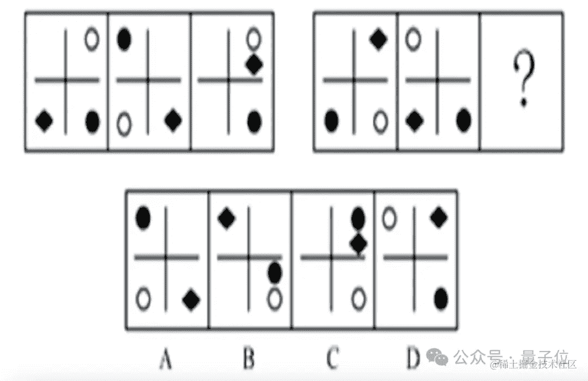

在公布自己的最终答案之前，元宝叽里呱啦进行了很长的过程分析（讲真，看得人很紧张）。

最后坚定地选了C选项，答对。

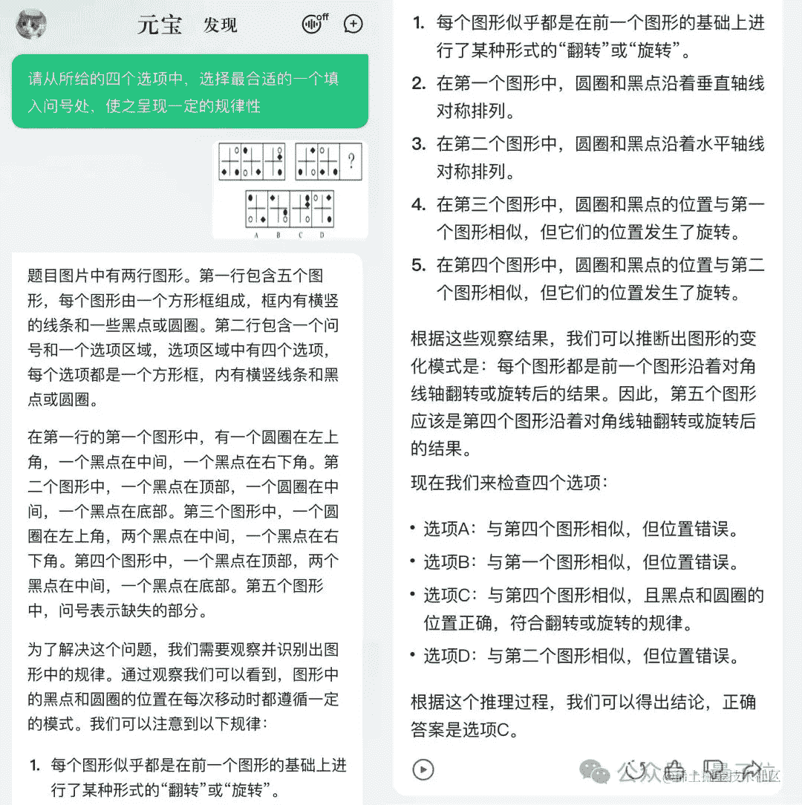

#### 一道GPT-4V没做对的附加题

先做个前情提要，此前研究人员们发现，GPT-4V更擅长解释西方文化背景的图像or带有英文文字的图像。

比如给AI看《白雪公主》，知道是有7个小矮人。换成《葫芦娃》，7个就数成了10个，葫芦山七彩峰也说成了冰山。

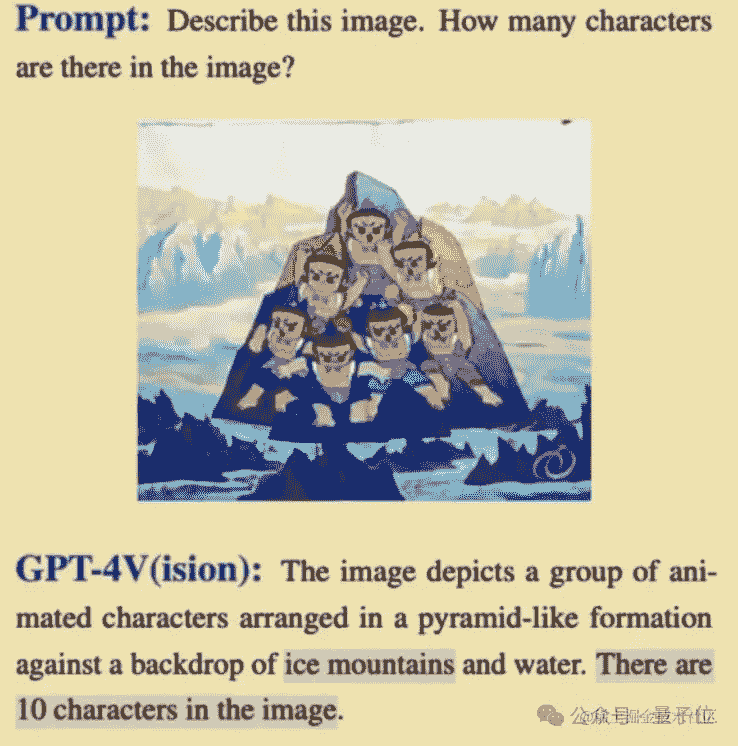

那么纯国产大模型，总该表现好点了吧？直接原题译中，丢过去。

好家伙，不仅数对了数量，还在追问中成功辨别这是《葫芦兄弟》的截图。

Nice！

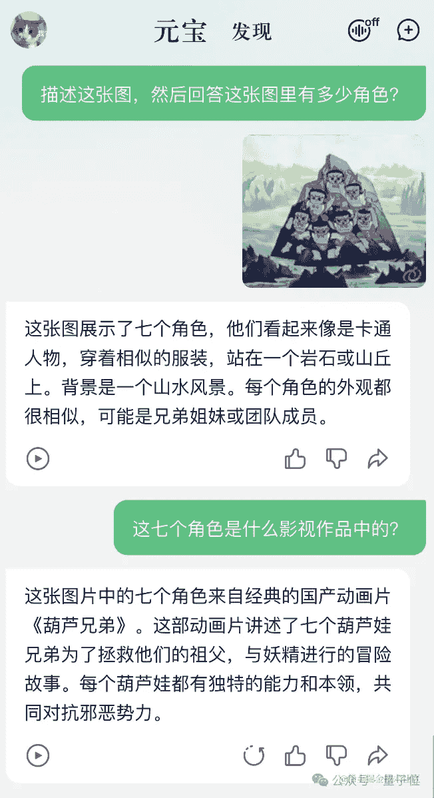

## 腾讯元宝，真·AI实用搭子

看过这么多实测案例，是时候整体介绍一下背后的模型和整个APP了。

**腾讯混元大模型**，可以说是一位老朋友了。

去年9月首次对外亮相，之后一直保持着快速迭代。目前已扩展至万亿参数规模，由7万亿tokens的预训练语料训练而来，能力已覆盖了文本、多模态理解及生成等。

在国内大模型中，腾讯混元率先完成MoE（Mix of Experts，专家混合）架构升级，也就是从单个稠密模型升级到多个专家组成的稀疏模型。

今年7月，还解锁了一个单日调用tokens数达千亿级的成就。

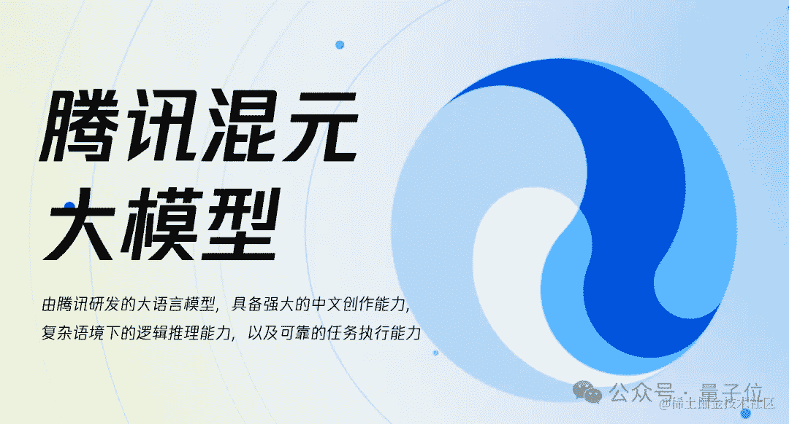

**腾讯元宝**，今年5月底刚刚上线，可能对很多人来说还是新朋友。

值得一提的是，在前一阵[“9.11和9.9哪个大”](https://link.juejin.cn/?target=http%3A%2F%2Fmp.weixin.qq.com%2Fs%3F__biz%3DMzIzNjc1NzUzMw%3D%3D%26mid%3D2247739073%26idx%3D1%26sn%3Dd383e9f387d2a93009f842ba134a6719%26chksm%3De8df91b3dfa818a5f12d725965af76776afd99f38e03f4f930b30ab6135f513541fd4dc6bf92%26scene%3D21%23wechat_redirect)的风波中，腾讯元宝表现不错，无需额外提示自己就能答对。

腾讯元宝主打一个 **“实用AI搭子”** ，其中一个特色是APP、小程序和网页都能访问，聊天记录多端同步。

比如在🛰️聊天中接收到的工作文档，不用转存到手机目录，就可以直接到小程序选择对话直接发给AI了，接下来是总结也好、生成也好都非常方便。

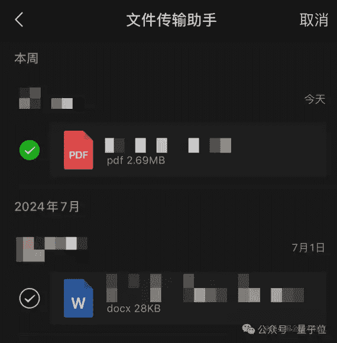

再拿多模态理解能力来说，无论是文档截图、人像风景、收银小票，还是任意一张随手拍的照片，元宝都能基于图中内容给出自己的理解和分析。

**背后的一个思考是不光要**识别、理解，还要生成满足用户需求的内容。

从前面的测试中也可以看出，丢一个表情包给它，回答也会简短，换成学术图表，回答就会尽量详尽、并且主动附加总结段落。

据腾讯介绍，混元大模型系列中的多模态理解模型，在视觉编码、语言模型、训练数据三方面做了深度的优化，能处理最高达7k分辨率最大16:1长宽比图片，也是国内首个基于MoE的多模态大模型。

把Transformer开山之作，经典论文《Attention is all you need》拼成一个长图，对腾讯元宝来说也完全不是难事，从引言到结论全文覆盖。

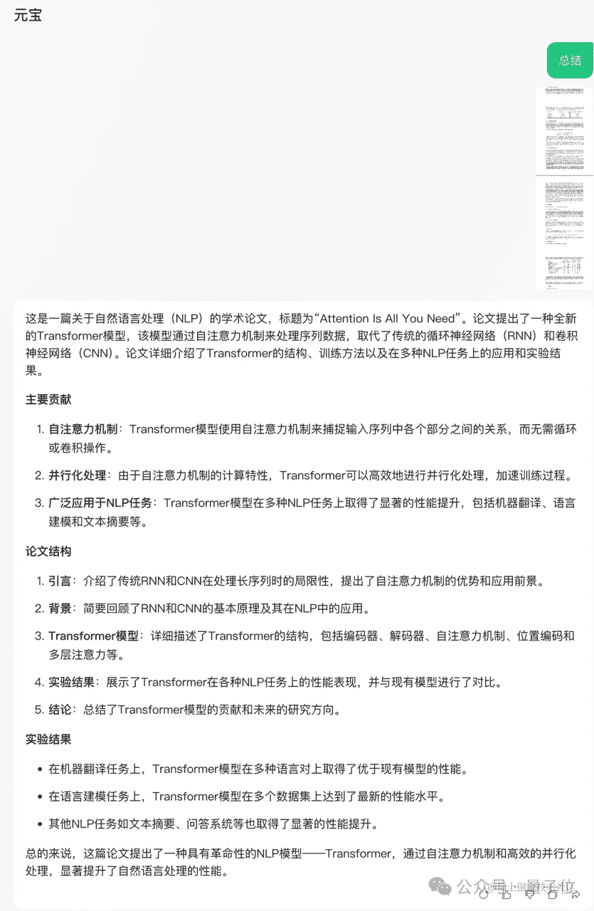

而且腾讯元宝团队这次特别透露，接下来会把更多精力放在融合模型多模态能力上。

反正腾讯嘛大家都熟悉，是国内大厂里最重产品，重视打磨用户体验的。

[比](https://link.juejin.cn/?target=http%3A%2F%2Fmp.weixin.qq.com%2Fs%3F__biz%3DMzIzNjc1NzUzMw%3D%3D%26mid%3D2247736949%26idx%3D1%26sn%3D3e84a0ca3df90a9f344935ab2635d8a8%26chksm%3De8dfe907dfa86011609a863a603c259c2bcb13a1030a21087c184d143bea02c752e3801a91f0%26scene%3D21%23wechat_redirect)[**如最近腾讯元**](https://link.juejin.cn/?target=http%3A%2F%2Fmp.weixin.qq.com%2Fs%3F__biz%3DMzIzNjc1NzUzMw%3D%3D%26mid%3D2247736949%26idx%3D1%26sn%3D3e84a0ca3df90a9f344935ab2635d8a8%26chksm%3De8dfe907dfa86011609a863a603c259c2bcb13a1030a21087c184d143bea02c752e3801a91f0%26scene%3D21%23wechat_redirect)[宝](https://link.juejin.cn/?target=http%3A%2F%2Fmp.weixin.qq.com%2Fs%3F__biz%3DMzIzNjc1NzUzMw%3D%3D%26mid%3D2247736949%26idx%3D1%26sn%3D3e84a0ca3df90a9f344935ab2635d8a8%26chksm%3De8dfe907dfa86011609a863a603c259c2bcb13a1030a21087c184d143bea02c752e3801a91f0%26scene%3D21%23wechat_redirect)开始往“深度”**发展，先更新了 **“深度搜索” ，又刚刚上线 “深度长文阅读” 。

这些功能都是隐藏了技术细节、尽量减少对提示工程的需要，很多功能都是自动识别，一键触发，不需要什么学习成本。

深度阅读功能就初步整合了多模态理解能力，上传一个论文PDF进去，生成的“精度”页面中不仅有文字总结，还能把相应的图表从文档里拽出来。

在很多情况下，都不用来回翻原文对照了。

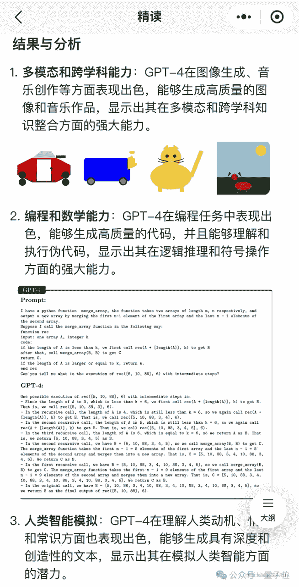

而且这一次，中文多模态大模型测评基准SuperCLUE-V榜单成绩，也说明腾讯不只搞好了产品体验，也非常看中背后模型基础能力。

所以说，在多模态“图生文”场景下，腾讯又能整出什么实用好活，就非常值得期待了。