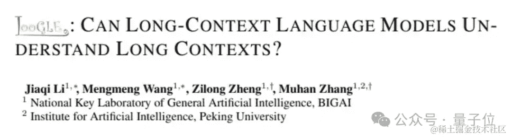
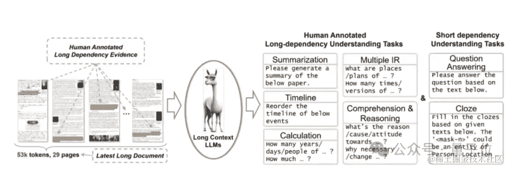
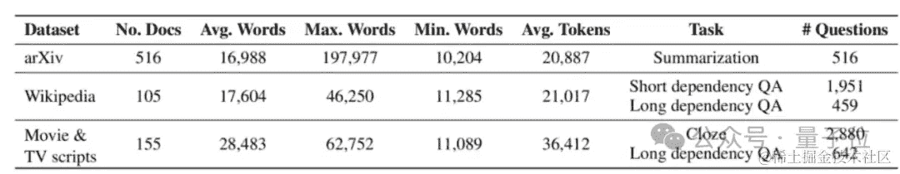
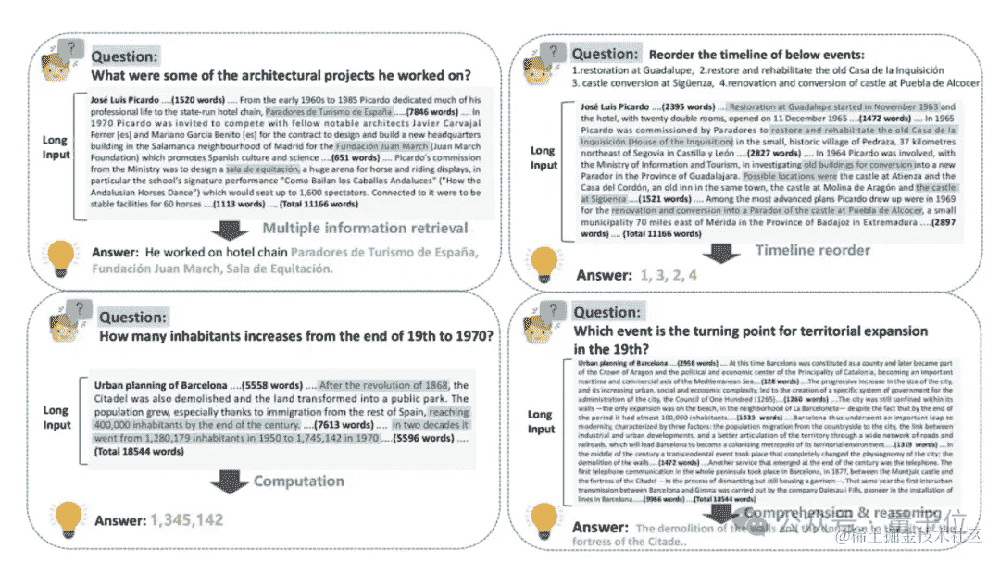
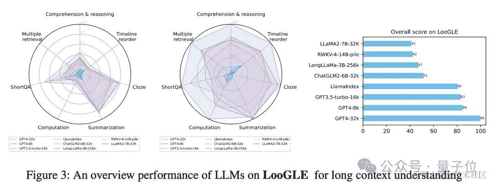
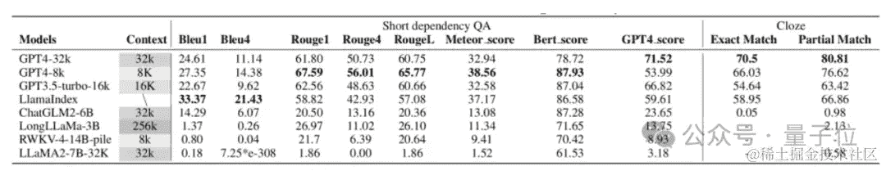
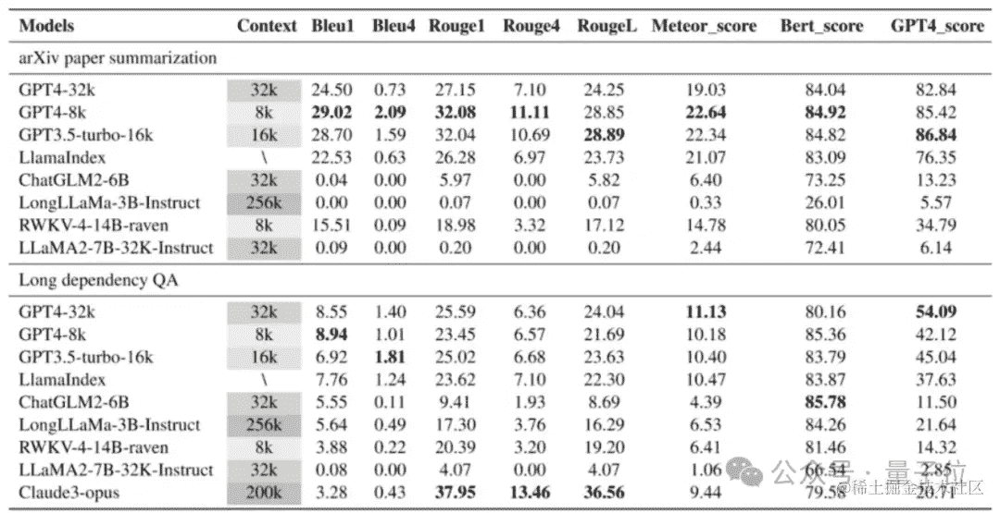
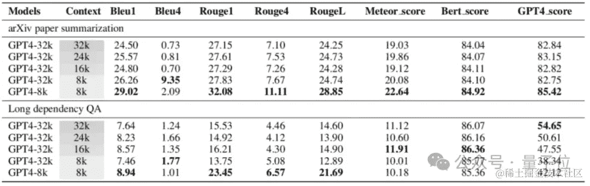
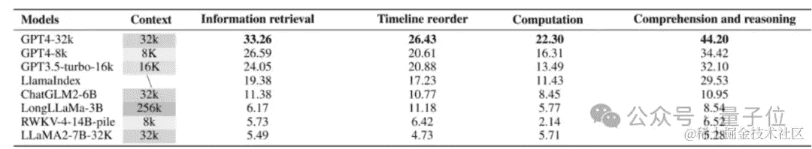

# 无一大模型及格！ 北大/通研院提出超难基准，专门评估长文本理解生成

> 来源：[https://agijuejin.feishu.cn/docx/AwvCdqNv8oXjjsxMZlLcjImbnsf](https://agijuejin.feishu.cn/docx/AwvCdqNv8oXjjsxMZlLcjImbnsf)

> LooGLE团队 投稿自 凹非寺

> 量子位 | 👸号 QbitAI

在长文本理解能力这块，竟然没有一个大模型及格！

**北大联合北京**通用人工智能研究院提出了一个新基准数据集：LooGLE，专门用于测试和评估大语言模型（LLMs）长上下文理解能力。

该数据集既能够评估LLMs对长文本的处理和检索能力，又可以评估其对文本长程依赖的建模和理解能力。

结果不评不知道，一评估发现这些模型在复杂的长依赖任务中的多信息检索、时间重排序、计算、理解推理能力表现均不乐观。

比如像Claude3-200k，GPT4-32k、GPT4-8k、GPT3.5-turbo-6k、LlamaIndex**这种商业模型，平均只有40%的准确率。

而像开源模型表现就更不理想了…

ChatGLM2-6B、LongLLaMa-3B、RWKV-4-14B-pile、LLaMA-7B-32K平均只有10%的准确率。

目前该论文已被ACL 2024接收。

论文共同一作为通研院的李佳琪、王萌萌，通讯作者为通研院研究员郑子隆和北京大学人工智能研究院助理教授张牧涵。

## LooGLE基准测试

LooGLE基准测试主要有这样几个特点：

首先，它包含包含近 800 个最新收集的超长文档。平均近2万字（是现有相似数据集长度的2倍），并从这些文档中重新生成了6千个不同领域和类别的任务/问题用于构建LooGLE。

目前目前没有既评估LLMs对长文本的处理和记忆，又评估其对文本长程依赖的建模和理解能力的数据集。

LooGLE的数据集由7个主要的任务类别组成，旨在评估LLMs理解短程和长程依赖内容的能力。

团队设计了**5种类型**的长期依赖任务，包括理解与推理、计算、时间线重新排序、多重信息检索和摘要。

通过人工标注精心生成了超过1100对高质量的长依赖问答对，以满足长依赖性要求。这些问答对经过了严格的交叉验证，从而得到了对大型语言模型（LLMs）长依赖能力的精确评估。

LooGLE基准数据集仅包含2022年之后发布的文本，尽可能地避免了预训练阶段的数据泄露，考验大模型利用其上下文学习能力来完成任务，而不是依靠记忆事实和知识储备。

该基准的文本源自广泛认可的开源文档，包括了arxiv论文、维基百科文章以及电影和电视剧本，涉及学术、历史、体育、政治、艺术、赛事、娱乐等领域。

## 长文理解中长程问答任务生成

在本研究中，团队组织了近百名标注者手工编制了约1100个真实的长依赖问答对，分为4类长依赖任务：多信息检索、时间重排序、计算、理解推理。

**多信息检索****：与传统的短期检索任务显著不同**，该任务下回答一个特定答案通常需要在整个文本中搜集多个线索或证据。任务要求从长文本中广泛分布的相关证据或线索中进行检索和提取，然后对这些证据进行汇总，才能得出最终答案。

**计算**：**与前一个任务类似，**首先需要从广泛的文本中进行多次信息检索提取相关数字，例如关于数量、频率、持续时间、特定年份等。要得出准确的答案，还需要对这些数字进行计算。这个过程既依赖于强大的长上下文信息提取能力，并且涉及一定程度的数学推理能力。

**时间重排序**：这个任务给大模型输入指令“请重新排列以下事件的时间轴”，以及一组按顺序排列的事件描述。任务目标是根据这些事件在长文本中出现的时间先后顺序将这些事件排列起来。成功完成这个任务需要对文档的主要故事情节进行抽取和理解，且要求模型具有时间意识。

**理解推理**：这个任务要求模型利用散落在长上下文中的证据，深入理解问题并推理出答案。最常见的问题模式涉及到因果关系、影响、贡献、态度以及与各种事件相关的基本属性。此外，当问题围绕着证据的重要程度、显著程度、最高或最关键方面时，则需要进行更广泛的比较和评估。此任务的答案通常在源文本中不明显。它们通常需要多步推理来模拟内在的联系和依赖关系，通过复杂的分析过程获取答案。

## 实验分析

为了提供更全面和通用的性能评估，LooGLE 使用基于语义相似性的度量、GPT4 作为判断的度量，以及人类评估作为度量。在LooGLE上对9种最先进的长文本LLMs进行评估(其中包括OpenAI和Anthropic的商用模型，以及几个主流开源基座模型微调得到的长文本模型，和带有外部记忆模块的检索增强模型），得出了以下关键发现：

+   商业模型显著优于开源模型；

+   LLMs在短依赖任务（如短问答和填空任务）方面表现出色，但在更复杂的长依赖任务中均表现不佳；

+   CoT**（思维链）只在长上下文理解方面带来了微小的改进；

+   基于检索的技术在短问答方面表现出明显的优势，而通过优化的Transformer架构或位置编码来扩展上下文窗口长度的策略对长上下文理解的提升有限。

###### **△**不同LLM在LooGLE上展现的长文本理解能力

###### **△**不同模型在LooGLE短程问答上的性能

###### **△**不同模型在LooGLE短程问答上的性能

###### **△**不同上下文窗口对长程问答性能的影响

###### **△**不同模型在4种不同类型长程问答上的性能

因此，LooGLE不仅提供了关于长上下文LLMs的系统和全面的评估方案，而且为未来开发增强型模型以实现“真正的长上下文理解”提供了启示。

论文地址：

arxiv.org/abs/2311.04…

数据地址：

huggingface.co/datasets/bi…

代码地址：

github.com/bigai-nlco/…