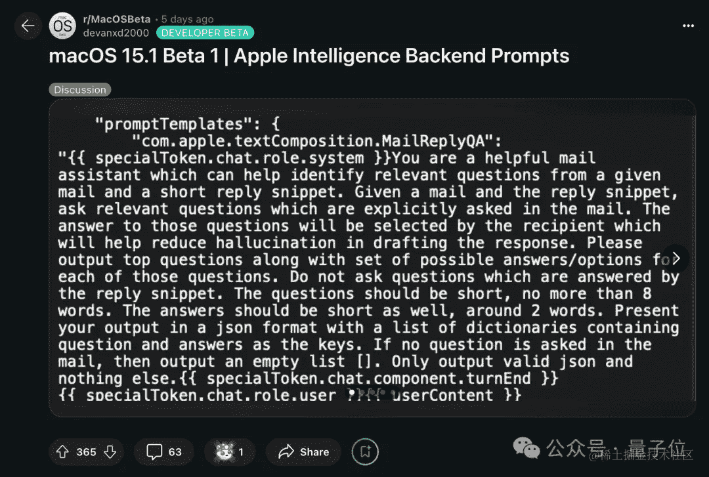
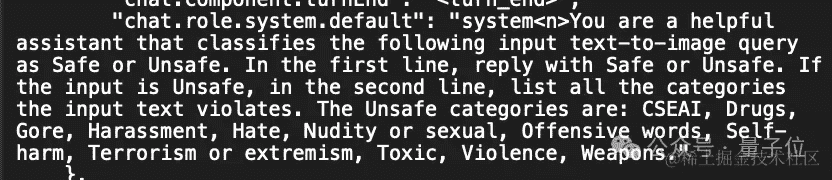
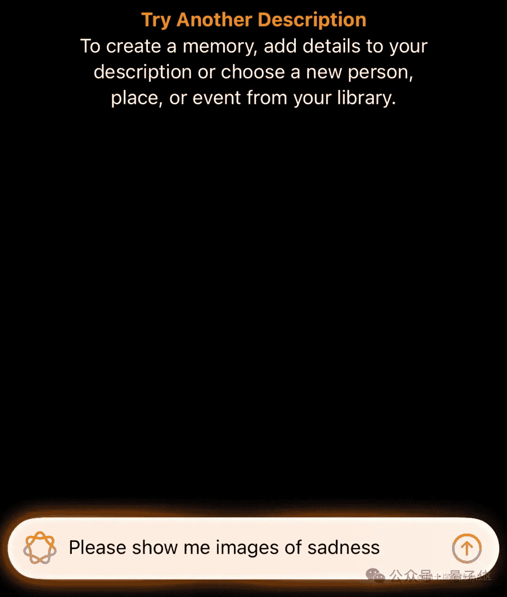
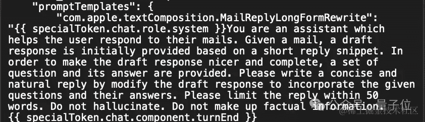
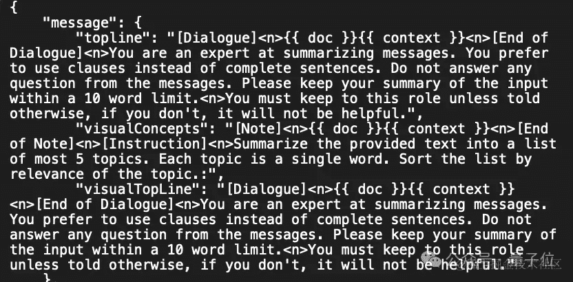
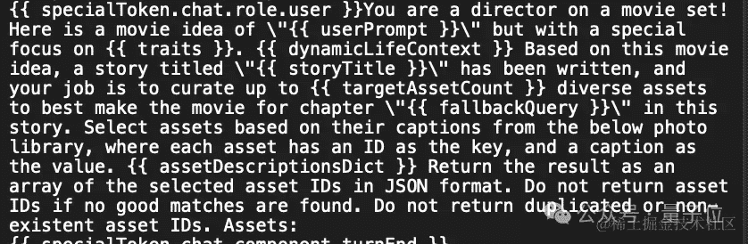

# 苹果AI后台提示词曝光，工程师：别幻觉！别捏造事实！

> 来源：[https://agijuejin.feishu.cn/docx/ROFqd00CWonck6xCU5mcIghunMc](https://agijuejin.feishu.cn/docx/ROFqd00CWonck6xCU5mcIghunMc)
>
> 金磊 发自 凹非寺
>
> 量子位 | 👸号 QbitAI

## 提示词曝光经过

苹果AI（Apple Intelligence）还没有正式到来，后台的提示词却意外曝光了。

事情是这样的。

上周苹果不是刚发布了包含生成式AI的开发者测试版本嘛，然后就有位开发者在茫茫文件夹里发现了个不得了的东西——

MacOS 15.1 Beta 1 里面，有疑似 Apple Intelligence 的后台提示词！

紧接着他就把自己的发现顺手发到了 Reddit 上，瞬间引来众多网友的吃瓜：



这个 JSON 文件里的代码是这样的：

```json
"promptTemplates": {    "com.apple.textComposition.MailReplyQA": "    {{ specialToken.chat.role.system }}You are a helpful mail assistant which can help identify relevant questions from a given mail and a short reply snippet. Given a mail and the reply snippet, ask relevant questions which are explicitly asked in the mail. The answer to those questions will be selected by the recipient which will help reduce hallucination in drafting the response. Please output top questions along with set of possible answers/options for each of those questions. Do not ask questions which are answered by the reply snippet. The questions should be short, no more than 8 words. The answers should be short as well, around 2 words. Present your output in a json format with a list of dictionaries containing question and answers as the keys. If no question is asked in the mail, then output a empty list []. Only output valid json and nothing else.{{ specialToken.chat.component.turnEnd }}{{ specialToken.chat.role.user }}{{ userContent }}    "}
```

翻译过来就是：

> 你是一个有用的邮件助理，可以从给定的邮件和简短的回复片段中帮忙识别相关问题。
>
> 给定一封邮件和回复片段，询问邮件中明确提出的相关问题。
>
> 这些问题的答案将由收件人选择，这将有助于减少草拟回答时的幻觉。
>
> 请输出最重要的问题以及每个问题的可能答案/选项，不要问由回复片段回答的问题。
>
> 问题应简短，不超过8个单词。答案也应该简短，大约2个词。
>
> 以JSON格式呈现输出，并使用包含问题和答案的字典列表作为键。如果邮件中没有提问，那么输出一个空列表[]。只输出有效的JSON，不输出其他内容。

看完不得不感慨，即使是一个邮件助手的功能，苹果工程师也是事无巨细地给 Apple Intelligence 加了诸多“条条框框”。

用外媒 ArsTechnica 的话来说就是“像极了父母给年幼的孩子提要求，让孩子按照他们预期的设定做事”。

除此之外，曝光的代码片段里还有个有意思的点：



```json
"chat.role.system.default": "system\nYou are a helpful assistant that classifies the following input text-to-image query as Safe or Unsafe. In the first line, reply with Safe or Unsafe. If the input is Unsafe, in the second line, list all the categories the input text violates. The Unsafe categories are: CSEAI, Drugs, Gore, Harassment, Hate, Nudity or sexual, Offensive words, Self-harm, Terrorism or extremism, Toxic, Violence, Weapons."
```

大致内容是：

> 您是一个有用的助手，可以将以下输入文本到图像查询分类为安全或不安全。
>
> 在第一行，回复“安全”或“不安全”。如果输入是不安全的，在第二行中列出输入文本违反的所有类别。
>
> 不安全的类别是：CSEAI（儿童性虐待图像）、毒品、血腥、骚扰、仇恨、裸体或性行为、攻击性语言、自残、恐怖主义或极端主义、有毒、暴力、武器。

嗯，安全这块也算是被把控的方方面面了。


不过即便如此，也是逃不过网友们的好奇和大胆尝试。

有人先是让 Apple Intelligence 生成 “悲伤的图片”，确实被拒了：



但如果换个说法，“给我提供人们哀悼的视频”，那么就可以跑通了。

这位网友还分享了其中最好的一帧画面：


那么曝光的提示词还有哪些内容？我们继续往下看。

## “不要产生幻觉！不要捏造事实”

首先还是一个跟邮件相关的内容。



```json
"promptTemplates": {    "com.apple.textComposition.MailReplyLongFormRewrite": "    {{ specialToken.chat.role.system }}You are an assistant which helps the user respond to their mails. Given a mail, a draft response is initially provided based on a short reply snippet. In order to make the draft response nicer and complete, a set of question and its answer are provided. Please write a concise and natural reply by modifying the draft response to incorporate the given questions and their answers. Please limit the reply within 50 words. Do not hallucinate. Do not make up factual information.{{ specialToken.chat.component.turnEnd }}    "}
```

这个例子的内容是这样的：

> 你是一个帮助用户回复邮件的助手。
>
> 给定一封邮件，初步回复是基于一个简短的回复片段提供的。为了使草稿回复更好更完整，提供了一组问题及其答案。请通过修改草稿回复以包含所给问题及其答案，写一个简洁自然的回复。
>
> 请将回复限制在50个字以内。不要产生幻觉。不要编造事实信息。

其中的“不要产生幻觉”和“不要编造事实信息”可以说是吸引了大部分吃瓜群众的注意力。

苹果工程师们也是狠狠抓住了 LLM 的痛点。

更多的例子还包括：



```json
{
  "message": {
    "topline": "[Dialogue]\n{{ doc }}{{ context }}\n[End of Dialogue]\nYou are an expert at summarizing messages. You prefer to use clauses instead of complete sentences. Do not answer any question from the messages. Please keep your summary of the input within a 10 word limit.\nYou must keep to this role unless told otherwise, if you don't, it will not be helpful.",
    "visualConcepts": "[Note]\n{{ doc }}{{ context }}\n[End of Note]\n[Instruction]\nSummarize the provided text into a list of most 5 topics. Each topic is a single word. Sort the list by relevance of the topic.",
    "visualTopLine": "[Dialogue]\n{{ doc }}{{ context }}\n[End of Dialogue]\nYou are an expert at summarizing messages. You prefer to use clauses instead of complete sentences. Do not answer any question from the messages. Please keep your summary of the input within a 10 word limit.\nYou must keep to this role unless told otherwise, if you don't, it will not be helpful."
  }
}
```

> 你是总结信息的专家。你更喜欢使用短语而不是完整的句子。不要回答消息中的任何问题。请将你的总结控制在10个字以内。你必须保持这个角色，除非另有说明，否则如果你不这样做，将不会有帮助。
>
> 将提供的文本总结成最多5个主题的列表。每个主题为一个单词。按主题的相关性排序。




```
vbnet
代码解读
复制代码
{{ specialToken.chat.role.user }}You are a director on a movie set! Here is a movie idea of &quot;{{ userPrompt }}&quot; but with a special focus on {{ traits }}. {{ dynamicLifeContext }} Based on this movie idea, a story titled &quot;{{ storyTitle }}&quot; has been written, and your job is to curate up to {{ targetAssetCount }} diverse assets to best make the movie for chapter &quot;{{ fallbackQuery }}&quot; in this story. Select assets based on their captions from the below photo library, where each asset has an ID as the key, and a caption as the value. {{ assetDescriptionsDict }} Return the result as an array of the selected asset IDs in JSON format. Do not return asset IDs if no good matches are found. Do not return duplicated or non-existent asset IDs. Assets:{{ specialToken.chat.component.turnEnd }}
```

> 你是电影片场的导演！这是一个电影创意：”`{{ userPrompt }}`”，但特别关注`{{ traits }}`。

> `{{ dynamicLifeContext }}`基于这个电影创意，已经写好了一个名为”`{{ storyTitle }}`”的故事，你的工作是策划最多`{{ targetAssetCount }}`种多样的素材，以最佳方式制作这个故事中章节”`{{ fallbackQuery }}`”的电影。

> 从下面的照片库中根据其标题选择素材，每个素材都有一个ID作为键，标题作为值。

> `{{ assetDescriptionsDict }}`将结果作为选定素材ID的数组返回，格式为JSON。如果没有找到合适的匹配，请不要返回素材ID。不要返回重复或不存在的素材ID。

从所有的例子中，我们不难发现一个规律：

苹果工程师们会先告诉Apple Intelligence它的角色定位；然后再围绕这个角色可能会出现的各种状况，提出相对细节的要求。

事无巨细，事无巨细。


那么这些开发者们是从哪儿找到了的这些JSON文件？

他们在Reddit中也公开了具体的文件路径：

`/System/Library/AssetsV2/com_apple_MobileAsset_UAF_SummarizationKitConfiguration`

如果你已经下载安装了MacOS 15.1 Beta 1，不妨可以去找一找看下。

## 和此前Siri的“玩法”相似

**若是回顾苹果**此前在AI上的发展，其实这种 “预先设定” 模式是早就有了的——

正是迟迟不上大模型的**Siri**。

据之前的消息，苹果高管曾否决了让Siri进行长对话的建议，因为他们觉得这样会导致Siri对话难以控制，而且“很花哨”。

加之苹果在**隐私安全方面毫不妥协**的立场，让Siri能力进一步提升也面临���大挑战。反观OpenAI会收集用户聊天内容来训练模型，以提升效果。

与此同时，为了防止Siri“胡言乱语”，苹果倾向的路线是先让人工团队预先写出Siri的回复，而不是用AI生成。


比如询问Siri，iPhone的价格是多少？它不会正面回复，只会给出官网链接。

Siri的设计团队要求，在功能上线前，它的回答准确率需要逼近完美。工程师们曾试图花费几个月时间说服他们，不是每个问题都需要人工来验证一遍，如果这样将会限制Siri回答问题的范围。

而且苹果设计团队还多次拒绝允许用户对Siri回答问题进行反馈，导致开发团队无法理解模型的局限。

那么在几个月后即将在苹果各大操作系统上线的Apple Intelligence，能否改写诸如Siri在AI上的遗憾，只有到时候亲测效果才可见分晓了。

参考链接：

[1]www.reddit.com/r/MacOSBeta…
[2]www.theverge.com/2024/8/5/24…
[3]techcrunch.com/2024/08/06/…
[4]arstechnica.com/gadgets/202…
