# GPT-4搞不定的图推理，港科大7B模型搞定｜KDD2024

> 来源：[https://agijuejin.feishu.cn/docx/YyS7dzm6locdGHxHnwVcNL4Xnfe](https://agijuejin.feishu.cn/docx/YyS7dzm6locdGHxHnwVcNL4Xnfe)

不仅给出正确答案，还能提供清晰且详细的推理路径

> 香港科技大学 陈诺 投稿

> 量子位 | 👸号 QbitAI

大模型执行图推理任务，我们是希望大模型**仅仅给出结果，还是在**给出准确答案的同时，输出详细的推理过程？

先来看**GPT-4**的表现：

给出了一个非常简短且错误的答案（判断该图中没有环），这可能是由于模型在处理长输入时的局限性，或者是对图的复杂结构理解错误所致。这显示了大型模型在适应图论问题时面临的挑战。

相比之下，港科大团队开发的**GraphWiz**不仅给出了正确的答案，还提供了一条清晰且详细的推理路径。

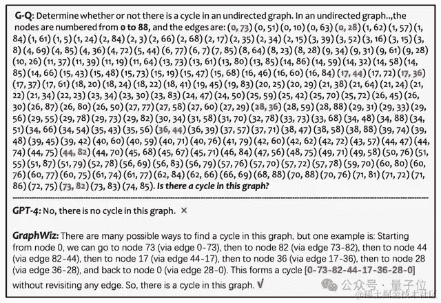

GraphWiz 的设计目的是提升目前开源的大型模型在解决各种图推理任务时的能力：

通过对大型模型进行针对性的微调，处理不同复杂度的图推理任务，并同时输出明确而连贯的推理路径。

对于人类来说，要在这样规模的图中检测环是极具挑战性的。通常，人类需要借助外部工具或花费大量时间来完成这一任务，因为仅仅依靠脑力计算是不切实际的。

这突显了GraphWiz在空间推理和记忆保持方面的能力。它表明，该模型已经有效地吸收了图论的基本原理，并能够自主地在大规模且复杂的图结构中进行导航和推理。GraphWiz在处理复杂图问题方面的能力，证明了其在实际应用中的巨大潜力。

总的来说，本篇文章的主要贡献如下：

+   创建了GraphInstruct，一个大规模的数据集，用于训练语言模型处理图任务，并提供清晰推理路径，提高可解释性。

+   推出了GraphWiz，一个开源的大型语言模型，擅长通过明确推理解决各种图问题，性能优于GPT-4。

+   研究了训练数据量和DPO框架下采样策略等对模型性能的影响，并探索了GraphWiz跨任务迁移的能力，为后续模型优化和性能提升提供指导。

# 图推理任务介绍

在本研究中，团队精心挑选了九种不同计算复杂度层次的图问题，涵盖了研究的广度和深度，包括：

+   四个线性复杂度任务：连通性和环检测、二分图检验、拓扑排序；

+   三个多项式复杂度任务：最短路径、最大三角形和、最大流；

+   以及两个NP完全任务：哈密尔顿路径和子图匹配。

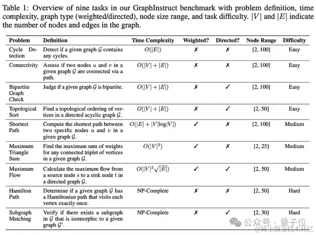

通过选择这九个图问题，团队的工作从简单到复杂、可解到难解的问题上进行了全面的图论探索。这种多样化的选择不仅有助于团队理论上理解图算法，而且还能解决广泛的实际应用问题。

# GraphInstruct数据集构建

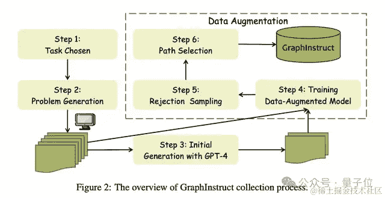

GraphInstruct的构建包括以下几个关键步骤：

**图问题生成。** 为了打造一个多样而具挑战性的图问题库以供模型训练与测试之用，团队通过编程辅助的方法，为每一种预设的任务生成随机图问题。团队为每一个任务设计了独特的模板，以捕捉图的特有属性，例如图是有向还是无向，边是否有权重等。随机图的生成团队采用了Erdős-Rényi（ER）模型。

**显式推理路径生成。** GraphInstruct为每一个图问题对都配备了一条显式推理路径。考虑到手动标注这些图任务的推理路径既复杂又耗时，团队选择利用GPT-4来生成初步的推理路径。

**数据增强与拒绝采样。** 由于观察到GPT-4在许多图任务上的表现欠佳，比如在初始数据集中的最大流任务上自由不足100个样本是正确的，团队采用了拒绝采样策略来增广数据集，以包含更多样的推理路径。

**挑选多样化的推理路径。** 这个步骤需要在准确度和多样性之间找到平衡。为此，团队采用了一系列精细化策略，这些策略分为基于字符串和基于语义的方法，用以筛选出不同的生成推理路径。

# GraphWiz训练

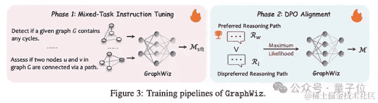

基于GraphInstruct，团队训练了GraphWiz，旨在优化当前大模型解决图问题并给出显式推理路径的能力。GraphWiz的训练方法是一个创新的两阶段过程：

**混合任务指令调优**（Mixed-Task Instruction Tuning）：在第一阶段，团队专注于提升模型解释和解决各种图问题的能力。通过这种方法，GraphWiz学习处理包括理解问题、识别图的属性、应用图算法等在内的多个子任务。

**直接偏好优化对齐**（Direct Preference Optimization Alignment ）：第二阶段，团队通过训练模型区分更有效与不太有效的问题解决路径来进一步锐化模型的推理能力。DPO对齐使模型能够识别和生成更理想的推理路径，从而提高解决问题的效率和准确性。

# GraphWiz性能评测

团队对GraphWiz进行评估，旨在回答以下关键问题：

+   Q1: GraphWiz在不同复杂度的图问题上的表现如何，特别是与目前最强大的闭源模型GPT-4相比如何？

+   Q2: 训练数据量的变化对GraphWiz的性能有什么影响？

+   Q3: GraphWiz 对不同图问题的迁移能力如何？

+   Q4: 图中节点数量的变化会如何影响GraphWiz的性能？此外，它能有效处理的最复杂的图是多大的？

+   Q5: 超参数ß如何影响模型性能？

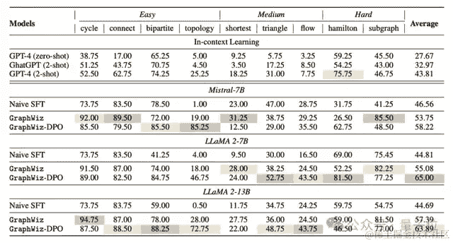

从上表中可以看出，团队的模型在各种开源模型上展示出了卓越的结果，显著超过了GPT-4的性能。这一点在从简单到困难类别的各种任务中都保持一致。DPO进一步提高了模型平均性能。然而，DPO可能对特定任务有不利影响。这表明，虽然DPO通常有助于改善模型推理，但可能需要进一步调整，以避免对某些问题类型产生负面影响。

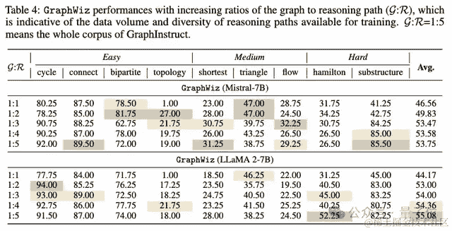

根据上表，团队观察到随着训练语料库的增加，两个模型都有效果的提升，比如GraphWiz (Mistral-7B)的平均准确率从1:1比率的46.56％上升到1:5比率的53.75％。这表明更多的多样化推理路径通常有利于模型解决图推理问题的整体性能。

团队可以注意到在某些任务上，如三角形和汉密尔顿路径问题，准确性并没有显著提高，甚至随着数据量的增加而略有下降。例如，GraphWiz (Mistral-7B) 在三角和问题上在1:1比率下的准确性为47.00％，然后在1:5比率下降至38.75％。这可能表明了过拟合现象，即模型开始记住训练数据中的模式，这些模式并不适用于未见过的数据。

总之，虽然增加数据量和推理路径的多样性通常可以导致更好的模型性能，但在某些复杂任务中存在潜在的过拟合迹象，这强调了需要仔细设计模型训练，并对不同的图问题任务进行验证，以确保广泛的泛化能力。

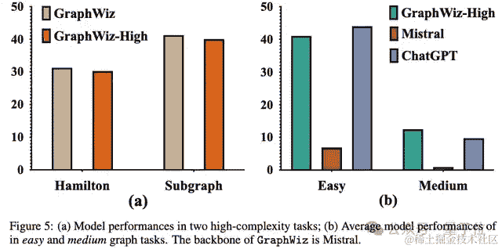

为了探索GraphWiz在不同图任务中的**迁移能力，团队建立了一个额**外的模型变体：GraphWiz-High。这个模型仅在两个高复杂度（NP-完全）图任务上进行训练：汉密尔顿路径和子图匹配。为了研究其迁移能力，团队进行了两个比较实验：

**高复杂度任务比较。** 团队首先将GraphWiz-High与常规的GraphWiz在高复杂度任务上进行比较。上图(a)表明GraphWiz的表现更好，验证了混合任务训练的有效性。这个结果也表明模型能够将从其他任务学到的知识转移到特定的高复杂度任务上。

**零样本迁移能力。** 团队进一步测试GraphWiz-High在从未训练过的低和中复杂度任务上的零样本迁移能力。如上图 (b) 所示，GraphWiz-High与Mistral-Base相比有显著的性能提升。即使与ChatGPT相比，团队的模型也能保持相当的性能。考虑到ChatGPT和GraphWiz-High之间在参数数量上的巨大差异，这表明团队的模型具有值得称赞的跨任务泛化能力，展示了实际应用的重大潜力。

为了解答关于模型性能如何随着不同图大小变化的问题，以及确定模型能够有效解决的最大图大小，团队在上图展示了GraphWiz在表现最佳任务（a）环检测和最差任务（b）最短路径上的性能。

从图中，团队得出以下结论：

GraphWiz和GPT-4在图的大小增加时都表现出性能的下降。然而，团队的模型在大多数时候当图大小上一致时优于GPT-4，这表明了对图结构更强大的理解和处理能力。

团队观察到在最短路径上，随着节点数的增加，性能显著下降。这种下降很可能可以归因于两个主要因素：该任务要求高推理和记忆能力，因为更高时间复杂性，以及强大的计算技巧，这可能对模型的容量构成额外挑战。实际上，团队发现两种模型主要依赖枚举来得出解决方案。因此，随着图大小的增加，所需的枚举推理呈指数级增长，导致当节点数超过60后，准确率显著下降，之后几乎不再有准确性。

这些观察表明，尽管GraphWiz在处理与图相关的任务方面明显优于GPT-4，但存在一个复杂度的阈值——特别是在需要超出简单推理的计算的任务中——即使是最先进的模型的性能也开始显著下降。

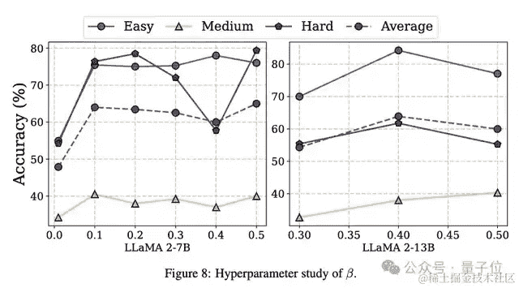

最后，团队还探究了参数ß对模型效果的影响。团队观察到，较高的 ß似乎在一定程度上有利于困难任务的性能，但这并非严格的线性关系，并且在不同的模型大小之间也不一致。这表明，仔细调整 ß 对于在不同难度任务之间取得最佳平衡，提高模型的整体准确性是必要的。

# 更多样例

团队还展示了更多不同任务上GraphWiz的推理样例。

连通性任务：

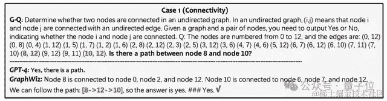

汉密尔顿路径任务：

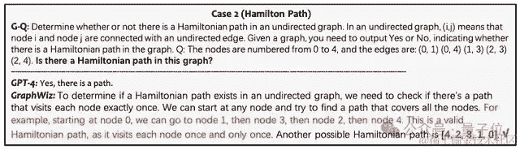

最短路径任务：

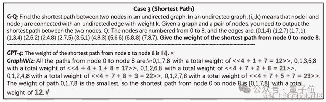

子图匹配任务：

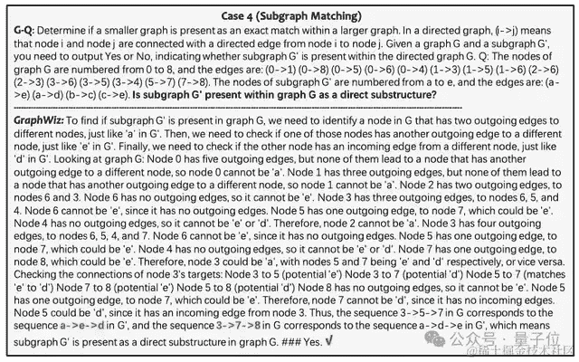

论文链接：arxiv.org/abs/2402.16…

项目主页：graph-wiz.github.io/