# 陈丹琦团队新作：微调8B模型超越Claude3 Opus，背后是RLHF新平替

> 来源：[https://agijuejin.feishu.cn/docx/Ht7kdCPKEoawp5xVK3XcL3APn1d](https://agijuejin.feishu.cn/docx/Ht7kdCPKEoawp5xVK3XcL3APn1d)

资源消耗也比DPO更低

> 克雷西 发自 凹非寺

> 量子位 | 👸号 QbitAI

比斯坦福DPO（直接偏好优化）更简单的RLHF平替来了，来自陈丹琦团队。

该方式在多项测试中性能都远超DPO，还能让8B模型战胜Claude 3的超大杯Opus。

而且与DPO相比，训练时间和GPU消耗也都大幅减少。

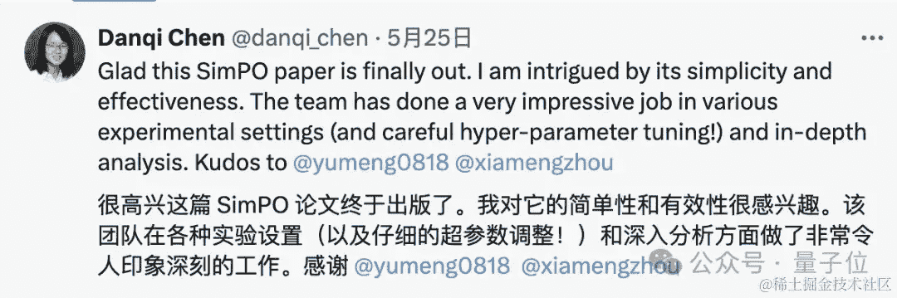

这种方法叫做SimPO，Sim是Simple的简写，意在突出其简便性。

与DPO相比，SimPO**摆脱了对参考模型的需要**，在简化训练流程的同时，还避免了训练和推理不一致的问题。

对于这项成果，普林斯顿PLI主任Sanjeev Arora教授这样称赞：

> 和（SimPO方法调整出的）模型聊天感觉让人难以置信。

> Llama3-8B是现在最好的小模型，SimPO把它变得更好了。

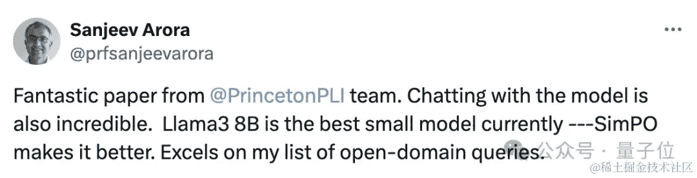

成果发布并开源后，大模型微调平台Llama-Factory也迅速宣布引进。

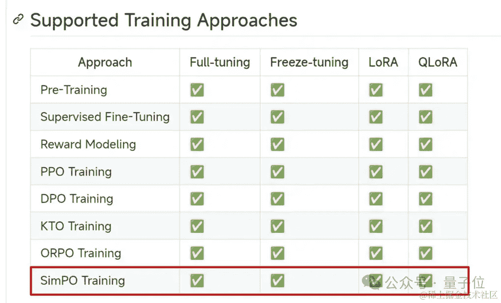

## 摆脱对参考模型的需要

陈丹琦团队的SimPO，和斯坦福提出的DPO一样，都是对RLHF中的奖励函数进行优化。

在传统的RLHF中，奖励函数通常由一个独立的奖励模型提供，需要额外的训练和推理；DPO利用人类偏好和模型输出之间的关系，直接用语言模型的对数概率来构建奖励函数，绕开了奖励模型的训练。

而和DPO相比，SimPO只基于当前优化的模型π_θ进行设计，完全摆脱了对参考模型π_ref的依赖。

具体来说，SimPO采用了**长度归一化的对数概率**作为奖励函数。

其中，β是一个正的缩放系数，|y|表示回复y的token长度，πθ(y|x)表示当前语言模型πθ生成回复y的概率。

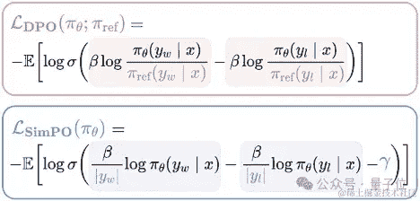

**对数概率**是衡量生成质量的常用指标，较高的对数概率意味着在当前模型看来，这个回复是高质量、自然、连贯的。

因此，这种奖励方式可以让模型生成的回复更加符合自身已有知识。

**长度归一化**则是指，在函数当中，奖励值除以了回复长度|y|，起到了“惩罚”过长回复的作用。

这样做的原因是语言模型倾向于生成更长的文本，因为每个额外的token都会为总对数概率做贡献，但过长的回复往往会降低可读性和信息密度。

除以长度相当于计算平均每个token的对数概率，鼓励模型用尽可能简洁的方式表达完整的信息。

消融实验结果也证实，如果不进行长度归一化，模型很容易利用长度偏差，只有在生成文本较长时才有较好的表现。

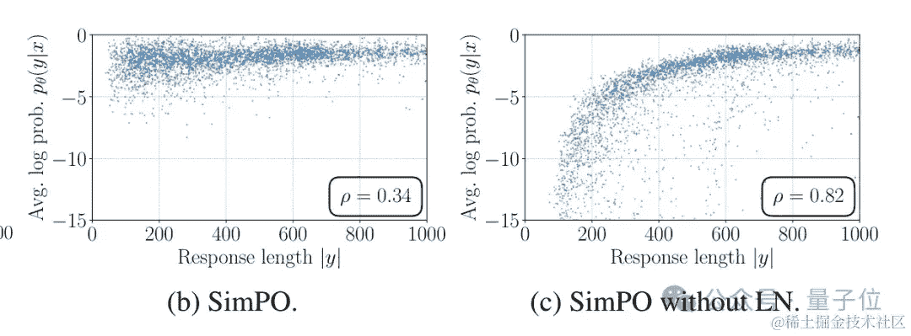

**除了使用对**数概率和长度归一化，SimPO还引入了奖励差异项（公式中的γ）对目标函数进行改进。

引入γ相当于给正负样本的差异设定了一个阈值，主要目的就是加强优化信号，促使模型学习更加鲜明地区分正负样本。

在标准的Bradley-Terry损失中，只要正样本的奖励略高于负样本，损失就会很低，导致模型对正负样本的区分不够清晰；加入γ项后，模型必须使正样本的奖励明显高于负样本，才能取得较好的优化效果。

当然如果γ过大则可能会给优化带来困难，导致训练不稳定或收敛速度变慢，作者通过实验比较了不同γ值的效果，最终发现γ在0.8到1.6之间时SimPO可以取得最佳表现。

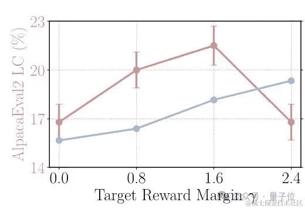

总体的消融实验结果表明，长度归一化和奖励差异项的引入都是让SimPO表现进一步提升的关键，无论是在AlpacaEval 2还是Arena-Hard当中，缺少两项技术中的任意一项，都会造成表现下降。

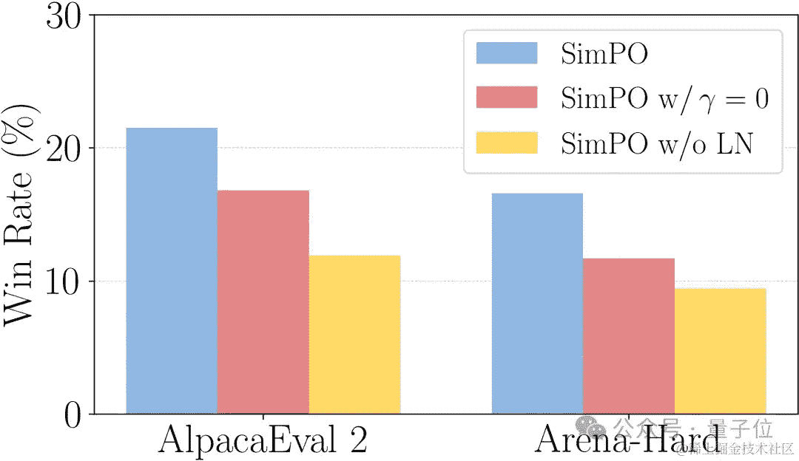

那么，SimPO的具体表现究竟怎样呢？

## 表现超越各种“PO”，还让8B模型战胜Claude 3

作者首先在AlpacaEval 2基准上对SimPO调整后的Llama3-Instruct-8B模型和榜单上的先进模型进行了比较。

该测试的主要指标是Win Rate及加入长度控制（LC）后的Win Rate，即模型的回答被评判者认为比GPT-4 Turbo（1106）更好的比例（这里评判者也是GPT4-Turbo）。

结果，SimPO调整后的8B模型，表现已经超过了Claude 3的超大杯Opus；和DPO相比，胜率也有10%左右的提升。

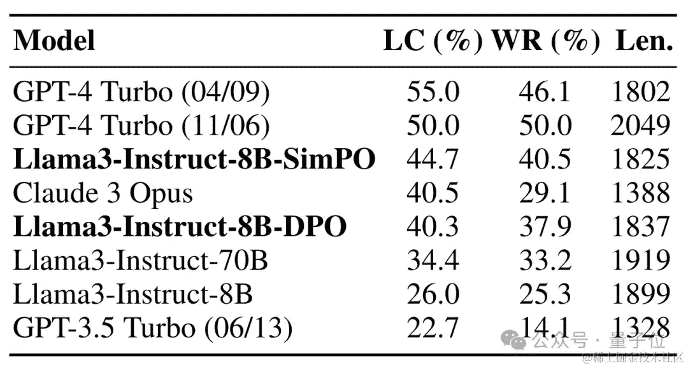

接着，作者又用AlpacaEval 2、Arena-Hard和MT-Bench基准，将SimPO的实际效果与一些其他PO进行了对比。

其中Arena-Hard与AlpacaEval 2类似都是比较胜率，但前者任务难度更大，需要多步推理和专业知识，此外baseline也换成了GPT4-0314。

MT-Bench则是一个多语言理解评测基准，评价方式是直接打分，裁判是GPT-4和GPT-4-Turbo。

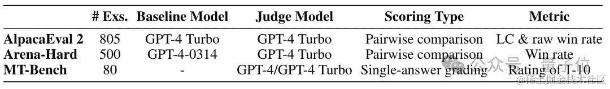

参与比较的其他PO如下表所示，其中ORPO和SimPO一样都没有使用参考模型。

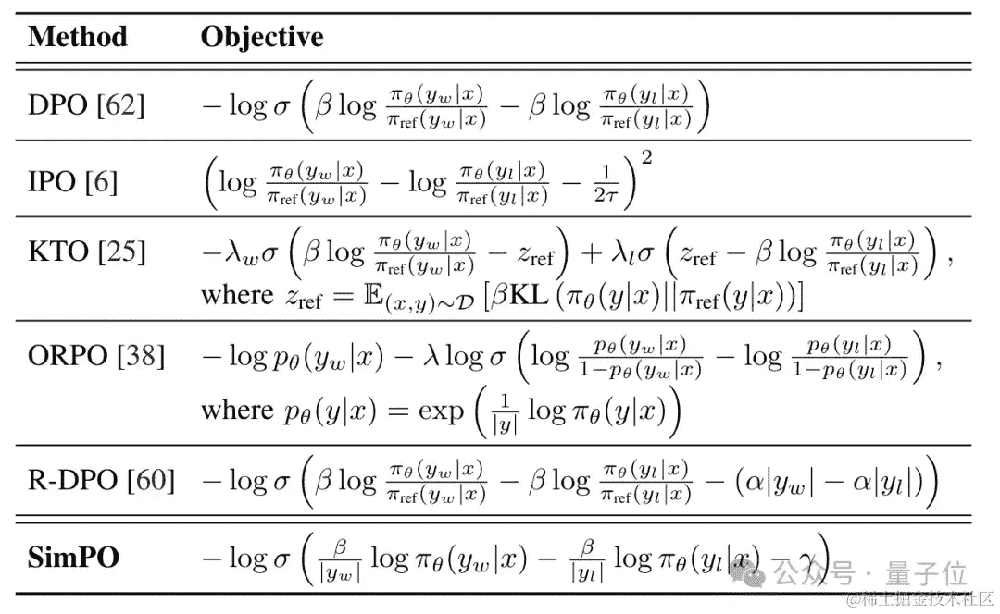

结果，在Arena-Hard与AlpacaEval 2上，调整Mistral-7B和Llama3-8B两种模型时，无论是Base还是Instruct版本，SimPO的效果都显著优于DPO等其他方式。

在MT-Bench测试当中，GPT-4-Turbo也都把最高分打给了SimPO，GPT-4给出的成绩中SimPO也与最高分十分接近。

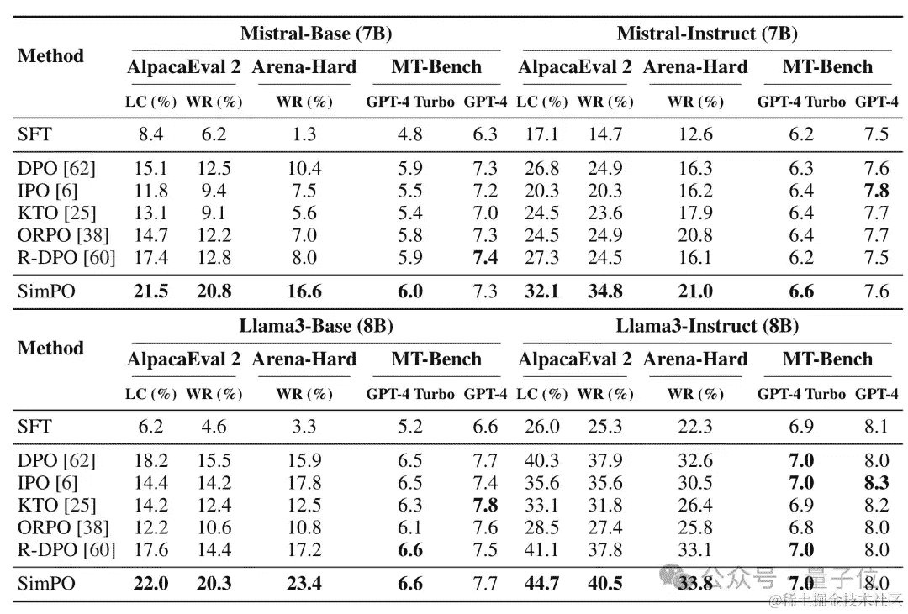

另外SimPO的开销也大幅减少，在8块H100上，SimPO调整Llama3-8B的时间为60分钟，比DPO减少了20%；GPU消耗峰值为69GB，也比DPO少了10%。

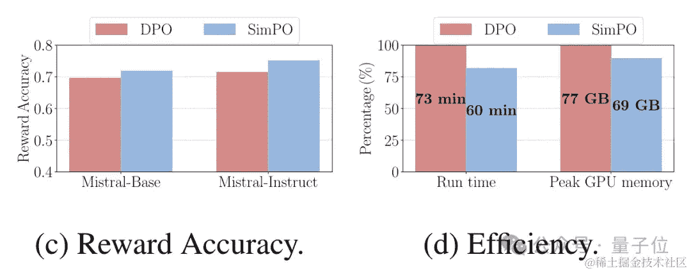

但同时，作者也指出了SimPO还存在一些不足：

+   一是未明确考虑安全性和诚实性，采用的奖励函数主要关注了模型的表现，需要进一步加强安全措施；

+   二是在GSM8k等需要密集推理的任务，特别是数学问题上的表现有所下降，未来会考虑集成一些正则化策略进行改进。

有网友也指出，让一个8B模型取得超越Claude3-Opus的胜率，一定会有过拟合的现象出现。

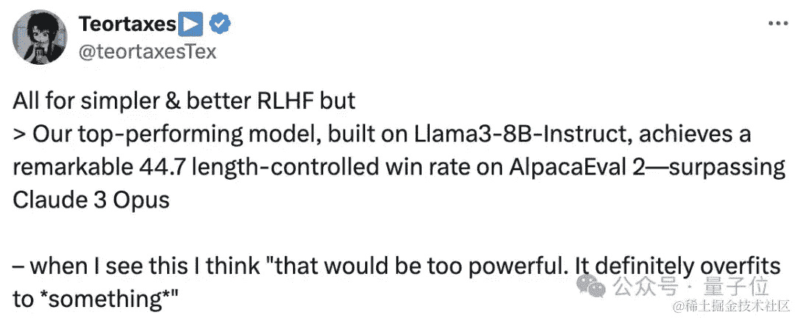

对此作者表示确实存在这种可能，但也强调，在单独一个标准上成绩比Claude高，并不意味着全面超越，比如在Arena-Hard上的表现就不如Claude。

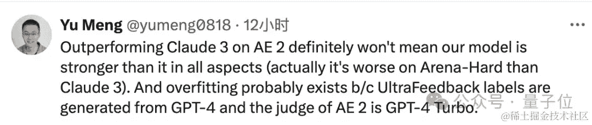

不过无论如何，SimPO创新性运用到的长度归一化和奖励差异项，都可以给大模型从业者带来新的启发。

论文地址：

arxiv.org/abs/2405.14…