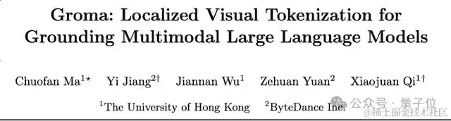
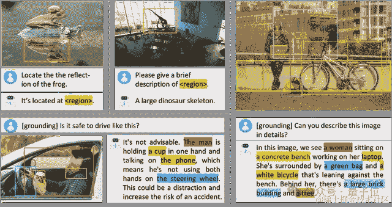
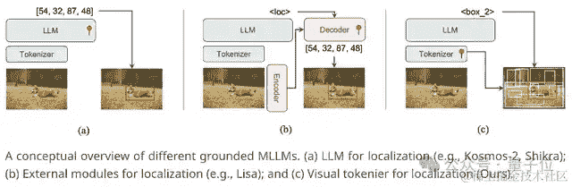
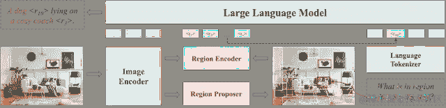
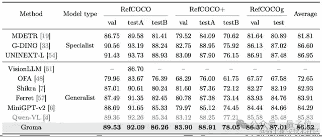
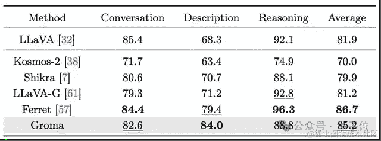
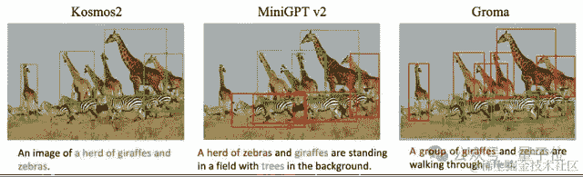
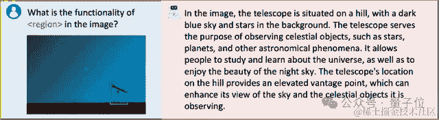
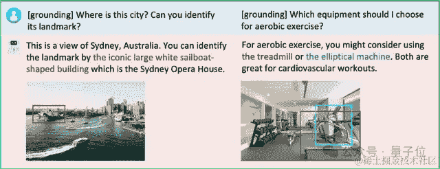

# 港大字节提出多模态大模型新范式，模拟人类先感知后认知

> 来源：[https://agijuejin.feishu.cn/docx/RiYHdXJusoOAMsxHnRgcdSNunuc](https://agijuejin.feishu.cn/docx/RiYHdXJusoOAMsxHnRgcdSNunuc)

区域性图像编码来提升多模态大模型的感知定位能力。

> 允中 发自 凹非寺

> 量子位 | 公众号 QbitAI

当前，**多模态大模型** （MLLM）在多项视觉任务上展现出了强大的认知理解能力。

然而大部分多模态大模型局限于**单向的图像理解**，难以将理解的内容映射回图像上。

比如，模型能轻易说出图中有哪些物体，但无法将物体在图中准确标识出来。

**定位能力的缺失**直接限制了多模态大模型在图像编辑，自动驾驶，机器人控制等下游领域的应用。

**针对这一问**题，港大和字节跳动商业化团队的研究人员提出了一种新范式Groma——

通过**区域性图像编码**来提升多模态大模型的感知定位能力。

在融入定位后，Groma可以将文本内容和图像区域直接关联起来，从而显著提升对话的交互性和指向性。

# 核心思路

如何赋予多模态大模型定位物体的能力，乃至于将文字内容和图像区域关联起来，做到“言之有物”，是当前一大研究热点。

常见的做法是微调大语言模型使其直接输出物体坐标。然而这种方法却有着诸多限制：

**1、** 在文本上预训练的大语言模型本身不具备空间理解能力，仅依靠少量数据微调很难精准定位物体。

**2、** 定位任务对输入图像的分辨率有较高要求，但提高分辨率会显著增加多模态大模型的计算量。

**3、** 大语言模型的输出形式不适合处理精细的定位任务，比如分割。

基于这些考虑，Groma提出将定位转移到多模态大模型的vision tokenizer中，由vision tokenizer发现并定位潜在的物体，再交给大语言模型识别。

同时，这样的设计也充分利用了vision tokenizer本身的空间理解能力，而无需外接专家模型（比如SAM）来辅助定位，从而避免了外接模型的冗余。

具体而言，Groma在全局图像编码的基础上，引入了区域编码来实现定位功能——如下图所示，Groma先利用Region Proposer定位潜在的物体，再通过Region Encoder将定位到的区域逐一编码成region token。

而大语言模型则可以根据region token的语意判断其对应的区域，并通过在输出中插入region token来达成类似超链接的效果，实现visually grounded conversation。

同样地，用户指定的区域也可以通过Region Encoder编码成相应的region token，并插入到用户指令中，从而让多模态模型能关注到指定的区域并产生指向性的回答。

为了提升定位的鲁棒性和准确性，Groma采用了超过8M的数据（包括SA1B）来预训练Region Proposer。因此其产生的proposal不仅包括常见的物体，也涵盖了物体的组成部分以及更广阔的背景等要素。

此外，得益于分离式的设计，Groma可以采用高分辨率特征图用于Region Proposer/Encoder的输入，并采用低分辨率的特征图用于大模型输入，从而在降低计算量的同时又不损失定位性能。

# 实验结果

Groma在传统的Grounding Benchmarks上表现出了超越MiniGPT-v2和Qwen-VL的性能。

同时，Groma在多模态大模型通用的VQA Benchmark (LLaVA-COCO)验证了其对话和推理能力。

在可视化的对比中，Groma也表现出了更高的recall和更少的幻觉。

此外，Groma还支持融合对话能力和定位能力的referential dialogue以及grounded chat。

得益于大语言模型强大的认知推理能力，多模态大模型在视觉理解任务上表现突出。

然而一些传统的视觉任务，如检测分割、深度估计等，更多依赖视觉感知能力，这恰恰是大语言模型所缺乏的。

**Groma**在这个问题上提供了一种新的解决思路，即把感知和认知解耦开来，由vision tokenizer负责感知，大语言模型负责认知。

这种先感知后认知的形式除了更符合人类的视觉过程，也避免了重新训练大语言模型的计算开销。

5月15日，字节跳动刚刚公布了自研的豆包大模型，提供多模态能力，下游支持豆包APP、扣子、即梦等50+业务，并通过火山引擎开放给企业客户，助力企业提升效率、加速智能化创新。目前，豆包APP已成为中国市场用户量最大的AIGC应用。字节跳动正持续加大对顶尖人才和前沿技术的投入力度，参与行业顶尖的技术挑战和攻坚。

项目网站：

groma-mllm.github.io

论文链接：

arxiv.org/abs/2404.13…

开源代码：

github.com/FoundationV…