# 微软重新定义AI PC：与GPT-4o共享一个屏幕，看过的东西再也不会忘

> 来源：[https://agijuejin.feishu.cn/docx/W7TmdKiq9oXw0rxjsEKcuF4ensg](https://agijuejin.feishu.cn/docx/W7TmdKiq9oXw0rxjsEKcuF4ensg)

> 集成 40 + 模型，AI 实时处理

> 梦晨 西风 发自 凹非寺

> 量子位 | 公众号 QbitAI

今天，微软重新定义了个人电脑。

刚刚发布新一代 **Copilot+PC**，让上市还没几天的第一批 AI PC 直接过时了。

在新一代 PC 里，打游戏时可与 **AI 实时对话，提供吐槽陪玩**或攻略指导，由 GPT-4o 提供支持。

任何文件或网页浏览记录都可以用自然语言搜索，轻松回忆任何东西，“之前好像在哪看过” 这个问题被彻底解决了。

实时翻译音频或视频字幕，目前支持 40 + 种语言。

没错，在专为 AI 重构的新版 Windows 11 上，许多功能都是实时的。

这要求硬件 AI 算力达到 40 TOPS 以上，或者说每秒 40 万亿次运算，超过英伟达 RTX4060。

而目前市面上的 AI PC，仅能提供 10 TOPS。

例如微软自己的新版 Surface Laptop Copilot+ Pro，就比上一代 Surface Laptop 5 要快 80%。

甚至纯看跑 AI，比苹果 M3 芯片的最新 Macbook Air 还快 58%，同样拥有全天候的电池续航，屏幕还没刘海。

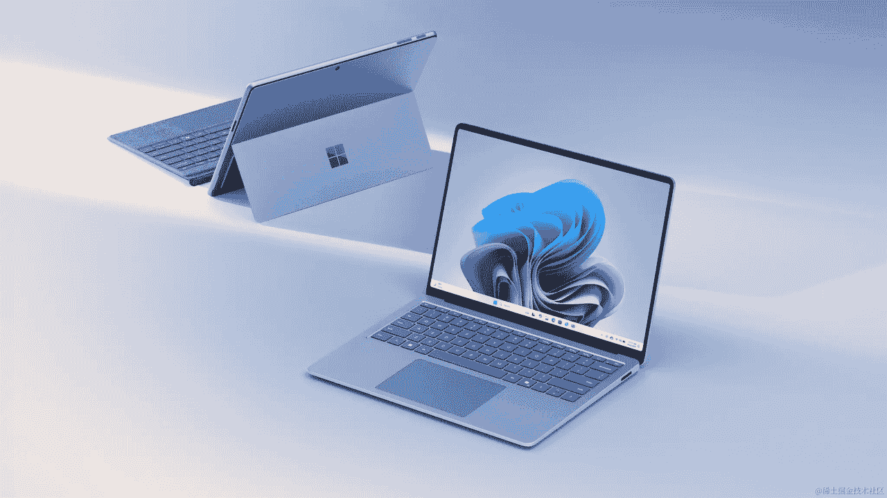

那么 Copilot+ PC 到底与传统 PC 有什么区别？如何实现众多 AI 功能？

## 能理解我们的计算机

微软 CEO 纳德拉指出，需要构建能够理解我们的计算机，而不是我们必须去理解的计算机。

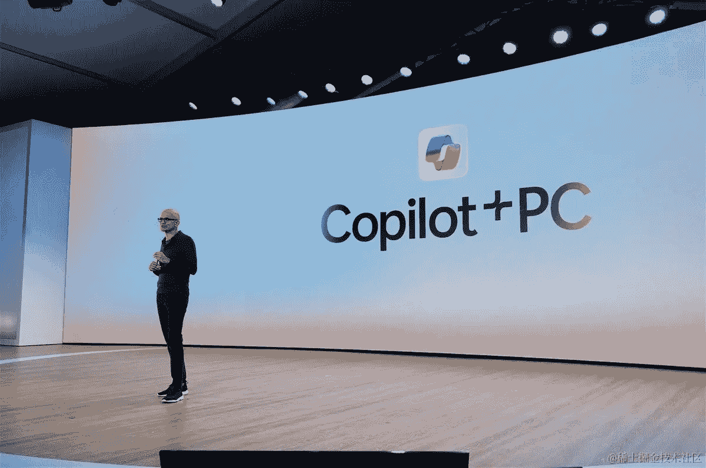

为了做到这一点，微软引入了全新的系统架构，将 CPU、GPU 和新的高性能神经处理单元 (NPU) 结合在一起。

在本地小模型和 Azure 云端大模型加持下，Copilot+PC 运行 AI 工作负载的功能增强了 20 倍，效率也提高了 100 倍。

NPU 负责在后台实时运行 AI，比如前面展示的 Recall 功能，背后就是 AI 对你屏幕上正在处理的所有内容做分类。

包括网页、电子邮件、文档和聊天记录，所有数据将保留在本地设备上，不会用于训练 AI。

微软还重新设计了 Copilot 应用程序，现在它不只是存在于侧边栏，也可以变成独立窗口或全屏浏览，并支持文件拖入操作。

使用键盘上独立的 Copilot 键轻按一下即可唤出，并且在接下来几周内将接入 OpenAI 最新模型 GPT-4o，支持自然的语音交互。

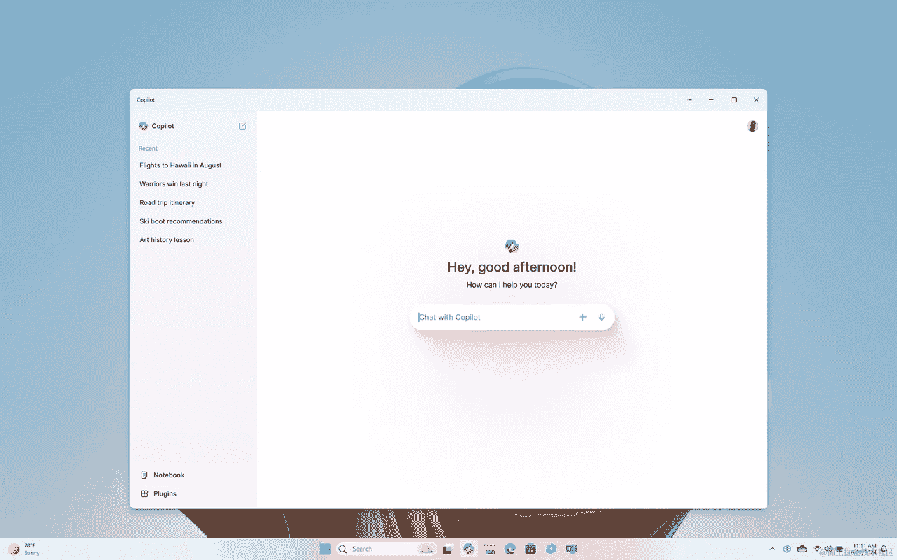

连大家熟悉的 “画图” 都得到史诗级更新，随手打草稿就能实时与 AI 一起创作。

此外，微软还透露了一些即将到来的功能：

+   旧照片可以通过超分辨率工具焕然一新，还提供 AI 根据照片内容讲故事。

+   会在 Windows 11 中添加自动超分辨率，像英伟达 DLSS 一样，同时提升游戏的画质和帧率。

为了做到这一切，大约有 40 多个 AI 模型深度集成到 Windows 11 中。

## Windows 转型 ARM

第一批 Copilot+ PC 的 CPU 主要由高通骁龙 X Elite 提供支持，英特尔和 AMD 的版本随后跟上。

ARM 带来的一大好处就是续航，新 Copilot+ PC 一次充满电支持播放本地视频续航 22 小时播放， 或浏览网页 15 小时。相比之下 2022 年的 Surface Laptop 5 浏览网页只支撑 8 小时 38 分。

微软还特意在发布页面注明 **“本地视频播放时的电池续航比 MacB**ook Air 15 英寸高出 20%”，各方面来讲都是冲着苹果来的。

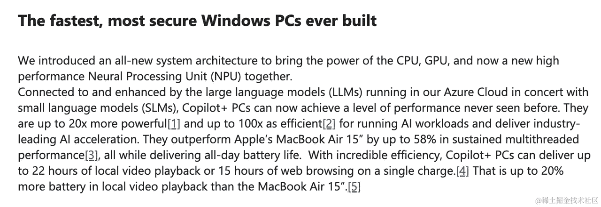

从 x86 过渡到 ARM 也不是问题，Microsoft 365（原 Office）、Chrome、Adobe 等系列常用软件都已支持 Windows ARM 版。

换句话说，今天的人们在 87% 的时间里使用的 APP，都已经或即将提供原生 ARM 支持。

对于尚未支持 ARM 的应用程序，微软也推出了 Prism 模拟器，声称它与苹果的 Rosetta 2 一样高效。

比如 **Adobe**，旗舰 APP 包括 Photoshop、Lightroom、Express 等今天即可体验 Copilot+PC 带来的全性能优势，可比以往更快速的展现创意。

Illustrator、Premiere Pro 等应用也会陆续推出。

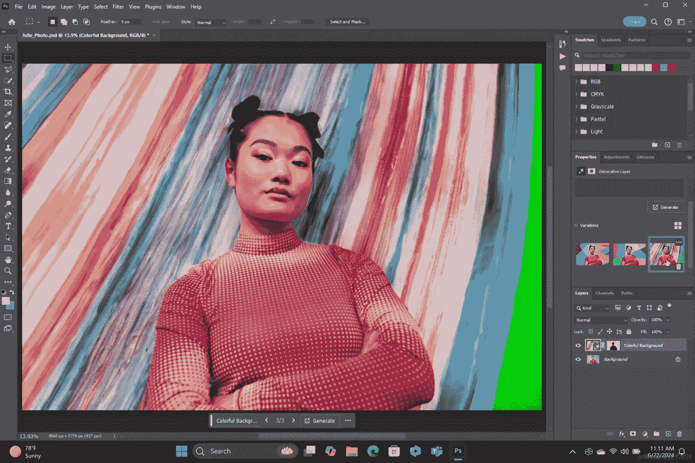

此外，使用 DaVinci Resolve Studio 中的 NPU 加速 Magic Mask 功能，可以轻松对视频主体添加视觉效果。

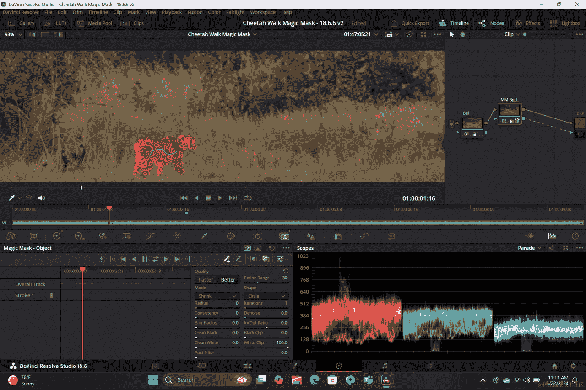

通过 NPU 加速，**CapCut** 的自动剪切功能，可实现快速、轻松地一键移除视频背景。

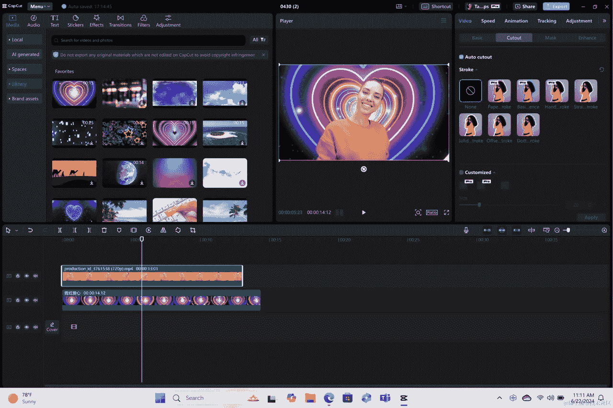

**Cephable** 中由 NPU 驱动的新摄像头 pipeline，能利用头部运动或面部表情等自适应输入控制，使操作更加快速和灵敏：

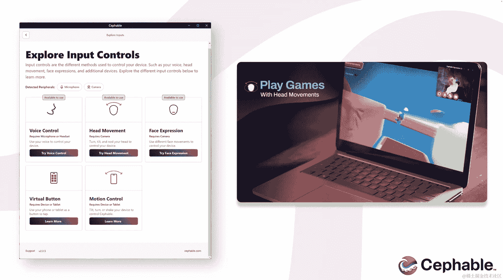

所以跟随苹果步伐，Windows 转型 ARM 也是大势所趋了，接下来再来了解一下背后提供支持的 ARM 芯片们。

## 高通骁龙首发，英特尔 AMD 跟进

第一批 Copilot+ PC，全部搭载高通骁龙处理器，英特尔 AMD 暂时缺席。

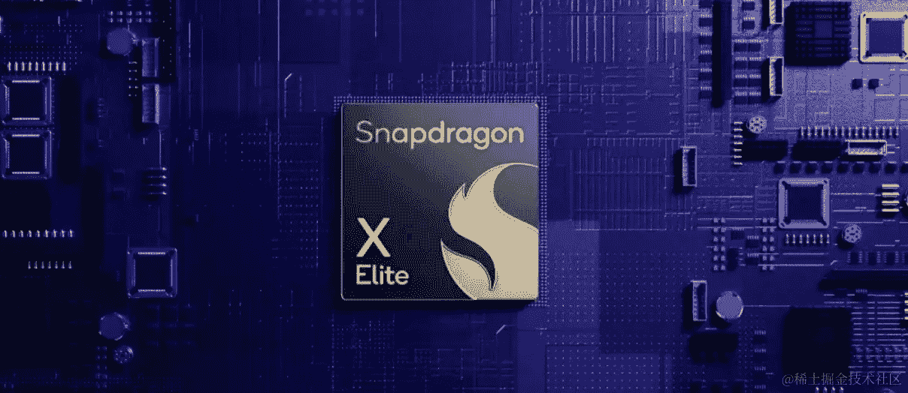

微软官方介绍，新款 Surface Pro 将比配备 **M3 处理**器的 MacBook Air 快 58%，且电池寿命可持续一整天。

而骁龙 X Elite，之前量子位也有介绍过——

高通在去年 10 月骁龙峰会上发布；采用 4nm 制程；集成 Oryon CPU、Adreno GPU、Hexagon NPU；支持 130 亿参数大模型的本地运行，70 亿参数模型可每秒生成 30 个 token。

此外，骁龙 X Elite 的 AI 引擎算力可达 75TOPS，AI 处理速度可达竞品的 4.5 倍，Hexagon NPU 算力达到 45TOPS。

CPU、GPU 性能均是竞品的 2 倍，相同峰值性能功耗比竞品低 68%。

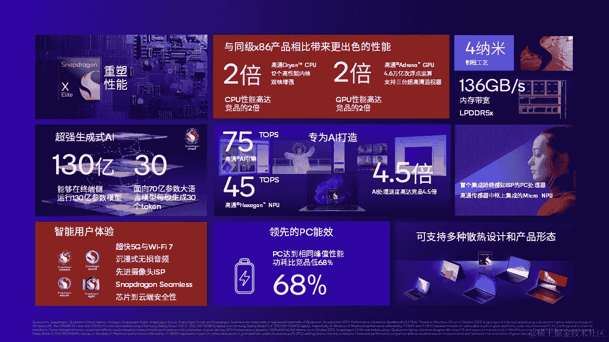

有意思的是，微软发布会同一天，英特尔也宣布了全新 Lunar Lake 处理器。

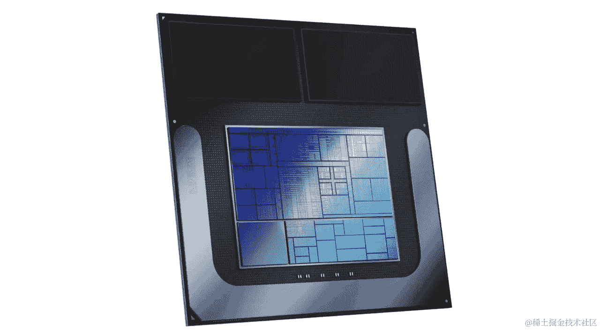

Lunar Lake 将集成 CPU、Xe2 GPU 和 NPU，其 NPU 每秒可执行超 40 万亿次操作_（TOPS）_，远高于前代 Meteor Lake 的 10 TOPS。

因此，整体 AI 性能方面，Lunar Lake 相比前代 Meteor Lake 提升了三倍。

重点是，英特尔还强调其 Lunar Lake 处理器使用 Stable Diffusion 1.5 的性能比基于 ARM 的骁龙 X Elite 快 1.4 倍。

至于 “___，Yes！” 这边，虽然没有官方发布，但也有被微软 cue 到。

AMD 针对 Copilot+ PC 推出的芯片系列名为 Strix。

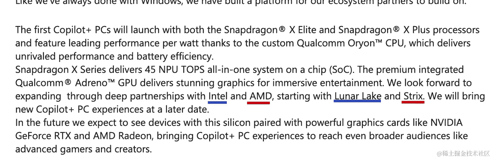

根据之前的泄露消息，Strix 系列虽然会在今年晚些时候问世，但 AI 算力方面可能会超过骁龙 X Elite（45 TOPS）。

其中代号 Strix Halo 的型号预计拥有 60 TOPS，Strix Point vanilla 预计跑分 50 TOPS。

到那时，搭载苹果 M4 芯片的 Mac 电脑或许也会发布。

总之对于关注家用 PC 和笔记本的朋友来说，今年下半年将会非常热闹。

说回到微软 Copilot+ PC，除 Surface 系列外，知名 OEM 厂商如联想、华硕、宏碁、戴尔、惠普、三星都公布了首发型号，起售价 999 美元，今天开始接受预定，6 月 18 日开始陆续发货。

那么，你会买一台 Copilot+ PC 么？或者已经买了 AI PC 正在后悔

参考链接：

[1]blogs.microsoft.com/blog/2024/0…

[2]www.theverge.com/2024/5/20/2…

[3]www.tomshardware.com/laptops/mic…