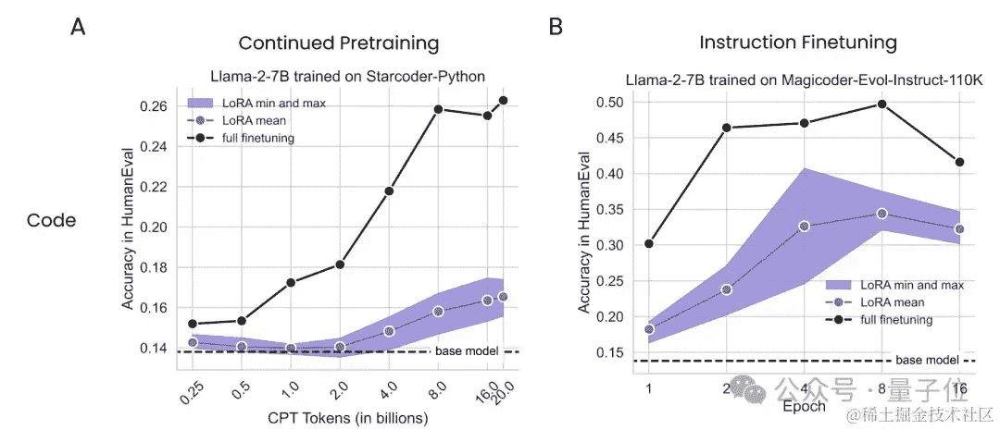
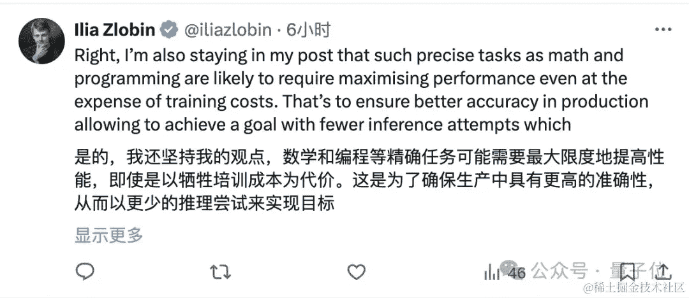
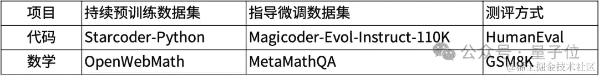
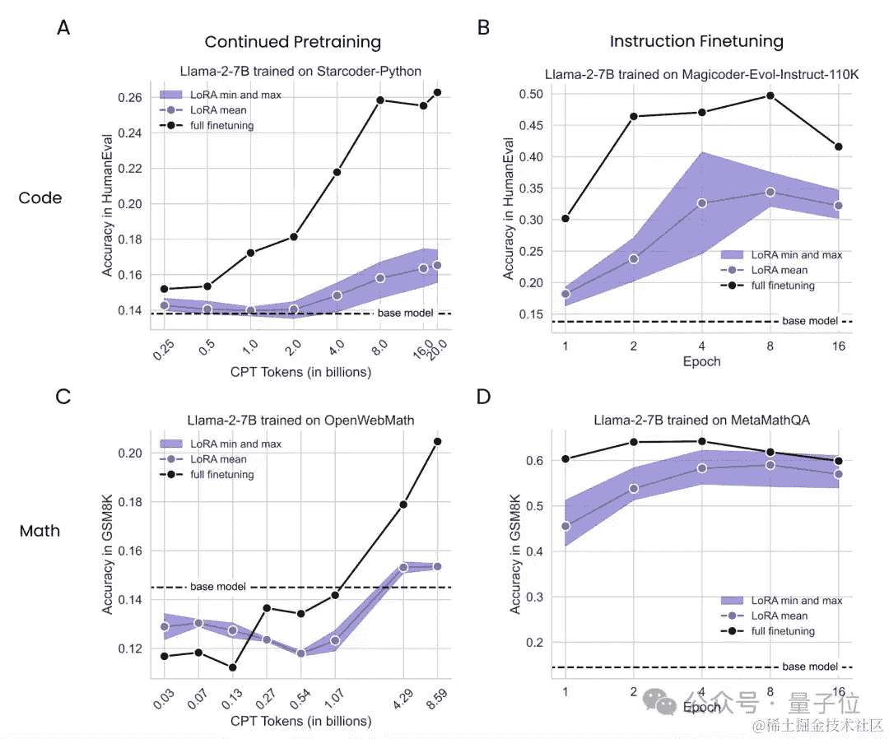
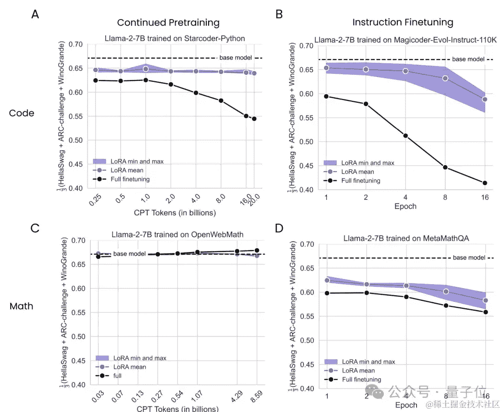
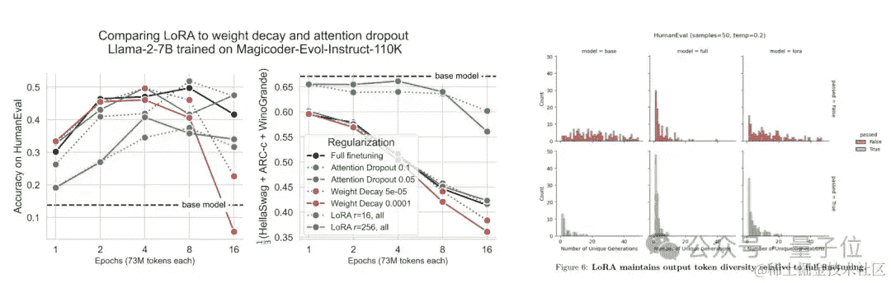
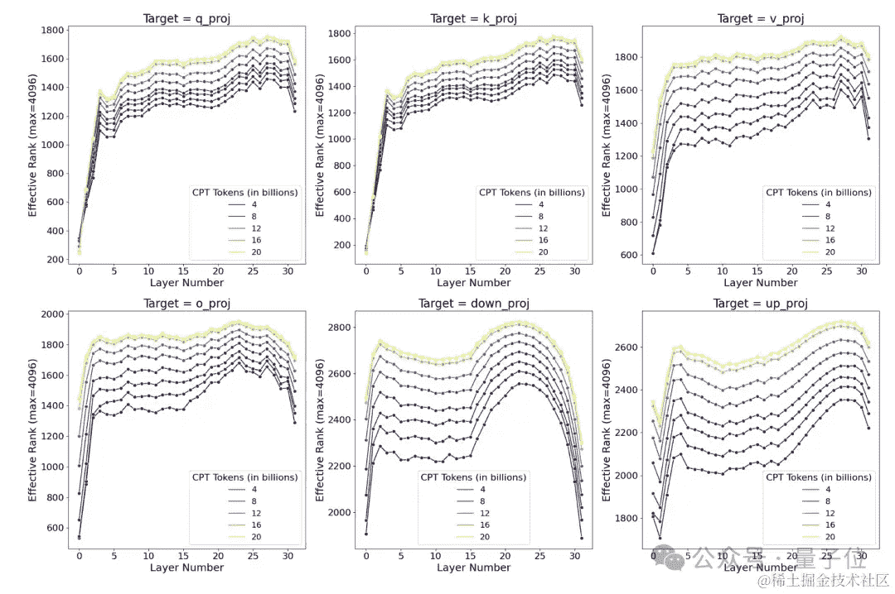
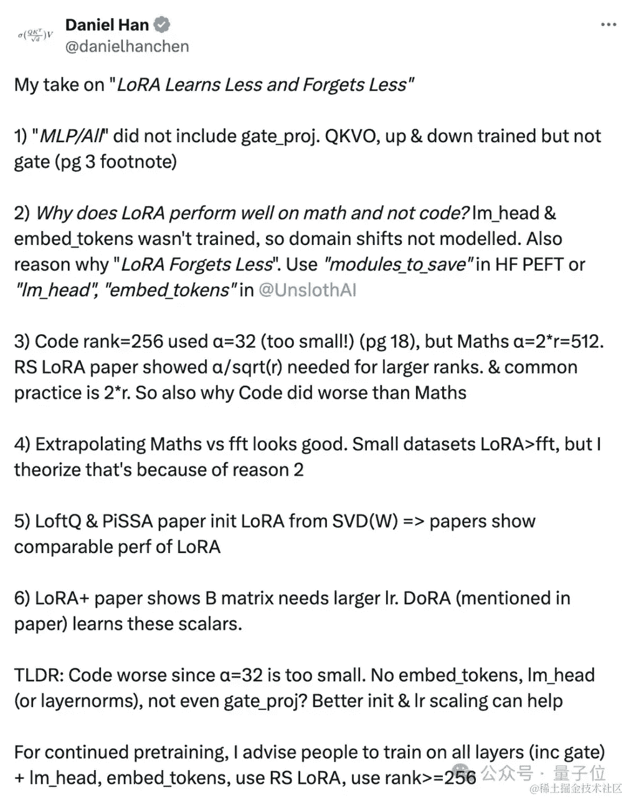
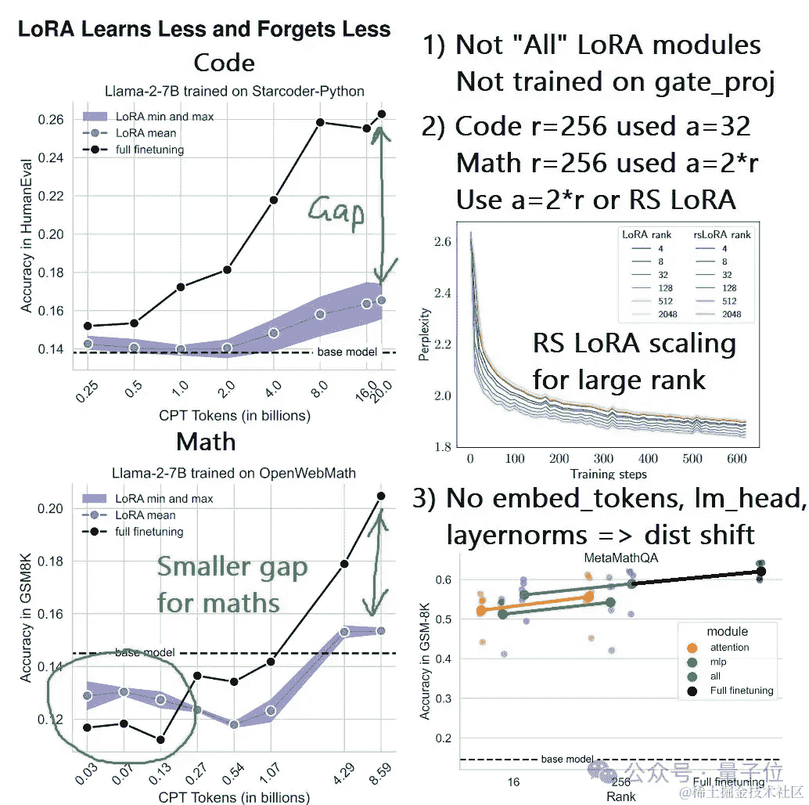
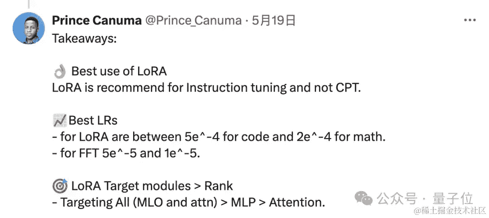

# LoRA数学编程任务不敌全量微调 | 哥大&Databricks新研究

> 来源：[https://agijuejin.feishu.cn/docx/TjoodkjbGouasQxd1zicF6shn7g](https://agijuejin.feishu.cn/docx/TjoodkjbGouasQxd1zicF6shn7g)

但遗忘现象也更少

> 克雷西 发自 凹非寺

> 量子位 | 👸号 QbitAI

大数据巨头Databricks与哥伦比亚大学最新研究发现，在数学和编程任务上，LoRA干不过全量微调。

具体来说，在这两种任务中，LoRA模型的精确度只有后者的八到九成左右。

**不过，作者也发现，Lo**RA虽然学得少，但是“记忆力”却更好，遗忘现象要比全量微调少得多。

究其原因，作者认为是数学和代码任务的特性与**L**oRA的低秩“八字不合”，遗忘更少也与秩相关。

但LoRA的一个公认的优势是**训练成本更低**；而且相比全量微调，能够**更好地保持原有模型性能**。

于是，网友们的看法也自然地分成了两派：

一波人认为，单纯考虑降低成本用LoRA，表现却显著降低，这是不可接受的。

更具针对性的，有人指出，对于数学和代码这样对精度要求高的任务，一定要最大程度地保证性能，哪怕牺牲一些训练成本。

另一波机器学习工程师则认为，作者的一些实验参数设置不当，造成这种现象的原因不一定是LoRA本身。

质疑的具体理由我们放到后面详细讲解，先来看看作者的研究都有哪些发现。

## 学的更少，但忘的也少

**实验中，作**者**使用7B**参数的Llama2作为基础模型，在持续预训练和监督微调两种模式下分别应用LoRA和全量微调，并比较了它们的表现，使用的数据集如下表：

持续预训练实验中，作者在2.5-200亿token之间共选择了8个点进行了测试；监督微调实验则是在训练1、2、4、8、16个epochs时取样；LoRA的rank取值为16和256，适配对象包括Attention、MLP和All。

结果不难看出，无论是持续预训练还是监督微调，LoRA在编程上的表现从未追上过全量微调，而且在持续预训练中，随着token数量的增加，差距越来越悬殊。

而在数学任务上的持续预训练实验中，LoRA起初表现略胜于全量微调，但也是随着token数量的增加，这种优势逐渐被反超。

这一系列结果表明，LoRA在让模型学习新知识的工作中，表现不及全量微调。

**不过尽管在性**能上比不过全量微调，但LoRA的遗忘现象更少，更有利于保持原有模型的能力。

换言之，如果把原始模型比作刚毕业的小学生，那么用LoRA能学到的初中知识更少，但之前的小学知识忘得也更少。

对应到应用当中，则主要在语言理解、尝试推理等基础能力中体现。

作者使用了相同的实验配置，把测试数据集更换成了HellaSwag、ARC-Challenge和Winogrande，分别测试经过代码和数学微调后的Llama2在基础任务上的表现。

结果，用代码来微调造成的“遗忘”现象更加严重，LoRA从整体上看更接近基础模型，即遗忘现象更轻。

## 秩是模型表现关键

**作**者分析了这些现象背后的原因，结果发现，秩在其中扮演了重要的角色。

在线性代数中，一个矩阵的秩是指其线性无关的行或列的最大数量，秩越高，所能表示的变换或关系就越复杂。

同理，在深度学习中，模型的权重矩阵可以看作是将输入信息转换为输出信息的一种映射关系，这些矩阵的秩反映了模型在学习时所需的自由度或复杂度。

对于LoRA来说，其学习的矩阵秩较小，对原始权**重矩阵的影响也就**越小，因此在适应新任务时更易保留原有知识。

而在作者的实验中，低秩矩阵的特性还体现为了更强的正则化能力和生成多样性。

至于为什么LoRA在学习新知识上表现不如全量微调，原因同样和秩相关。

作者对在Llama2上用StarCoder-Python数据集进行持续预训练过程中各个阶段的权重矩阵进行了奇异值分解。

结果发现，即使在训练的早期阶段，全面微调学到的权重扰动矩阵的秩就是LoRA常用秩的10-100倍，这表明在编程任务上，全面微调需要学习高秩的权重扰动以适应目标领域；而且随着训练的进行，权重扰动矩阵的秩还会持续增长。

也就是说，此类任务的**高秩**需求，注定无法与LoRA的低秩特性相匹配，表现不佳也就不是什么意外之事了。

实验中的另一个现象是，虽然同样比不过全量微调，但数学任务中两者的差距相比代码任务更小，作者推测可能有两方面原因：

+   **首先还是和秩相关，**作者认为数学任务相比于代码更接近于预训练数据，因此秩也相对更低。

+   另一个原因，则是目前的GSM8K数据集可能挑战性不够，对模型考察不充分，这可能也是导致出现一开始LoRA超过全量微调的原因。

## ML工程师提出质疑

不过对作者的实验，有人指出了实验的参数设置存在不合理之处。

首先提出质疑的，是模型微调和训练平台UnslothAI创始人、前英伟达ML工程师Daniel Han。

Daniel首先指出，论文中的LoRA实验只适配了QKVO、up和down矩阵，没有适配gate_proj矩阵。

如果LoRA没有对gate_proj进行适配，那么FFN模块的大部分权重实际上没有被优化，这可能限制了LoRA在编程任务上的表现。

至于数学能力好一些而在编程任务上表现不佳的原因，可能是lm_head和embed_tokens层没有进行适配训练，因此领域转移没有被很好地建模。

lm_head和embed_tokens层分别对应了语言模型的输出和输入嵌入，它们与具体领域的词汇和表达密切相关。如果这两个层没有被LoRA适配，那么模型在新领域的词汇和表达习惯上的适应能力就会受限。

另一方面，Daniel认为编程任务的超参数设置也有问题，比如秩为256时α值设得太小了，导致适配矩阵的值可能难以得到有效更新。

总结一下就是，LoRA在这些任务上的表现不如全量微调的原因，可能不是出在LoRA本身。

同时Daniel还表示，有论文指出LoftQ和PiSSA使用奇异值分解（SVD）来初始化LoRA矩阵，据称可以使LoRA达到与全面微调相当的性能。

另一名ML工程师附和了Daniel的观点，同时还针对LoRA的应用给出了一些具体建议：

+   LoRA更适用于监督微调而不是持续预训练

+   对于LoRA来说，0.0005（代码）或0.0002（数学）的学习率是最佳的

+   应用LoRA时，优先选择同时适配MLP和Attention，其次单独MLP，最后单独Attention

总之，虽然出现了论文中的结果，但LoRA仍然是一项重要的技术，而且能够显著降低训练成本，所以做好性能和资源的权衡，该用还是得用。

关于LoRA，你还有什么看法或经验，欢迎评论区交流。

论文地址：

arxiv.org/abs/2405.09…

参考链接：

[1]x.com/danielhanch…

[2]x.com/Prince_Canu…