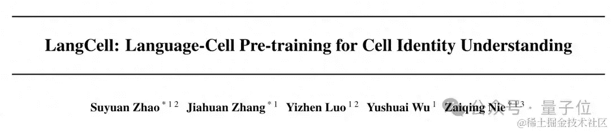
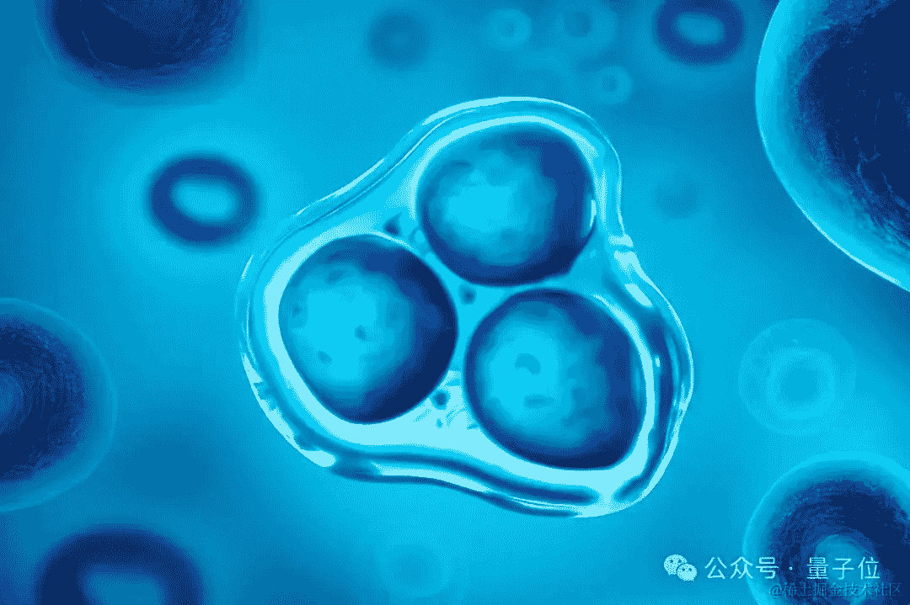
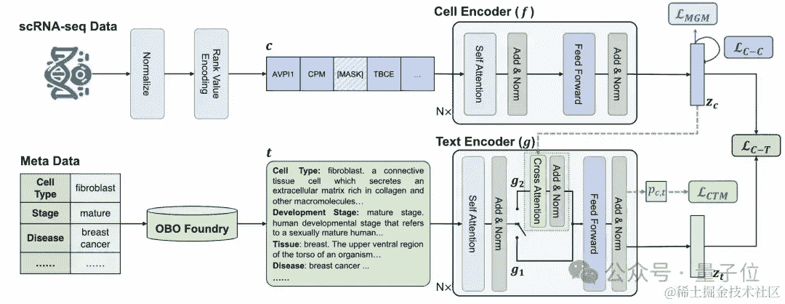
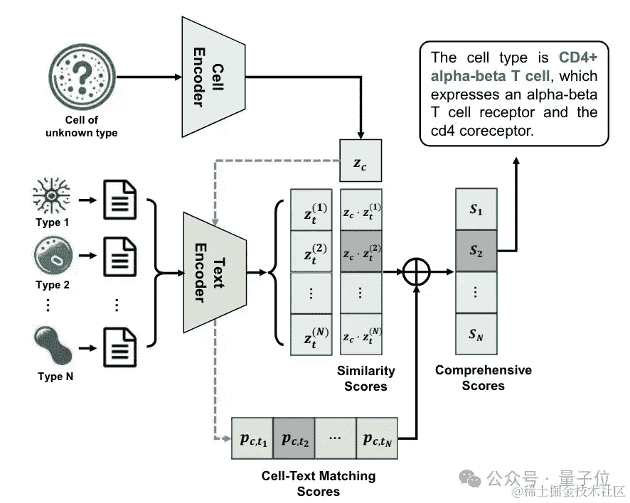
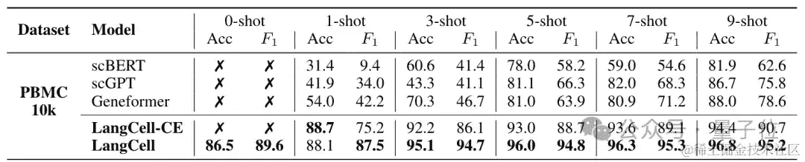
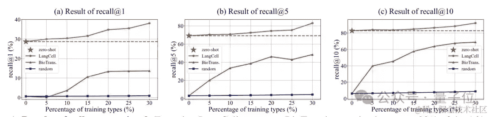
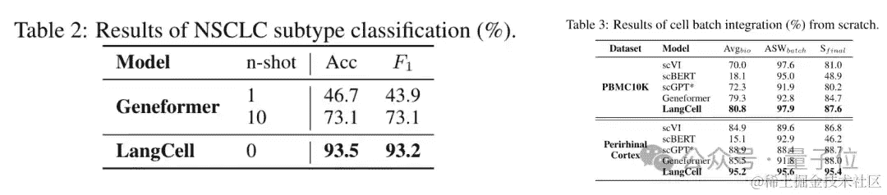
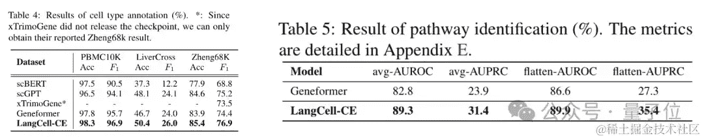

# 识别细胞也能用大模型了！清华系团队出品，已入选ICML 2024 | 开源

> 来源：[https://agijuejin.feishu.cn/docx/Ra19dkUz1o9B4yxy6VacqyQSnRe](https://agijuejin.feishu.cn/docx/Ra19dkUz1o9B4yxy6VacqyQSnRe)

> 水木分子 投稿

> 量子位 | 公众号 QbitAI

大模型带来的生命科学领域突破，刚刚再传新进展。

来自清华系，**使用大模型实现了单细胞身份识别**，同时模型LangCell也正式对外开源。

它不仅可以准确识别细胞身份，还具有很强的零样本分析能力，论文已被ICML 2024录⽤。

LangCell的数据集中包含约2750万条数据，覆盖了细胞类型、发育阶段、组织器官、疾病等8个维度的信息，称得上是“细胞的百科全书”。

实际测试中，LangCell也在多个细胞识别理解任务上超越了前SOTA，在研究人员专门设计的新任务上也表现突出。

而且，即使在不使用文本信息的情况下，单独用其包含的细胞编码器模块，也能在各个任务上实现最优表现。

出品团队：清华系创业公司**⽔⽊分⼦**与**清华⼤学AIR聂再清教授团队**。

# 大模型，细胞识别的“新武器”

细胞，是探索⽣命奥秘的起点，细胞⾝份的识别，是⽣物科学领域的⼀⼤热点。

这不仅关乎细胞的“户⼝调查”，还关系到它们在组织中的“社交关系”，以及它们对“⽣物信号”和“环境变化”的敏感反应，⽽了解这些信息的重要途径，就是分析单细胞测序数据。

但单细胞测序数据分析，就像是⼀场科学界的“寻宝游戏”，可能需要⼀个⼏⼈到⼏⼗⼈不等的跨学科的团队，用⼏周到⼏个⽉，甚⾄更⻓时间来完成。

现在，LangCell模型成为了细胞⾝份识别的“新武器”。

LangCell是⾸个结合单细胞RNA测序数据与⾃然语⾔处理进⾏预训练的单细胞表征模型，不仅提⾼了识别的准确性，还减少了对⼤量标记数据的依赖。

传统的单细胞RNA测序数据分析，就像是在没有地图的情况下寻找宝藏，虽然能找到⼀些线索，但总有些⼒不从⼼。

⽽LangCell模型，通过构建单细胞数据和⾃然语⾔的统⼀表⽰，就像是给了模型⼀张“藏宝图”，让它能够更直接地找到与细胞⾝份相关的信息。

具体来说，LangCell主要由细胞编码器（Cell Encoder，CE）和文本编码器两部分组成。

其中细胞编码器使用预训练的Geneformer初始化。将排序后的基因表达序列输入转化为嵌入向量序列，在序列开始处添加[CLS]标记，其嵌入向量经过线性变换作为整个细胞的表征向量。

文本编码器又有单模态和多模态两种编码模式。

单模态时相当于一个BERT模型,用于将文本转换为嵌入向量；

多模态时在self-attention后添加cross-attention模块，融合细胞嵌入向量计算联合表征，并通过线性层预测细胞-文本匹配概率。

为训练LangCell，研究⼈员还构建了⼀个名为scLibrary的数据集，它包含了2750万条scRNA-seq数据及从OBO Foundry中获取的细胞⾝份的多视⻆⽂本描述，就像是细胞研究的“百科全书”。

这个数据集不仅包含了⼤量的原始数据，还包含了多视⻆的细胞⾝份⽂本描述，为模型提供了丰富的学习材料。

此外在零样本场景中，只需未知类型细胞的scRNA-seq数据输入到CE中，得到细胞嵌入向量表征，然后与候选类型的文本嵌入向量进行相似度计算，分数最高的类型即被预测为该未知细胞的类型。

结果，LangCell模型在零样本细胞⾝份理解场景中表现出⾊，即使没有进⾏微调，也能直接对新的细胞类型进⾏注释。

在PBMC数据集上，零样本的LangCell分类准确率就已达到86.5%，F1评分更是超过了前SOTA模型的9-shot表现。

在更具挑战的跨数据集的细胞-文本检索任务中，LangCell的零样本召回率R@1、R@5和R@10结果都超过了用30%标注数据训练的BioTranslator模型。

此外，研究者还专门构建了“非小细胞肺癌亚型分类”和“细胞通路识别”两个具有重要生物学意义的新基准测试任务。

结果在非小细胞肺癌亚型分类任务中，LangCell的零样本分类准确率和F1分数分别达到93.5%和93.2%，比10-shot的Geneformer高出约20%。

而对于细胞批次整合任务，在PBMC10K和Perirhinal Cortex两个数据集上，LangCell的Avgbio、ASWbatch和Sfinal三个指标均达到了最优。

不仅LangCell的表现优异，即使在不使用文本信息的情况下，单独的CE模块也能在各个任务上实现最优表现。

在多个细胞类型注释任务的数据集上，CE模块的成绩都超过了前SOTA，在细胞通路识别上的表现也十分优异。

作者介绍，LangCell的这些能力，在新疾病或细胞亚型的研究中尤为重要，可以减少对⼤量标记数据的依赖，加速疾病机理的发现。

# 团队简介

⽔⽊分⼦由清华⼤学智能产业研究院（AIR）孵化，重点研究方向是⽣物医药⾏业基础⼤模型及新⼀代对话式⽣物医药研发助⼿。

水木分子和清华大学还有两项与北大和南大共同研发的成果一同入选了ICML 2024，分别在小分子3D表示学习和大分子蛋白质表示学习方面取得进展。

GitHub：

github.com/PharMolix/O…

论文地址

arxiv.org/abs/2405.06…