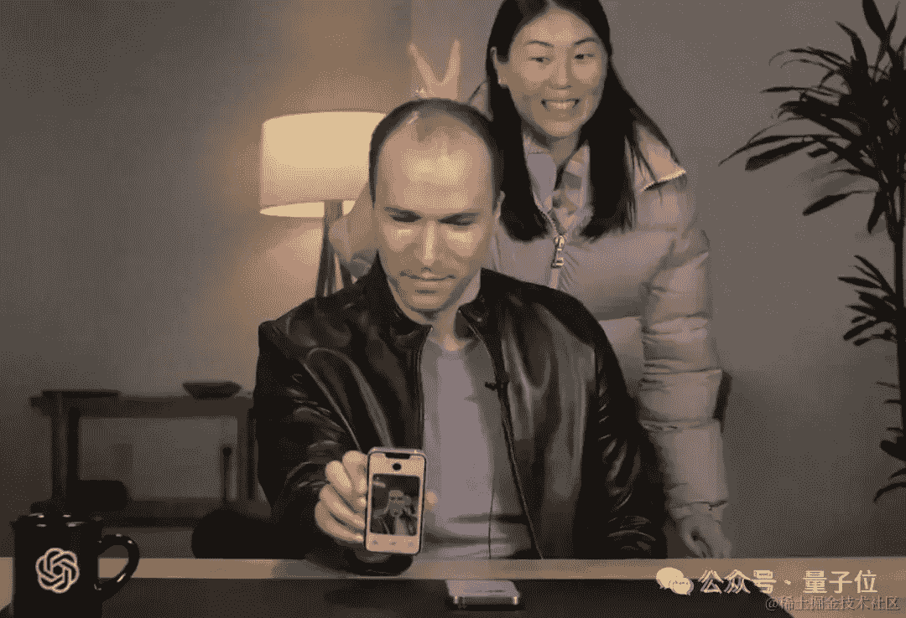

# 蚂蚁百灵大模型一号位：GPT-4o发布不意外，原生多模态方向已明

> 来源：[https://agijuejin.feishu.cn/docx/G58rd09ZMom61Vx91VTcByRcnzc](https://agijuejin.feishu.cn/docx/G58rd09ZMom61Vx91VTcByRcnzc)

> GPT-4o 最大改进在于它在整合方面的精细度

白交 发自 凹非寺

量子位 | 公众号 QbitAI

> 与之前的版本相比，GPT-4o 最大改进在于它在整合方面的精细度，它将所有模态集成在一个端到端的模型中（All in One）。

> OpenAI 这三个关键能力值得借鉴：数据组织能力、技术聚焦以及工程优化。如果我们能把这些关键点做好，也有可能会开发出具有类似效果的模型。

> 原生多模态大模型，大概率成为国内大模型主要竞争点。

OpenAI 再度用 GPT-4o 震撼世界，这一次将如何影响行业？蚂蚁 AI 创新研发与应用部门 NextEvo 一号位徐鹏博士如是说道。

谁是徐鹏博士？

徐鹏博士，目前是蚂蚁集团副总裁，AI 创新研发与应用部门 NextEvo 一号位。他曾在谷歌工作 11 年，负责和领导了谷歌翻译的核心技术研发，并参与了谷歌显示广告系统的算法研发。NextEvo 则承担了蚂蚁 AI 的所有核心技术研发，包括蚂蚁百灵大模型的所有研发工作。

据徐鹏透露，蚂蚁在今年年初判断了原生多模态的技术方向，并持续投入，目前正在研发全模态数字人和全模态智能体相关产品。

作为 OpenAI 第一个整合所有模态的大模型 GPT-4o，它还拥有惊人的响应速度，这到底是如何做到的？给整个行业，以及躬身大模型的企业，又有哪些借鉴意义？

量子位第一时间同徐鹏博士聊了聊。在不改变原意的基础上，量子位联合各位大模型做了如下整理。

1、怎么看 OpenAI 发布的 GPT-4o？

**徐鹏**：今天 OpenAI 展示的这款 demo 产品并不出人意料。从 OpenAI 的角度来看，他们一直希望将语音能力和语言理解能力进行深度融合。几年前，他们推出了的 Whisper 语音识别模型，这可以看作是他们在这方面的早期研究。

他们将各种模态的数据，包括语音、图像、视频和文字，都整合在一个统一的表征框架下，这实际上是他们实现人工通用智能（AGI）的自然途径，因为在他们看来，人类就是这样一个多模态理解并交互的智能体。他们的智能体最终发展的方向也是如此。

从效果上来看，这次发布 GPT-4o 与之前的版本相比，最大的改进在于它在整合方面的精细度。

它将所有模态集成在一个端到端的模型中，而之前的 GPT-4 在语音识别和语音回复方面还是由三个不同的模块完成的，尽管这些模块已经提供了相当不错的体验，尽管可能需要等待一两秒。

这次整合后，GPT 4o 能够实现大约 300 毫秒的延迟响应，并且能够感知人的情绪以及其他非语音信号，这是一个非常显著的进步。

这也让人联想到，可能明天 Google I/O 发布也会有类似的功能，因为谷歌已经强调多模态原生模型作为其重要特点。因此，尽管我们期待的是 GPT-5 的推出，但他们推出这个产品是完全可以理解的，这在智能交互，特别是在超自然交互模式上，是一个巨大的进步。

**2、这里面最厉害的地方在哪里？**

**徐鹏**：我认为 OpenAI 一个非常厉害的措施是，在谷歌推出了原生多模态大模型 Gemini 之后，他们显然已经开始有计划地应对竞争。

在整合资源、聚焦突破方面，他们的组织能力确实值得敬佩。要开发这样的产品，无论是数据准备，还是端到端模型的训练，都需要处理极其庞大的数据量。虽然他们已经拥有像 GPT-4 作为基础，但要将模型训练完善并实现 300 毫秒以下的响应延迟，这无疑考验了他们在数据组织能力、技术聚焦以及工程优化方面的能力，这些成就确实值得称赞。

在借鉴他们的做法时，如果这些关键点能够做好，我们很可能会开发出具有类似效果的模型。

近半年多来我注意到业界，包括国内一些公司在原生多模态领域已经进行了相当大的投入。虽然这些公司在投入速度上可能不及 OpenAI，但在这一领域特别在端到端语音模型上也都取得了一定的进展。包括蚂蚁集团今年年初在原生多模态领域也做了战略判断和重大投入。

3、多模态与原生多模态之间的区别在哪里？

**徐鹏**：在我看来，多模态与原生多模态之间的主要区别在于实际应用时，系统背后是基于多个模型的简单协作，还是由单一模型端到端完成所有任务。

以之前 GPT-4 为例，它可以通过语音识别模型将语音转换为文字，也能通过图像识别模型提取图像内容，然后利用 GPT-4 的大型语言模型作为中控生成优质的回答。回答完毕后，系统决定是向用户返回一张图片、一段文字，还是通过语音合成技术返回一段语音输出。

这些功能在 GPT-4 中都是可行的，但它并不是一个原生多模态模型，而是由多个模型组合而成的，这些模型在训练时各自有独立的训练目标。

相比之下，原生多模态模型则将图像、文字、语音甚至视频等多种编码集成到一个模型中。在训练过程中，这些不同模态的数据被统一输入给模型内部学习。当不同模态的信息相关且指向同一类事物时，它们的内部表征是非常相似的。在生成阶段，模型可以更加灵活地利用统一的表征进行不同模态的生成。

因此，最核心的区别在于模型训练过程中，是否同时处理所有模态的数据，还是分别针对不同目标进行优化。

4、要从传统大模型技术思路转向原生多模态大模型，困难吗？

**徐鹏：**技术本身可能并不是大家想象中那样的难度，真正挑战在于实际操作过程中，如何有效地聚合多种模态的数据，然后做成一个能整合各种能力的端到端模型。

这其中不仅是工程方面的挑战，还涉及到数据的准备，以及在训练过程中采用何种方法能够使进展更加顺利。因为这样一个模型训练，过程中会遇到各种各样的小问题，解决这些问题需要经验和知识的积累。

5、会成为国内大模型公司竞争点吗？

**徐鹏**：我觉得大概率是会的。但不管是大厂还是初创公司，当中关键是能力的一个聚焦，然后在这个领域里面持续优化。

6、GPT-4o 低延时，跟端到端训练有怎样关联？

**徐鹏**：这里面是有直接关联的。

以现有 GPT-4 为例在进行语音识别时，需要等待用户完整地表述完一句话，才能完成整句话识别。识别完成后，将整句话输入到后续的语言模型中，然后根据这些信息生成回复。再之后才能调用语音合成模型来转换成语音。

这个过程中可以进行一定程度的优化。例如，语音识别的输出到大模型理解这一环节，很难达到 100% 的融合，因为有些话语需要等到完全表述出来才能被理解。同样，在语音合成时输出的内容越多，合成的声调和语调等就越自然。

**而现在将这些功能集成到一个**模型中，各部分之间的依赖性就会降低。因为模型内部表征已经融合在一起，所以它可以更快地开始生成语音输出，而不必等待前面的所有信息都处理完毕。在这个模型内部，信息已经被统一表征，因此无需等待所有信息都准备好，就能作为一个整体进行处理。

**7、怎么看它的商业价值？**

**徐鹏**：我认为，OpenAI 的这次发布会实际上并不是直接针对商业化的活动。在发布会上，他们提到了 GPT-4o 将对外界免费开放。

从这一点来看，OpenAI 似乎更看重基于这种能力的未来发展潜力。他们期待未来有更多的企业能够在这一基础上开发出更自然的、能够与人交互的、更专业的产品，并通过这些产品实现商业化。

在过去由于技术条件的限制，产品设计上的一些创新想法很难实现突破，能做的东西相对有限。然而，GPT-4o 模型的出现，将发展的上限提高了很多，使得不同行业的企业在进行业务设计时，可以更放心地将交互任务交给这种自然的交互模式。

**8、能不能理解为 OpenAI 是想再**形成一个新的入口，或者是成为一个超级入口

**徐鹏**：我认为是会这样的，然后包括他们跟苹果的这个合作、自研搜索引擎也是在朝着这个方向去努力的。

**9**、今天 OpenAI 展现出来新的软件形态，接下来如何平衡技术创新与商业模式之间的关系？与像苹果、多邻国之间合作关系如何演变？

**徐鹏**：我的理解是，技术能力固然重要，但要真正实现有效的实际应用，还需要深入理解不同业务领域和行业的核心需求。只有了解了行业面临的问题，技术的应用才能带来业务模式的变革，这也正是我们对 AI 发展所期待的——通过 AI 技术的发展推动新的业务模式改革。

目前看来，OpenAI 似乎更专注于技术层面的深入准备。他们之前推出的 GPT Store 旨在鼓励开发者利用 GPT 技术开发自己的应用程序。然而，就目前而言，这些应用在深度和广度上可能还未达到 OpenAI 预期能引发行业变革的程度。

但我认为，OpenAI 这次的技术展示可能会激发更多的期待和探索。更多的行业参与者可能会愿意利用其技术能力，在业务模式上进行更深入的探索。尽管目前商业上能否取得成功还是未知数，但我认为这需要结合对行业的深入理解，真正融入行业内部，才能实现行业内的实质性变革。OpenAI 所提供的基础，为未来的变革提供了良好的起点。

**1**0、如果是产品经理这样一个创业人物，想基于这个百灵或者是蚂蚁生态去做应用创新，那我应该做什么？不做什么？

**徐鹏**：我不是做产品经理的，我只能通过技术这个角度探讨产品与技术应该如何合作。毕竟，产品最终是要服务于用户的。我认为产品经理应该做的是深入理解当前 AI 模型发展，明确其能力边界所在，并预判能力提升的可能方向。在此基础上，去思考这些能力如何为用户创造价值，以及它们将如何影响用户的使用习惯。

从蚂蚁集团的角度来看，我们拥有底层技术，并不断演进这方面的技术，我们不担心在技术上落后太多。我认为，我们更应该在产品层面进行投入，思考如何创造出真正有价值的产品，更快地与用户建立联系，让用户通过这种全新极致体验的交互模式迅速获得服务。

这可能是我们未来产品开发中需要重点关注的方向。

**11、人机交互体验上面，还有哪些**技术挑战？原生多模态这条路径是最好的吗？

**徐鹏**：这次 GPT-4o 发布确实令人惊艳，它能一定程度捕捉说话者语音语调和语气，还能通过视觉能力识别人的面部表情和情绪。但这些能力在实际应用场景中能够达到什么程度，还需要进一步探索和验证。

但像这种能在交流过程中全方位理解这个人，无疑是未来产品和技术发展中需要突破的重要方向，到时会带来真正的交互变革。

原生多模态这条路径应该是体验最好的，尤其在交互流畅度上面。但技术难度不小，比如要准确地理解和响应所有视觉和听觉信息；此外，相较于多模态数据，单模态数据收集会相对容易一些。

接下来的产品决策需要考虑的是，这种极致的体验对于产品来说是否刚需。另一方面，我们是否可以利用单模态数据进行合成，生成有助于模型训练的合成数据。