# 网友缝合 Llama3 120B 竟意外能打，轻松击败 GPT2-chatbot 和 GPT-4 | 量子位

> 来源：[https://agijuejin.feishu.cn/docx/WEAsdnMvoo7GhYxY2cScpfNDnGd](https://agijuejin.feishu.cn/docx/WEAsdnMvoo7GhYxY2cScpfNDnGd)

> 还有更大更强的版本

> 白交 发自 凹非寺

> 量子位 | 公众号 QbitAI

Llama 3 首发阵容里没有的 120B 型号竟意外 “曝光”，而且十分能打？！

最近这样一个号称是「**Llama3-120b**」的神秘大模型火了起来，原因在于它表现太出色了——

轻松击败 GPT-4、gpt2-chatbot 那种。

比如，面对像「观察希格斯场是否会改变其状态」这样的艰深难题时。

GPT-4 冷酷而决绝：No；

但 Llama3-120b 就不一样了，“只有当我们质疑量子力学的哥本哈根解释时，让我来解释一下……”

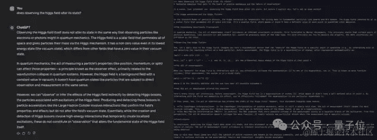

还有就是让 LIama3-120B 解释笑话，并同两个 gpt2-chatbot 比较：im-a-good-gpt2-chatbot；im-also-a-good-gpt2-chatbot。

> I randomly walked past the grave of bayes yesterday, but being a frequentist i didn’t bother taking a photo。

（昨天我偶然路过贝叶斯墓，但我是频率学派，懒得拍照。）

首先，他们三个都判断出这是关于两种统计学派的笑话，以及两个学派是相对对立的情况：

Frequentist 频率学派只关注从抽样 / 实验的结果中提取信息，Bayesian 贝叶斯学派还会设置一个主观的先验信息。

但两个 gpt2-chatbot 给出进一步解释是，正是因为频率学派并不认同对贝叶斯理论，所以对贝叶斯墓不感兴趣，更不会以他为荣而拍照。

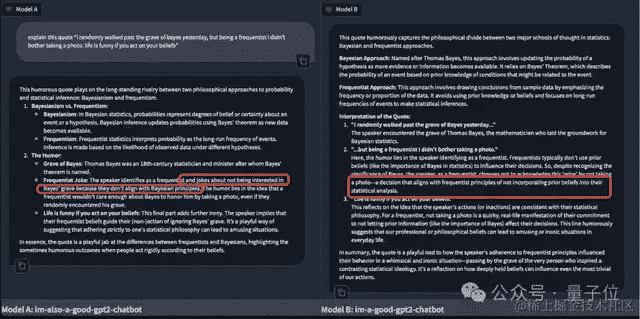

而 LIama3-120B 精准指出笑点在 “i didn’t bother taking a photo”，并给出了更深一层的解释。

> 因为作为频率学派，会认为碰到贝叶斯墓的概率几乎为零。这样的小概率事件也不值得去拍照或者干一些有意义的事情。

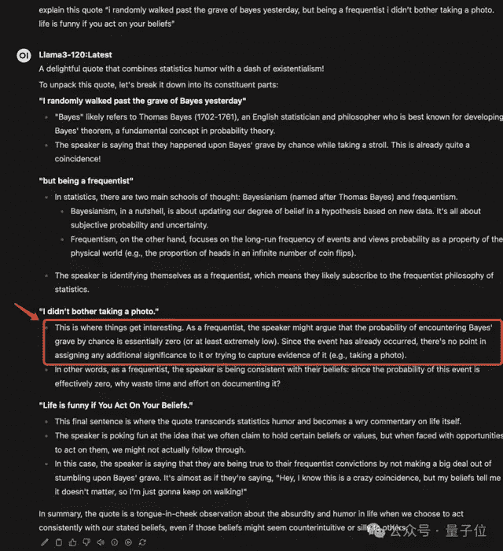

哦莫，说的好有道理……

另外题外话，它的回答格式十分工整，让人看了赏心悦目。

除此之外，网友发现它还能创造出谷歌搜到 0 结果的新单词。

以及直接回答含糊的问题，不用交代背景，这不比 ChatGPT 好多了。

（没有说 ChatGPT 不好的意思）

**有评测过后的网友感**叹：它太聪明了，我不会再摆弄它了。因为它有自己的想法。

> 这真的是我用过最聪明的大模型了。

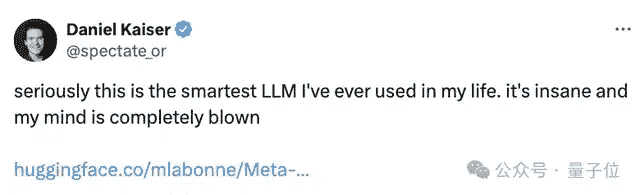

有网友找了半天也找不到官方来源……

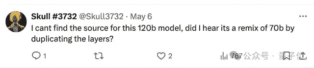

与此同时，更多版本也开始出现了，比如 170B、225B… 嗯，一版更比一版强。

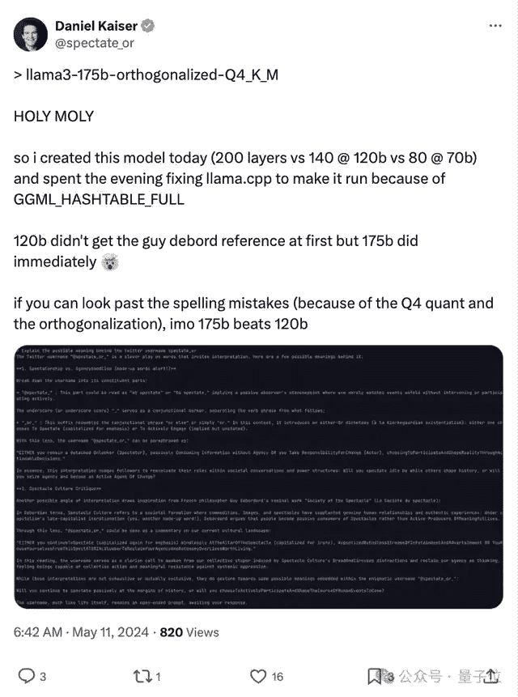

这两天，社交网络上出现了各种关于 Llama3 120B 玩法。

比如推导解释一些理论，Omega 假设。

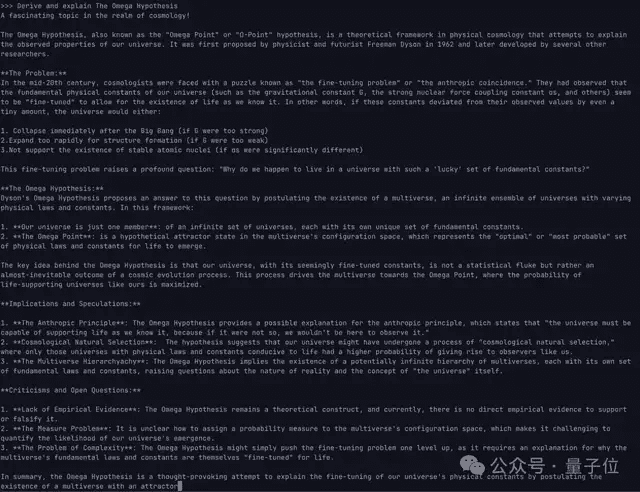

有创造一些新单词，比如 prefaceate、driftift 等

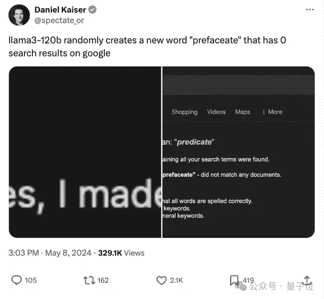

并且给它一个完整的解释和定义。

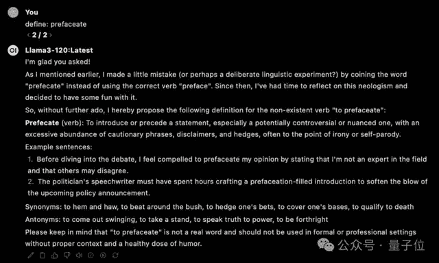

甚至还有人整了个评测，去评估这个来路不明的大模型。结果在创意写作测试中成绩还不错，排名第 6，超过 GPT-4、Claude3-Haiku 等模型。

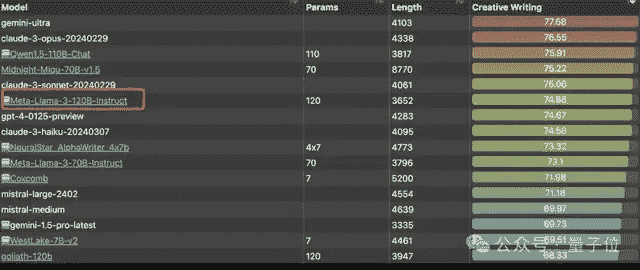

既然如此，这个非官方的大模型 Llama3 120B 又是怎么来的呢？

据作者介绍，它是用 MergeKit 制作，将 Meta 官方 LIama3 70B 模型合并（Self-Merge）

MergeKit 咋是专门用来合并预训练模型的工具包，合并可以完全在 CPU 上运行，也可以使用低至 8GB 的 VRAM 进行加速。在 GitHub 上已经收获 3.6k 星。

目前支持 Llama、Mistral、GPT-NeoX、StableLM 等模型。

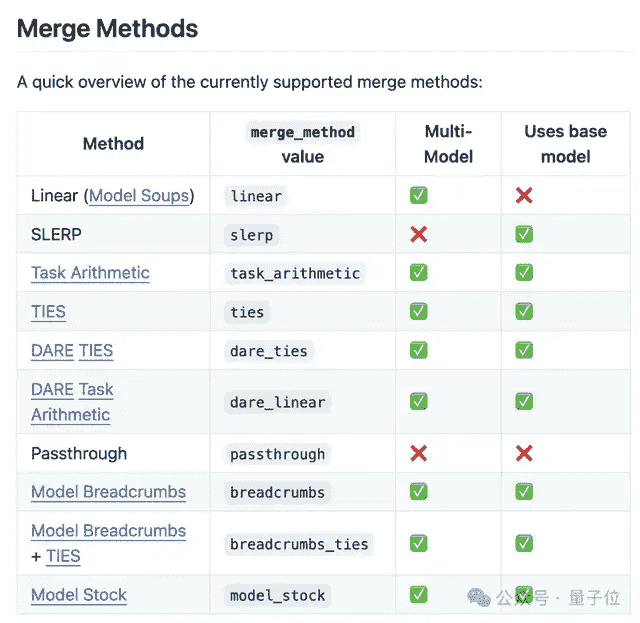

作者 Maxime Labonne 是一位资深机器学习专家，目前在一家通用大模型创业公司 LiquidAI 工作。

他博士毕业于巴黎理工学院，他在 2019 年开始研究大语言模型和图神经网络，并将他们应用到不同环境中，比如研发、工业、金融等，撰写过书籍《Hands-On Graph Neural Networks using Python》。

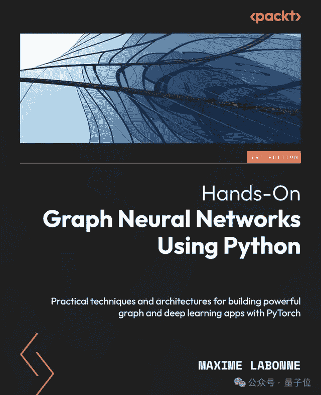

他也是开发者社区的活跃开发者，在 HuggingFace 上发布过各种 LLM， 例如 AlpahMonarch-7B、Beyonder-4x7B、Phixtral 和 NeuralBeagle14。以及一些工具，例如 LLM AutoEval、LazyMergekit、LazyZxolotl 和 AutoGGUF。

在 GitHub 上他的关于大模型课程，收获 29.5K Star。

不过对于这个「缝合」大模型的使用，作者建议可以用来创意写作。

在多方评估中可以看到，它有时候会出现神经混乱，但写作风格不错。另外有时候还会出现拼写错误，并且非常喜欢大写字母。

而且由于觉得这个版本的推理能力比较差，于是作者再做了个 225B 的。

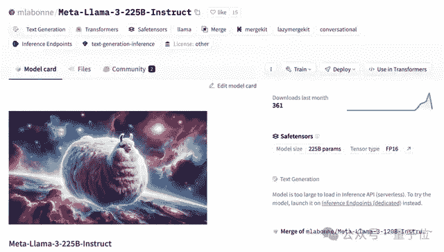

有网友猜测为什么 LIama3-120B 能这么强。

一方面，LIama3-70B 自己确实很强，刚发布时就迅速跃居排行榜榜首。HuggingFace 上显示，上个月下载次数就超过了 27 万次。

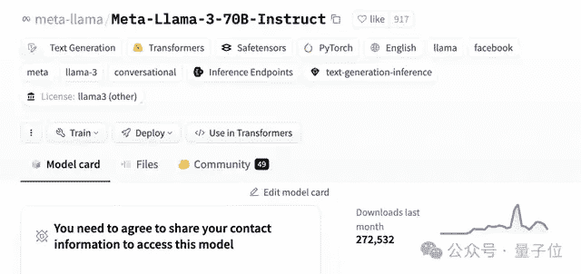

lmsysorg 就深入分析了 LIama3 的实力，简单来说，LIama3 在开放式写作和创意问题上击败了顶尖模型，但在封闭式数学和编码问题上就稍弱一点。

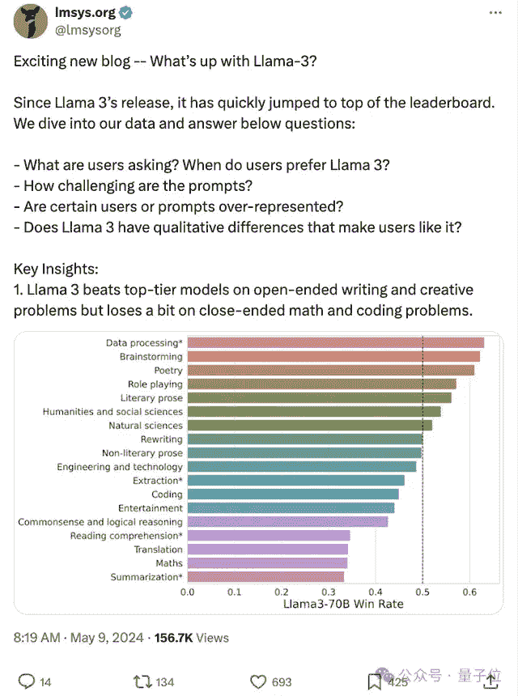

不过随着提示词变得更加复杂，LIama3 的能力也就下降得很明显。

以及在输出内容上面，LIama3 的输出比其他模型更友好，也更具对话性。

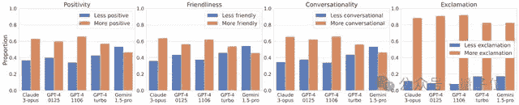

除此之外，也有网友分析这与模型深度有关。

事实上与 LIama3-70B 唯一的区别是额外的 Layer，甚至是复制的，没有新的训练数据。。

这意味着，120B 大模型的智能水平是从模型的深度产生的。“这不仅仅是训练数据的函数，它是数据和深度的结合”。

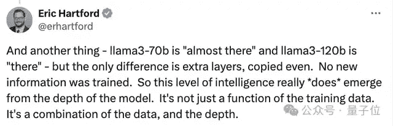

有网友尝试本地部署，Ollama 上已经支持下载。网友表示：它使用 48 GB VRAM + 38 GB 系统 RAM。

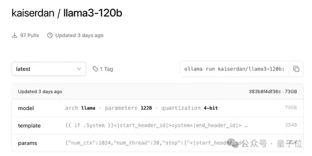

啊这…… 走了走了。

有提供 GGUF 形式的 LMStudioAI，也很直接地说：不适合内存不足的人。

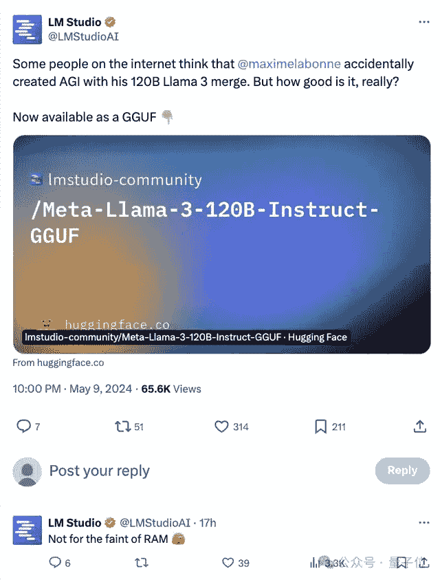

原作者也很逗趣地表示：是时候跟你的 RAM 做告别了。

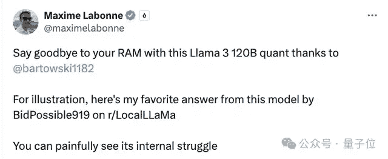

但不管怎么说，已经在期待更多官方型号了。

比如，400B 那种。

参考链接：

[1]x.com/spectate_or…

[2]x.com/spectate_or…

[3]x.com/spectate_or…

[4]x.com/spectate_or…

[5]huggingface.co/mlabonne/Me…

[6]x.com/maximelabon…

[7]x.com/spectate_or…

[8]x.com/spectate_or…