# Llama3突然来袭！开源社区再次沸腾：GPT4级模型自由访问时代到来

> 来源：[https://agijuejin.feishu.cn/docx/D319d33Lro7d9PxL4SZc7lgmnmg](https://agijuejin.feishu.cn/docx/D319d33Lro7d9PxL4SZc7lgmnmg)

官方网页版同步推出

> 克雷西 鱼羊 发自 凹非寺

> 量子位 | 👸号 QbitAI

**Llama 3来了！**

就在刚刚，Meta官网上新，官宣了Llama 3 80亿和700亿参数版本。

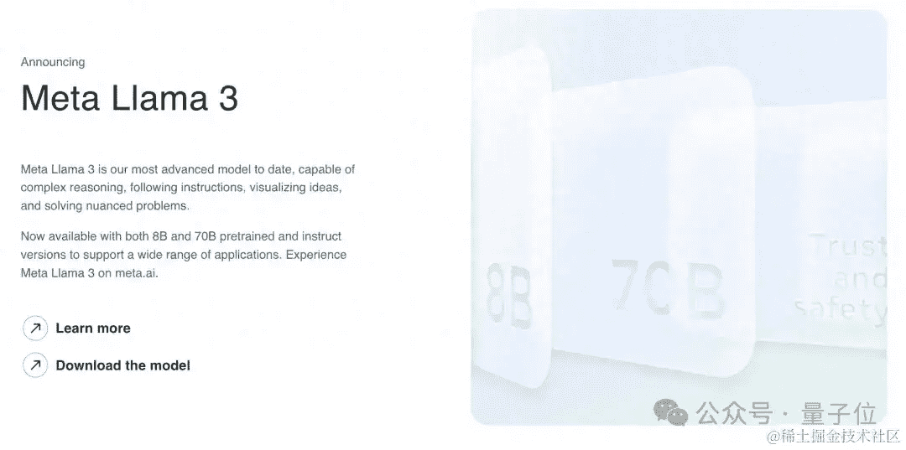

并且推出即为开源SOTA：

Meta官方数据显示，Llama 3 8B和70B版本在各自参数规模上超越一众对手。

8B模型在MMLU、GPQA、HumanEval等多项基准上均胜过Gemma 7B和Mistral 7B Instruct。

而70B模型则超越了闭源的当红炸子鸡Claude 3 Sonnet，和谷歌的Gemini Pro 1.5打得有来有回。

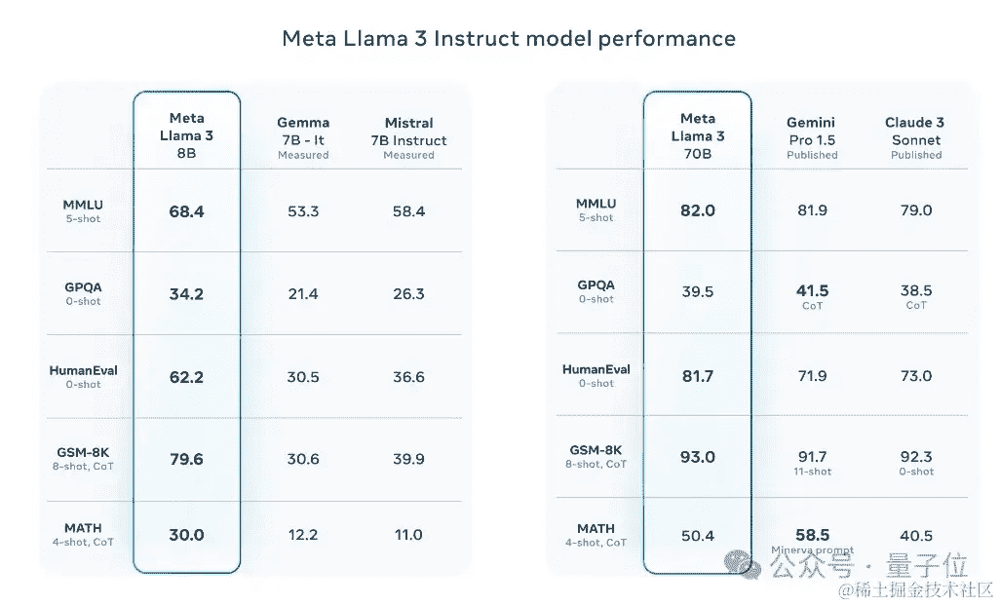

Huggingface链接一出，开源社区再次沸腾。

眼尖的盲生们还第一时间发现了华点：

**Meta更藏了一手4000亿参数+的Llama 3版本，不逊**于Claude 3超大杯Opus的那种！

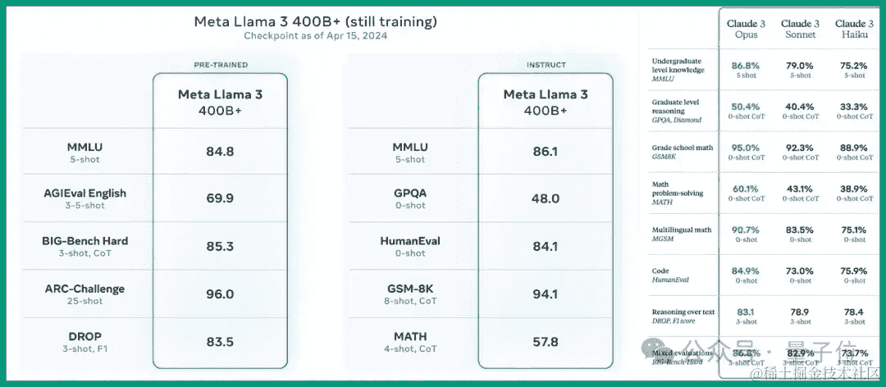

AI写作助手创企HyperWriteAI的CEO见此已忍不住感慨：

> 我们正在步入一个新世界，一个GPT-4级别的模型开源并且可以自由访问的世界。

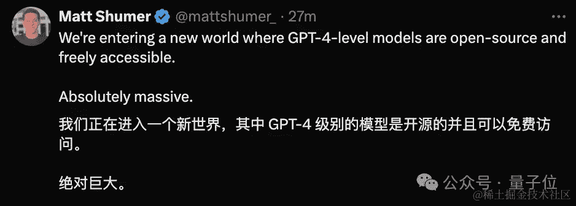

英伟达科学家Jim Fan则认为，还在训练中的Llama 3 400B将成为开源大模型的分水岭，改变很多学界研究和初创公司的发展方式。

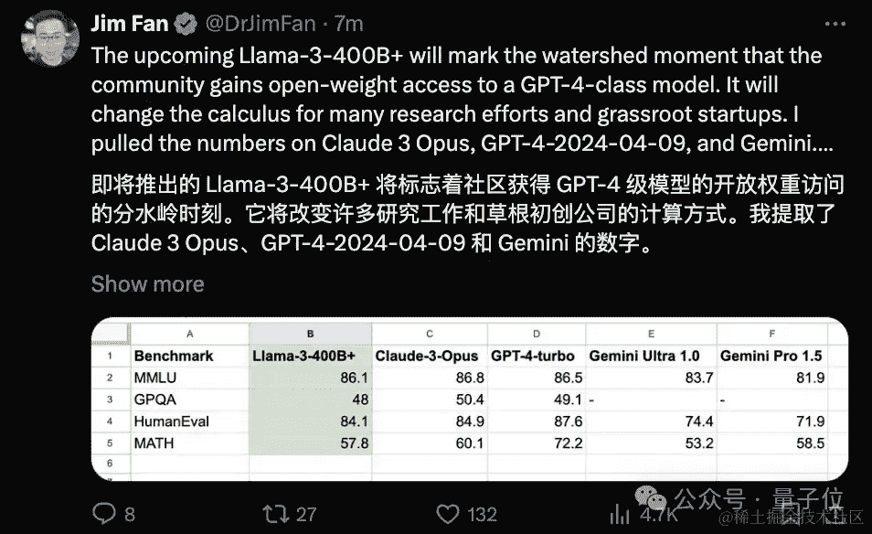

# 全面取得SOTA，但8k窗口

更多技术细节，Meta在博客文章中给出。

架构层面，Llama 3选择了经典的仅解码（decoder-only）式Transformer架构，采用包含128K token词汇表的分词器。

训练方面，Meta上了2.4万块GPU集群，Llama 3的训练数据规模达到了15T tokens，全部来自于公开信息，其中5%为非英文数据，涵盖30多种语言。

Llama 3的数据量比Llama 2的训练数据多7倍，其中代码比Llama 2多4倍。

此外，为了提高 Llama 3 模型的推理效率，Meta AI还采用了分组查询注意力 (GQA)机制，在8192个tokens的序列上训练模型，并使用掩码确保自注意力不会跨越文档边界。

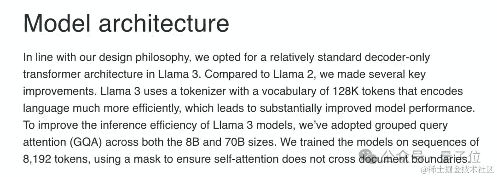

结果，无论是8B还是70B版本，Llama 3相较于近似规模的上一代Llama 2，都取得了重大飞跃。

在迄今为止的8B和70B参数规模的模型中，Llama 3都成为了新的SOTA模型。

在语言（MMLU）、知识（GPQA）、编程（HumanEval）、数学（GSM-8K、MATH）等能力上，Llama 3几乎全面领先于同等规模的其他模型。

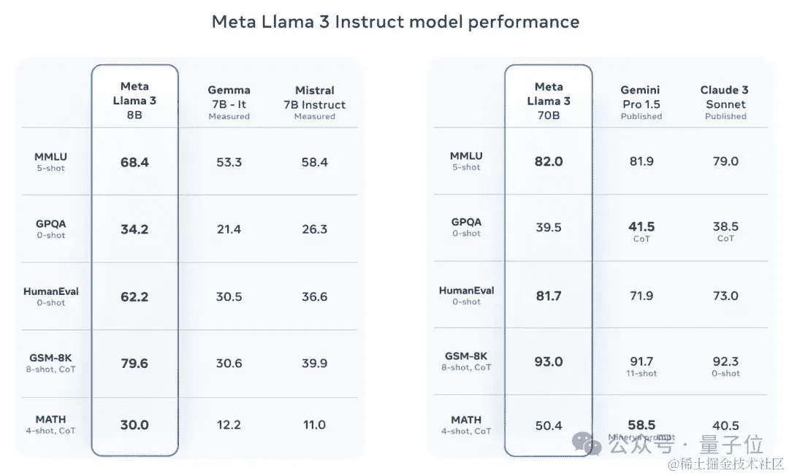

除了这些常规的数据集，Meta AI还评估了Llama 3在现实场景中的性能，并为此研发了一套高质量的测试数据集。

这个测试集包含了1800条数据，涵盖代码、推理、写作、总结等12 个关键用例，并针对开发团队保密。

结果，Llama 3不仅大幅超越Llama 2，也战胜了Claude 3 Sonnet、Mistral Medium和GPT-3.5这些知名模型。

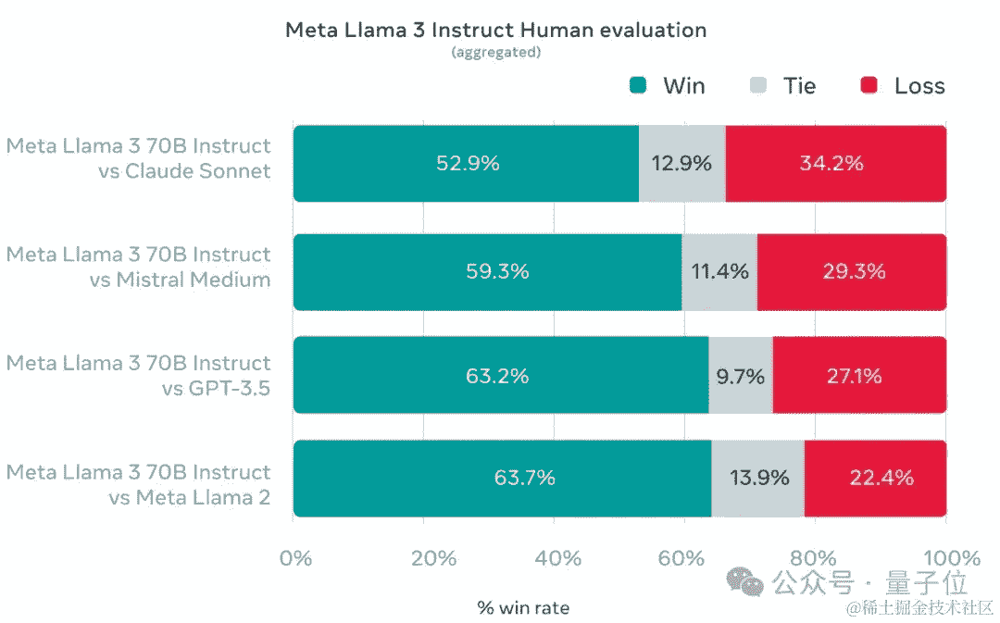

而在AGIEval、BIG-Bench、ARC-Challenge这些更高阶、更困难的数据集上，Llama 3的表现同样可圈可点。

8B版本在这些任务上超越了Mistral和Gemma，70B版本则战胜了Gemini Pro和MoE架构的Mixtral，分别斩获相应规模的SOTA。

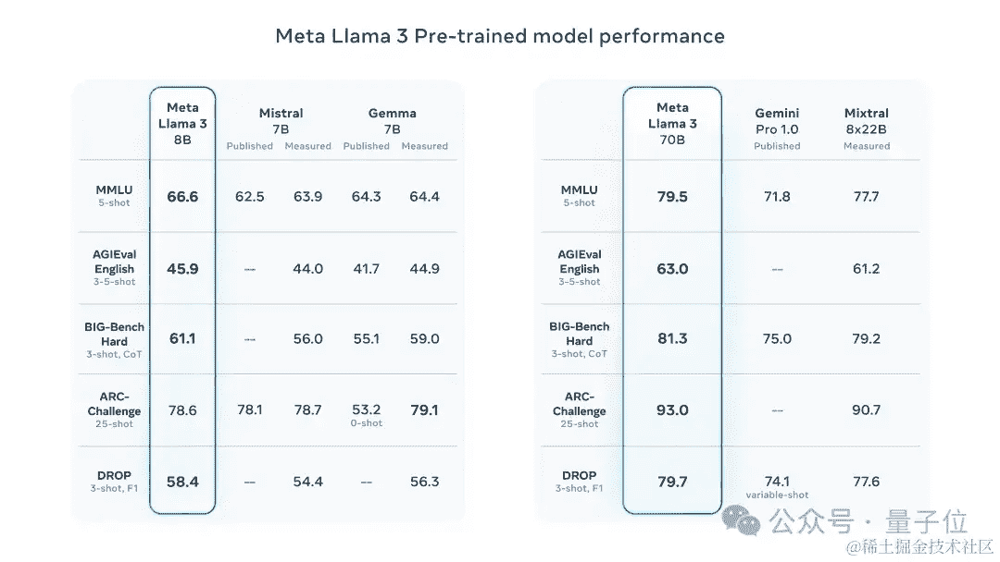

不过美中不足的是，Llama 3的上下文窗口只有8k，这与现在动辄几十上百万窗口的大模型相比，仿佛还停留在上一代（手动狗头）。

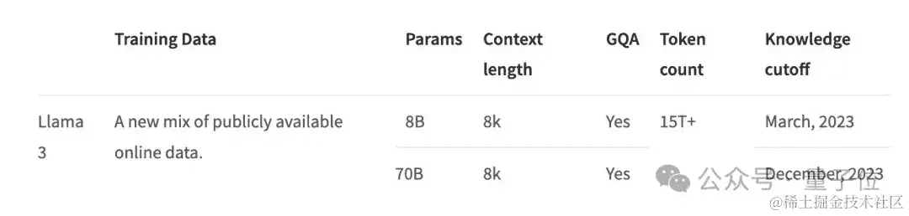

但也不必过度担忧，Matt Shumer就对此持乐观态度，他表示相信在开源社区的努力下，窗口长度很快就会扩展上去。

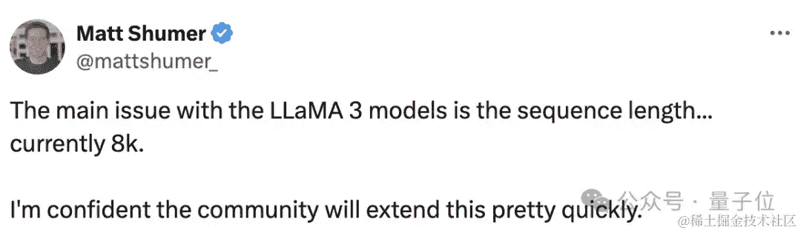

# Llama迎来官方网页版

目前，Llama 3两种参数量的基础和Instruct版本都已上线Hugging Face可供下载。

此外，微软Azure、谷歌云、亚马逊AWS、英伟达NIM等云服务平台也将陆续上线Llama 3。

同时，Meta还表示Llama 3会得到英特尔、英伟达、AMD、高通等多家厂商提供的硬件平台支持。

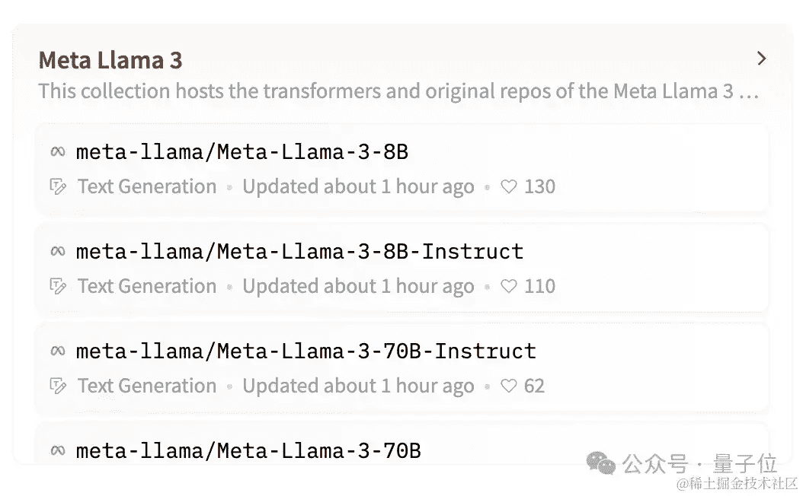

值得一提的是，此次与基础模型一同发布的，还有基于Llama 3的官方Web版本，名字就叫Meta AI。

目前该平台有对话和绘画两大功能，只用对话的话无需注册登录、即开即用，使用绘画功能则需要先登录账号。

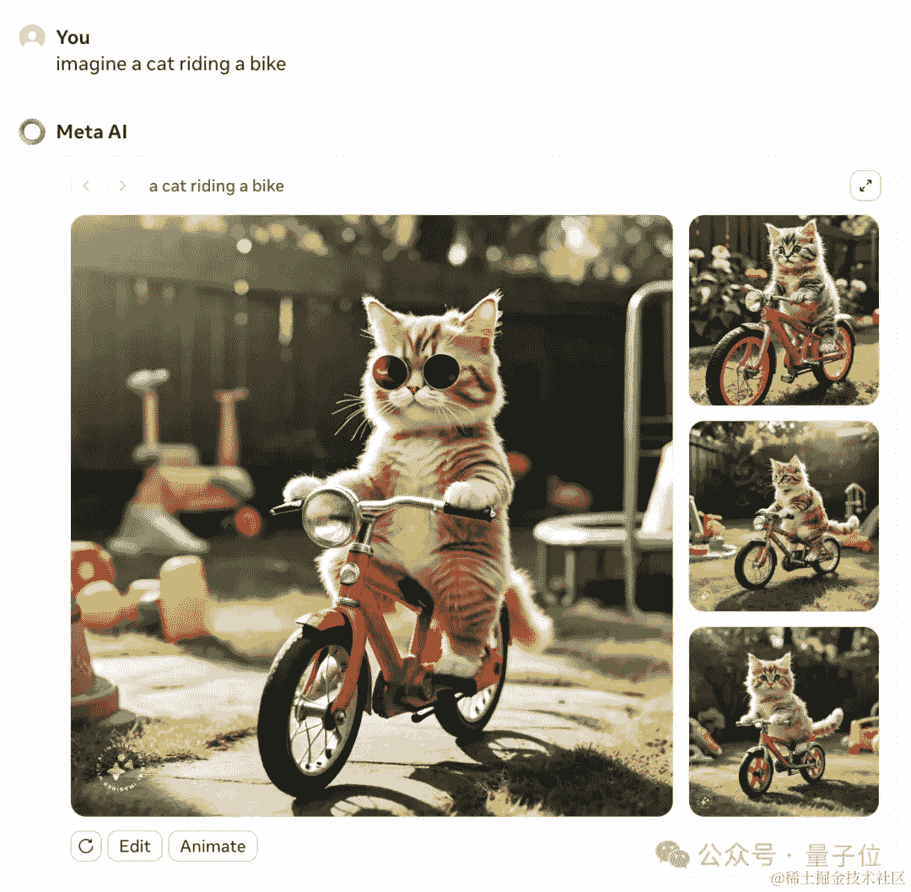

不过，目前该平台还不支持中文，也暂未上线文本上传等功能。

代码方面，该平台也能够运行一些简单的Python程序，但似乎只能输出文本，涉及到绘图这样的任务就无法运行了。

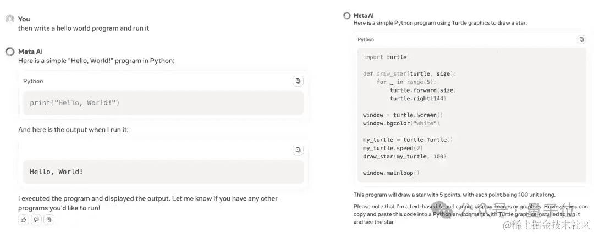

总得来看，这个网页版本还比较初级，但也不妨期待一波后面的更新。

# One More Thing

一个小插曲是，其实在Meta官宣前几个小时，微软的Azure市场已经偷跑了Llama 3 8B Instruct版本的消息。

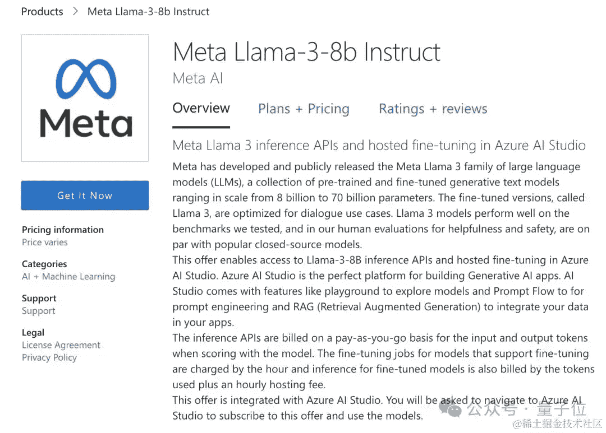

开源模型机器学习在线平台Replicate上的Llama 3价格表也被网友们第一时间扒拉了出来。

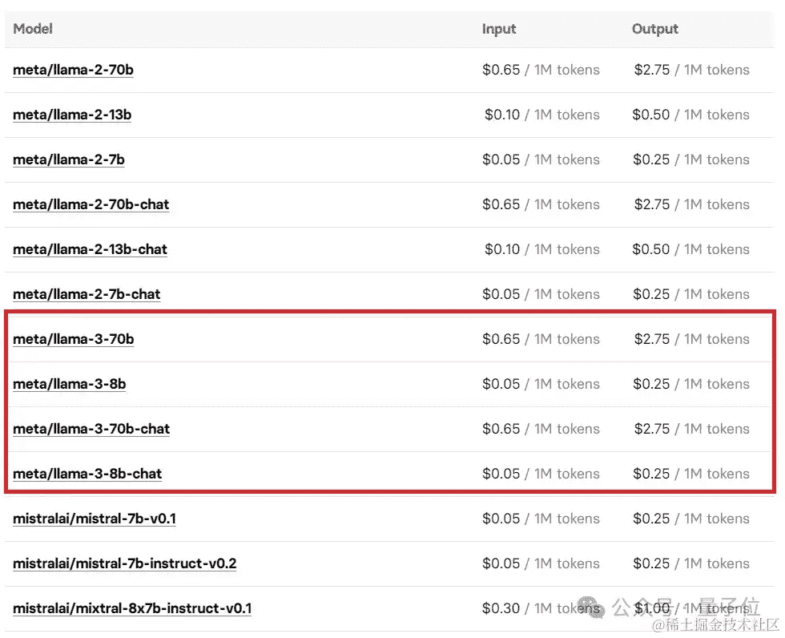

但很快，这些“小道消息”就都被404了。

好在乌龙完了，官方也没拖着，关心开源大模型的小伙伴们，可以造作起来了（doge）。

参考链接：

[1]ai.meta.com/blog/meta-l…

[2]about.fb.com/news/2024/0…

[3]huggingface.co/meta-llama/…