# OpenAI创始大神手搓千行C代码训练GPT，附PyTorch迁移教程

> 来源：[https://agijuejin.feishu.cn/docx/XiP6daxoLoe8lkxUOMscV7Gsncf](https://agijuejin.feishu.cn/docx/XiP6daxoLoe8lkxUOMscV7Gsncf)

> 复工 4 天就整了大活

> 明敏 发自 凹非寺

> 量子位 | 公众号 QbitiAI

大神卡帕西（Andrej Karpathy）刚 “复工”，立马带来神作：

纯 C 语言训练 GPT，1000 行代码搞定！，不用现成的深度学习框架，纯手搓。

发布仅几个小时，已经揽星 2.3k。

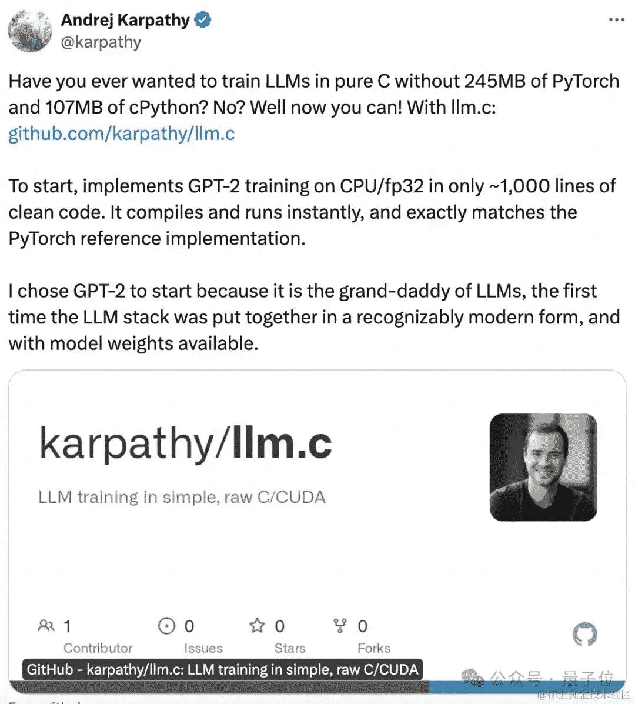

它可以立即编译和运行，和 PyTorch 完全兼容。

卡帕西使用的示例是 GPT-2，但 Llama 2 和 Gemma 等也适用。

项目发布后，他还给出了从 PyTorch 迁移到 C 的教程。

网友们直呼：他甚至都不用 C++……

而且就连怎么让大模型如法炮制的**提示词**，他也放了出来。现在已经有人在用 Devin 尝试 ing。

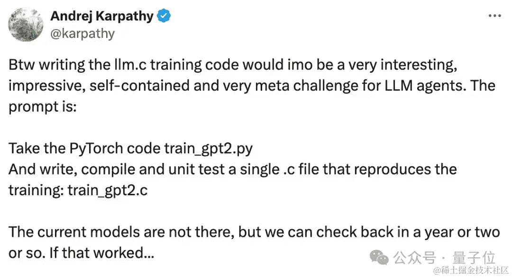

选择用 GPT-2 的原因很简单，有模型权重，采用了堆栈式的 Transformer 模型结构。

项目核心的重点包括：

+   直接在 C/CUDA 上训练 LLM，速度接近 PyTorch

+   通过在 CPU 版本中使用 SIMD 指令（如 AVX2 和 NEON）聊加速 CPU 版本

+   支持更先进的架构，比如 Llama2 和 Gemma

卡帕西解释，他在开始时分配了所有所需内存，训练期间内存占用保持不变，只是数据在不同批次之间动态流动。

关键在于手动实现每个单独层的前向传播和反向传播，并将它们串联起来。例如，下面是层归一化（layernorm）的前向传播和反向传播。

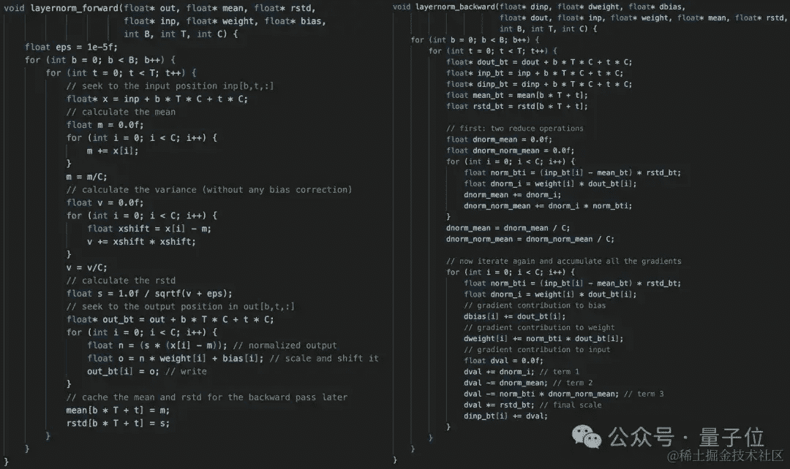

一旦有了所有的层，把它们全部串联在一起。

卡帕西表示这写起来非常乏味且痛苦，因为过程中必须保证所有 pointer 和张量都正确排列。

下图中左边是分配一个单一的一维内存数组，然后将所有模型权重和激活函数都指向它。

右图为非常小心地进行 pointer 计算。

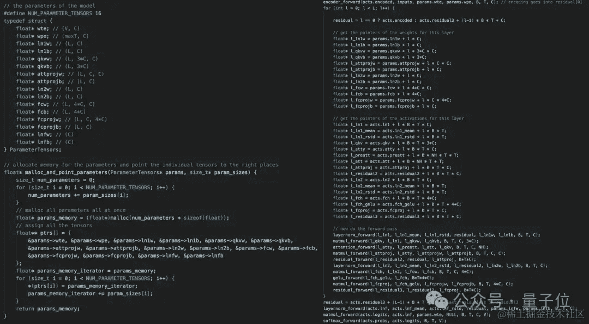

一旦建立好了正向 / 反向传播，其他的都好说了。

但是到这部分，卡帕西觉得到了最有趣的部分。

> 我正在将其逐层移植到 CUDA，使其更加高效，甚至可能和 PyTorch 效率差不多，但不会有过多依赖。

从这里开始还有一些扩展，比如精度从 fp32 下降到 fp16 或更低，以及一些更多的层（比如 RoFE）来支持更先进的架构。

卡帕西表示，后面还将出一个视频进行更加详细的讲解。

更多的代码在 GitHub 项目页中有更具体展示。

后面他还加了一个如何从 PyTorch 迁移到 C 的教程。

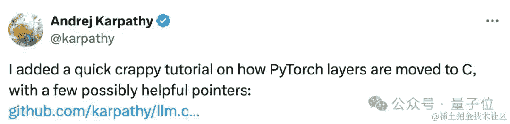

前几天，“消失” 了一段时间的卡帕西突然发推特，表示自己前段时间戒网去了，总体来说感觉害行。

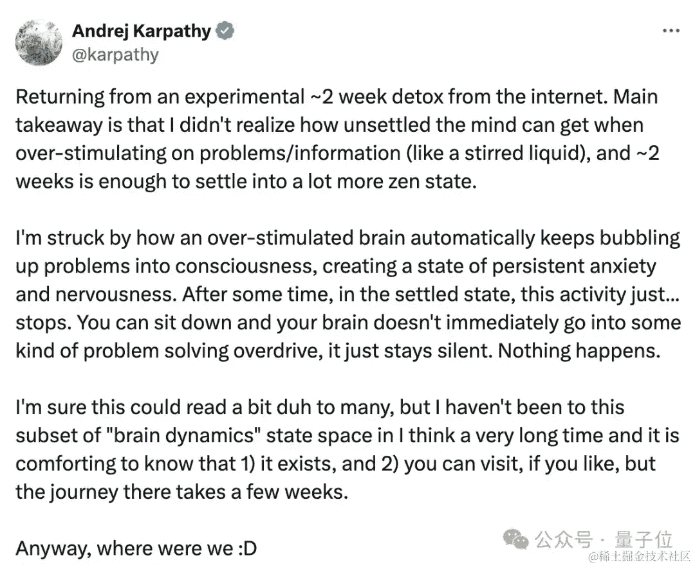

和互联网世界通上信号第 4 天，他就发布了这一新项目。给网友们来了点小震撼。

在一系列常规的 amazing、great 之外，大家对新项目主要关心三个方面。

**第一，为啥不用 Rust？**

卡帕西表示他也在学习 Rust，但是仍旧认为 C 语言已经很好了。

> 它简单、干净、轻便、美观，是最好的语言。

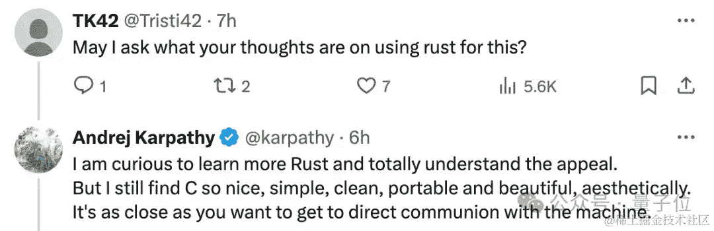

第二，AI 程序员能写出同样的项目吗？

值得一提的是卡帕西还给出了一段提示词，表示大家可以用 LLM Agent 试试看。

> 目前的模型生成结果没那么好，但也许 1、2 年之后可以再看看。如果成功了……

“可能就是 AGI 到来了？”

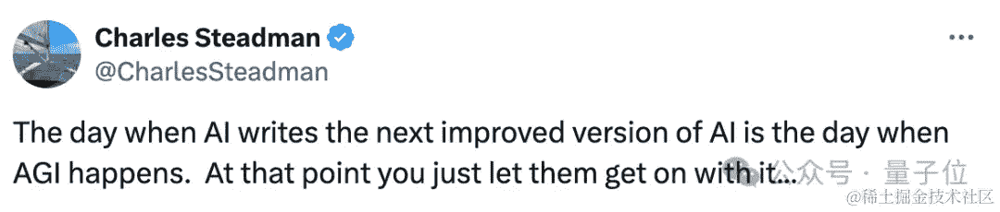

现在已经有网友开始用 Devin 尝试了。

他担心 Devin 搜到了卡帕西的项目，然后直接抄下来。目前为止 Devin 还没有这么做。

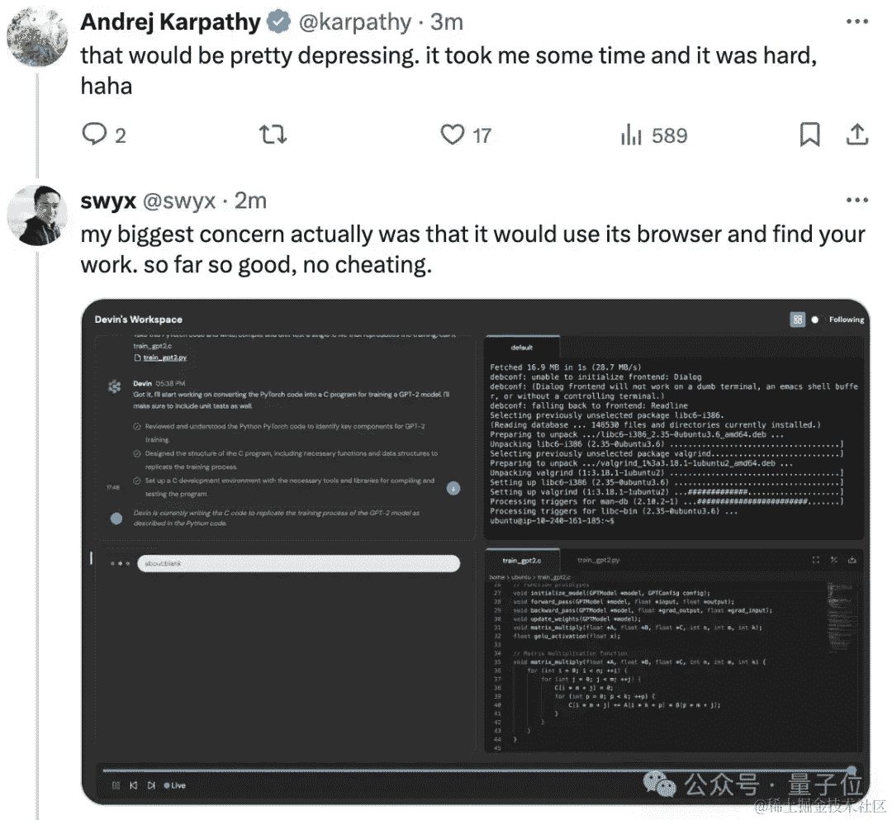

不过卡帕西表示相比于这个，他更担心 LLM Agent 在 1-2 年后确实可以解决这个问题了，但是那时各种代码和讨论会以一种别样的方式渗透到训练数据里，导致结果不够令人满意。

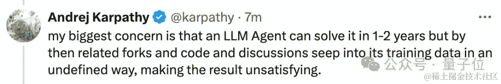

有人补充说，要加强数据管理了。

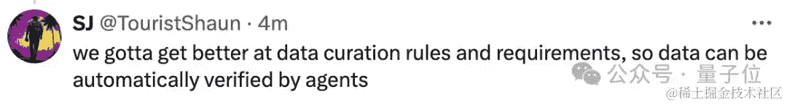

第三个讨论比较多的话题则是，这个项目和 LLM OS 有关吗？

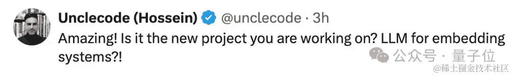

前段时间卡帕西从 OpenAI 离职，计划要开始推进个人项目。

当时大家都猜测，他要做 LLM OS。

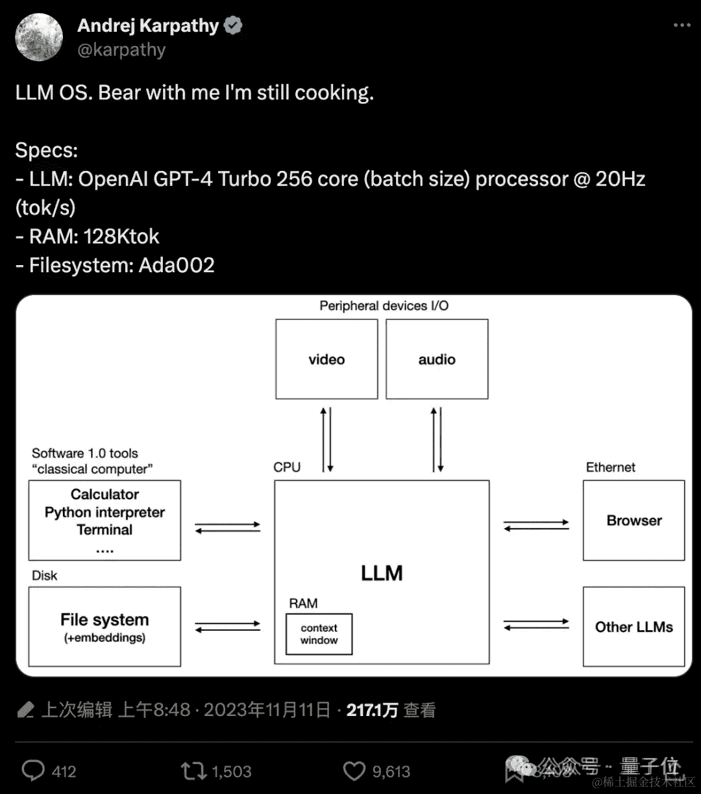

3 月底在访谈中，他也再次聊了这个话题。

他表示，现在 AGI 的路线已经相对清晰了，大家都在如火如荼推进工作，大致来说，每个人都在努力构建 “大模型操作系统（LLM OS）”.

> 我喜欢把它比作一个操作系统。你要准备好各种外围设备**，**然后把他们连接在一个新的 CPU 上。这些外围设备包括文本、图像、音频等各种模态。CPU 就是语言模型本身。它还要与我们已经构建的所有 Software 1.0 基础设施相连。

> 我认为大家都在努力构建这样一个东西，然后把它定制成适用于各个经济领域的产品。

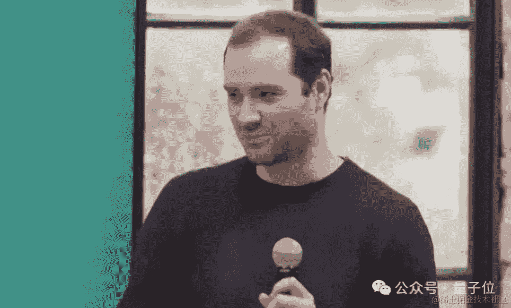

现在随着新项目推出，卡帕西的个人项目大概是已经提上日程了。

后续关于 LLM.C 的项目还会推出更详细的视频讲解版本，大家可以期待一波了~

GitHub 地址：

github.com/karpathy/ll…

参考链接：

[1]twitter.com/karpathy/st…

[2]twitter.com/karpathy/st…

[3]twitter.com/karpathy/st…