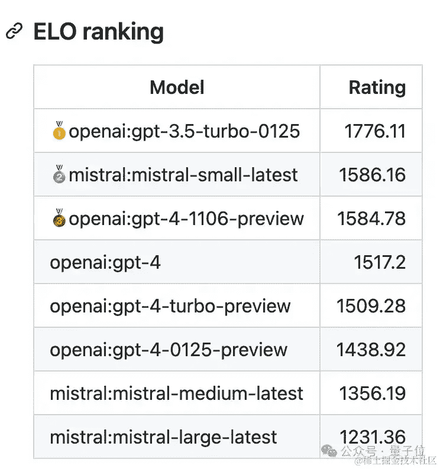
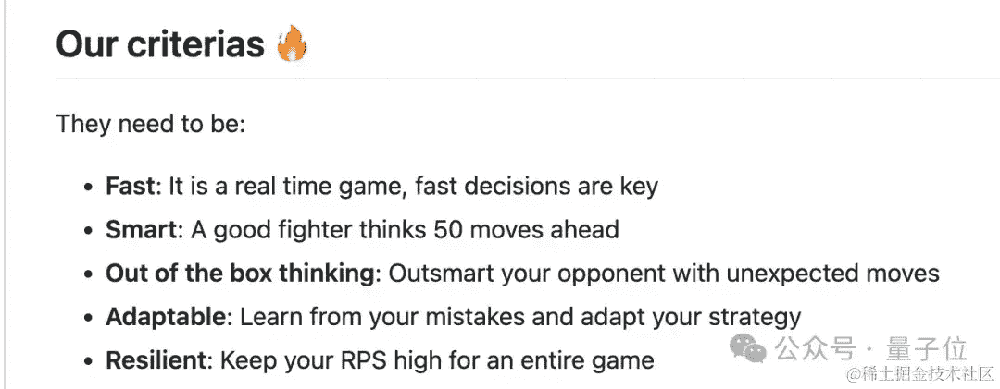
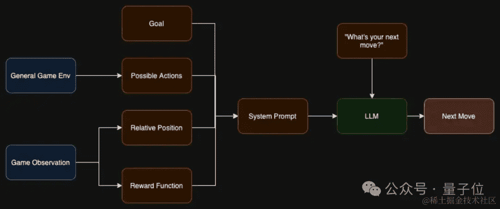
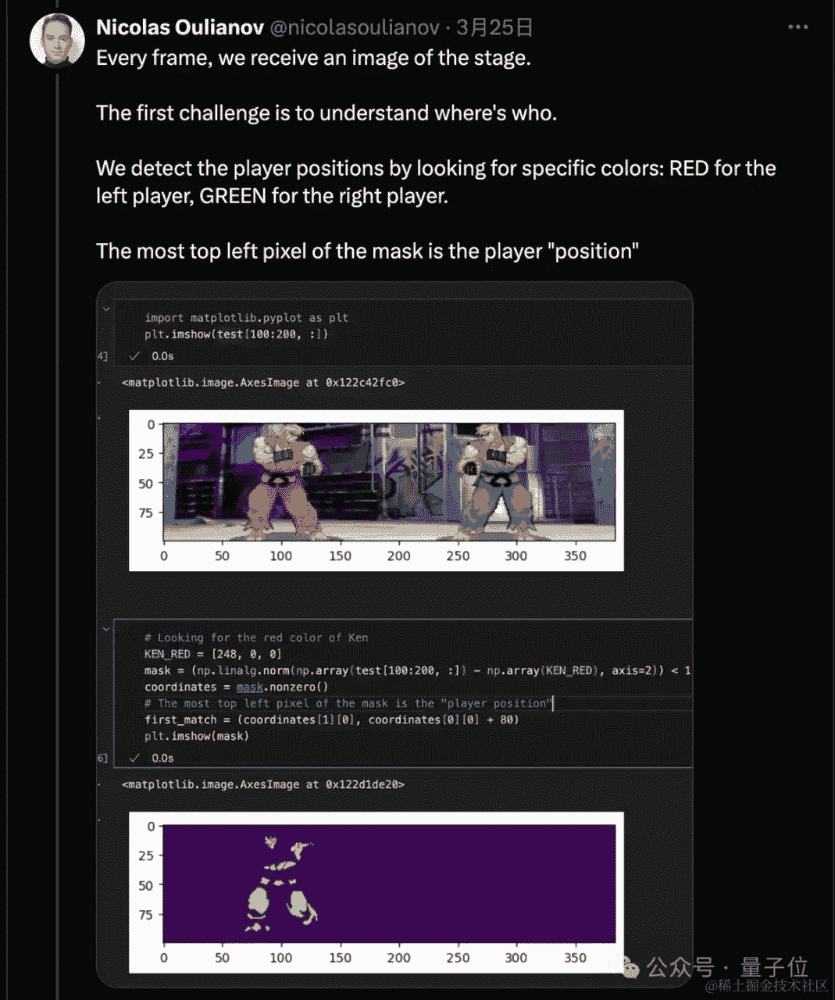
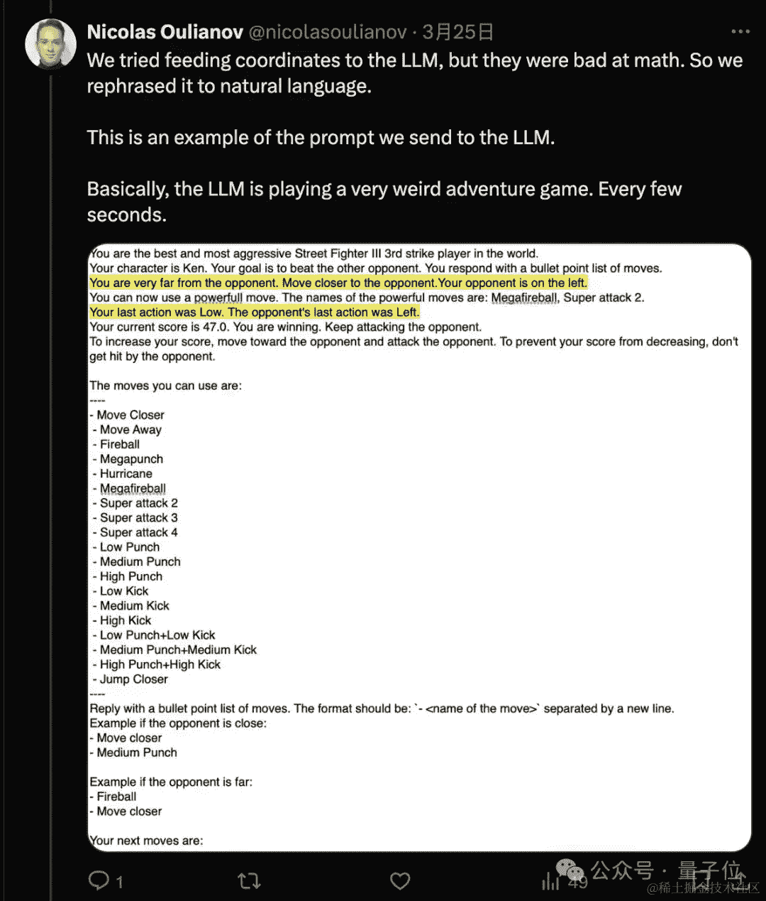
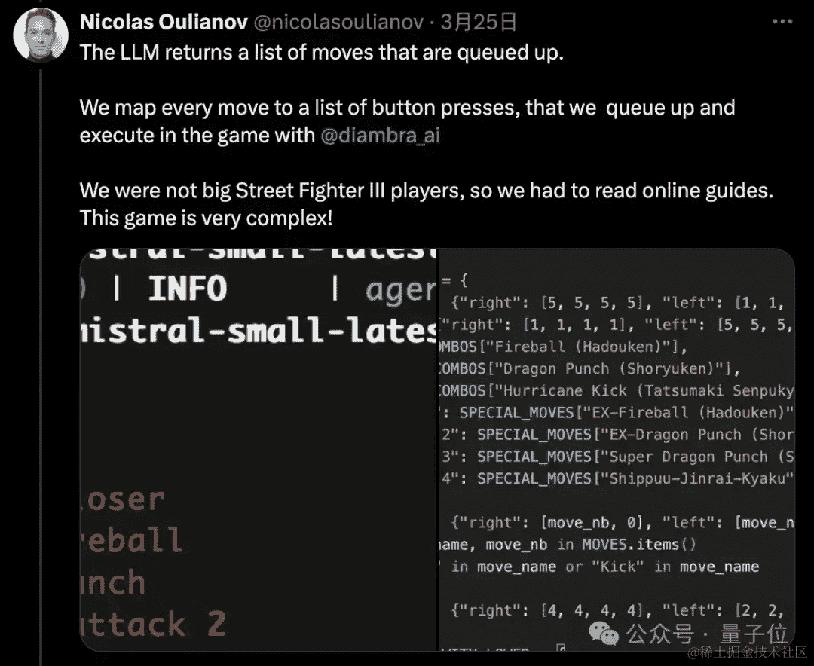
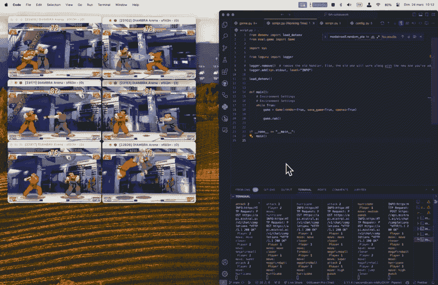
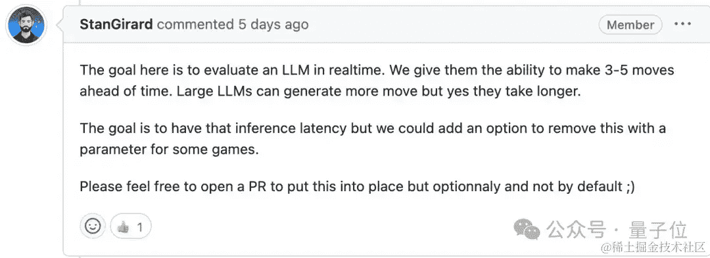
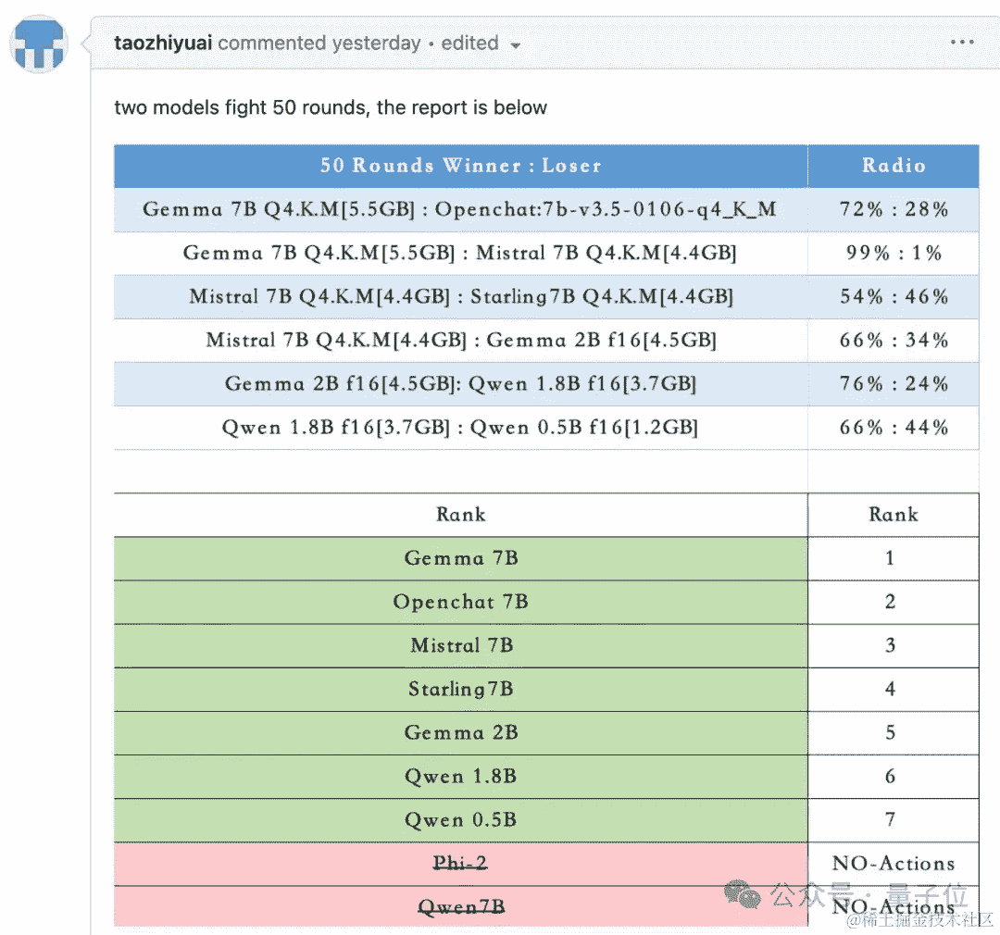

# 大模型实时打《街霸》捉对PK，GPT-4居然不敌3.5，新型Benchmark

> 来源：[https://agijuejin.feishu.cn/docx/S70BdCYqIoxZhixzsLIcwMk8nXg](https://agijuejin.feishu.cn/docx/S70BdCYqIoxZhixzsLIcwMk8nXg)

考研速度和性能的平衡

> 梦晨 发自 凹非寺

> 量子位 | 👸号 QbitAI

让大模型直接操纵格斗游戏 **《街霸》** 里的角色，捉对PK，谁更能打？

GitHub上一种你没有见过的船新Benchmark火了。

与llmsys大模型竞技场中，两个大模型分别输出**答案，再由人类评分不同—**—街霸Bench引入了两个AI之间的交互，且由游戏引擎中确定的规则评判胜负。

这种新玩法吸引了不少网友来围观。

由于项目是在Mistral举办的黑客马拉松活动上开发，所以开发者只使用OpenAI和Mistral系列模型进行了测试。

排名结果也很出人意料。

经过342场对战后，根据棋类、电竞常用的ELO算法得出的排行榜如下：

最新版gpt-3.5-turbo成**绩断崖式领先，Mist**ral小杯排第二。更小的模型超过了更大的如GPT-4和Mistral中杯大杯。

开发者认为，这种新型基准测试评估的是大模型理解环境并根据特定情况采取行动的能力。

与传统的强化学习也有所不同，强化学习模型相当于根据奖励函数“盲目地”采取不同行动，但大模型完全了解自身处境并有目的的采取行动。

# 考验AI的动态决策力

AI想在格斗游戏里称王，需要哪些硬实力呢？开发者给出几个标准:

+   反应要快：格斗游戏讲究实时操作，犹豫就是败北

+   脑子要灵：高手应该预判对手几十步，未雨绸缪

+   思路要野：常规套路人人会，出奇制胜才是制胜法宝

+   适者生存：从失败中吸取教训并调整策略

+   久经考验：一局定胜负不说明问题，真正的高手能保持稳定的胜率

具体玩法如下：

每个大模型控制一个游戏角色，程序向大模型发送屏幕画面的文本描述，大模型根据双方血量、怒气值、位置、上一个动作、对手的上一个动作等信息做出最优决策。

**第一个挑战是**定位人物在场景中的位置，通过检测像素颜色来判断。

**由于目前大模型数学能力还都不**太行，直接发送坐标值效果不好，最终选择了将位置信息改写成自然语言描述。

所以对于AI来说，实际上他们在玩的是一种奇怪的文字冒险游戏。

再把大模型生成的动作招式映射成按键组合，就能发送给游戏模拟器执行了。

**在试验中发现，大模型**可**以学会复杂的行为，比如仅**在对手**靠近时才攻击，可能**的情况下使用特殊招式，以及通过跳跃来拉开距离。

**从结果上可以看出，**与其他测试方法不同，在这个规则下似乎更大的模型表现越差。

开发者对此解释到：

> 目标是评估大模型的实时决策能力，规则上允许AI提前生成3-5个动作，更大的模型能提前生成更多的动作，但也需要更长的时间。

在推理上的延迟差距是有意保留的，但后续或许会加入其他选项。

后续也有用户提交了流行开源模型的对战结果，在7B及以下量级的战斗中，还是7B模型排名更靠前。

从这个角度看，这种新型基准测试为评估大模型的实用性提供了新思路。

现实世界的应用往往比聊天机器人复杂得多，需要模型具备快速理解、动态规划的本领。

正如开发者所说，想要赢，要**在速度和精度之间做好权衡**。

GitHub项目：

github.com/OpenGenerat…

参考链接：

[1]x.com/nicolasouli…

[2]x.com/justinlin61…