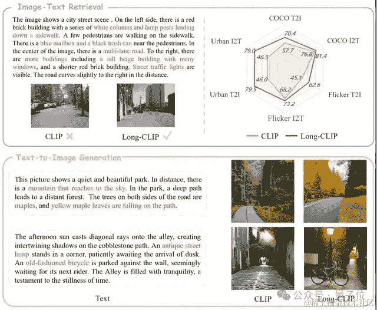
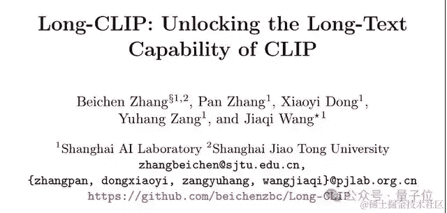
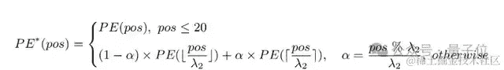
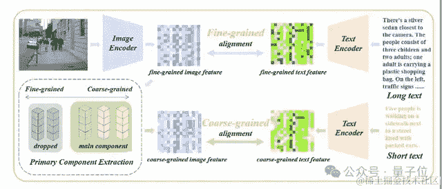
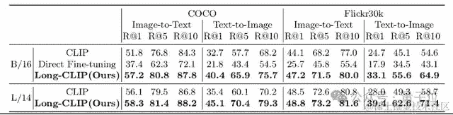
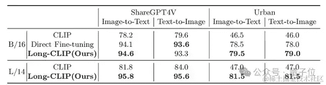
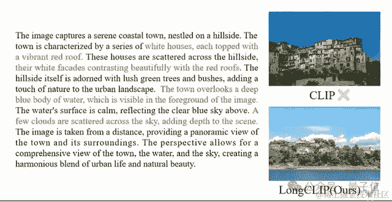
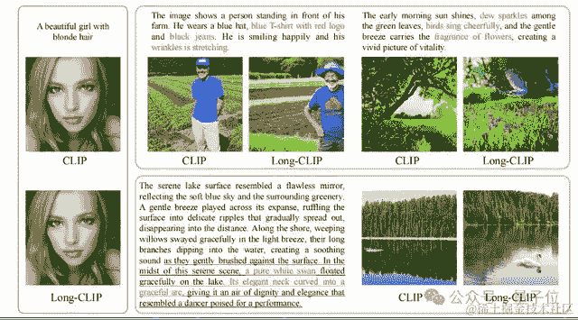

# 上海交大新框架解锁CLIP长文本能力，多模态生成细节拿捏，图像检索能力显著提升

> 来源：[https://agijuejin.feishu.cn/docx/EwftdYRAgobUeyxgeoScFRhOnNf](https://agijuejin.feishu.cn/docx/EwftdYRAgobUeyxgeoScFRhOnNf)

即插即用

> 白交 发自 凹非寺

> 量子位 | 👸号 QbitAI

CLIP长文本能力被解锁，图像检索任务表现显著提升！

**一些关键细节也能被**捕捉到。上海交大联合上海AI实验室提出新框架Long-CLIP。

△棕色文本为区分两张图的关键细节

Long-CLIP在保持CLIP原始特征空间的基础上，在图像生成等下游任务中即插即用，实现长文本细粒度图像生成——

长文本-图像检索提升20%，短文本-图像检索提升6%。

# 解锁CLIP长文本能力

CLIP对齐了视觉与文本模态，拥有强大的zero-shot泛化能力。因此，CLIP被广泛应用在各种多模态任务中，如图像分类、文本图像检索、图像生成等。

但CLIP的一大弊病是在于**长文本能力的缺失**。

首先，由于采用了绝对位置编码，CLIP的文本输入长度被限制在了77个token。不仅如此，实验发现CLIP真正的有效长度甚至不足20个token，远远不足以表征细粒度信息。

文**本端的长文**本缺失也限制了视觉端的能力。由于仅包含短文本，CLIP的视觉编码器也只会提取一张图片中最主要的成分，而忽略了各种细节。这对跨模态检索等细粒度任务是十分不利的。

同时，长文本的缺乏也使CLIP采取了类似bag-of-feature（BOF）的简单建模方式，不具备因果推理等复杂能力。

针对这一问题，研究人员提出了Long-CLIP模型。

具体提出了两大策略：保留知识的位置编码扩充（Knowledge-Preserving Stretching of Positional Embedding）与加入核心成分对齐（Primary Component Matching）的微调策略。

# 保留知识的位置编码扩充

一个简单的扩充输入长度、增强长文本能力的方法是先以固定的比率 λ1 对位置编码进行插值，再通过长文本进行微调。

研究者们发现，CLIP的不同位置编码的训练程度是不同的。由于训练文本很可能以短文本为主，较低位的位置编码训练较为充分，能够精确地表征绝对位置，而较高位的位置编码则仅能表征其大致的相对位置。因此，对不同位置的编码进行插值的代价是不同的。

基于以上观察，研究者保留了前20个位置编码，而对于剩下的57个位置编码，则以一个更大的比率λ2 进行插值，计算公式可表示为：

实验表明，相较于直接插值，该策略可以在支持更长的总长度的同时大幅提升在各个任务上的性能。

# 加入核心属性对齐的微调

仅仅引入长文本微调会使模型走入另一个误区，即一视同仁地囊括所有细节。针对这一问题，研究者们在微调中引入核心属性对齐这一策略。

具体而言，研究者们利用主成分分析（PCA）算法，从细粒度的图像特征中提取核心属性，将其余属性过滤后重建粗粒度图像特征，并将其与概括性的短文本进行对齐。这一策略既要求模型不仅能够包含更多的细节（细粒度对齐），同时还能识别并建模其中最为核心的属性（核心成分提取与粗粒度对齐）。

△加入核心属性对齐的微调流程

# 即插即用在各种多模态任务中

在图文检索、图像生成等领域，Long-CLIP可即插即用地替换CLIP。

比如图文检索，Long-CLIP能够在图像与文本模态捕捉更多细粒度信息，从而可以增强相似图像和文本的区分能力，大幅提升图文检索的表现。

无论是在传统的短文本检索（COCO、Flickr30k），还是在长文本检索任务上，Long-CLIP在召回率上均有显著提升。

△短文本-图像检索实验结果

△长文本-图像检索实验结果

# △长文本-图像检索可视化，棕色文本为区分两张图片的关键细节

除此之外，CLIP的文本编码器常被用于文本到图像生成模型中，如stable diffusion系列等。但由于长文本能力的缺失，用于生成图像的文本描述通常都十分简短，无法个性化地订制各种细节。

Long-CLIP可以突破77个token的限制，实现篇章级别的图像生成（右下）。

也可以在77个token内建模更多地细节，实现细粒度图像生成（右上）。

论文链接：

arxiv.org/abs/2403.15…

代码链接：

github.com/beichenzbc/…