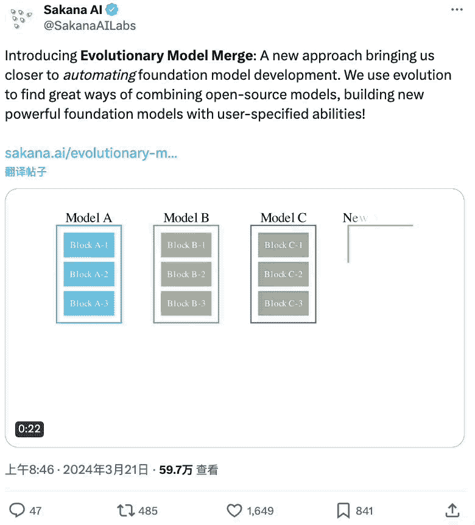
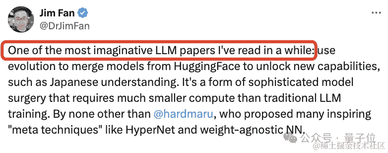
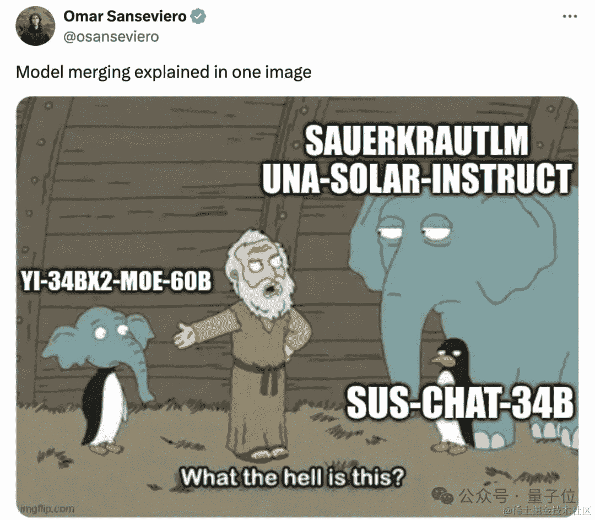
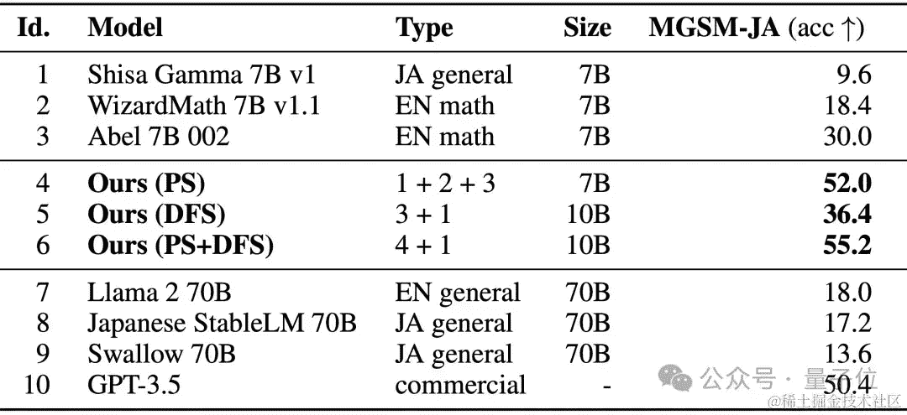
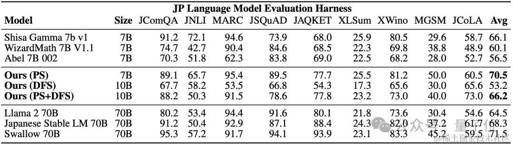
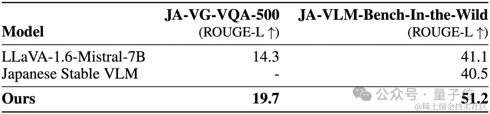
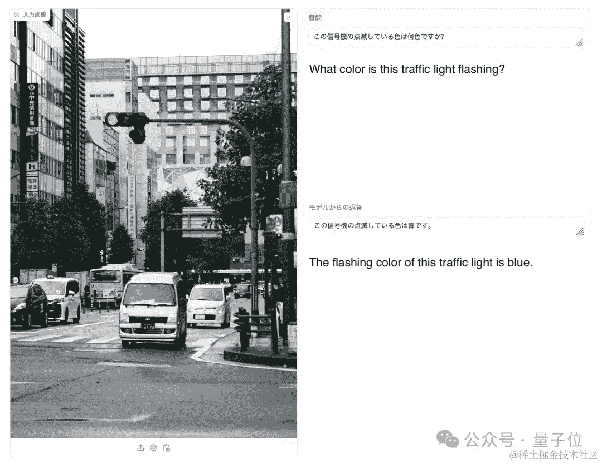

# 模型合并就进化，直接拿下SOTA！Transformer作者创业新成果火了

> 来源：[https://agijuejin.feishu.cn/docx/WoJsdafqvoE1xYxIZB6c9KxKnAd](https://agijuejin.feishu.cn/docx/WoJsdafqvoE1xYxIZB6c9KxKnAd)

英伟达科学家：最有想象力的论文

> 丰色 发自 凹非寺

> 量子位 | 👸号 QbitAI

**把 Hu**ggingface 上的现成模型拿来 “攒一攒”——

直接就能组合出新的强大模型？！

日本大模型公司 sakana.ai 脑洞大开（正是 “Transformer 八子” 之一所创办的公司），想出了这么一个进化合并模型的妙招。

**该方法不仅**能自动生成新的基础模型，而且性能绝不赖：

他们得到的一个 70 亿参数的日语数学大模型，直接在相关基准测试上取得了 SOTA，打败了 700 亿参数的 Llama-2 等前辈。

最重要的是，得出这样的模型**不需要任何梯度训练**，因此需要的计算资源大大减少。

英伟达科学家 Jim Fan 看完大赞：

> 这是我最近读过的最有想象力的论文之一。

从开源大模型排行榜上表现最好的模型，大多不再是 LLaMA 或 Mistral 这种 “原始” 模型，而是一些微调或合并模型之后，我们就能看出：

一种新的趋势出现了。

Sakana.ai 介绍，开源基础模型很容易在数百个不同的方向上进行扩展和微调，然后产生在新的领域表现出色的新模型。

而在这之中，**模型合并**显现出了巨大前景。

但，它可能是一种 “黑魔法”，严重依赖直觉和专业知识。

因此，我们需要更为**系统性**的方法。

受自然界的自然选择启发，Sakana.ai 盯上了进化算法，引入 “进化模型合并”（Evolutionary Model Merge）的概念，提出一种可以发现最佳模型组合的通用方法。

该方法结合了两种不同的思路：

（1）合并数据流空间（层）中的模型，以及（2）合并参数空间（权重）中的模型。

具体而言，第一种数据流空间方法是通过进化来发现不同模型层的最佳组合，以此形成新模型。

在社区以往的做法中，都是靠直觉来确定如何以及模型哪些层可以与另一个模型的层结合。

但其实，Sakana.ai 介绍，这个问题有一个组合数量巨大的搜索空间，最适合由优化算法如进化算法来搜索。

其操作示例如下：

至于第二个参数空间方法则混合多个模型权重来形成新模型。

这种方法其实很无数种实现，再加上混合的每一层原则上可以使用不同的混合比例，就更多了。

而这，利用进化方法就可以有效地找出更为新颖的混合策略。

以下是将两个不同模型的权重进行混合得到新模型的操作示例：

将以上这两种方法合并，就是这样的：

作者介绍，他们希望在相距较远的领域，例如数学和非英语语言、视觉和非英语语言，来组成之前大家不曾探索过的新兴组合。

结果，还真有点让人惊喜。

用以上进化合并方法，团队得到了 3 个基础模型：

+   **大语言模型 EvoLLM-JP**

由日语大模型 Shisa-Gamma 和数学大模型 WizardMath/Abel 合并而成，擅长解决日语数学问题，进化了 100-150 代。

+   视觉语言模型 EvoVLM-JP

日语大模型 Shisa Gamma 7B v1+LLaVa-1.6-Mistral-7B，是具有日语能力的 VLM。

+   图像生成模型 EvoSDXL-JP

支持日语的 SDXL 扩散模型。

前两个已在 Hugging Face 和 GitHub 上发布，最后一个也即将推出。

具体来看。

**1、EvoLLM-JP**

它在 GSM8K 数据集的多语言版本——MGSM 的日语评估集上取得成绩如下：

可以看到，EvoLLM-JP 用日语解决数学问题的表现超过了它们的原始模型，也超过了 Llama-2、GPT-3.5 等高性能模型。

其中模型 4 是仅在参数空间进行了优化，模型 6 是使用模型 4 在数据流空间中进一步优化的结果。

在既评估数据能力也评估一般日语能力的日语 lm-evaluation-harness 基准上，EvoLLM-JP 则在 9 个任务上的平均得分最高达到了 70.5——只用 70 亿参数，它就打败了 700 亿的 Llama-2 等模型。

团队表示，EvoLLM-JP 已经足够优秀，可以作为通用日语大模型，并解决一些有趣的例子：

比如需要特定日本文化知识的数学问题，或者用关西方言讲日本笑话。

**2、EvoVLM-JP**

在以下两个图像问答的基准数据集上，分数越高，代表模型用日语回答的描述越准确。

结果，它不仅比其所基于的英语 VLM LLaVa-1.6-Mistral-7B 更出色，也比现有的日语 VLM 更厉害。

如下图所示，在回答图中的信号灯为什么颜色之时，只有 EvoVLM-JP 答对：蓝色。（日本的习俗就是把红绿灯称为红蓝灯）

**3、EvoSDXL-JP**

这个支持日语的 SDXL 模型只需 4 个扩散模型即可执行推理，生成速度相当快。

具体跑分还没出来，但团队透露也是 “相当有希望的”。

可以欣赏一些示例：

提示词包括：味噌ラーメン、最高品質の浮世絵、葛飾北斎、江戸時代。

对于以上 3 个新模型，团队指出：

原则上，我们可以采用基于梯度的反向传播来进一步提高以上这些模型的性能。

**但我们不用**，因为现在的目的就是表明，即使没有反向传播，我们仍然可以得到足够先进的基础模型，挑战当前的 “昂贵范式”。

对此，网友们纷纷点赞。

Jim Fan 也补充：

在基础模型领域，目前社区几乎完全专注于让模型去学习，而不太重视搜索，但后者在训练（也就是本文提出的进化算法）和推理阶段其实都有巨大的潜力。

所以，如网友所说：

我们现在已经处于模型的寒武纪大爆发时代了吗？

论文地址：

arxiv.org/abs/2403.13…

参考链接：

[1]sakana.ai/evolutionar…

[2]twitter.com/DrJimFan/st…

[3]twitter.com/SakanaAILab…