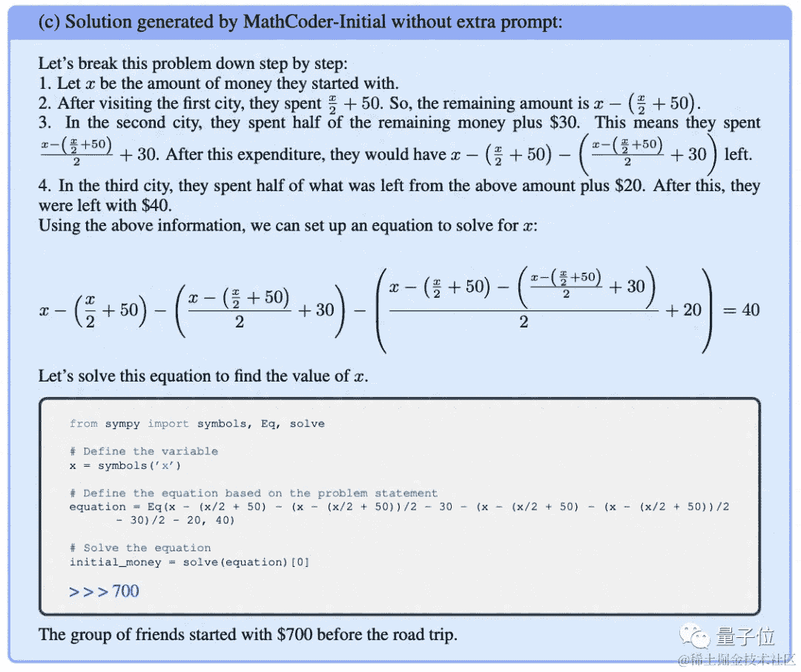
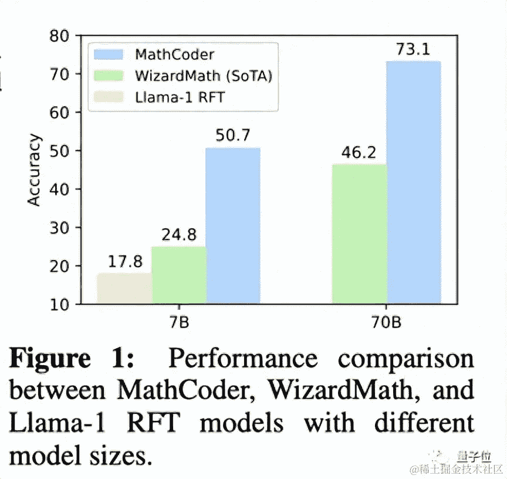
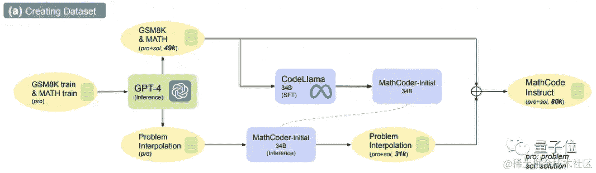
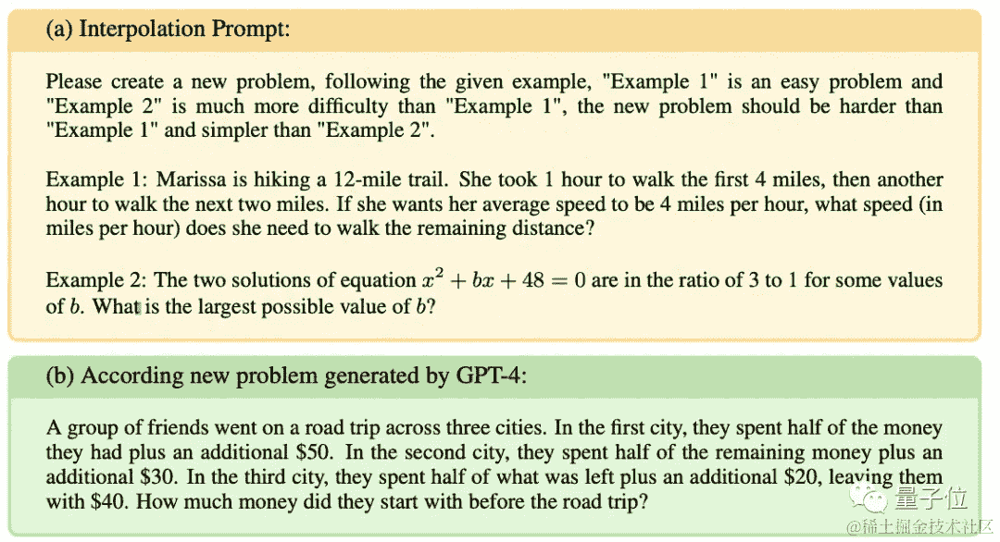
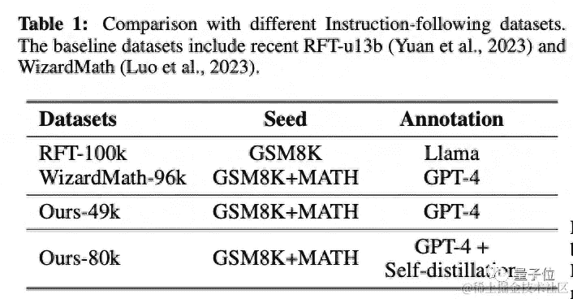
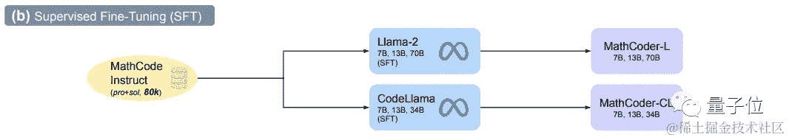
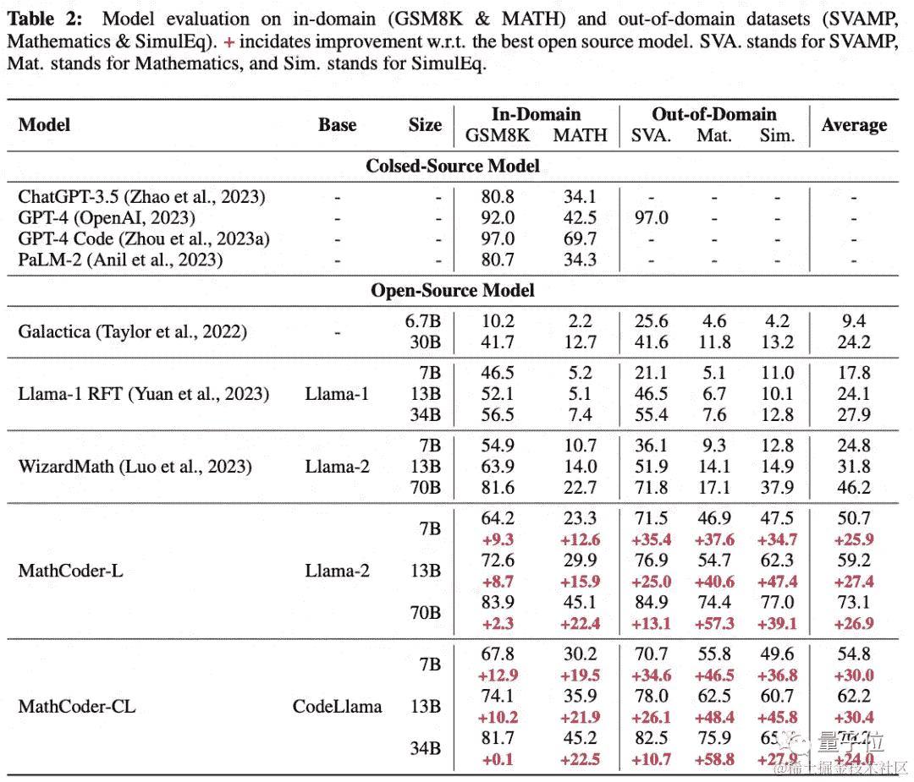
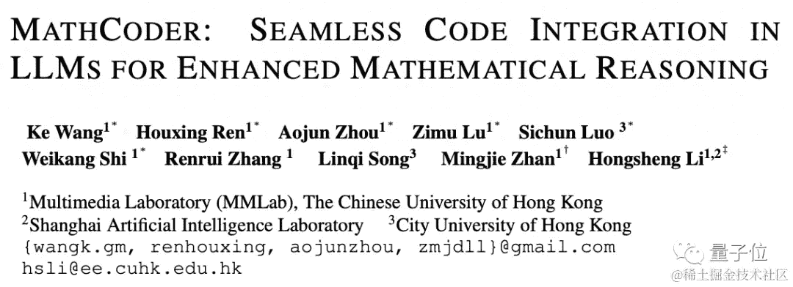

# 对标GPT-4代码解释器！港中大让模型写代码解决数学难题，得分超越GPT-4

> 来源：[https://agijuejin.feishu.cn/docx/F1DRdcJGuoiUqzxenxWcxYU3nJe](https://agijuejin.feishu.cn/docx/F1DRdcJGuoiUqzxenxWcxYU3nJe)

对标 **GPT-4 代码解释器**，港中大最新研究放了个 “大招”：

他们开发了一个叫做 MathCoder 的大模型，数学能力直接在竞赛级 “题库”Math 上超过 GPT-4。

△ 形象为羊驼是因为 MathCoder 底层模型来自羊驼家族

做到这一点靠的就是**无缝集成代码**的能力——

在遇到数学问题时，它不仅能用自然语言推理，还能自动编写和执行代码来建模、推导公式与方程。

这样的工作方式无疑和强大的 GPT-4 代码解释器一样。

在**实际评测中，MathCode**r 除了超过 GPT-4，还顺利在 MATH 和 GSM8K 两大数据集上取得了开源 LLM 中的 SOTA（打败了 8 月份才诞生的 WizardMath）

这个 “新王” 究竟是如何诞生的？

## 对标 GPT-4 代码解释器

总的来看，港大这项研究为了提高大模型的数学推理能力，学习了 GPT-4 代码解释器的优点和工作原理，提出了一种微调开源语言模型的方法。

该方法最终使大模型无缝集成代码，利用代码来解决数学问题。

**具体而言，他们首先提出了一个可以生成高质量数学题的数**据集：MathCodeInstruct。

该数据集由两部分组成：

种子数据（D0）：主要基于 GSM8K 和 MATH，并利用 GPT-4 收集答案。

插值数据（D1）：让 GPT-4 基于他们提出的一种叫做 “问题插值提示” 的方法生成。

如下图所示：

示例 1 和 2 分别来自于 GSM8K 和 MATH，1 简单，2 难一些，GPT-4 要做的 “插值” 就是生成比 1 难但比 2 更简单的新问题。

基于以上两类问题，最终 MathCodeInstruct 数据集一共收集了 8 万道数学题。

如下表所示，这比业内其他数据集规模稍小一些：

而与其他数据集相比，它的**特点之一**是同时弥补了 GSM8K 和 MATH 这两大重要数据集中不足的部分，给出了一些难度范围更广的问题，增强了数据集的泛化能力。

**特点之二**是数据集中的每道题目同时包含基于自然语言推理的部分 + 基于代码解决的部分（包括执行代码和代码输出结果）。

如下图所示，这是对上面 GPT-4 生成的 “插值” 问题的解决思路：

**在**数据集准备好以后，团队便提出了一种定制的监督微调和推理方法，最终在 Llama-2 和 Code Llama 上微调出了 MathCoder。

具体而言，该方法使用特殊的 token（<|text|>、<|code|>、<|execution|>）来识别训练数据集中哪一部分是自然语言、代码还是结果，让模型学习生成由这些特殊标记划分的自然语言和代码。

在推理期间，该方法还会将动态执行的结果附加到模型的先前预测中。

然后，继续基于这个新版本的输入自回归预测下一个 token，以及最后的执行结果。

作者表示，通过这种方式，模型将能够 “看到” 执行结果，并不断地继续推理。

最终，该方法使微调模型 MathCoder 以类似 GPT-4 代码解释器的方式运行。

在评测中，MathCoder 凭此直接在 MATH 和 GSM8K 这俩数据集上取得了 45.2% 和 83.9% 的好成绩。

**该成绩证明：**

其一，它超过了 ChatGPT-3.5 和 PaLM-2 等 9 个闭源模型，并在以数学竞赛题为主的 MATH 集上超过 GPT-4。

其二，它打败了此前数学领域里最强的开源模型 WizardMath，成为新的开源之最。

**不过其三，模仿但还未超**越，在这俩数据集上，MathCoder 还是与 GPT-4 代码解释器（69.7% 和 97% 高分）存在着一定的性能差距。

## 作者介绍

本研究一共 10 位作者，除了两位来自香港城市大学以外，其余均来自香港中文大学。

共同一作一共有 6 位，分别是：Ke Wang、Houxing Ren、Aojun Zhou、Zimu Lu、Sichun Luo 和 Weikang Shi。

通讯作者为李鸿升，为港中大电子工程系副教授，同时也就职于上海人工智能研究室。

论文地址：

arxiv.org/abs/2310.03…