# 字节“开盒”OpenAI所有大模型，揭秘GPT-3到GPT-4进化路径！把李沐都炸出来了

> 来源：[https://agijuejin.feishu.cn/docx/TF6Fdo8gPoxffexxcA3cIJ37nBb](https://agijuejin.feishu.cn/docx/TF6Fdo8gPoxffexxcA3cIJ37nBb)

GPT-3究竟是如何进化到GPT-4的？

**字节给O**penAI所有大模型来了个 “开盒” 操作

**结果还真摸清**了GPT-4进化路上一些关键技术的具体作用和影响。

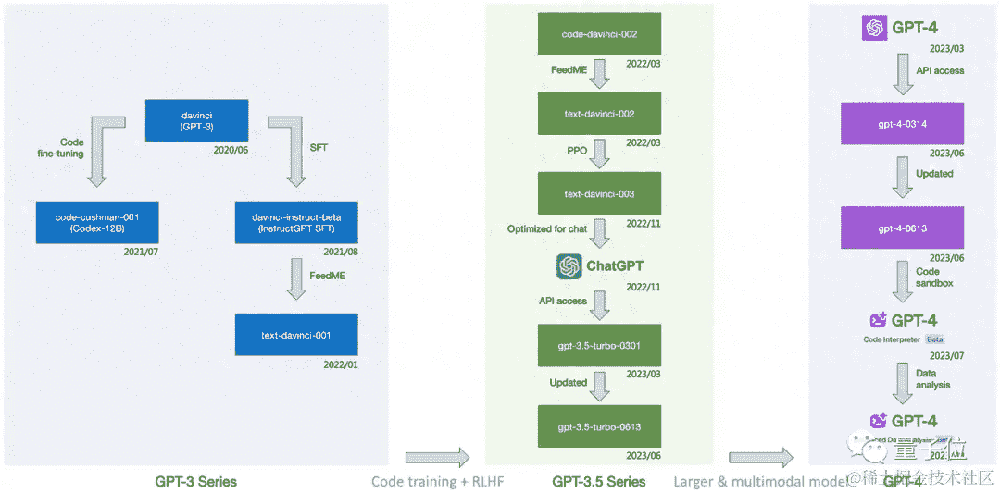

比如：

+   SFT是早期GPT进化的推动者

+   帮助GPT提升编码能力的最大功臣是SFT和RLHF

+   **在预训**练中加入代码数据则提升了后续GPT版本的各方面能力，尤其是推理……

创业后忙得不可开交的**AI大牛李沐**看完，也久违地出现在公众视野，并给这项研究点了个赞。

网友们更是盛赞：

> 这是迄今为止第一个充分开盒OpenAI所有模型的工作，respect。

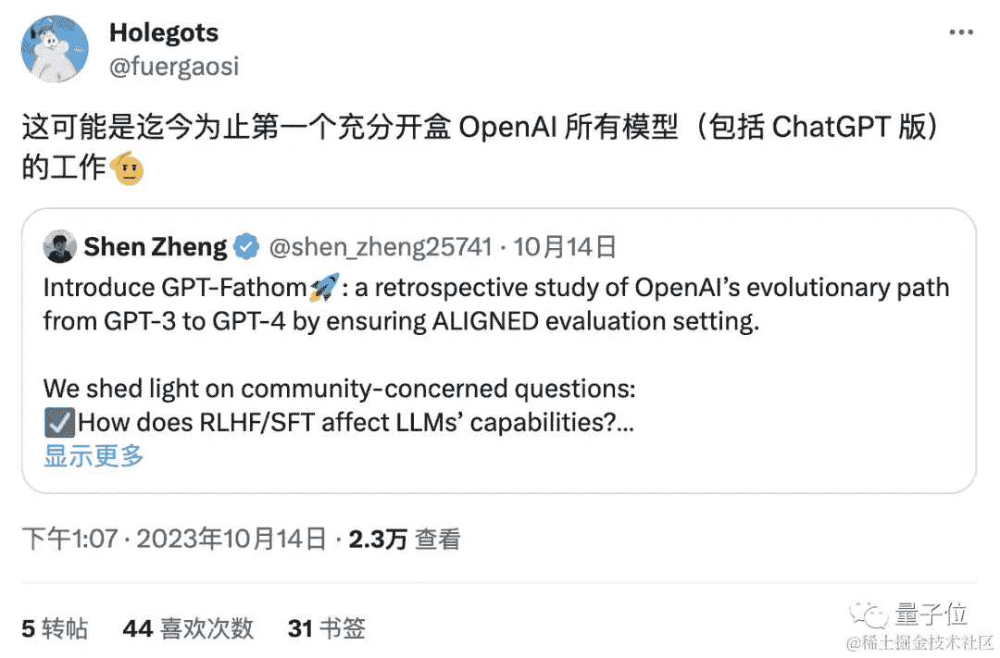

而除了一些新发现，它还坐实了一些已有猜想：

比如**GPT-4在变笨并非危言耸听**，这项评测发现GPT进化路上出现了明显的**“跷跷板现象”**，即模型进化过程中一部分能力提升另一部分下降。

这和网友此前的感受不谋而合。

如作者本人表示：

> 这项工作可以为GPT-3到GPT-4的演化路径提供宝贵的见解。

言外之意，通过它我们可以一窥GPT模型的“成功之道”，为接下来的大模型构建工作提供有效经验。

那么，具体它都“开”出了哪些东西，我们扒开论文来看。

## 探秘GPT-3到GPT-4进化之路

最开头的进化图由作者们根据公开信息总结得出。

可以看到，它标注了每一个中间模型是经过哪些技术（如代码微调、SFT/FeedME等）一路从最初的GPT-3进化到3.5再到如今的4。

这**些技术具**体起到了多大影响，从davinci到gpt-4-0613，字节对每代GPT的数学、编码、推理等7大能力全部测了个“底朝天”。

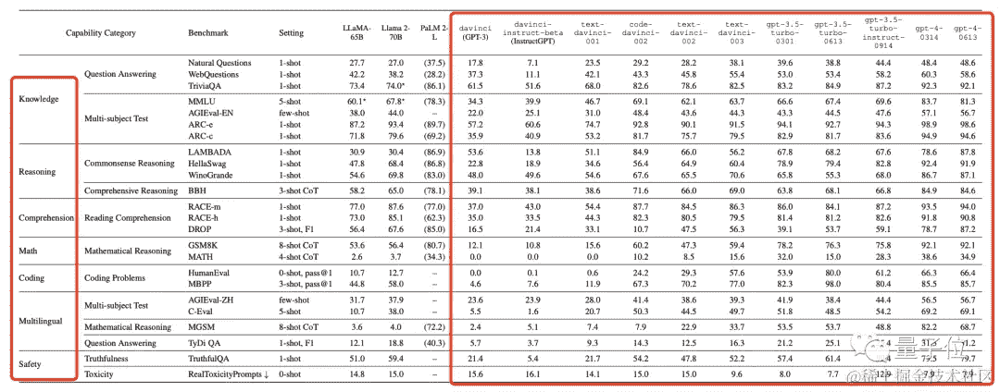

1.  SFT：早期GPT进化的推动者

首先，在GPT-3系列中，最初的davinci (GPT-3)通过监督微调SFT和其变体FeedME进化为了text-davinci-001。

这让后者在几乎全部任务上都获得了性能提升：

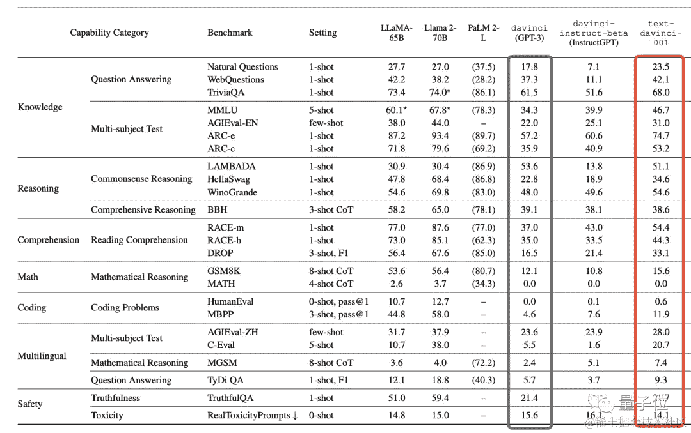

更直观的表现如下图所示（“粉圈”为进化后的text-davinci-001）。

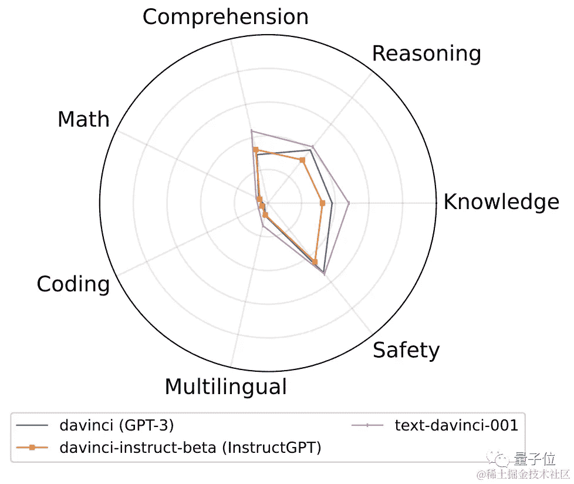

接着，GPT开始进入3.5系列，在该系列早期阶段，先**是最基础的co**de-davinci002采用同样的技术进化成text-davinci-002。

然而这一进化操作的效果属实不大，GPT的各项性能只有少数几个提升，更多是不增反减的。

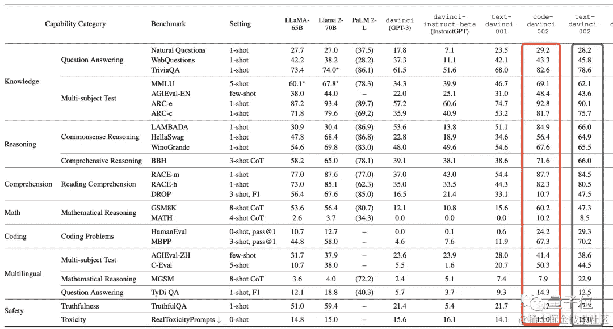

在此，作者引出他们的第一个结论，即：

SFT只在较弱的基础模型上管用，用在更强的模型上收效甚微。

类似现象在开源模型身上也可见（这个评测还测了Llama1和2、PaLM2-L、Claude 2等模型）：

在初**代Llam**a-65B之上，SFT成功提升了它在MMLU基准上的性能，但是，所有使用了SFT改进的Llama2-70B在Open LLM Leaderboard榜单上却只表现出微小的进步。

总结：在GPT3阶段，SFT技术对模型的进化起到了关键作用。

## 2、RLHF和SFT：编码能力提升的功臣

顺着GPT3.5系列接着看，从text-davinci-002开始，OpenAI开始引入新技术基于PPO算法的RLHF，得到text-davinci-003。

此时，它在大部分基准上的表现和前代模型持平或略变差，说明作用不是特别明显（在开源模型身上也是如此）。

但有一个除外：编码任务，最高足足增加了近30分。

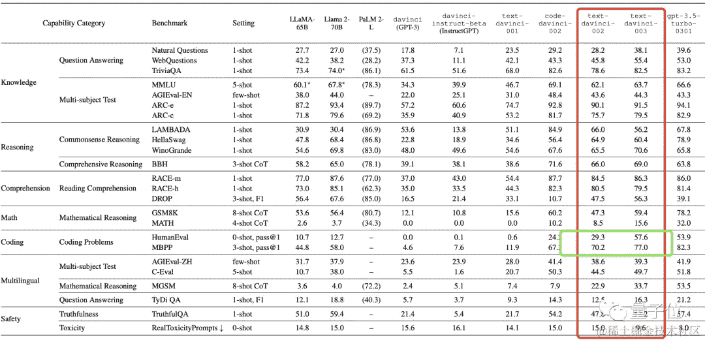

联想到前面code-davinci002采用SFT技进化成text-davinci-002造成整体性能下降时，编码任务也没受影响，反而还涨分了——

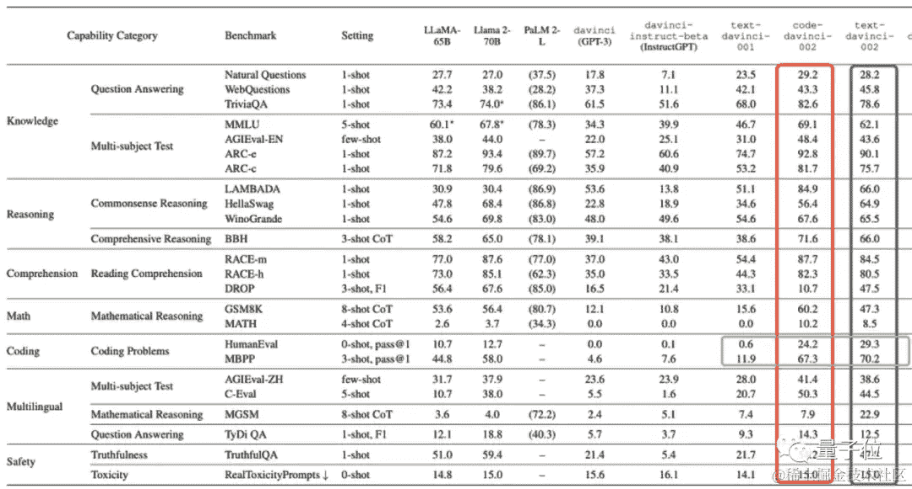

作者决定验证SFT和RLHF对大模型编码能力的影响。

在此，他们测量了几代GPT模型的pass@1（采样1次通过的概率）、pass@100（采样100次通过的概率）等分数。

结果是与基础模型相比，使用了SFT和RLHF技术的模型在pass@1上出现了大幅提升，而在pass@100上略有下降。

这说明啥呢？

作者解释：

pass@100刻画的是模型内在coding能力，而pass@1代表的是模型一遍过、bug-free的coding能力。

pass@100小幅下降表明SFT和RLHF在编码任务上和其它任务一样，仍然有所谓的对齐税（alignment tax）。

不过，SFT和RLHF能够将pass@100的能力学到pass@1上，即把内在能力（但需要很多次尝试）转化到一遍过、bug-free的coding能力，致使pass@1大幅提升。

而再仔细看结果，可以发现gpt-3.5-turbo-0301通过SFT和RLHF，大幅提升了pass@1，这对于小模型的性能优化是个好消息。

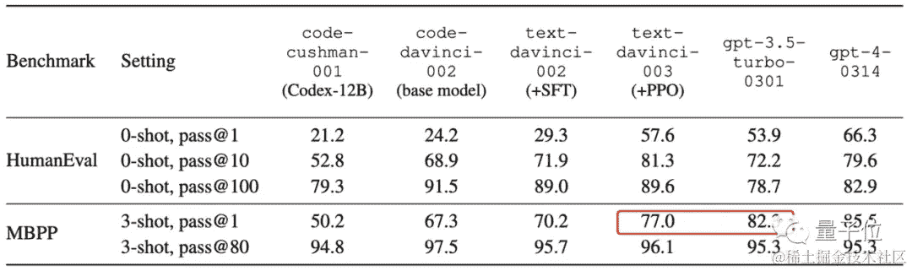

**这还没完，鉴**于作者之前观察到GPT-4在一些复杂推理任务上经过多次尝试才能解决问题。

他们结合上面的观察，总结为：

LLM仍可以通过SFT和RLHF，不断将内在能力（但需要多次尝试）转化成一次性解决问题的能力，不断逼近LLM的能力上限。

言外之意，GPT-4还可以更强。

## 3、代码加入预训练，对推理帮助最大

在GPT4进化之路上，还出现了2个特别的模型：

code-cushman-001 (Codex-12B) 和code-davinci-002。

前者是OpenAI初次尝试使用代码数据训练模型，尽管它的规模较小，但也取得了不错的代码能力。

后者是GPT3.5的基座模型，它是在GPT3的基础上使用RLHF+代码训练的结果，也就是文本和代码混合预训练。

可以看到，它大幅超越GPT-3（不止是编码能力）、在一些推理任务上（如BBH）表现甚至可以超过后面的gpt-3.5-turbo-0613。

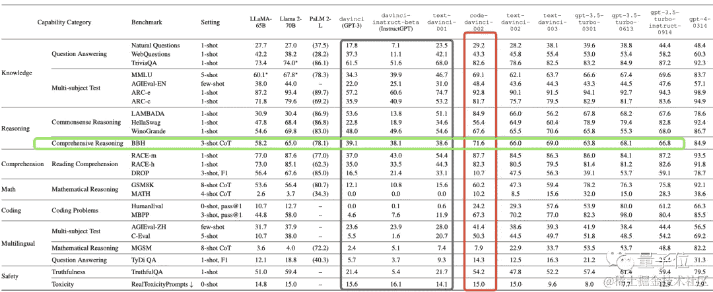

作者表示：

这表明预训练加入代码数据可以全面提升LLM的能力，尤其是推理能力。

## 4、“跷跷板”现象

通过比较2023年3月和2023年6月的OpenAI API模型，我们确实可以发现这一现象：

与gpt-3.5-turbo-0301相比，升级后的gpt-3.5-turbo-0613在HumanEval上表现出色（53.9 -> 80.0），但在MATH上却大幅下降（32.0 -> 15.0）。

gpt-4-0613在DROP上的表现优于gpt-4-0314 (78.7 -> 87.2) ，但在MGSM上也出现了直线下降(82.2 -> 68.7) 。

作者认为：

“跷跷板现象”可能成为LLM通往AGI之路的绊脚石，因为AGI强调“通用智能”，要在所有task上都有优异的性能，要求模型不能“偏科”。

在此，他们也呼吁社区重视这个问题，共同推进大模型平衡发展的研究。

## 帮助大模型从业者找到方向

以上这些发现，全部基于GPT-Fathom——

字节最新提出的一个大模型评测工具。

想必大家肯定疑问：

大模型排行榜和评测工具已经有很多了，为什么还要提出一个新的方法？

**作者介绍，相**比**已有的测评方式，**GPT-Fathom尺度更加统一，结果具有可重现性。

大模型从业者可以借助它来明确自己与领先模型的差距到底在什么地方，从而有的放矢地完善自己的产品。

具体来看，GPT-Fathom主要是解决了其他大模型评测方法的三个不足：

+   **setting标准不一致**：是否使用思维链（CoT）、样本数量等设置，以及答案评价方法没有统一标准

+   **模型和任务收集不完整**：测试关注的能力不全面，缺乏对早期模型的关注

+   **缺乏对模型敏感性的研究**

为了更直观体现GPT-Fatham的特点，作者对比了一些具体的现有榜单，可以总结成下面这个表格：

其中，对敏感性的评测就发现了此前的测试标准没能找出的问题。

相比于GPT，其他模型对提示词的敏感度很高，稍有变化就会导致输出截然不同，提示其他模型的鲁棒性和GPT之前还存在很大差距。

比如在TriviaQA数据集上，提示词的细微改变就让Llama 2-70B的得分下降四分之一，而GPT系列模型则没有明显变化。

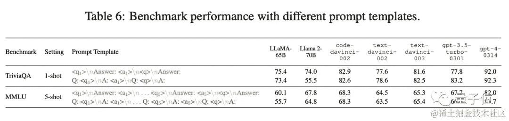

此外诸如CoT、样本数量以及采样方差等因素也都被包括进了敏感性测试当中。

未来，作者计划从能力种类、测试数据集和模型三个维度继续扩展GPT-Fathom，将支持多轮对话、多模态等能力的测评，以及增加对多个数据集和模型的测试。

GPT-Fatham的两位共同一作分别是字节公司应用机器学习研究组的研究人员张驭宇（Yuyu Zhang）和实习生Shen Zheng。

Shen Zheng是伊利诺伊大学香槟分校（UIUC）的一名硕士生。

此外，字节公司的Yijie Zhu等四名研究人员，以及UIUC的Kevin Chen-Chuan Chang教授也参与了这项研究。

论文地址：

arxiv.org/abs/2309.16…

参考链接：

github.com/GPT-Fathom/…