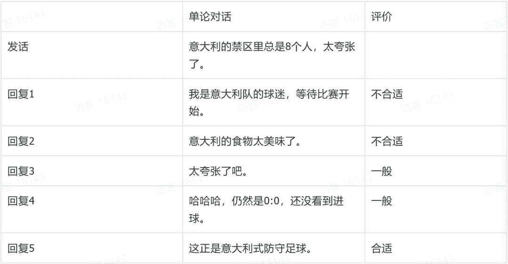
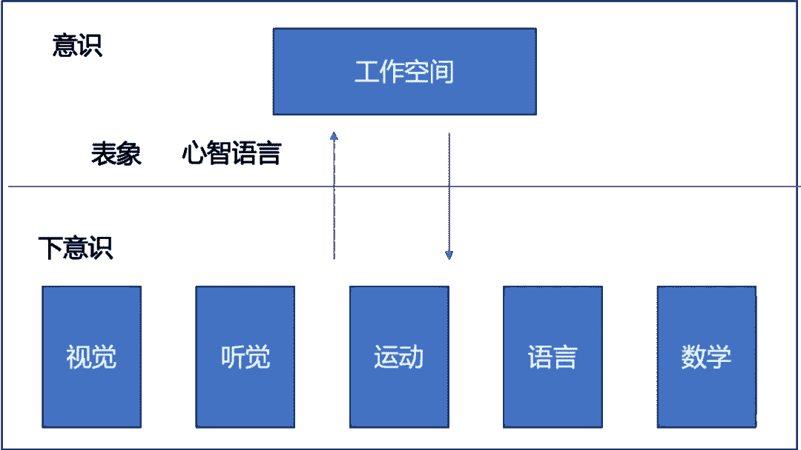
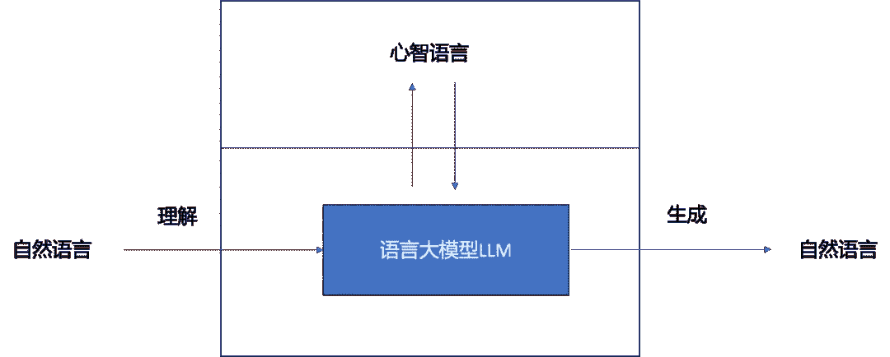
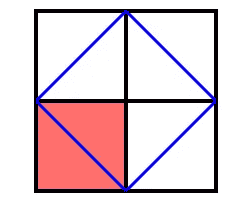

# 字节跳动李航：对语言大模型的若干观察和思考

> 来源：[https://agijuejin.feishu.cn/docx/KiP9dBvDVoEzoHxygxPcd8TFnPb](https://agijuejin.feishu.cn/docx/KiP9dBvDVoEzoHxygxPcd8TFnPb)

本文阐述笔者对 LLM 的一些看法，主要观点如下：

+   ChatGPT 的突破主要在于规模带来的质变和模型调教方式的发明。

+   LLM 融合了实现人工智能的三条路径。

+   LLM 的开发需要结合第三者体验和第一者体验。

+   LLM 能近似生成心智语言。

+   LLM 需要与多模态大模型结合，以产生对世界的认识。

+   LLM 本身不具备逻辑推理能力，需要在其基础上增加推理能力。

1.  **LLM 强大之所在****
1.1 LLM 的主要突**破
ChatGPT 和 GPT4 为代表的 LLM 有以下主要手段 [1][2]。

+   模型：Transformer 拥有强大的表示能力，能对具有组合性（compositinality）的语言进行很好的表示和学习。

+   预训练（pre-training）：使用大规模文本数据进行语言建模（language modeling），学习进行的是数据压缩，也就是单词序列的生成概率最大化或预测误差最小化。

+   监督微调 SFT（supervised fine tunning）：学习的是输入到输出的映射，X→Y,   或者是输入到输出的映射及产出过程  X, C_1⋯,C_n→Y，学习到模型的基本行为。这里，C_1⋯,C_n 代表思维链。

+   基于人类反馈的强化学习 RLHF（reinf**orcement lear**n**ing from human feedb****ack）：根据人**的反馈，调整模型的整体行为。
ChatGPT 和 GPT4，相比传统的深度学习技术，如 BERT，主要是在智能性和通用性上取得了巨大突破。具备语言、知识、简单推理能力，能够很好地近似人的智能行为。不需要标注数据就可以在不同领域完成不同任务，也就是进行零样本或小样本学习。
LLM 带来的巨大进步，所能产生的效果是之前我们大多数人都没有能预见到的。究其原因，一是使用大数据大模型大算力，规模带来了质的变化。ChatGPT 有 175B 参数，300B 的 token 做训练。而之前的模型参数规模超过 1B 的都不多。二是 Open AI 开发出了一套调教大模型的方法，包括基本步骤、技巧和工程实现。利用语言建模的机制将人的知识和能力输入给大模型。大规模系统的工程实现和模型的调教方法成了 Open AI 的核心竞争力。这一点可以从相关技术的演进过程中看出。
1.2 历史演进
ChatGPT 和 GPT4 技术的一个源头是生成式对话。
从 2012 年到 2017 年在华为诺亚方舟实验室我们对对话进行了研究，2015 年开发了领域第一个基于序列到序列 seq2seq 的生成式对话系统 Neural Responding Machine [3]。当时的序列到序列模型还是基于 LSTM 的。但是即使是这样的模型，也能生成自然的中文。表 1 给出生成的对话例子。使用 4 百万🧣数据训练的 7 千万参数的这个模型，对给定一个发话，可以生成一个回复，形成一轮对话。表中给出 top 5 的几个回复。可以看出有些回复是合适的，有些是不合适的。

1.  
为解决序**列到序列有时产****生不合理结果的问题，我们于 2**017 年开发了基于深度强化学习的方法，对序列到序列 seq2seq 的学习结果做进一步的调优 [4]。与 RLHF 有相同的算法，先学习奖励模型，然后基于策略梯度，调节整个序列到序列模型（策略模型）。模型也是基于 LSTM 的。当时的研究发现，加上深度强化学习的微调，可以把序列到序列的生成结果做得更好。
Google 的研究团队于 2017 年发表了 Transformer 模型。序列到序列的生成开始转向使用 Transformer。由于 Transformer 强大的表示和学习能力，生成式对话的效果有了大幅度的提升，也从单轮对话的生成逐渐发展到多轮对话的生成。
2018 年 Open AI 团队发表了 GPT-1 模型。其基本想法是，先训练一个基于 Transformer 的大规模语言模型，在其基础上通过有监督的微调 SFT 方法，学习序列到序列模型，把自然语言的理解和生成任务都转化为序列到序列生成的任务，在一个模型上实现所有的任务，包括生成式对话。之后又于 2019 年发表了 GPT-2，2020 年发表了 GPT-3，逐步发展到 ChatGPT 和 GPT-4。
传统的相对小的生成式模型也可以生成自然的人类语言，甚至是基于 LSTM 的。因为学习的目标是单词序列的预测误差最小化。但生成的自然语言所描述的内容有很多在现实中是不会发生的或者不合理的，也就是有严重的幻觉（hallucination）。而大规模语言模型，由于学习手段和规模，其生成的自然语言所描述的内容，在现实中是很容易发生的，甚至是合理的，幻觉现象也得到比较有效的控制。
ChatGPT 之前，业界开发出了一系列的生成式大模型，做生成式对话等任务。整体观察的现象是能更好地完成各种任务，但是能力都没有能够达到 ChatGPT 的水平。仔细阅读 GPT-3 [5] 和 InstructGPT 的论文 [1]，认真观察 ChatGPT 等各种 LLM 的结果，让人感到 Open AI 的核心竞争力是他们开发了一整套语言大模型的调教方法和工程实现方法。调教方法包含预训练、SFT、RLHF 等基本步骤，更重要地，包含高质量大规模数据的准备，将数据一步步喂给模型的训练细节。
LLM 的特点
2.1 结合了人工智能三条路径
实现人工智能可以考虑到以下三条路径：

1.  输入经验知识：人将知识通过规则等形式教给计算机，让计算机进行智能性处理。

1.  实现人类大脑：解明人脑的机制，基于相同的原理实现人类智能。

1.  从数据中学习：通过数据驱动机器学习的方法模拟人类智能。

1.  实现人工智能的三条路径
人工智能**传统的符号处理属于第 1 条路径。机器学习****属于第 3 条路径。深度学习是**受人脑启发**的机器学习，属于第 3 条路****径，但也借鉴****了第 2 条路径。
第 1 **条路径最容易想到，**但是人工智能的历史证****明，它有很大**的局限性。第 2 条路径依赖于脑科学的进步，目前研究进展缓慢，也是非常困难的。第 3 条路径看上去不是很直接，但是是目前实现人工智能的主要手段。
笔者认为 LLM 主要属于第 3 条路径，但也借鉴了第 2 条路径，兼具第 1 条路径的特点，因为 LLM 是深度学习，模型中的知识和能力是人通过精选的数据和巧妙的训练方法授予的。三条路径的融合使 LLM 成为当前实现人工智能的最强大手段。
2.2 第三者体验和第一者体验
对外部世界的认识和理解，我们可以站在第三者的角度，观察现象，总结规律，分享结果，属于第三者体验（third person expeirence）。科学是在第三者体验基础上建立起来的。我们每个人的内心感受和想法是自己的精神活动，很难与他人分享，只能大概描述，属于第一者体验（first person experience）。
可以认为符号处理是基于开发者第一者体验的，而机器学习是基于开发者第三者体验的。比如，围棋大师总结下棋的经验，定义规则，在其基础上开发围棋系统，就是基于第一者体验的。观察围棋大师下棋，从其下棋数据中自动学习规律，开发围棋系统，就是基于第三者体验的。
有趣的是，LLM 的开发基于第三者体验，也结合第一者体验。因为模型是基于深度神经网络，使用大规模数据，通过预测误差最小化的方式学到的，这些都可以认为是基于第三者体验的。但是在学习过程中的数据收集，数据清洗，数据标注，以及在推理过程中使用的提示（prompt），上下文学习（in context learning），都需要开发者基于自己的经验，有效地将知识和能力提供给模型，这应该看作是基于第一者体验。这一点与其他的机器学习有本质的不同。这也就意味着开发 LLM，既需要能够观察数据和模型的统计指标，比如 scaling law，又要能够站在使用者的角度准备数据，调教模型。而后者的技巧需要很多观察和摸索才能掌握。
2.3 LLM 的优点和局限
LLM 在一定程度上解决了通用性问题，进一步提高了智能性。大数据、大模型返回的结果大概率是现实中应该发生的而且是合理的。开发者通过预训练、SFT、RLHF、Prompt 等方式，调教模型，可以大大提高模型的能力。
LLM 已经非常强大。但也有大家指出的明显需要解决的问题：如何优化模型，也就是降低训练和使用成本，同时扩大可处理问题的规模。如何保证模型生成内容的真实性，也就是避免幻觉。如何构建可信赖大模型，也就是保证模型生成结果的有用性，安全性等。
笔者在 ChatGPT 出现之前，曾经指出深度学习需要更多地借鉴人脑的处理机制，需要更多的理论指导 [6]。这在 LLM 时代也依然是成立的。LLM 规模已经极其庞大，可能需要新的理论，对模型的能力进行分析和解释。当模型达到一定规模以后，整个系统的 Dynamics 呈现了完全不同的规律，需要进一步研究。
重要研究课题
总结起来，LLM 时代有以下重要研究课题。

+   LLM 的优化

+   LLM 的真实性

+   可信赖 LLM 与 AI 伦理

+   LLM 的理论

+   多模态大模型

+   LLM + 逻辑推理

+   智能体（agent）

1.  **面向未来，多模态大模型、****LLM 加逻辑推理、智能**体等都是重要的研究课题。下面重点讨论前两个课题。
从人类智能角度看 LLM
4.1 人脑、心智、意识
人脑是一个巨大的神经网络，推测有 1 千亿个神经元，1 千万亿个突触。脑神经网络由诸多去中心化（decentralized）的子网络组成，每个子网络负责一个特定的功能，子网络之间有一定的连接。神经网络进行的是并行处理，处理速度快，在下意识中进行。人脑神经网络的一部分被激活时产生某种状态，称作神经表示（ neural representation）。
心智（mind）是我们每个人体验的内心的感知和认知，既有意识的部分又有下意识的部分，主要是意识层面的。目前脑科学的一个有利假说是，意识是人脑整体信息同步的机制，信息同步在工作空间（workspace）中进行 [7]。意识中的信息处理是串行处理，处理速度慢。
具身认知论（emboddied cognition）认为，在人的思维过程中，在意识中的处理产生的是表象（image），心智计算论（computational theory of mind）认为意识中的处理产生的是心智语言（mental language, mentalese）[8]。目前没有定论，本文根据需要，同时借用两者的观点。

图 2 人脑和心智的组成**

图 2 给出了人脑和心智**的组成。下意识中的脑（神经网络）分成不同的脑区负责听觉、视觉、运动、语言，数学等功能。意识得到下意识神经网络处理的结果，通过心智语言表示出来，或者产生表象，在工作空间里进行各种处理。

心智语言是认知科学家福多、平克等提出的假说。一个重要特点是，自然语言是有歧义的，而心智语言没有歧义。当我们理解某一个概念的时候，脑中唤起所有相关的多模态信息进行消歧处理，得到心智语言的表示。

4.2 LLM 的统一实现

目前为止，自然语言处理有六个大的任务，包括分类、匹配、标注和语义分析、序列生成、序列到序列、序贯决策。

+   分类：从文字序列到标签的映射，如文本分类。

+   匹配：文字序列与文字序列的匹配，如搜索、阅读理解。

+   标注和语义分析：文字序列到标签序列或结构表示的映射，如分词、词性标注、句法分析。

+   序列生成：文字序列的生成，也就是基于语言模型的生成。

+   序列到序列（seq2seq）：文字序列到文字序列的转化，如机器翻译、生成式对话、摘要。

+   序贯决策：基于已有的文字序列产生新的文字序列，如多轮对话。

前三个是语言理解任务，后三个是语言生成任务。理解任务的输出是类别标签等，可以认为是心智语言的表示。

所有的任务都可以用序列到序列 seq2seq 模型实现。语言理解是自然语言到心智语言的 seq2seq。语言生成是心智语言到自然语言的 seq2seq。语言转换是一种自然语言到另一种自然语言的转换。

GPT3、ChatGPT 等用大量文章数据做预训练，然后用 seq2seq 数据做微调，但 seq2seq 数据也转换成序列数据的形式 [seq:seq]，即把两者拼接起来。注意 ChatGPT 等在生成的时候并不区别是自然语言还是内部表示。内部表示也可以是程序代码。

1.  图 3 LLM **实现所有自然语言处理****任务
图 3 描述基于 LLM**** 的语言理解，语言生**成，语言转**换（翻译）的 LL****M。比如，思维链（c**hain of thought）就可以认为是心智语言的内容。基于 LLM 的语言理解就是把自然语言转化为心智语言。注意：心智语言应该是没有歧义的，而用 LLM 生成的内容，包括思维链，经常是有歧义的。
所以，可以认为 LLM 用于语言理解时生成的内容是心智语言的近似。自然语言表示心智语言的好处是人们可以很容易定义和标注数据，如思维链数据，但是缺点是不能保证不产生歧义。6.1 节有一个数学解题的例子，也可以用程序表示心智语言，就没有歧义的问题。
LLM 与多模态处理
5.1 人的语言理解和世界理解
人的语言理解可以从两个角度定义，一个是概念，另一个是功能。如果是概念，理解一个词语或者是一句话，意味着把记忆中的相关概念和事件唤起，并把它们联系起来，这是在意识中产生表象或由心智语言的表示。理解的结果产生语义落实（grounding），是没有歧义的。因为人脑在理解中做了消歧。
有很多证据表明，人的语言理解过程是通过视觉、听觉等多模态处理进行的。概念相关的视觉、听觉表征分别记忆在视觉、听觉的脑区。当相关概念被唤起的时候，在意识中产生多模态的表象。比如，被问到「大猩猩是不是有鼻子」时，要回答这个问题，我们脑子里会展现出大猩猩的视觉表象。
另一方面，人对世界的理解也是通过语言的。人通过视觉、听觉、触觉、味觉、嗅觉从外界环境获取信息。世界理解通常是将多模态信息与语言联系到一起的过程。在这个过程中也会在意识中产生表象或心智语言的表示。比如，看到桌子上的物体，会识别是「杯子」，「圆珠笔」等。
5.2 多模态大模型
大家关注的一个问题 LLM 是否实现了人的语言理解，LLM 是否建立了世界模型。笔者的回答：是也不是。
LLM 建立的对世界的认识完全是基于语言的，从语言数据中学习，将学到的知识存储于语言模型。所以当问到关于世界的任何问题，LLM 都能回答，虽然有时是有幻觉的。知识的存储的方式也与人不一样，不是基于实体和概念，而是存储在 Transformer 参数之中。
可以预见，当 LLM 和多模态大模型结合时，就能产生与人更接近的世界模型。这时知识也会通过实体和概念等联系起来。特别是未来，机器人能通过与世界互动，获得具身的多模态信息时，其产生的多模态大模型就应该能更接近人类的世界模型。注：世界模型并没有大家都接受的严格定义。
因此，多模态处理应该是 LLM 之后未来人工智能发展的重要方向。多模态研究最近也有很多进展。比如，视觉语言模型（vision language model）方面，Open AI 开发的 CLIP 模型是视觉语言对齐上最有代表性的模型。字节跳动也开发了 X-VLM 模型，在细粒度的多模态理解任务上有最好的表现 [9]。
LLM 与数学能力
6.1 人的数学能力
数学能力包括几种能力，有逻辑推理、算术计算、代数计算、几何概念理解等。

+   数学能力：从哲学角度看
在西方哲学中，数学一直被认为是一种人类天生具有的独立的能力。
亚里士多德认为哲学理论可以分为数学、自然学（physics）和形而上学 (metaphysics)。在古希腊，数学被认为独立于「科学」的学科，因为其抽象性和逻辑性。

图 4  将 2×2 的正方形面积扩大一倍的方法

柏拉图在《美诺篇》中介绍了苏格拉底与一位奴隶少年的对话。苏格拉底通过不断提问的方式，引导奴隶少年解决了如何把一个 2×2 的正方形的面积扩大一倍的数学问题（见图 4）。苏格拉底试图证明，人的数学思维能力，更一般地，人的理性是生来具有的。

康德在《纯粹理性批判》中主张人的推理能力是先天的，他称之为先验综合判断，其中包括数学推理，比如计算 5+7=12。

+   **数学能力：从脑科学角度看**
近年脑科学和认知科学的研究发现，人的数学基本能力是先天的，如基本的计算能力。数学思维主要涉及一些特定的脑区 [9]。
有这样的实验，4 个月的儿童，让他们看到把一个球滚到屏风后面，再滚一个球过去，当把屏风挪开的时候，如果他们看到的留下的不是两个球而是一个球，都会露出非常吃惊的表情。说明他们知道 1+1=2。
递归运算是数学的核心能力，猜测是人天生就有的。脑科学家发现人脑顶叶有一个脑区，其主要功能是数学思维，具体的机理仍不清楚，需要今后进一步研究。
当然不是所有的数学能力都是先天的，也有后天习得的数学能力。研究发现，数学家的部分视觉脑区在后天的学习过程中被再利用于数学 [10]。

+   数学思维：科学家的自省

**

数学思维会经常上升到意识。****科学家们经常把自己的数学思维过程描述为意识中的与数****学相关的表象的操作过程，这些**表象与数学概念密切联系在一起。对应着大脑神经网络怎样的计算尚不清楚。

爱因斯坦曾这样反思自己的数学思维过程，「词汇或者语言，无论是书面形式还是口头形式，似乎在我的思维中并没有发挥任何作用。作为思维元素的实体是某些符号和或多或少清晰的表象，可以自发地复制和组合。而且，这些元素和相关的逻辑概念之间存在一定的联系。」

6.2 LLM 用于数学解题

LLM 本身具备类推推理（analogical reasoning）的能力，但不具备逻辑推理（logical reasoning）的能力（逻辑推理是指基于三段论的推理）。因此，LLM 可以做一些简单的数学计算、数学解题。对比于人，相当于用死记硬背的方法做数学。虽然 GPT4 展现出了非常强的数学解题能力，求解复杂的数学问题应该还需要其他机制。

一个想法是 LLM + 逻辑推理的数学解题。用 LLM 理解数学问题的题意，将其转换为心智语言，在心智语的基础上进行逻辑推理和数学计算。逻辑推理和数学计算调用其他的数学计算机制。

人的数学解题有两种机制，分别使用心理学称作的系统 1 和系统 2，进行快的思维（基于死记硬背）和慢的思维（进行深入思考）。用 LLM 直接解题，对应着系统 1。用 LLM 产生心智语言，在心智语言的基础上进行解题，对应着系统 2。

在字节跳动，我们去年提出了神经符号处理方法，结合神经处理和符号处理，用于自然语言理解任务。也是基于相同的思想结合系统 1 和系统 2 的机制 [11]。这套方法既可以用于数学解题，又可以用于自然语言理解。

6.3 程序语言作为心智语言

上述基于 LLM 的数学解题和自然语言理解方法中，一个自然的想法是用程序语言表示心智语言。这是因为 LLM 一般使用程序训练，也能生成程序。

我们最近做了大规模的实验，验证了 Python 程序比英语（自然语言）作为 “心智语言”，在数学解题中更有优势的事实 [12]。这个方法的一个优点是，LLM 理解题意后，得到的程序可以直接通过解释器执行，验证解题步骤的正确性。在 Python 程序上进行推理，也比在自然语言上进行推理更为容易。