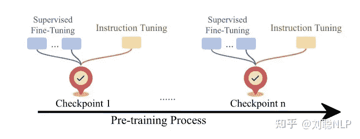
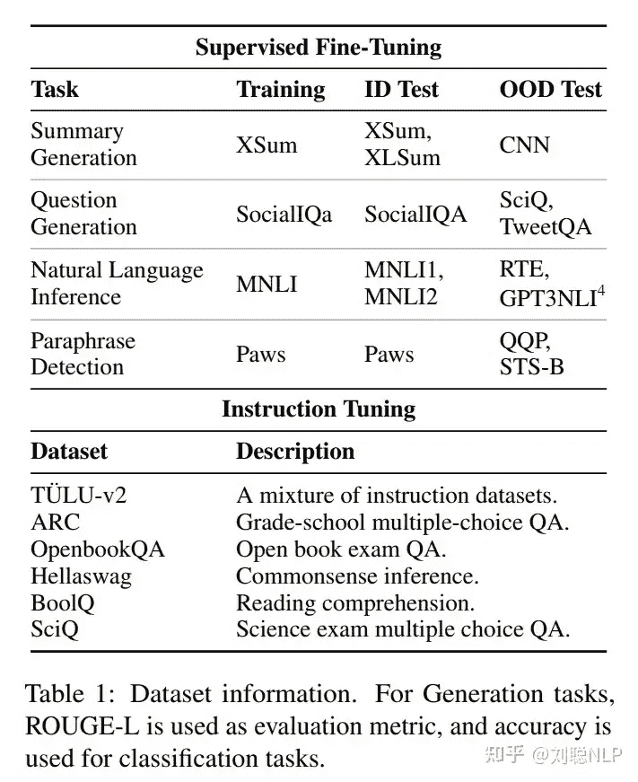
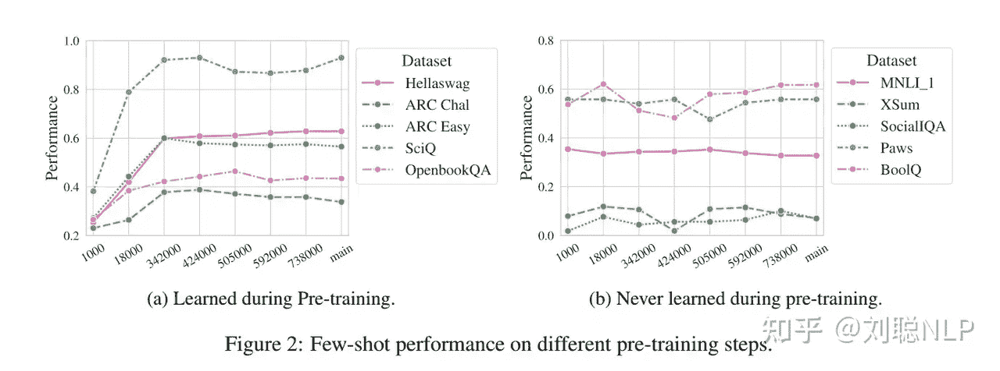
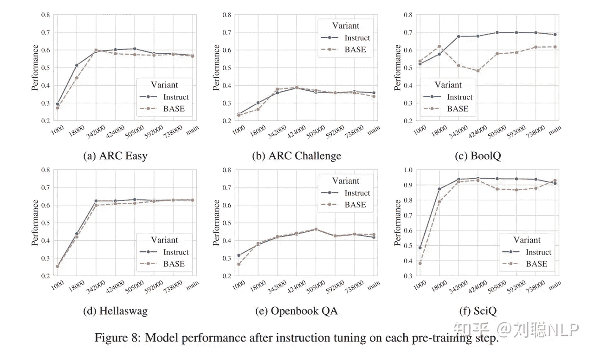
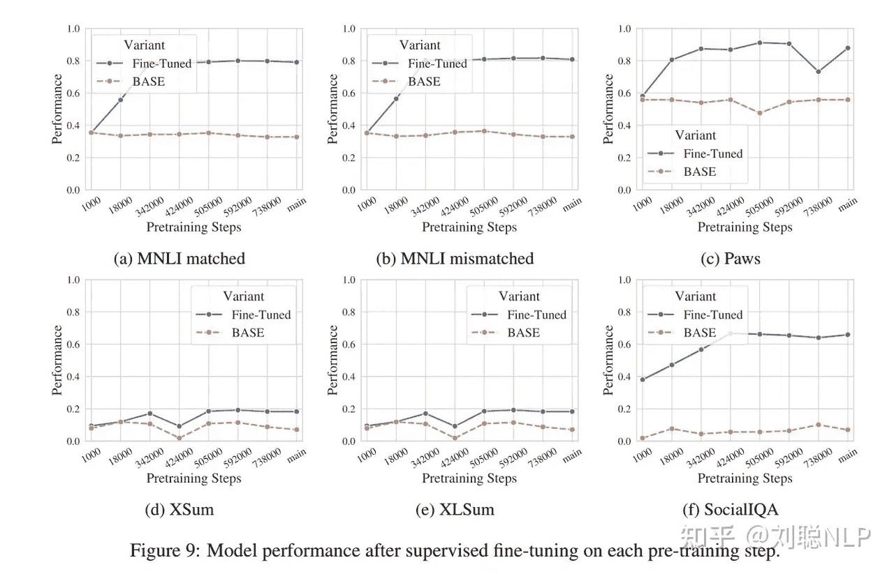
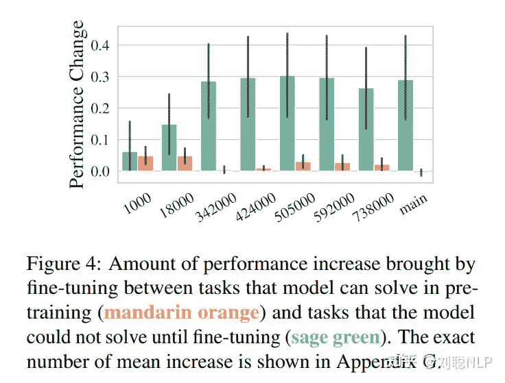
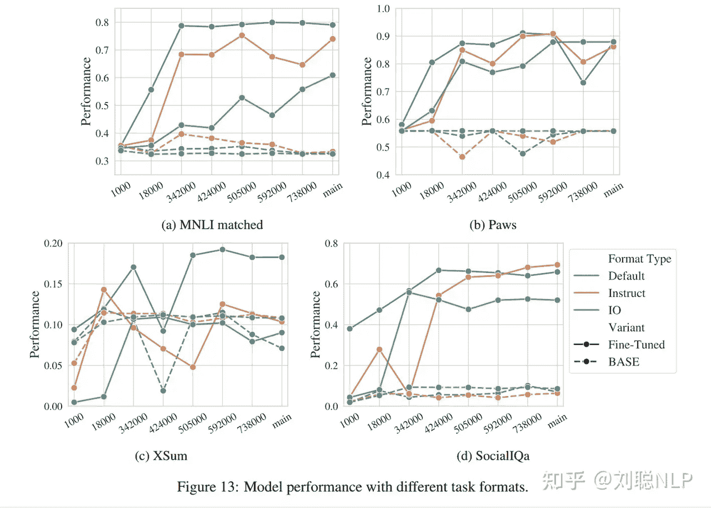
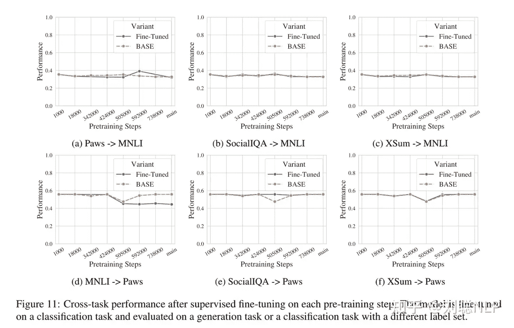
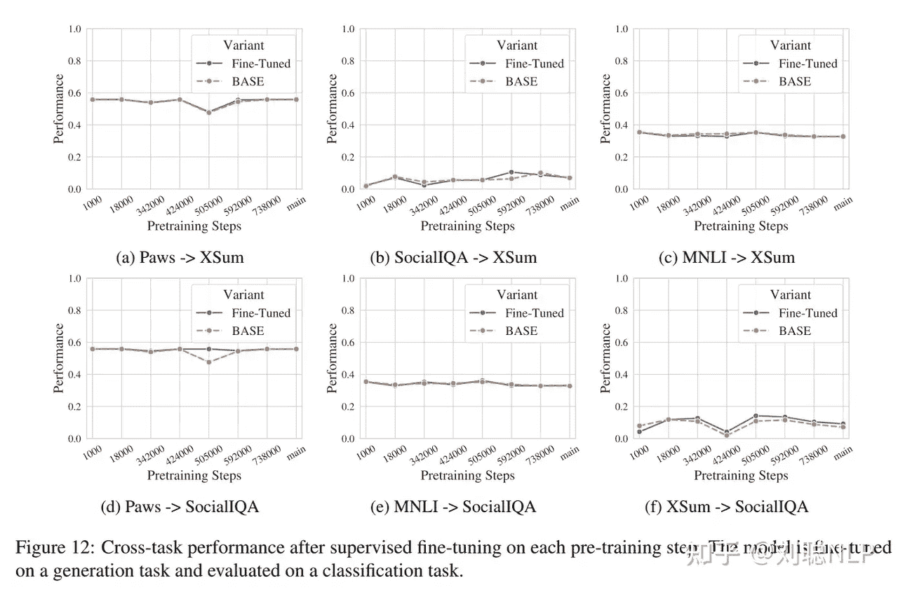
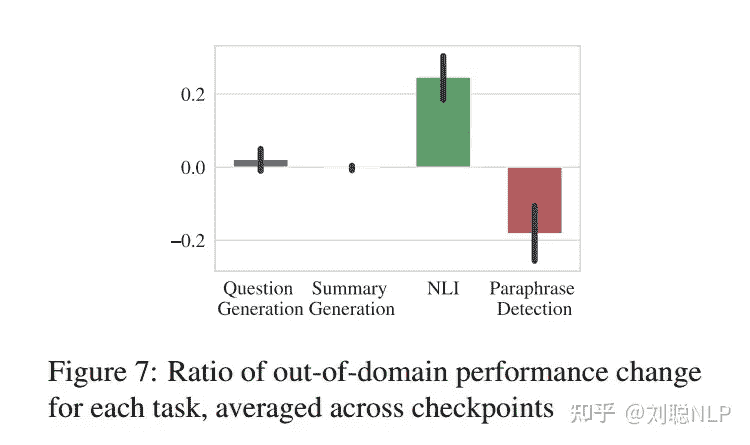

# 探讨大模型预训练与微调之间的相互作用

> 来源：[https://agijuejin.feishu.cn/docx/AOEidfHxyobnwtxRySBc5NzDnMg](https://agijuejin.feishu.cn/docx/AOEidfHxyobnwtxRySBc5NzDnMg)

#


大家好，我是刘聪NLP。

今天给大家带来一篇探讨大模型预训练与微调之间关系的文章，主要通过微调预训练阶段各个checkpoint，来发现预训练本身或对下游微调有哪些影响。

+   大模型在预训练过程中的性能如何变化？

+   更多步数的预训练对下游微调有何影响？

+   大模型微调学到了什么，又忘记了什么？



```
Paper: https://arxiv.org/abs/2408.06663
```

由于目前开源模型中，开放全量checkpoints的模型较少，并且实验成本较大，以下分析结果主要基于OLMo-1B模型（同时训练细节、预训练数据、微调数据都公开了）进行实验，微调数据详细如下表所示，



## 大模型在预训练过程中的性能如何变化？



针对大模型在预训练过程中的checkpoints，进行下游任务zero-shot或few-shot测试，如上图可以发现，大模型随着训练步数的增加，并不是所有任务数据的效果会随之提高，部分任务数据在整个预训练过程中，基本没有变化。效果提高的任务数据，也主要在训练前期提高较多，后期趋于平稳。

模型在预训练过程中，更多在学习知识，即使学习更多，可能也不会使用。

## 更多步数的预训练对下游微调有何影响？





如上图所示，可以发现，在预训练时表现较好的任务数据，在微调过程中并不会得到改善，即在预训练过程中已经获取了知识信息，微调则没有帮助。

但在预训练阶段表现不好的任务数据，微调模型的每个checkpoint都会有明显的改善，一般微调收益先增加再减少。



那么，如果模型在某一任务上一定需要下游微调时，可能早停的checkpoint效果更优。

## 大模型微调学到了什么，又忘记了什么？

从任务格式、任务迁移和领域知识三个维度来分析微调学到了哪些内容。

+   任务格式：利用三种任务格式（默认格式、IO格式、Intruct格式）验证大模型在不同checkpoint上的性能。发现：在预训练早期，微调格式与预训练格式一致可以获取更好的效果，随着预训练步数增加，大模型对格式的敏感性会随之下降，可以变的更加灵活。微调阶段可以教会大模型去适应任务格式。



+   任务迁移：很多研究已经发现模型微调会导致某些任务的改进，但另一些任务的退化。通过实验发现，在生成任务上微调，在其他生成任务和分类任务上验证基本无下降；在分类任务上微调，在其他分类任务上无下降，但在分类任务上有明显下降。





+   领域知识：模型在学习其他能力之后，是否一定会遗忘微调之前拥有的领域知识。如下图所示，对于不同任务的结论不一致，所有NLI数据在MNLI上微调后，都会得到提高；但在Paws微调后，其他释义检测数据集均有下降。意味着遗忘和学习都发生。



## 写在最后

这篇主要是一些实验分析结论，一些结论可能大家已经默认，但实验结果可以给大家带来更直观的感受。