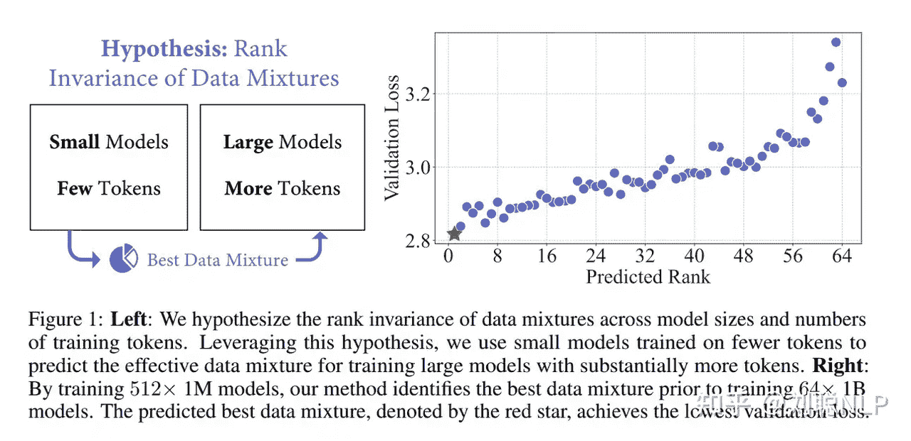
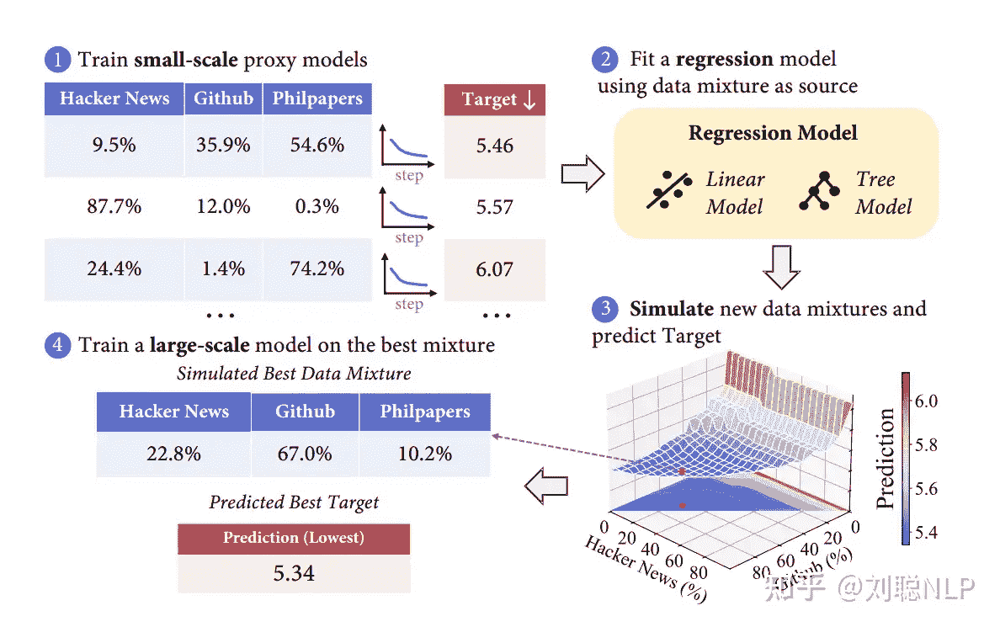
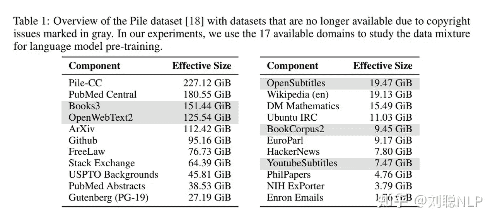
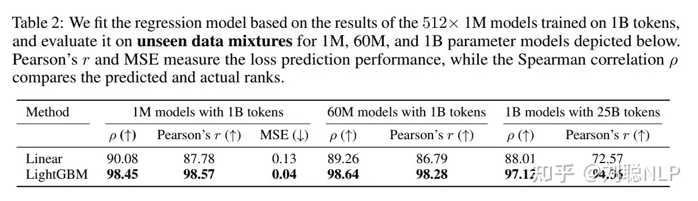
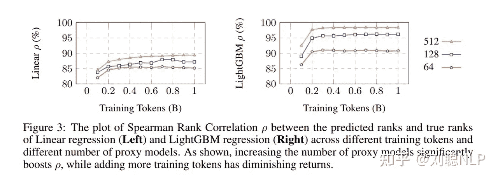
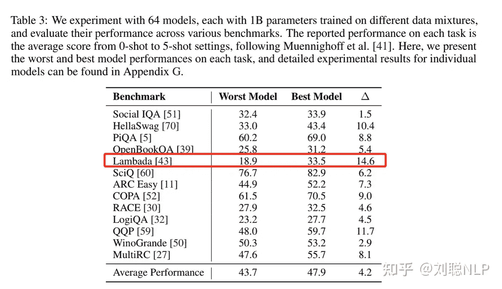
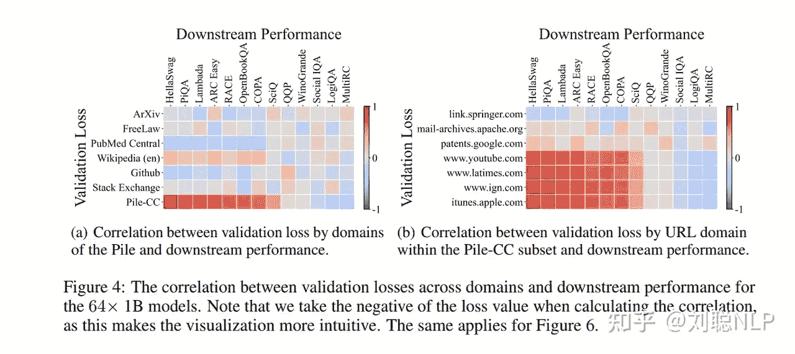
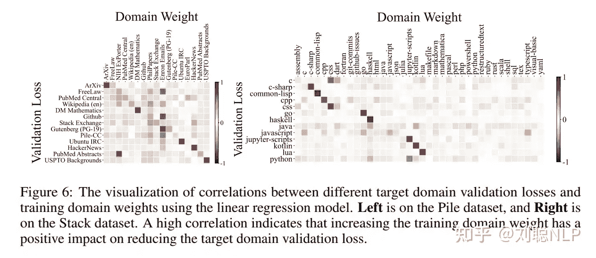

# RegMix-用回归任务解决大模型数据混合问题

> 来源：[https://agijuejin.feishu.cn/docx/RUxVdBy8xoPs72xfSpscUJMEnAg](https://agijuejin.feishu.cn/docx/RUxVdBy8xoPs72xfSpscUJMEnAg)

大家好，我是刘聪NLP。

大型语言模型在预训练过程中，如何选取数据的混合比例（利用较少的Tokens来实现较小的Loss从而加速预训练过程）是一个复杂和关键的问题。手动确认数据集中各组成的比例是不可扩展的，并且很可能不是最优选择。

今天给大家介绍一个用回归任务解决大模型数据混合问题的方法-RegMix。其核心思想是，利用不同的数据混合比例先训练多个小模型并获取其结果，在利用这些样本训练一个回归模型，再遍历所有比例利用回归模型找到最优的数据混合比例，最后用最优数据混合比例训练更大的语言模型。

```
Paper: https://arxiv.org/abs/2407.01492
Github: https://github.com/sail-sg/regmix
```



通过训练512个1M的小模型，拟合回归模型，找到top64的数据混合比例，训练1B模型，最优数据混合比例训练的模型的验证集loss也是最低。

## 方法



整体流程如上图所示，

+   生成随机数据混合比例，按照比例采用混合数据并训练小模型；

+   利用数据混合比例作为特征值，模型训练的目标值作为标签，拟合回归模型；

+   在模拟更大数据混合比例空间，利用回归模型预测最佳目标值，以获取最佳混合比例；

+   使用模拟出的最佳混合比例的数据训练更大的模型。

训练小模型时越多越好，但为了节约成本需要尽量减少小模型训练次数，那么在初始化数据混合比例时就需要时多样化的，并且每个数据领域需要都存在极端值，数据采用过程主要是基于Tokens（chunk-level）分布的狄利克雷分布来实现。

```
详见：mixture_config/synthesize_mixture.py
```

同时在拟合回归模型时，采用了线性回归和LightGBM两种回归模型。

## 结果

数据集采用Pile dataset中不涉及版权的17个数据集，如下表所示，



512个1M小模型在1B Tokens训练得到的回归模型，与在25B Tokens数据下训练的1B模型，排序具有97.12%的高相关性，如下表所示，



同时训练次数要比训练的总Token数要重要，更影响回归模型的效果，并且采用LightGBM建模要比线性回归建模要好。



PS：跟作者@乾神交流过，其实做过1024的实验，但并回归模型效果无明显提高，并且从成本考虑，512最佳。

不同的数据混合比例对下游任务结果影响较大，在Lambada数据集上最好和最差的效果相差14.6%，如下表所示，



同时发现了一个与传统理解不一致的结果，一般我们任务维基数据质量很高，是评估大型语言模型最具代表性的数据集。但实验结果发现，网络数据集上评估的效果，更能体现模型在下游任务上的好坏，如下图所示，可以发现Pile-CC数据集作为验证时损失值与下游任务的相关性更强。



并且RegMix可以发现各领域数据之间是如何相互作用的，数据领域之间复杂的相互作用利用人类固有经验很难直接区分。



## 写在最后

大家可能会有疑问实验最大仅到1B的参数，对于更大参数是否试用呢？

我也是跟乾神交流了一下，乾神说他们训练Sailor模型的时候，用的就是这一套规则，从4B到14B的模型都有，再大的模型参数还在补，效果应该不会差。