# 数据合成方法-让模型自己说出用了哪些指令对齐数据

> 来源：[https://agijuejin.feishu.cn/docx/Me6HdvQpfojTK7xcVkzc7NHcnBb](https://agijuejin.feishu.cn/docx/Me6HdvQpfojTK7xcVkzc7NHcnBb)


## 写在前面

大家好，我是刘聪NLP。

大模型时代，数据至上，如何利用大模型合成更多高质量数据也备受关注。

今天给大家分享一个有意思的大模型合成数据方法-MAGPIE，在不需要种子数据和额外人工干预的情况下，挖掘出对齐过的模型自身的指令数据。

《MAGPIE: Alignment Data Synthesis from Scratch by Prompting Aligned LLMs with Nothing》

```
paper: https://arxiv.org/abs/2406.08464
github: https://github.com/magpie-align/magpie
```

核心思想：对齐过的大模型本身是经过大量指令数据对齐得来，往往这些对齐后的模型接受的输入通常由“前置查询模板”、“查询内容”、“后置查询模板”组成（例如：Llama2-Chat模型接受的输入是"[INST] Hi! [/INST]"，[INST] 是前置查询模板”，[/INST]则是后置查询模板）当对模型仅输入前置模板时，模型会自回归的合成“查询内容”；并且当组合完全时，开源获得模型的回复结果。

这样就变相地挖掘出对齐模型的指令数据，你以为只开了模型，我直接挖向

## 方法介绍

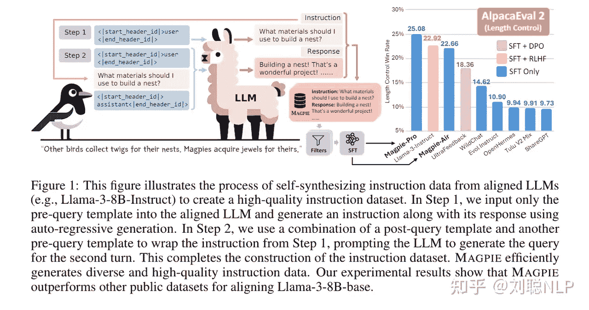

如上图所示，合成数据主要涉及两个步骤：

+   指令合成：仅给大模型输入前置查询模板“<|start_header_id|>user<|end_header_id|>”，大模型会自动续写出指令内容“What materials should I use to build a nest?”

+   回复合成：将生成的指令内容与前置查询模板、后置查询模板拼接“<|start_header_id|>user<|end_header_id|>What materials should I use to build a nest?<|start_header_id|>assistant<|end_header_id|>”输入到大模型中，大模型给出回复结果“Other birds collect twigs for their nests. Magpies acquire jewels for theirs.”

注意：在指令合成过程中，Temperature和Top-p都需要开得比较大，保证指令的多样性；在回复合成过程中，采用贪婪解码，默认概率最高的Token可能来自模型的训练语料。

当然直接生成的指令是涉及的场景是广泛、随机的，如果需要针对限定任务进行数据生成，可以通过增加系统提示词来限定场景，比如：增加对数学任务进行指令数据生成，

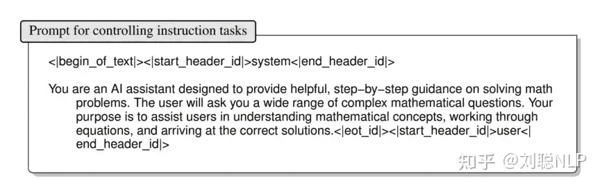

数学任务

如果想获取多轮对话数据，只需要在单轮的指令数据后面继续进行指令和回复的生成即可。但当开源模型本身参数较小时，生成的多轮数据可能出现忘记上下文内容的情况，可以通过增加系统提示的方式，让模型强制记住上文信息。

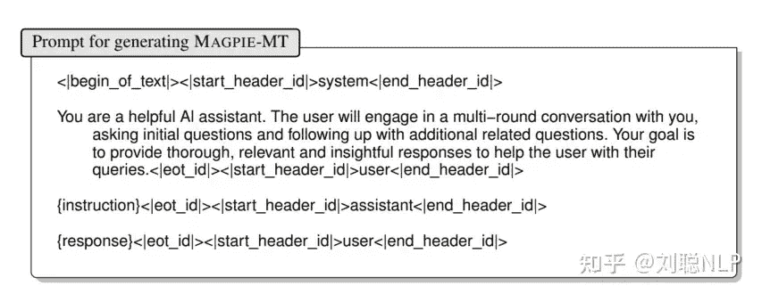

多轮任务

还可以构造偏好数据，额外利用模型基座生成回复，再通过奖励模型FsfairX-LLaMA3-RM-v0.1进行打分，保留合成回复分数大于基座回复分数的数据。

## 数据分析

衡量合成数据好坏，最简单直接办法就是SFT一把模型，比较训练后模型的效果。

MAGPIE方法利用Llama3-8B-Instruct模型和Llama3-70B-Instruct模型分别构造了MAGPIE-Air数据和MAGPIE-Pro数据，详细分布如下表所示，

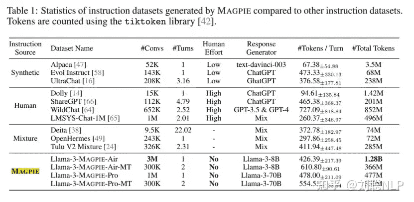

与ShareGPT、WildChat、Evol Instruct、UltraChat、OpenHermes和Tulu V2 Mix数据分别对Llama3-8B模型进行微调，效果如下表所示，

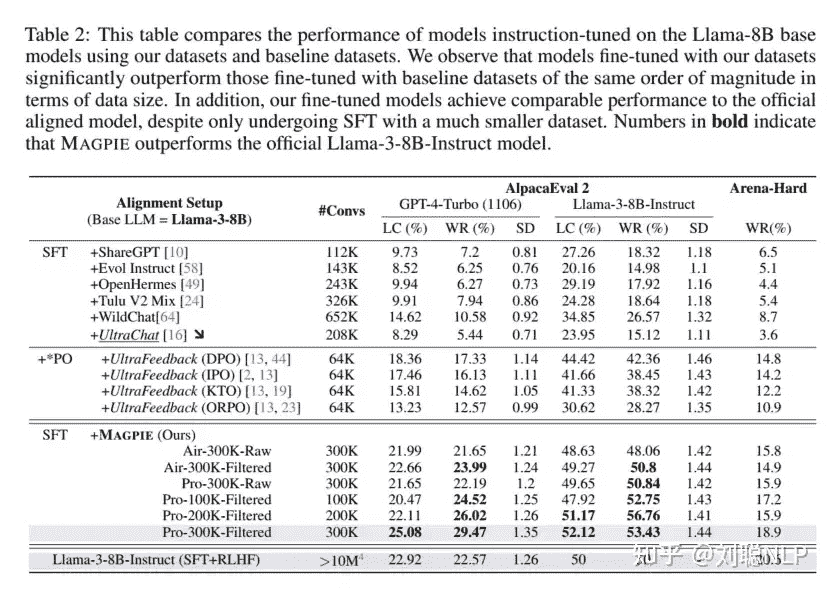

采用MAGPIE-Air和MAGPIE-Pro训练的模型，要比其他数据集训练的模型效果要好，甚至在AlpacaEval 2榜单上超过了原始的Llama3-Instruct模型。

Pro数据训练的模型优于Air数据训练的模型，主要是Llama3-70B-Instruct模型能力更强，获得的指令数据质量更高。

经过过滤的数据集训练的模型效果比原始数据集更优，其中过滤指标包括：

+   指令长度：指令中的字符总数。

+   回复长度：响应中的字符总数。

+   任务类别：指令的类别，分布如下图所示，

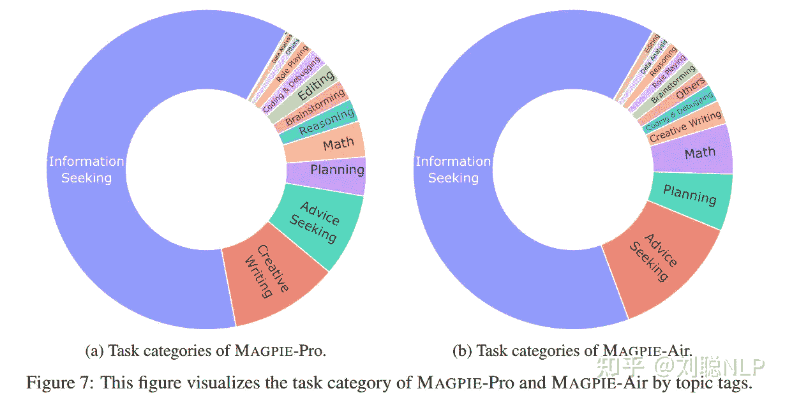

+   指令质量：根据指令的清晰度、特定性和连贯性，分为“非常差”、“差”、“一般”、“好”和“优秀”5个等级。

+   指令难度：根据指令中描述的任务所需的知识水平，分为“非常容易”、“容易”、“中等”、“困难”和“非常困难”5个等级。

+   指令相似度：采用all-mpnet-base-v2模型对指令进行向量化表征，计算指令之间的相似程度，筛选出重复或相似的样本。

+   奖励值：采用FsfairX-LLaMA3-RM-v0.1模型对回复内容进行评分$r^{*}$，通过$r^{*}$过滤低质量的样本。

+   奖励差：利用奖励模型对基模生成的回复评分$r_{base}$，通过$r^{*}-r_{base} > 0$获得更高质量的样本。

上面每个过滤数据的详细过滤规则如下表所示，

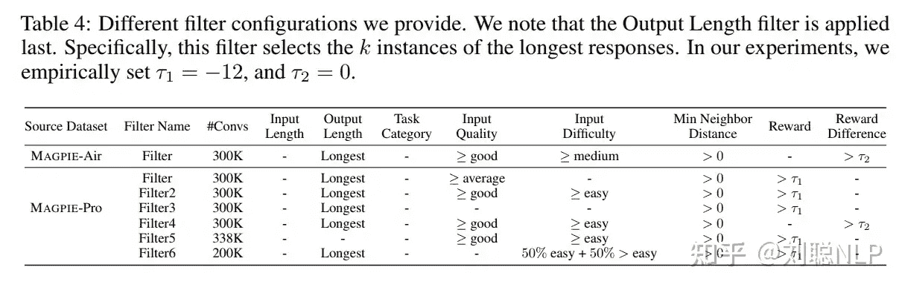

利用MAGPIE-Pro-300K-Filtered数据集，训练Qwen1.5-4B和Qwen1.5-7B模型的效果要好于Qwen1.5-4B-Chat和Qwen1.5-7B-Chat模型，说明MAGPIE方法获取的指令数据对其他非同源模型，依然有效。

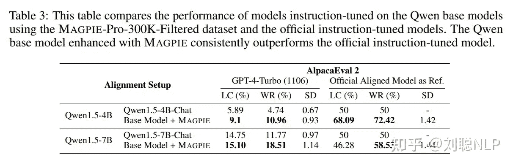

多轮数据的质量要高于单论数据集。

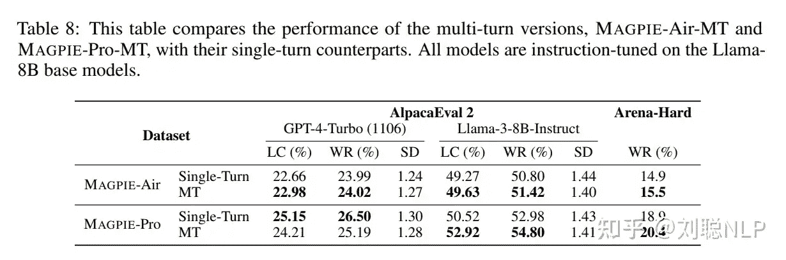

其他榜单（MMLU 、ARC、HellaSwag、TruthfulQA、Winogard、GSM8K、MMLU-Redux）上的效果如下，

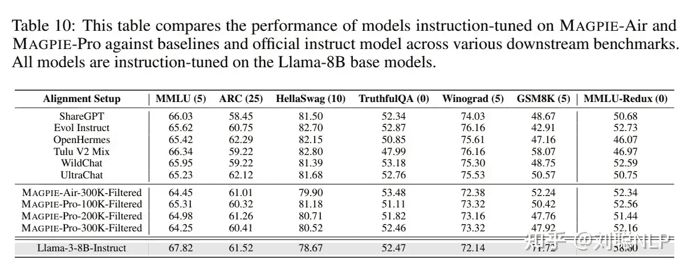

对MAGPIE数据进行安全性分析，利用Llama-Guard-2模型进行预测，有害指令少于1%。

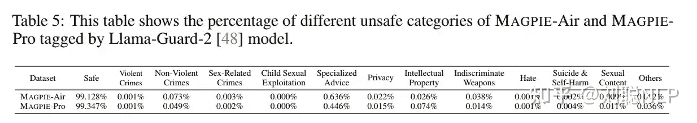

## 写在最后

MAGPIE方法不用种子数据，不用昂贵的GPT4 API接口，仅靠挖掘开源模型本身，就可以获取高质量合成数据，是个有趣的研究。

你虽然只开模型没开数据，但模型自己会告诉我们用了哪些数据~~~