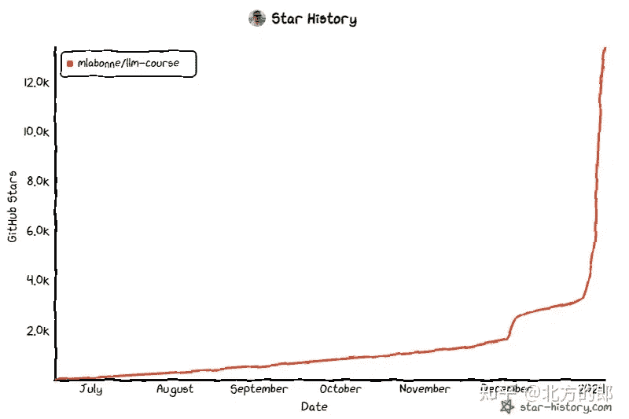
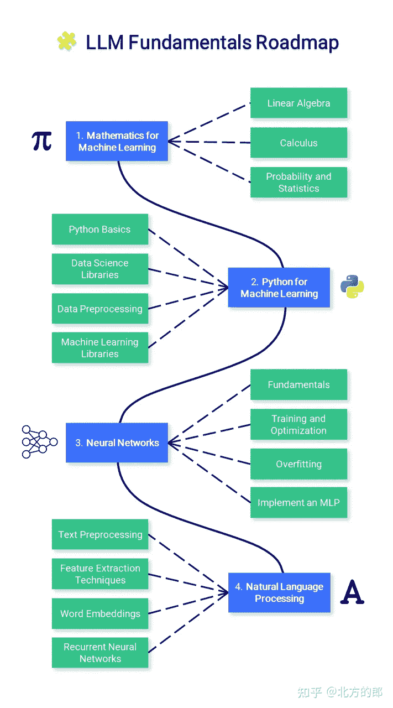
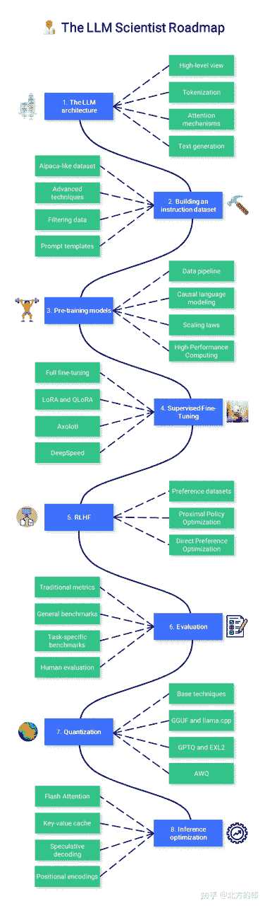
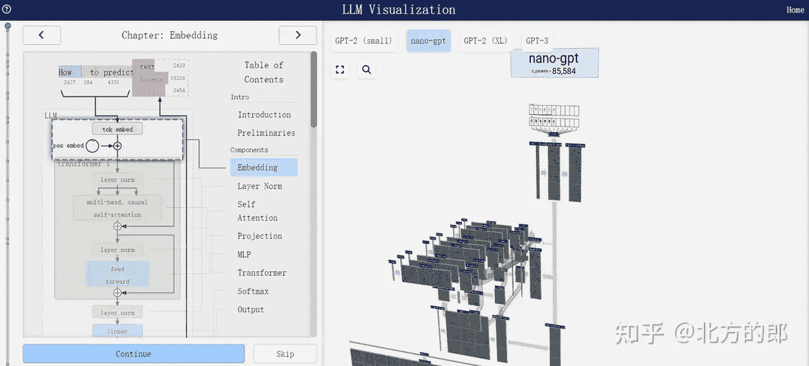

# `llm-course`，狂飙13.5K Star，GitHub上最全的开源大模型教程

> 来源：[https://agijuejin.feishu.cn/docx/RrZsdiBuJoDIAfxVGJGckeCunFh](https://agijuejin.feishu.cn/docx/RrZsdiBuJoDIAfxVGJGckeCunFh)

这是我在GitHub上发现的最全的开源大模型教程，作者整合了大量LLM教材和资料，绘制学习路线图。可以帮助初学者快速掌握大模型的应用和开发技巧，也可以帮助有经验的数据科学家进一步提升。

GitHub地址：[GitHub - mlabonne/llm-course: Course to get into Large Language Models (LLMs) with roadmaps and Colab notebooks.](https://link.zhihu.com/?target=https%3A//github.com/mlabonne/llm-course)

为方便大家实用，将其主要内容翻译成中文：

## LLM 基础知识

### 机器学习数学

在掌握机器学习之前，了解支持这些算法的基本数学概念非常重要。

+ 线性代数：这对于理解许多算法至关重要，尤其是深度学习中使用的算法。关键概念包括向量、矩阵、行列式、特征值和特征向量、向量空间和线性变换。

+ 微积分：许多机器学习算法涉及连续函数的优化，这需要了解导数、积分、极限和级数。多变量微积分和梯度的概念也很重要。

+ 概率和统计：这些对于理解模型如何从数据中学习并做出预测至关重要。关键概念包括概率论、随机变量、概率分布、期望、方差、协方差、相关性、假设检验、置信区间、最大似然估计和贝叶斯推理。

资源：

+ 3Blue1Brown - 线性代数的本质：一系列视频，为这些概念提供了几何直观。

+ StatQuest 与 Josh Starmer - 统计基础知识：为许多统计概念提供简单明了的解释。

+ Aerin 女士的 AP 统计直觉：提供每个概率分布背后的直觉的中等文章列表。

+ [沉浸式线性代数](https://link.zhihu.com/?target=https%3A//immersivemath.com/ila/learnmore.html)：线性代数的另一种视觉解释。

+ Khan Academy - 线性代数：非常适合初学者，因为它以非常直观的方式解释了概念。

+ [可汗学院 - 微积分](https://link.zhihu.com/?target=https%3A//www.khanacademy.org/math/calculus-1)：一门涵盖微积分所有基础知识的互动课程。

+ [可汗学院 - 概率与统计](https://link.zhihu.com/?target=https%3A//www.khanacademy.org/math/statistics-probability)：以易于理解的格式提供材料。

---

### 用于机器学习的Python

`Python` 是一种强大而灵活的编程语言，由于其可读性、一致性和强大的数据科学库生态系统，特别适合机器学习。

+ `Python`基础知识：`Python`编程需要很好地理解基本语法、数据类型、错误处理和面向对象编程。

+ 数据科学库：包括熟悉用于数值运算的 `NumPy`、用于数据操作和分析的 `Pandas`、用于数据可视化的 `Matplotlib` 和 `Seaborn`。

+ 数据预处理：这涉及特征缩放和标准化、处理缺失数据、异常值检测、分类数据编码以及将数据拆分为训练集、验证集和测试集。

+ 机器学习库：熟练使用 `Scikit-learn`（一个提供多种监督和非监督学习算法的库）至关重要。了解如何实现线性回归、逻辑回归、决策树、随机森林、`K-NN` 和 `K` 均值聚类等算法非常重要。`PCA` 和 `t-SNE` 等降维技术也有助于可视化高维数据。

资源：

+ [Real Python](https://link.zhihu.com/?target=https%3A//realpython.com/)：综合资源，包含针对初学者和高级 `Python` 概念的文章和教程。

+ freeCodeCamp - 学习 `Python`：长视频，完整介绍了 `Python` 中的所有核心概念。

+ [Python 数据科学手册](https://link.zhihu.com/?target=https%3A//jakevdp.github.io/PythonDataScienceHandbook/)：免费的数字书籍，是学习 `pandas`、`NumPy`、`Matplotlib` 和 `Seaborn` 的绝佳资源。

+ freeCodeCamp - 适合所有人的机器学习：为初学者介绍不同的机器学习算法。

+ Udacity - 机器学习简介：免费课程，涵盖 `PCA` 和其他几个机器学习概念。

---

### 神经网络

神经网络是许多机器学习模型的基本组成部分，特别是在深度学习领域。为了有效地利用它们，全面了解它们的设计和机制至关重要。

+ 基础知识：这包括理解神经网络的结构，例如层、权重、偏差、激活函数（`sigmoid`、`tanh`、`ReLU` 等）

+ 训练和优化：熟悉反向传播和不同类型的损失函数，例如均方误差（`MSE`）和交叉熵。了解各种优化算法，例如梯度下降、随机梯度下降、`RMSprop` 和 `Adam`。

+ 过度拟合：了解过度拟合的概念（模型在训练数据上表现良好，但在未见过的数据上表现不佳）并学习各种正则化技术（`dropout`、`L1/L2` 正则化、提前停止、数据增强）来防止过度拟合。

+ 实现多层感知器（`MLP`）：使用 `PyTorch` 构建 `MLP`，也称为全连接网络。

资源：

+ 3Blue1Brown - 但什么是神经网络？：该视频直观地解释了神经网络及其内部工作原理。

+ freeCodeCamp - 深度学习速成课程：该视频有效地介绍了深度学习中所有最重要的概念。

+ `Fast.ai` - 实用深度学习：为具有编码经验、想要了解深度学习的人设计的免费课程。

+ Patrick Loeber - `PyTorch` 教程：为初学者学习 `PyTorch` 的系列视频。

---

### 4. 自然语言处理（`NLP`）

`NLP` 是人工智能的一个令人着迷的分支，它弥合了人类语言和机器理解之间的差距。从简单的文本处理到理解语言的细微差别，`NLP` 在翻译、情感分析、聊天机器人等许多应用中发挥着至关重要的作用。

+ 文本预处理：学习各种文本预处理步骤，例如分词（将文本分割成单词或句子）、词干提取（将单词还原为其词根形式）、词形还原（与词干提取类似，但考虑上下文）、停用词删除等。

+ 特征提取技术：熟悉将文本数据转换为机器学习算法可以理解的格式的技术。主要方法包括词袋（`BoW`）、词频-逆文档频率（`TF-IDF`）和 `n-gram`。

+ 词嵌入：词嵌入是一种词表示形式，允许具有相似含义的词具有相似的表示形式。主要方法包括 `Word2Vec`、`GloVe` 和 `FastText`。

+ 递归神经网络（`RNN`）：了解 `RNN` 的工作原理，`RNN` 是一种设计用于处理序列数据的神经网络。探索 `LSTM` 和 `GRU`，这两种能够学习长期依赖关系的 `RNN` 变体。

资源：

+ [RealPython - NLP with spaCy in Python](https://link.zhihu.com/?target=https%3A//realpython.com/natural-language-processing-spacy-python/)：有关 `Python` 中用于 `NLP` 任务的 `spaCy` 库的详尽指南。

+ [Kaggle - NLP 指南](https://link.zhihu.com/?target=https%3A//www.kaggle.com/learn-guide/natural-language-processing)：一些笔记本和资源，用于 `Python` 中 `NLP` 的实践解释。

+ Jay Alammar - `Word2Vec` 插图：了解著名的 `Word2Vec` 架构的一个很好的参考。

+ Jake Tae - `PyTorch RNN from Scratch`：在 `PyTorch` 中实用且简单地实现 `RNN`、`LSTM` 和 `GRU` 模型。

+ [colah 的博客 - Understanding LSTM Networks](https://link.zhihu.com/?target=https%3A//colah.github.io/posts/2015-08-Understanding-LSTMs/)：一篇关于 `LSTM` 网络更具理论性的文章。

## LLM 科学家

### LLM 架构

虽然不需要深入了解 `Transformer` 架构，但深入了解其输入（令牌）和输出（`logits`）非常重要。普通的注意力机制是另一个需要掌握的关键组成部分，稍后会介绍它的改进版本。

+ 高级视图：重新审视编码器-解码器 `Transformer` 架构，更具体地说，是仅解码器的 `GPT` 架构，该架构在每个现代 `LLM` 中都使用。

+ 标记化：了解如何将原始文本数据转换为模型可以理解的格式，这涉及将文本拆分为标记（通常是单词或子词）。

+ 注意力机制：掌握注意力机制背后的理论，包括自注意力和缩放点积注意力，这使得模型在产生输出时能够关注输入的不同部分。

+ 文本生成：了解模型生成输出序列的不同方式。常见的策略包括贪婪解码、波束搜索、`top-k` 采样和核采样。

参考资料：

+ Jay Alammar绘制的 `Transformer` 插图：`Transformer` 模型的直观解释。

+ Jay Alammar 的 `GPT-2` 插图：比上一篇文章更重要，它重点关注 `GPT` 架构，与 `Llama` 非常相似。

+ Brendan Bycroft 的 `LLM` 可视化：以令人难以置信的 3D 可视化方式呈现 `LLM` 内部发生的情况。

+ [`nanoGPT`](https://link.zhihu.com/?target=https%3A//www.youtube.com/watch%3Fv%3DkCc8FmEb1nY)，作者：Andrej Karpathy：一段 2 小时长的 YouTube 视频，用于从头开始重新实现 `GPT`（针对程序员）。

+ [注意力？注意力！](https://link.zhihu.com/?target=https%3A//lilianweng.github.io/posts/2018-06-24-attention/)作者：Lilian Weng：以更正式的方式介绍关注的必要性。

+ [LLM中的解码策略](https://link.zhihu.com/?target=https%3A//mlabonne.github.io/blog/posts/2023-06-07-Decoding_strategies.html)：提供代码和对生成文本的不同解码策略的直观介绍。

---

### 构建指令数据集

虽然从维基百科和其他网站找到原始数据很容易，但在野外收集成对的指令和答案却很困难。与传统机器学习一样，数据集的质量将直接影响模型的质量，这就是为什么它可能是微调过程中最重要的组成部分。

+ [`Alpaca`](https://link.zhihu.com/?target=https%3A//crfm.stanford.edu/2023/03/13/alpaca.html)-like 数据集：使用 `OpenAI API` (`GPT`) 从头开始生成合成数据。您可以指定种子和系统提示来创建多样化的数据集。

+ 高级技术：了解如何使用 `Evol-Instruct` 改进现有数据集，如何生成 `Orca` 和 `phi-1` 论文中的高质量合成数据。

+ 过滤数据：传统技术涉及正则表达式、删除近似重复项、关注具有大量标记的答案等。

+ 提示模板：这[就是为什么了](https://link.zhihu.com/?target=https%3A//learn.microsoft.com/en-us/azure/ai-services/openai/how-to/chatgpt%3Ftabs%3Dpython%26pivots%3Dprogramming-language-chat-ml)解[不同的聊天模板](https://link.zhihu.com/?target=https%3A//crfm.stanford.edu/2023/03/13/alpaca.html)很重要，例如 `ChatML`、`Alpaca` 等。

参考资料：

+ [为指令调整准备数据集](https://link.zhihu.com/?target=https%3A//wandb.ai/capecape/alpaca_ft/reports/How-to-Fine-Tune-an-LLM-Part-1-Preparing-a-Dataset-for-Instruction-Tuning--Vmlldzo1NTcxNzE2)，作者：Thomas Capelle：探索 `Alpaca` 和 `Alpaca-GPT4` 数据集以及如何格式化它们。

+ [生成临床指导数据集](https://link.zhihu.com/?target=https%3A//medium.com/mlearning-ai/generating-a-clinical-instruction-dataset-in-portuguese-with-langchain-and-gpt-4-6ee9abfa41ae)作者：Solano Todeschini：有关如何使用 `GPT-4` 创建综合指导数据集的教程。

+ [用于新闻分类的 `GPT 3.5`](https://link.zhihu.com/?target=https%3A//medium.com/%40kshitiz.sahay26/how-i-created-an-instruction-dataset-using-gpt-3-5-to-fine-tune-llama-2-for-news-classification-ed02fe41c81f)，作者：Kshitiz Sahay：使用 `GPT 3.5` 创建指令数据集来微调 `Llama 2` 的新闻分类。

+ [用于微调 `LLM` 的数据集创建](https://link.zhihu.com/?target=https%3A//colab.research.google.com/drive/1GH8PW9-zAe4cXEZyOIE-T9uHXblIldAg%3Fusp%3Dsharing)：包含一些过滤数据集和上传结果的技术的笔记本。

+ Matthew Carrigan 的聊天模板：`Hugging Face` 关于提示模板的页面

---

### 预训练模型

预训练是一个非常漫长且成本高昂的过程，这就是为什么这不是本课程的重点。对预训练期间发生的情况有一定程度的了解是很好的，但不需要实践经验。

+ [数据管道：预训练](https://link.zhihu.com/?target=https%3A//arxiv.org/abs/2307.09288)需要巨大的数据集（例如，`Llama 2` 使用 2 万亿个标记进行训练），需要对这些数据集进行过滤、标记化并与预定义的词汇进行整理。

+ 因果语言建模：了解[因果语言建模](https://link.zhihu.com/?target=https%3A//github.com/NVIDIA/Megatron-LM)和[屏蔽语言建模](https://link.zhihu.com/?target=https%3A//github.com/EleutherAI/gpt-neox)之间的区别，以及本例中使用的损失函数。为了进行高效的预训练，请了解有关 `Megatron-LM` 或 `gpt-neox` 的更多信息。

+ 缩放法则：[缩放法则](https://link.zhihu.com/?target=https%3A//arxiv.org/pdf/2001.08361.pdf)根据模型大小、数据集大小和用于训练的计算量描述预期的模型性能。

+ 高性能计算：超出了本文的范围，但如果您打算从头开始创建自己的 `LLM`（硬件、分布式工作负载等），那么更多有关 `HPC` 的知识是基础。

参考资料：

+ [`LLMDataHub`](https://link.zhihu.com/?target=https%3A//github.com/Zjh-819/LLMDataHub)，作者：Junhao Zhu：用于预训练、微调和 `RLHF` 的精选数据集列表。

+ 通过 `Hugging Face` 从头开始训练因果语言模型：使用 `Transformers` 库从头开始预训练 `GPT-2` 模型。

+ [`TinyLlama`](https://link.zhihu.com/?target=https%3A//github.com/jzhang38/TinyLlama)，作者：Zhang 等人：查看此项目，可以很好地了解 `Llama` 模型是如何从头开始训练的。

+ `Hugging Face` 的因果语言建模：解释因果语言建模和屏蔽语言建模之间的区别以及如何快速微调 `DistilGPT-2` 模型。

+ 怀旧学者对 `Chinchilla` 的疯狂暗示：讨论缩放定律并解释它们对 `LLM` 的一般意义。

## 相关资源与框架

+   BigScience 的`BLOOM`：概念页面描述了如何构建 `BLOOM` 模型，其中包含有关工程部分和遇到的问题的大量有用信息。

+   Meta 的`OPT-175` 日志：研究日志显示出了什么问题以及什么是正确的。如果您计划预训练非常大的语言模型（在本例中为 175B 参数），则非常有用。

+   [LLM 360](https://link.zhihu.com/?target=https%3A//www.llm360.ai/)：开源LLM框架，包含培训和数据准备代码、数据、指标和模型。

---

## 监督微调

预训练模型仅针对下一个标记预测任务进行训练，这就是为什么它们不是有用的助手。`SFT` 允许您调整它们以响应指令。此外，它允许您根据任何数据（私有数据、GPT-4 无法看到的数据等）微调您的模型并使用它，而无需支付 OpenAI 等 API 的费用。

+   全微调：全微调是指训练模型中的所有参数。这不是一种有效的技术，但它会产生稍微好一点的结果。

+   [`LoRA`](https://link.zhihu.com/?target=https%3A//arxiv.org/abs/2106.09685)：一种基于低阶适配器的参数高效技术（`PEFT`）。我们不训练所有参数，而是只训练这些适配器。

+   [`QLoRA`](https://link.zhihu.com/?target=https%3A//arxiv.org/abs/2305.14314)：[另一种基于 `L`](https://link.zhihu.com/?target=https%3A//github.com/unslothai/unsloth)`oRA` 的 `PEFT`，它还将模型的权重量化为 4 位，并引入分页优化器来管理内存峰值。将其与`Unsloth`结合使用，可以在免费的 Colab 笔记本上高效运行。

+   [`Axolotl`](https://link.zhihu.com/?target=https%3A//github.com/OpenAccess-AI-Collective/axolotl)：一种用户友好且功能强大的微调工具，用于许多最先进的开源模型。

+   [`DeepSpeed`](https://link.zhihu.com/?target=https%3A//www.deepspeed.ai/)：针对多 GPU 和多节点设置的 LLM 的高效预训练和微调（在 Axolotl 中实现）。

### 参考资料

+   Alpin的新手 LLM 培训指南：概述微调 LLM 时要考虑的主要概念和参数。

+   Sebastian Raschka 的`LoRA` 见解：有关 `LoRA` 以及如何选择最佳参数的实用见解。

+   微调您自己的 Llama 2 模型：有关如何使用 Hugging Face 库微调 Llama 2 模型的实践教程。

+   [`填充大型语言模型`](https://link.zhihu.com/?target=https%3A//towardsdatascience.com/padding-large-language-models-examples-with-llama-2-199fb10df8ff)作者：Benjamin Marie：为因果LLM填充训练示例的最佳实践

+   [`LLM 微调初学者指南`](https://link.zhihu.com/?target=https%3A//mlabonne.github.io/blog/posts/A_Beginners_Guide_to_LLM_Finetuning.html)：有关如何使用 `Axolotl` 微调 CodeLlama 模型的教程。

---

## 根据人类反馈进行强化学习

经过监督微调后，`RLHF` 是用于使 LLM 的答案与人类期望保持一致的一个步骤。这个想法是从人类（或人工）反馈中学习偏好，这可用于减少偏见、审查模型或使它们以更有用的方式行事。它比 `SFT` 更复杂，并且通常被视为可选的。

+   偏好数据集：这些数据集通常包含具有某种排名的多个答案，这使得它们比指令数据集更难生成。

+   [`近端策略优化`](https://link.zhihu.com/?target=https%3A//arxiv.org/abs/1707.06347)：该算法利用奖励模型来预测给定文本是否被人类排名较高。然后使用该预测来优化 `SFT` 模型，并根据 `KL` 散度进行惩罚。

+   [`直接偏好优化`](https://link.zhihu.com/?target=https%3A//arxiv.org/abs/2305.18290)：`DPO` 通过将其重新定义为分类问题来简化该过程。它使用参考模型而不是奖励模型（无需训练），并且只需要一个超参数，使其更加稳定和高效。

### 参考资料

+   Ayush Thakur 的《使用 `RLHF` 培训LLM简介》：解释为什么 `RLHF` 对于减少LLM的偏见和提高绩效是可取的。

+   Hugging Face 的插图 `RLHF`：`RLHF` 简介，包括奖励模型训练和强化学习微调。

+   [`StackLLaMA`](https://link.zhihu.com/?target=https%3A//huggingface.co/blog/stackllama) by Hugging Face：使用 Transformer 库有效地将 LLaMA 模型与 `RLHF` 对齐的教程。

+   LLM 培训：`RLHF` 及其替代方案，作者：Sebastian Rashcka：`RLHF` 流程和 `RLAIF` 等替代方案的概述。

+   使用 `DPO` 微调 Mistral-7b：使用 `DPO` 微调 Mistral-7b 模型并重现NeuralHermes-2.5 的教程。

---

## 评价

评估LLM是管道中被低估的部分，既耗时又不可靠。您的下游任务应该决定您想要评估的内容，但始终记住古德哈特定律：“当一项措施成为目标时，它就不再是一个好的措施。”

+   传统指标：困惑度和 `BLEU` 分数等指标并不像以前那样流行，因为它们在大多数情况下都存在缺陷。了解它们以及何时应用它们仍然很重要。

+   通用基准：基于[语言模型评估工具](https://link.zhihu.com/?target=https%3A//github.com/EleutherAI/lm-evaluation-harness)，[开放 LLM 排行榜](https://link.zhihu.com/?target=https%3A//huggingface.co/spaces/HuggingFaceH4/open_llm_leaderboard)是通用 LLM（如 ChatGPT[）的主要基准。还](https://link.zhihu.com/?target=https%3A//github.com/google/BIG-bench)有[其他流行的基准测](https://link.zhihu.com/?target=https%3A//arxiv.org/abs/2306.05685)试，如`BigBench`、`MT-Bench`等。

+   特[定于任务的基准：摘要](https://link.zhihu.com/?target=https%3A//pubmedqa.github.io/)、翻译、问答等任务有专用的基准、指标，甚至子领域（医学、金融等），例如用于生物医学问答的`PubMedQA` 。

+   人工评价：最可靠的评价是用户的接受率或人工的比较。如果你想知道一个模型表现是否良好，最简单但最可靠的方法就是自己使用它。

### 参考资料

+   Hugging Face 的固定长度模型的困惑：使用 Transformer 库实现它的代码的困惑概述。

+   [`BLEU 风险自负，`](https://link.zhihu.com/?target=https%3A//towardsdatascience.com/evaluating-text-output-in-nlp-bleu-at-your-own-risk-e8609665a213)作者：Rachael Tatman：`BLEU` 分数及其许多问题的概述和示例。

+   Chang 等人的LLM评估调查：关于评估内容、评估地点以及如何评估的综合论文。

+   lmsys 的Chatbot Arena 排行榜：基于人类进行的比较的通用 LLM 的 Elo 评级。

+   [`LLM AutoEval`](https://link.zhihu.com/?target=https%3A//github.com/mlabonne/llm-autoeval)：从 Colab 笔记本自动评估 LLM。

---

## 量化

量化是使用较低精度转换模型权重（和激活）的过程。例如，使用 16 位存储的权重可以转换为 4 位表示。这项技术对于降低LLM相关的计算和内存成本变得越来越重要。

+   基本技术：学习不同级别的精度（`FP32`、`FP16`、`INT8` 等）以及如何使用 `absmax` 和零点技术执行简单量化。

+   [`GGUF` 和 `ll`](https://link.zhihu.com/?target=https%3A//github.com/ggerganov/llama.cpp)`ama.cpp` ：`llama.cpp`和 `GGUF` 格式最初设计为在 CPU 上运行，现已成为在消费级硬件上运行 LLM 的最流行工具。

+   `GPTQ` 和 `EXL2：[`GPTQ`](https://link.zhihu.com/?target=https%3A//arxiv.org/abs/2210.17323)，更具体地说，[`EXL2`](https://link.zhihu.com/?target=https%3A//github.com/turboderp/exllamav2)格式提供了令人难以置信的速度，但只能在 GPU 上运行。模型也需要很长时间才能量化。

+   `AWQ`：这种新格式比 `GPTQ` 更准确（更低的复杂性），但使用更多的 VRAM，并且不一定更快。

### 参考资料

+   [`量化简介`](https://link.zhihu.com/?target=https%3A//mlabonne.github.io/blog/posts/Introduction_to_Weight_Quantization.html)：量化概述、`absmax` 和零点量化以及 `LLM.int8()` 和代码。

+   使用 `llama.cpp` 量化 Llama 模型：有关如何使用 `llama.cpp` 和 `GGUF` 格式量化 Llama 2 模型的教程。

+   使用 `GPTQ` 进行 4 位 LLM 量化：有关如何使用 `GPTQ` 算法和 `AutoGPTQ` 来量化 LLM 的教程。

+   `ExLlamaV2`：运行 LLM 最快的库：有关如何使用 `EXL2` 格式量化 Mistral 模型并使用 `ExLlamaV2` 库运行它的指南。

+   了解 `FriendliAI` 的激活感知权重量化：`AWQ` 技术及其优势概述。

---

## 推理优化

人们开发了许多优化技术来减少 VRAM 使用并提高生成速度。除了量化方法之外，这些改进还经常涉及更有效的注意力机制和架构变化的实施。

+   `Flash Attention`：优化注意力机制，将其复杂度从二次型转变为线性型，加快训练和推理速度。

+   键值缓存：了解键值缓存以及[多查询注意](https://link.zhihu.com/?target=https%3A//arxiv.org/abs/1911.02150)（`MQA`）和[分组查询注意](https://link.zhihu.com/?target=https%3A//arxiv.org/abs/2305.13245)（`GQA`）中引入的改进。

+   推测性解码：使用小型模型生成草稿，然后由较大模型进行审查以加快文本生成速度。

+   [`位置编码`](https://link.zhihu.com/?target=https%3A//arxiv.org/abs/2104.09864)：[了解 `Tr`](https://link.zhihu.com/?target=https%3A//arxiv.org/abs/2108.12409)`a`[`nsfo`](https://link.zhihu.com/?target=https%3A//arxiv.org/abs/2309.00071)`rmer` 中的位置编码，特别是`RoPE`、`ALiBi`和`YaRN`等相关方案。（与推理优化没有直接关系，而是与更长的上下文窗口相关。）

### 参考资料

+   [`GPU Inference`](https://link.zhihu.com/?target=https%3A//huggingface.co/docs/transformers/main/en/perf_infer_gpu_one) by Hugging Face：解释如何优化 GPU 上的推理。

+   [`Optimizing LLMs `](https://link.zhihu.com/?target=https%3A//huggingface.co/docs/transformers/main/en/llm_tutorial_optimization)`for Speed and Memory` by Hugging Face：解释优化速度和内存的三种主要技术，即量化、`Flash Attention` 和架构创新。

+   `Assisted Generation` by Hugging Face：HF 版本的推测解码，这是一篇有趣的博客文章，介绍了它如何使用代码来实现。

+   `Extending the RoPE` by EleutherAI：总结不同位置编码技术的文章。

+   扩展上下文很难……但并非不可能，作者：`kaiokendev`：这篇博文介绍了 `SuperHOT` 技术，并对相关工作进行了精彩的调查。

## 后记

说实话，现在互联网内容这么丰富，学习一样东西在自己钻研的同时，一定要没事多找找互联网上的资源，多看看别人的经验。今天在 LLM Visualization 上玩了半天LLM的可视化效果。我玩大模型也有不少的时日了，如果不是看这个教程，我还真不知道网上已经有人做了这么漂亮的LLM可视化效果。

