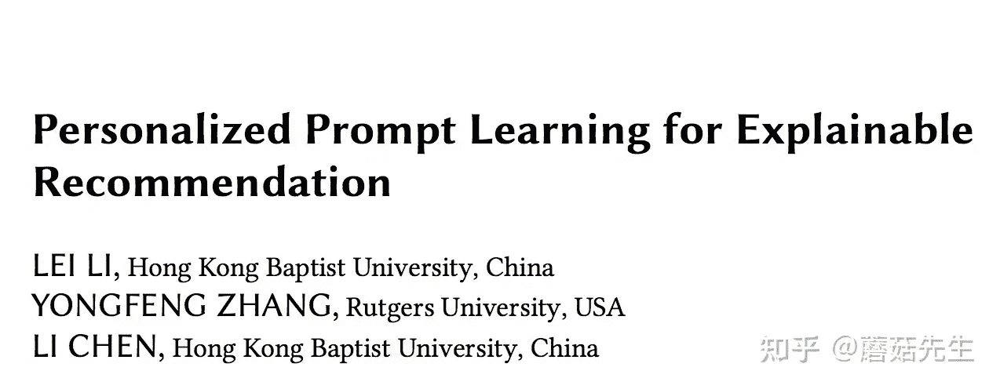
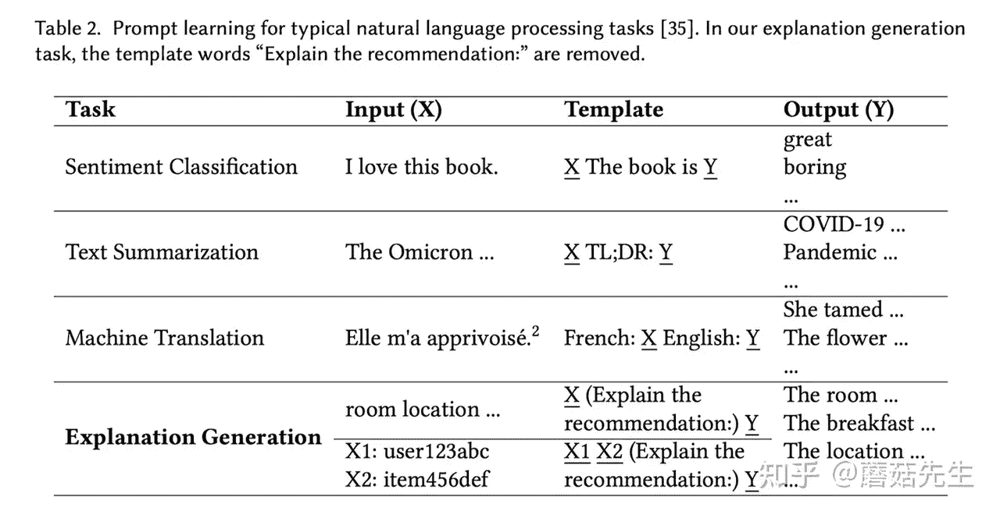
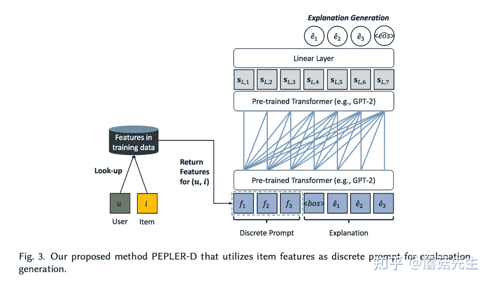
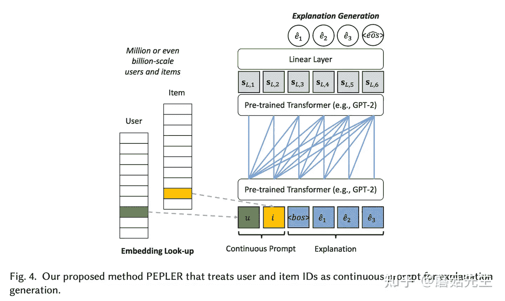
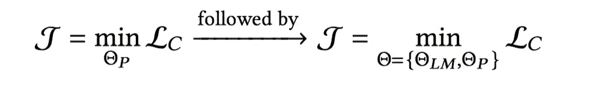
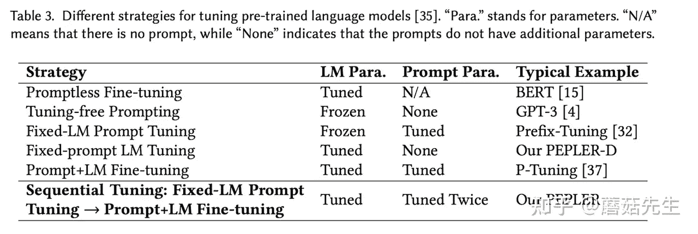
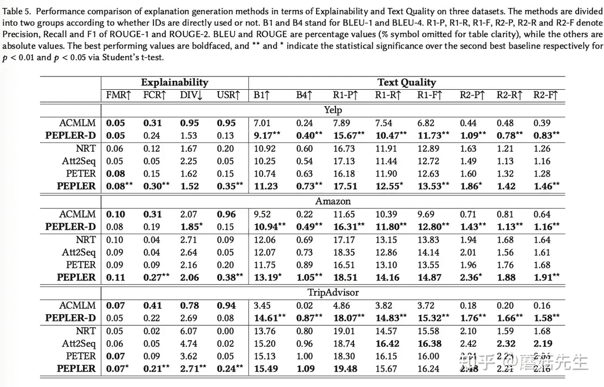
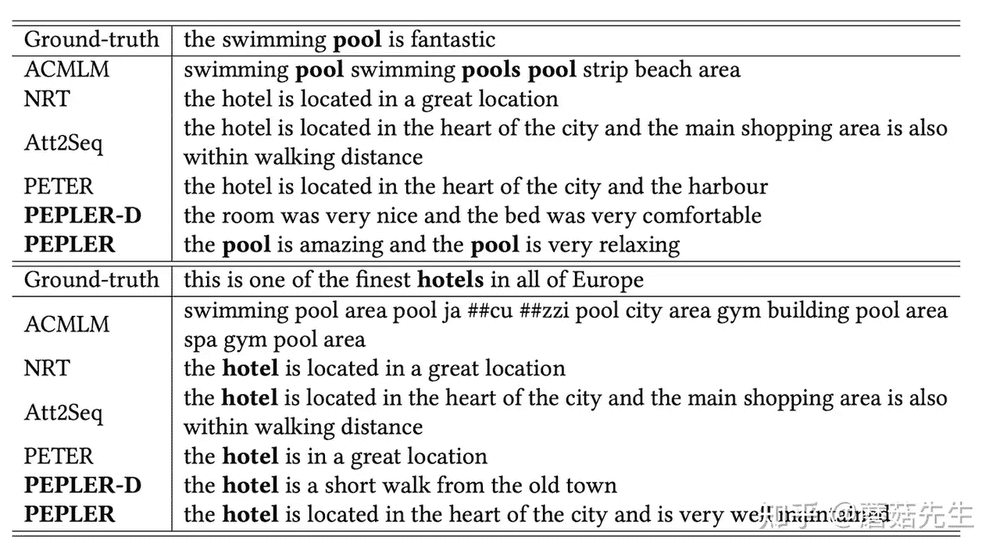
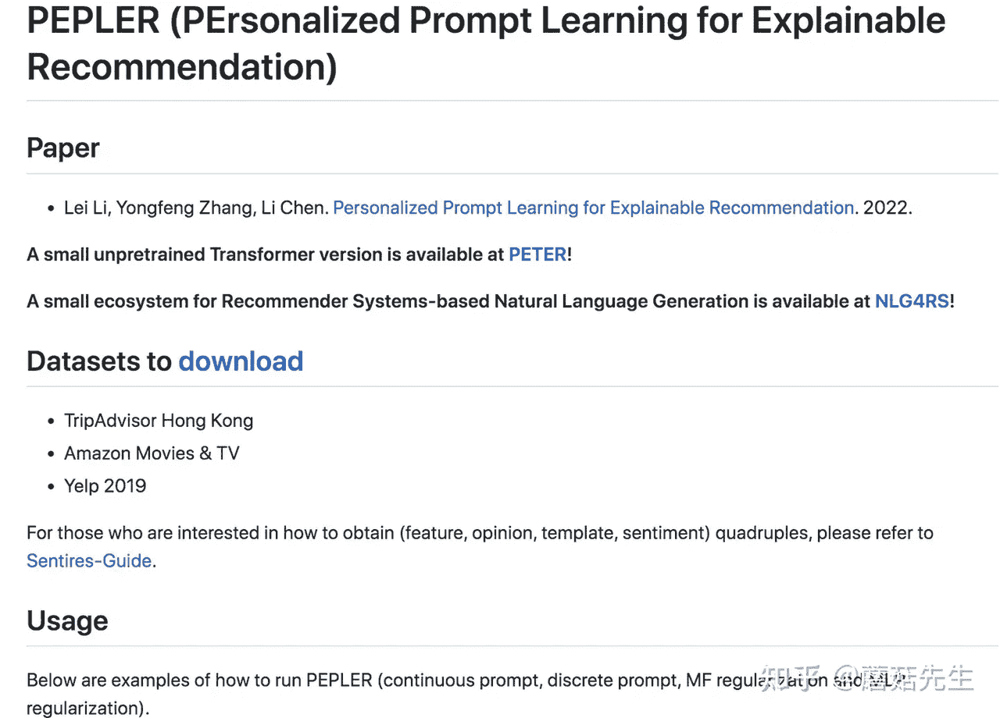
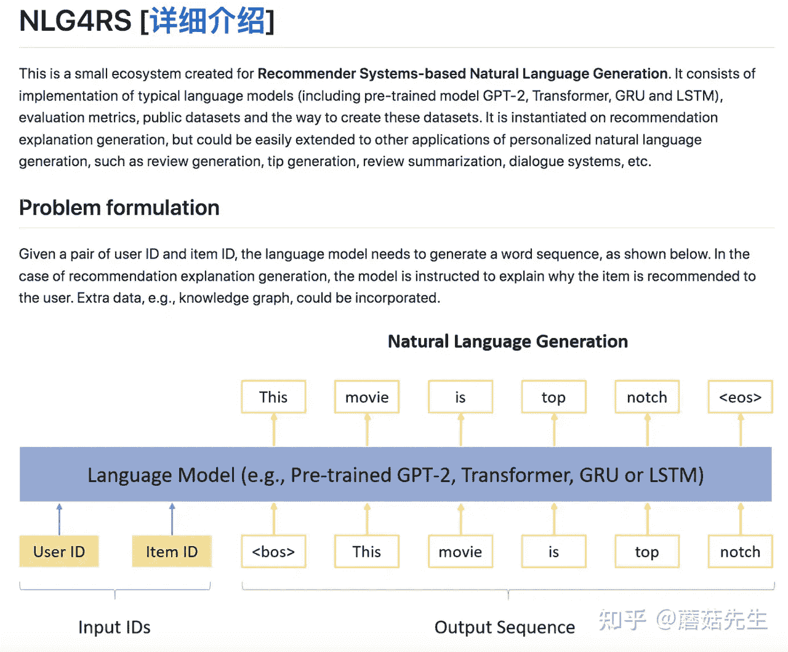

# 基于个性化Prompt的推荐：推荐系统和NLP的跨界融合

> 来源：[https://agijuejin.feishu.cn/docx/HUpNdTzqaoFqW8xF6NrcVFZxnNb](https://agijuejin.feishu.cn/docx/HUpNdTzqaoFqW8xF6NrcVFZxnNb)

今天分享Arxiv一篇最新的期刊工作：Personalized Prompt Learning for Explainable Recommendation[1]。这篇工作主要是研究基于个性化提示学习的可解释推荐，是作者在其发表在ACL2021工作 Personalized Transformer for Explainable Recommendation[2]基础上的延续，引入了提示学习和预训练模型到推荐理由生成任务上，是NLP和推荐系统的又一次"跨界融合"。

我在以前的文章分享过：Recsys'21 | 浅谈推荐系统如何在NLP的肩膀上前进，可以看到NLP研究进展如何深远的影响着推荐系统的研究。可以说很大程度上推荐系统的发展是在NLP的肩膀上前进的。且在文章的结尾留下了1个问题：我们看到的大多是单向影响，即：起步较早的领域深度影响着新兴领域，那么是否存在反哺的现象呢？例如：推荐系统社区是否有反哺NLP社区呢？

那么这篇文章也算是对这一问题的回答之一。虽然文章的主要场景是可解释推荐，但实际是NLG自然语言生成，借鉴了推荐系统的特点。即：推荐系统自己独特的"个性化以及核心思想“协同过滤”在NLP领域的应用。这篇文章算是我们朝着这个目标迈出的一小步，能够很好地推动推荐系统和NLP的跨界融合。

btw, 大模型和NLP/搜索推荐等结合的场景非常火，如果想更深入的学习大模型原理和实践等，推荐深蓝学院的这门课程：

[生成式预训练语言模型：理论与实战www.shenlanx](https://link.zhihu.com/?target=https%3A//www.shenlanxueyuan.com/channel/wtrepwJLLG/detail)ueyuan.com/channel/wtrepwJLLG/detail

会带你深入了解LLM工作原理，学习如何利用Transformer与GPT从0到1制作自己的mini-ChatGPT，推荐学习下。

1.  研究动机

为了更好地帮助用户理解被推荐的items，推荐系统可通过提供可理解的推荐理由来证明推荐的合理性。一方面体现了推荐系统自身的能力，另一方面还可以提高用户体验。

实现推荐理由的典型方法是自然语言生成。然而，以前的工作大多采用RNN来实现，而对潜在更有效的预训练 Transformer 模型的探索不足。然而，在推荐系统中，用户或物料的唯一标识User ID和Item ID中蕴含着很多信息，与预训练模型已经训练过的单词，本质上是处于不同的语义空间中。如何有效地将 ID 融合到此类预训练模型是核心问题。

受NLP预训练中的Prompt Learning(提示学习)近期进展的启发，本文创新的提出了一种利用user ID和item ID作为prompt来进行推荐理由生成的方法。

个人评价：个人认为是很有意思的想法，User ID和Item ID随机初始化并端到端地训练过程中，实际上融入了很多user-item交互数据中的协同信号，比如user ID表征了用户的兴趣，item ID也表征了item的属性/功能等，如果能够将ID中蕴含的语义或者协同信号作为一种“提示信息”，来指导推荐理由的生成，那么理想情况下，是能将用户兴趣和物品侧的属性功能传达到推荐理由上的，也最能体现推荐理由的价值。

为此，作者提出了两种解决方案，来有效地将User ID或Item ID融入到预训练模型中，来提升推荐系统的推荐理由生成，具体包括离散提示学习和连续提示学习：

+   找到表征User ID或Item ID的离散Token词，即将ID离散画像化或属性化，将这些离散的词作为prompt进行推荐理由的生成，称为离散提示学习；

+   将 User ID或Item ID 向量直接融入到预训练模型中，将连续的user/item向量作为prompt进行推荐理由的生成，称为连续提示学习。

本文的核心贡献：

+   提出了一种面向推荐系统可解释性的个性化提示学习方法PEPLER，将user/item ID作为prompt提示信息，是第一个将NLP中的prompt learning引入到推荐系统上的工作。

+   提出了两种预训练策略，来弥补基于user/item ID的连续提示学习和预训练模型之间的语义鸿沟。即：序贯微调策略(sequential tuning) 和正则化策略(recommendation as regularization)。从更高的视野来看，这种方式能够启发研究者"预训练模型如何更好地在推荐系统任务中进行微调"。

+   做了广泛的评估，包括文本质量（比如BLEU或ROUGE）评估；以及推荐的解释性评估（比如Item侧的属性体现度）。实验表明，本文提出的方法远好于SOTA推荐理由模型。

+   从长远影响来看，本文的工作能够启发nlp应用中哪些方向需要个性化，比如：个性化对话系统、个性化图片标题生成、个性化摘要等。实际上就是能够启发NLP+个性化推荐的融合。

个人评价：个性化NLG可能是个很不错的研究方向，既能够推动NLP中较难的NLG领域的发展，又能够解决推荐系统可解释性这一大难点。当然这个方向很硬核，涉及两个领域的难点。

1.  相关工作

涉及3个方向的相关工作，不做展开，感兴趣的可以参见原文。包括：

+   可解释推荐；

+   Transformer和预训练模型

+   个性化自然语言生成。

1.  PEPLER模型

## 3.1 问题定义

首先是问题定义：

+   推荐理由的目标是给定user-item pair (u,i)，来生成自然语言语句Eu,i，来解释为什么物品i会推荐给用户u。

+   在训练和测试阶段，只有用户u和物品i会作为输入，来输出推荐理由。

下面主要按照4个部分来依次展开介绍：

+   首先简单介绍下背景知识：Transformers、预训练模型和提示学习，前两者不做介绍，重点介绍下NLP中提示学习模板设计。

+   接着介绍两种提示学习方法：离散提示学习和连续提示学习，以及连续提示学习的训练方法，即：序贯微调和推荐系统正则化。

+   然后是推断阶段如何生成推荐理由。

+   最后介绍下实验评估。

## 3.2 提示学习模板设计

提示学习定位：where different natural language processing tasks are adapted to a pre-trained language model so as to enable direct modeling of text. In this way, the knowledge exhibited in the model could also be made good use of.

对于完型填空类问题，例如情感分类为例。正常情况下，

+   输入是：I Love the book。

+   输出是情感类别，正向为1。

在提示学习中，可以构造提示模板，如：X_ The book is Y_。X是输入实例，Y是输出Label。比如上述例子：

I Love the book. The book is Y_。这样模型只需要被引导去预测Y位置的词(完形填空)，例如：boring或者great。最后，Y位置的词可以映射到情感分类Label 0或者1。

这里头需要人类先验设计的主要有两个问题：

+   为不同的应用设计Prompt模板，并从中找到最适配的模板。

+   答案映射过程，将模型预测的词映射到输出空间Label。这意味着要提前枚举好可能的答案词，并做好映射。

对于自然语言生成类问题，例如：

+   文本摘要问题，提示学习的模板可能是：X_ TL; DR: Y_；

+   机器翻译问题，提示学习的模板可能是：French: X_ English: Y_。

+   推荐理由问题，提示学习的模板可能是：X_ Explain the recommendation: Y_

这些模板看起来可能有用，但实际上很难引导预训练模型来解决好上述特定的问题。

本文的重点放在：为推荐系统自动生成推荐理由，而不是手动构建模板。所以作者省略了一些提示词，变成了：

X_ Y_和X_1 X_2 Y_。

总结如下：

## 3.3 离散提示学习

下面介绍第一种基于离散提示学习来生成推荐理由的方法。

### 3.3.1 离散prompt的设计

user和item根据其特征进行离散化表达。例如：user和item如果有文本特征，那么相当于可以将user的画像和item的特征都进行文本化，即：用文本的token来刻画user和item。

具体的：对每个user-item pair (u,i)，关联的特征分别为Fu和Fi。将所有的user和item特征分成两组。一组是user和item共同的特征，Fu∩Fi；另一组是不相同的特征，(Fu∪Fi)/(Fu∩Fi)，前者和user, item都有关，因此蕴含的信息量更多。则组织下user/ item的特征：

Fu,i=[(Fu∩Fi),(Fu∪Fi)/(Fu∩Fi)]

上述可以看做预训练模型的离散prompt输入，通过user和item的特征进行了离散化的表达。这个排列可能主要是为了截断的时候，右侧次要的特征优先被截断掉。

### 3.3.2 prompt learning微调任务

下游finetune时，可以把上述离散prompt作为输入的一部分，另一部分是推荐理由文本，二者实际上都是文本的token，即：这些prompt和预训练vocab中的token是位于同一个空间的，因此输入侧没有引入额外的参数。

整个任务本质上是推荐理由生成任务，属于Seq2Seq。具体如下图所示：和通常的Seq2Seq模型唯一不同就是输入侧多了一部分Discrete Prompt，输入侧的另一部分是推荐理由第 T step前的文本。输入侧具体的表征方式和BERT类似，包括token embedding和position embedding，即：S=[f1,...,f|Fu,i|,e1,e2,...,e|Eu,i|]。|Fu,i|是prompt的长度，|Eu,i|是推荐理由的长度。输入侧过一个softmax全连接层，在输出侧依次生成第T step的token。

优化的目标函数为负对数似然损失，即：

LD=1|T|∑(u,i)∈T1|Eu,i|∑t=1|Eu,i|−log⁡c|Fu,i|+tet

其中，ctet是第t步生成目标token的概率。下标t的起始位置是离散prompt的长度|Fu,i|。

整个结构相当于希望在user/item的离散化prompt基础上，能更好的进行推荐理由的生成。背后的逻辑在于user, item上的特征能够反映用户的兴趣和item的属性，指导推荐理由的生成，能够更好的满足用户兴趣以及反映物品的特点。

## 3.4 连续提示学习

上述离散提示学习将User和Item进行文本离散化表达，很容易损失掉User ID和Item ID本身所蕴含的信息。

一种方式是，直接把所有的userID和itemID都视作vocab中的token，比如把所有user ID和itemID都加入vocab中，这样信息不会损失。但是问题是ID非常稀疏、量级也非常大，且userID/itemID和vocab token位于不同的空间。直接建模肯定无法学好。

此时可以借鉴Embedding和Prompt的特点。鉴于prompt不一定非要是离散化、文本化或者可读的，我们实际上可以考虑将prompt向量化表达，也即利用连续提示学习方法来建模User ID和Item ID。具体的，将user和item看成两种特殊的token进行向量化表达，此时输入为：S=[u,i,e1,e2,...,e|Eu,i|]，也即：userID和itemID向量化表达成u,i，并作为连续的prompt输入。

连续提示学习的模型结构如下：

u,i是随机初始化的，是Prompt Learning引入的额外模型参数，记做Θp，和推荐理由文本token实际上位于不同的空间，如何才能学习好呢？

作者提出了两种微调策略，整个模型包括两套参数，Prompt Learning的user item Embedding矩阵Θp和推荐理由生成任务ΘLM。

+   Sequential Tuning Strategy：先固定ΘLM，优化Prompt参数Θp；Θp收敛后再一起优化ΘLM和Θp。这实际上是Fixed-LM Prompt Learning(只优化Prompt参数)策略和Prompt+LMFinetuning策略(同时优化参数)的融合。

常见的prompt learning微调策略如下：

+   Recommendation as Regularization：引入评分预测辅助任务。背后的原理就是user对item的评分实际上蕴含着user-item的关系。因此上述user和item的prompt连续向量也可以用于评分预测，相当于作为额外的正则化项。即：r^u,i=uTi，此处使用点积，当然也可以用MLP(参数记做ΘRec)来预测评分。则评分预测辅助损失函数为：
LR=1|T|(ru,i−r^u,i)2

最终的损失函数为：

J=minΘ={ΘLM,ΘP,ΘREC}(LC+λLR)

## 3.5 推荐理由生成

在推理阶段，目标是引导模型生成推荐理由序列E⋆，也即最大化似然。

E⋆=arg⁡maxE∈E^∑t|E|log⁡c|prompt|+tet

E是所有可能的序列集合。|prompt|是提示的长度；对于离散prompt即：|Fu,i|，连续prompt则为2。有很多种方式进行序列的解码，比如贪心法、beam search等。作者采用了贪心法，即每个step，选取概率最大的那个作为生成的word。

具体的，以连续prompt学习为例，首先以u,i以及特殊的开始符号<bos>为输入，在bos的step时，基于cbos生成概率最大的word；接着和此前生成的序列拼接在一起，作为下一个step的输入，不断生成概率最大的word，直到生成的word为特殊的结束token <eos>。典型的seq2seq范式。

1.  实验

这一部分主要是看看推荐理由实验一般是怎么做的，公开数据集有哪些以及评估方法。

实验部分采用了3个公开的推荐理由数据集，分别是：

+   TripAdvisor (hotel)，类似国内的携程/美团/飞猪酒旅。

+   Amazon(movies & TV)，类似豆瓣。

+   Yelp(restaurant)，类似大众点评。

每条数据包含了user, item, rating, explanation, feature。explanation是从用户评论语句中抽取的，至少包含1处描述item features(e.g. bedroom)。其中Yelp数据量级是最大的，也是最接近真实场景的。

评估指标有两种：

+   文本质量：BLEU(机器翻译常用)和ROUGE(文本摘要常用)。此外增加了1个新指标USR(Unique Sentence Ratio，即生成不同句子占所有样本的比例，防止生成的推荐理由都千篇一律，缺乏个性化。
USR=|E|N

+   可解释性：参考文献[3]中提出的指标

+   Feature Matching Ratio (FMR)，FMR=1N∑u,iδ(fu,i∈E^u,i)，sample-by-sample的计算，即每个sample的ground truth特征fu,i包含在生成的句子中的比例。δ是指示函数。这就涉及到ground truth怎么定义的问题了。

+   Feature Coverage Ratio (FCR)，所有samples的所有不同的ground truth features混在一起，看总体生成的推荐理由中包含了多少比例的不同ground truth features。FCR=NgF。分母是所有不同的ground truth features，分子是生成的所有句子中包含ground truth features的数量。

+   Feature Diversity (DIV)，对不同的user-item对来说，描述的推荐理由应当存在差异。因此，考虑所有推荐理由pairs之间的差异化。即计算特征的重叠情况。重叠的越少越好。 可以看出，对于可解释性指标，都需要事先定义好什么才是ground truth features，这主要取决于item的属性，当然我认为也取决于用户的兴趣。

对比实验如下：可以看到效果不错。

可以看下具体的case study:

1.  结论

在这项工作中，作者提出了两种提示学习方法来利用预训练语言模型中包含的丰富知识来生成推荐理由。为了弥合连续提示学习和预训练模型之间的差距，作者提出了两种有效的学习策略。大量实验证明了我们的方法在生成高质量和可解释的推荐理由方面的有效性。

未来的工作，包括几个方面：

+   研究表明预训练模型会表现出对不同人群的社会偏见。因此，作者对生成的推荐理由是否会对某些社会群体造成偏见或刻板印象以及如何减轻它们非常感兴趣。

+   除了为推荐系统生成推荐理由外，作者还计划将该方法应用于个性化自然语言生成的其他应用，例如个性化问答系统和个性化会话代理等。

+   此外，将item的图像引入到预训练模型中来生成多模态视觉推荐理由也很有研究前景，毕竟"一图胜千言"。

+   最后，使预训练模型适应跨语言推荐理由的生成也很有意义。在国际化的平台(如亚马逊)中，系统需要为不同语言的用户提供服务。

1.  开源代码库

作者开源了不少基于个性化推荐的自然语言生成代码库，非常值得研究一下。

## PERLER：个性化提示学习

这篇文章在投稿中，作者已开源代码，感兴趣的可以去follow：

[PEPLER](https://link.zhihu.com/?target=https%3A//github.com/lileipisces/PEPLER)github.com/lileipisces/PEPLER

## NLG4RS：个性化自然语言生成工具库

[NLG4RS](https://link.zhihu.com/?target=https%3A//github.com/lileipisces/NLG4RS)github.com/lileipisces/NLG4RS

