# 图解大模型计算加速系列：vLLM源码解析2，调度器策略(Scheduler)

> 来源：[https://agijuejin.feishu.cn/docx/K8Fcd5P1RoyY5dx8RRTclCVcnYc](https://agijuejin.feishu.cn/docx/K8Fcd5P1RoyY5dx8RRTclCVcnYc)

在上一篇关于vLLM代码整体架构的文章中，我们提到过无论是“离线批处理（同步）”还是“在线流式服务（异步）”，它们都采用了同一个推理内核引擎`LLMEngine`，其整体架构如下：

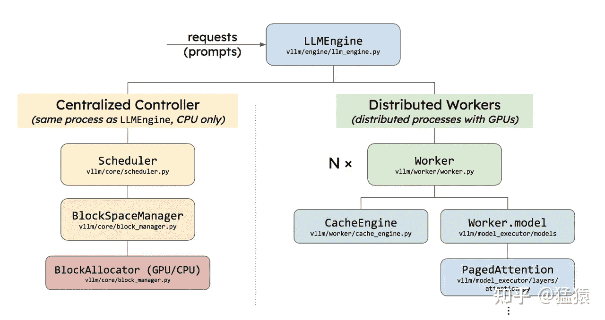

其中：

+ 在每1个推理阶段中，调度器（`Scheduler`）决定哪些请求可以参与推理，并为这些请求做好逻辑块->物理块的映射。

+ 在每1个推理阶段中，分布式执行者（图中`Distributed Workers`部分，根据代码，我们将其命名为`model_executor`会更加合适）接收调度器传来的这些请求，分发到各个`worker`上去做推理。`Worker`中的`CacheEngine`负责实际管理`KV Cache`；`Worker`中的`model`负责加载模型、实行推理，`PagedAttention`相关的实现和调用就在`model`下。

这里，每1个推理阶段的定义是：`prefill`算1个推理阶段，每个`decode`各算1个推理阶段。在本文中，我们统一用`step`来表示“1个推理阶段”。

+ 在本文中，我们会详细解读调度器（`Scheduler`）全部细节；

+ 在下一篇文章中，我们会详细解读块管理（`blockmanager`）的全部细节，并以`parallel sampling`，`beam search`和`prefix caching`为例，将上图左半部分全部串一遍

+ 在后续文章中，我们会来解读上图右半部分细节（还没来得及拆逻辑，暂时不知道会写几篇）

由于块管理者和调度器在代码上逻辑层层嵌套，所以为了不影响大家对调度器的理解，涉及到块管理者的部分，本文也会给出尽量简明清晰的说明。

## 一、入口函数

在源[码架构篇](https://link.zhihu.com/?target=https%3A//docs.vllm.ai/en/latest/getting_started/quickstart.html)中我们提过，本系列的介绍思路是：以“离线批处理”作为入口，详细解说内核引擎`LLMEngine`的各块细节。在此基础上我们再来看“在线流式服务”的运作流程。所以现在，我们先来回顾下离线批处理的调用方式：

```python
from vllm import LLM, SamplingParams

# batch prompts
prompts = [
    "Hello, my name is",
    "The president of the United States is",
    "The capital of France is",
    "The future of AI is",
]

# 采样参数
sampling_params = SamplingParams(temperature=0.8, top_p=0.95)

# 初始化vLLM offline batched inference实例，并加载指定模型
llm = LLM(model="facebook/opt-125m")

# 推理
outputs = llm.generate(prompts, sampling_params)

# 对每一条prompt，打印其推理结果
for output in outputs:
    prompt = output.prompt
    generated_text = output.outputs[0].text
    print(f"Prompt: {prompt!r}, Generated text: {generated_text!r}")
```

有两点需要注意：

+ `llm = LLM(model="facebook/opt-125m")`：实例化了一个离线批处理的`vLLM`对象。其本质是实例化了一个内核引擎`LLMEngine`对象。在执行这个步骤时，`LLMEngine`会执行一次模拟实验（`profiling`），来判断需要在`gpu`上预留多少的显存空间给`KV Cache` block（模拟实验的流程参见源码篇1的3.2节，TODO，大家可以对照着来读源码，本文不再涉及这块源码细节）。

+ 推理入口在第24行`outputs = llm.generate(prompts, sampling_params)`。现在我们进入`LLM`类下，来看这个`generate`函数，代码如下：


# vLLM LLM 类与 SequenceGroup

## 一、LLM 类与 generate() 调用流程

```
vllm/entrypoints/llm.py
class LLM:
    """An LLM for generating texts from given prompts and sampling parameters.
       ...
    """
    def __init__(self, model: str, tokenizer: Optional[str] = None, tokenizer_mode: str = "auto", trust_remote_code: bool = False, tensor_parallel_size: int = 1, dtype: str = "auto", quantization: Optional[str] = None, revision: Optional[str] = None, tokenizer_revision: Optional[str] = None, seed: int = 0, gpu_memory_utilization: float = 0.9, swap_space: int = 4, enforce_eager: bool = False, max_context_len_to_capture: int = 8192, disable_custom_all_reduce: bool = True, **kwargs,) -> None:
        ...

==============================================================================
使用配置好的engine参数，初始化LLMEngine实例
==============================================================================
self.llm_engine = LLMEngine.from_engine_args(engine_args, usage_context=UsageContext.LLM_CLASS)

==============================================================================
用于全局唯一的request_id，在vLLM中内核引擎的处理中，1个prompt视为1个request，分配全局唯一的request_id
==============================================================================
self.request_counter = Counter()

    def generate(self, prompts: Optional[Union[str, List[str]]] = None,
        sampling_params: Optional[SamplingParams] = None,
        prompt_token_ids: Optional[List[List[int]]] = None,
        use_tqdm: bool = True,
        lora_request: Optional[LoRARequest] = None,
        multi_modal_data: Optional[MultiModalData] = None,) -> List[RequestOutput]:
        """Generates the completions for the input prompts.

        NOTE: This class automatically batches the given prompts, considering
        the memory constraint. For the best performance, put all of your prompts
        into a single list and pass it to this method.

        Args:
            prompts: prompts可以是str，也可以是list[str]
            sampling_params: 采样超参，例如温度、top_k等；如果为None则使用vLLM默认的参数
            prompt_token_ids: prompt对应的token_id，如果没有提供的话，vllm会调用tokenizer进行转换
            use_tqdm: 是否要展示process bar
            lora_request: 如果想请求特定的lora_adapter，可以将它的path等信息包装在该请求中,
                          但vLLM建议尽量不要使用这种方式，因为私有的lora adapter可能会带来一些
                          安全性的问题
            multi_modal_data: 多模态相关的数据

        Returns:
            A list of RequestOutput objects containing the generated
            completions in the same order as the input prompts.
        """
        if prompts is None and prompt_token_ids is None:
            raise ValueError("Either prompts or prompt_token_ids must be provided.")
        if isinstance(prompts, str):
            prompts = [prompts]
        if (prompts is not None and prompt_token_ids is not None and len(prompts) != len(prompt_token_ids)):
            raise ValueError("The lengths of prompts and prompt_token_ids must be the same.")
        if sampling_params is None:
            sampling_params = SamplingParams()
        if multi_modal_data:
            multi_modal_data.data = multi_modal_data.data.to(torch.float16)

============================================================================
将request添加到engine中在vLLM内核运算逻辑中，1个prompt算1个request，需要有1个全局唯一的request_id
============================================================================
        num_requests = len(prompts) if prompts is not None else len(prompt_token_ids)
        for i in range(num_requests):
            prompt = prompts[i] if prompts is not None else None
            token_ids = None if prompt_token_ids is None else prompt_token_ids[i]

========================================================================
将每个prompt添加进LLMEngine中，_add_request具体做了以下几件事：
- 将每个prompt处理成特定的输入类型（SequenceGroup实例，后文会细说）
- 将每个prompt加入Scheduler的waiting队列，等待处理
========================================================================
            self._add_request(prompt,
                sampling_params,
                token_ids,
                lora_request=lora_request,
                multi_modal_data=MultiModalData(type=multi_modal_data.type, data=multi_modal_data.data[i].unsqueeze(0)) if multi_modal_data else None,)

============================================================================
把这个batch的所有prompt都添加完后，执行推理，详情参见_run_engine
============================================================================
        return self._run_engine(use_tqdm)

    def _add_request(self, prompt: Optional[str],
        sampling_params: SamplingParams,
        prompt_token_ids: Optional[List[int]],
        lora_request: Optional[LoRARequest] = None,
        multi_modal_data: Optional[MultiModalData] = None,) -> None:
        每个prompt赋1个request_id
        request_id = str(next(self.request_counter))
        self.llm_engine.add_request(request_id, prompt, sampling_params, prompt_token_ids,
            lora_request=lora_request,
            multi_modal_data=multi_modal_data)

    def _run_engine(self, use_tqdm: bool) -> List[RequestOutput]:
        Initialize tqdm.
        if use_tqdm:
            num_requests = self.llm_engine.get_num_unfinished_requests()
            pbar = tqdm(total=num_requests, desc="Processed prompts", dynamic_ncols=True)

===========================================================================
如果当前调度器中还有没完成推理的请求（调度器中waiting/running/swapped任一队列非空）
===========================================================================
        outputs: List[RequestOutput] = []
        while self.llm_engine.has_unfinished_requests():

=========================================================================
执行1次推理调度（step），决定哪些请求的数据可以参与到这次推理中
=========================================================================
            step_outputs = self.llm_engine.step()
            for output in step_outputs:

=====================================================================
如果本step后，有请求已经完成了推理，就将推理结果装进outputs中
=====================================================================
                if output.finished:
                    outputs.append(output)
            if use_tqdm:
                pbar.update(1)
        if use_tqdm:
            pbar.close()

        Sort the outputs by request ID.
        This is necessary because some requests may be finished earlier than
        its previous requests.
        outputs = sorted(outputs, key=lambda x: int(x.request_id))
        return outputs
```

总结来说，当我们调用 `outputs = llm.generate(prompts, sampling_params)` 时，它实际做了两件事情：

+   `_add_request`：将输入数据传给 `LLMEngine`，它具体做了如下事情：
    +   把每 1 个 `prompt` 包装成一个 `SequenceGroup` 对象。从客户端角度看，1 个请求可能包含多个 `prompts`，例如离线批处理场景下你可以将 1 个 batch 理解成 1 个请求；但是从 `LLMEngine` 的角度看，1 个 `prompt` 是 1 个请求，所以它会对输入数据进行预处理。在后文对 `SequenceGroup` 的讲解中，我们会来看 vLLM 这样做的意义。
    +   把包装成 `SequenceGroup` 对象的数据加入调度器（`Scheduler`）的 `waiting` 队列，等待处理。这一块相关的细节，我们放在后文说。

+   `_run_engine`：执行推理。只要调度器的 `waiting/running/swapped` 队列非空，我们就认为此时这批 batch 还没有做完推理，这时我们就会调用 `LLMEngine` 的 `step()` 函数，来完成 1 次调度以决定要送哪些数据去做推理。

所以，想要知道调度器的运作流程，我们只要从 `LLMEngine` 的 `add_request()` 和 `step()` 两个函数入手就好了。不过在正式进入这两个函数的讲解之前，我们先来看和输入数据一个问题：为什么要把每个 `prompt` 都包装成一个 `SequenceGroup` 实例？`SequenceGroup` 又长什么样呢？

## 二、SequenceGroup

### 2.1 原生输入

在一般的推理场景中，我们通常给模型传 1 个 `prompt` 及相关的采样参数，让模型来做推理。此时你的输入可能长下面这样：

```
("To be or not to be,", SamplingParams(temperature=0.8, top_k=5, presence_penalty=0.2)),
```

但在其余的场景中，模型 decoding 的策略可能更加复杂，例如：

+   Parallel Sampling：你传给模型 1 个 `prompt`，希望模型基于这个 `prompt`，给出 n 种不同的 output
+   Beam Search：你传给模型 1 个 `prompt`，在采用 Beam Search 时，每个推理阶段你都会产出 top `k` 个 output，其中 `k` 称为 Beam width（束宽）。

这些情况下，你传给模型的输入可能长下面这样：

```
Parallel Sampling("What is the meaning of life?", SamplingParams(n=2, temperature=0.8, top_p=0.95, frequency_penalty=0.1))
Beam Search (best_of = 束宽)("It is only with the heart that one can see rightly", SamplingParams(n=3, best_of=3, use_beam_search=True, temperature=0.0)),
```

【备注：`SamplingParams` 遵从 OpenAI [API 范式，对其中](https://link.zhihu.com/?target=https%3A//platform.openai.com/docs/api-reference/completions) 各种参数的解释可参见 OpenAI 官方文档】

总结来说，可能出现 `1 个`prompt` -> 多个`outputs`` 的情况。那是否能设计一种办法，对 1 个 `prompt` 下所有的 `outputs` 进行集中管理，来方便 vLLM 更好做推理呢？

### 2.2 SequenceGroup 的作用

+   `1 个`prompt` -> 多个`outputs`` 这样的结构组成一个 `SequenceGroup` 实例。

+   其中每组 "`prompt` -> `output`" 组成一个序列（`seq`，属于 `Sequence` 实例），每个 `seq` 下有若干状态（`status`）属性，包括：

+   `WAITING`：正在 `waiting` 队列中。`waiting` 队列中的序列都没有做过 `prefill`。

+   `RUNNING`：正在 `running` 队列中，即已经开始做推理。

+   `SWAPPED`：正在 `swapped` 队列中，表示此时 gpu 资源不足，相关的 `seq_group` 被抢占，导致其暂停推理，相关的 KV block 被置换到 cpu 上（`swap out`），等待 gpu 资源充足时再置换回来重新计算（`swap in`）。

+   若干和 `Finish` 相关的状态，表示该 `seq` 推理已经结束，具体包括：


## 2.2 Sequence 的状态

+ `FINISHED_STOPPED`：正常执行完毕，例如碰到 `<eos>` 符号，该 `seq` 的推理正常结束了

+ `FINISHED_LENGTH_CAPPED`：因为 `seq` 的长度达到最大长度限制，而结束推理

+ `FINISHED_ABORTED`：因不正常状态，而被终止的推理。例如客户端断开连接，则服务器会终止相关 `seq` 的推理

+ `FINISHED_IGNORED`：因 `prompt` 过长而被终止执行的推理。本质上也是受到长度限制

+ 在 `vLLM` 中有一个重要假设：一个 `seq_group` 中的所有 `seq` 共享 1 个 `prompt`。

我们来通过一个具体的例子，更好感受一下 `SequenceGroup` 的作用：

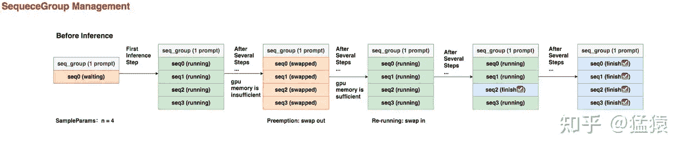

+ 在推理开始之前，这个 `seq_group` 下只有 1 条 `seq`，它就是 `prompt`，状态为 `waiting`。

+ 在第 1 个推理阶段，调度器选中了这个 `seq_group`，由于它的采样参数中 `n = 4`，所以在做完 `prefill` 之后，它会生成 4 个 `seq`，它们的状态都是 `running`。

+ 在若干个推理阶段后，`gpu` 上的资源不够了，这个 `seq_group` 不幸被调度器抢占（`preemption`），它相关的 `KV block` 也被 `swap out` 到 `cpu` 上。此时所有 `seq` 的状态变为 `swapped`。这里要注意，当一个 `seq_group` 被抢占时，对它的处理有两种方式：

+ `Swap`：如果该 `seq_group` 下的 `seq` 数量 > 1，此时会采取 `swap` 策略，即把 `seq_group` 下【所有】`seq` 的 `KV block` 从 `gpu` 上卸载到 `cpu` 上。（`seq` 数量比较多，直接把算出的 `KV block` 抛弃，比较可惜）

+ `Recomputation`：如果该 `seq_group` 下的 `seq` 数量 = 1，此时会采取 `recomputation` 策略，即把该 `seq_group` 相关的物理块都释放掉，然后将它重新放回 `waiting` 队列中。等下次它被选中推理时，就是从 `prefill` 阶段开始重新推理了，因此称为“重计算”。（`seq` 数量少，重新计算 `KV block` 的成本不高）

【注意，并不是每个 `seq_group` 都会经历抢占，具体要看调度器策略和 `gpu` 资源使用情况】

+ 又过了若干个推理阶段，`gpu` 上的资源又充足了，此时执行 `swap in` 操作，将卸载到 `cpu` 上的 `KV block` 重新读到 `gpu` 上，继续对该 `seq_group` 做推理，此时 `seq` 的状态又变为 `running`。

+ 又过了若干个推理阶段，该 `seq_group` 中有 1 个 `seq` 已经推理完成了，它的状态就被标记为 `finish`，此后这条已经完成的 `seq` 将不参与调度。

+ 又过了若干个推理阶段，这个 `seq_group` 下所有的 `seq` 都已经完成推理了，这样就可以把它作为最终 `output` 返回了。

相信通过这个例子，我们已经能更好理解为什么 `vLLM` 要把 1 个 `prompt` 包装成 `SequenceGroup` 实例了。接下来我们就来看 `SequenceGroup` 实例的具体结构。

## 2.3 SequenceGroup 的结构

`SequenceGroup` 相关的脚本在 `vllm/sequence.py` 中，下图给出了 `SequenceGroup` 的结构图解（仅列出重要的属性和方法）：

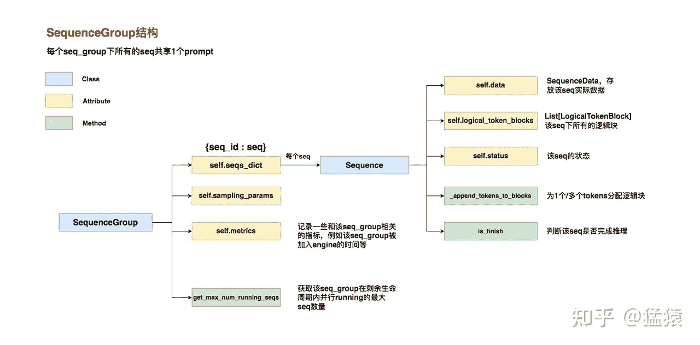

### （1）结构总述

#### SequenceGroup

+ `self.seqs_dict`：`{seq_id: seq}`，其中每个 `seq` 是一个 `Sequence` 对象。正如我们前文介绍的那样，一个 `seq_group` 下包含若干 `seqs`

+ `self.sampling_params`：采样参数

+ `self.metrics`：记录该 `seq_group` 相关的指标，例如该 `seq_group` 是什么时候被加入 `LLMEngine` 的（`arrival_time`），该 `seq_group` 第一次被调度器选中调度是什么时候等等。调度器在选择时，会参考 `seq_groups` 们的这些指标来做决策。

+ `get_max_num_running_steps`：该 `seq_group` 在剩余生命周期内并行 `running` 的最大 `seq` 数量。“剩余生命周期”指从此刻一直到 `seq_group` 中所有的 `seq` 都做完推理。举个例子来说，我们看 2.2 节配图中倒数第 3 个时刻，此时这个 `seq_group` 内所有的 `seq` 都还没结束推理，所以若调用这个方法，则返回值为 4；再看倒数第 2 个时刻，此时有 1 个 `seq` 已经完成了推理，所以若调用这个方法，则返回值为 3。在后续调度策略代码中，我们将经常看到这个方法被调用，目的是用于估计若当前对一个 `seq_group` 做推理，它将消耗多少 `gpu` 资源。

我们来详细看下 `get_max_num_running_steps` 代码实现（一切尽在注释中）：

```
    def get_max_num_running_seqs(self) -&gt; int:&quot;&quot;&quot;The maximum number of sequences running in parallel in the remaining
        lifetime of the request.
        返回请求在其剩余生命周期中并行运行的最大序列数。
        &quot;&quot;&quot;============================================================================若采用beam search，每1个推理阶段都是best_of（束宽）个seq在running============================================================================if self.sampling_params.use_beam_search:return self.sampling_params.best_of============================================================================如果不采用beam search============================================================================else:=========================================================================此时best_of默认和n一致，即表示我们希望1个prompt产出n个outputs。因此理论上，这个seq_group下会维护best_of个seq（这就是self.num_seqs()的返回值）。如果出现best_of &gt; self.num_seqs()的情况，说明该seq_group刚从waiting变成running准备做推理（参考2.2节配图中左侧第1个时刻），此时对于这个seq_group来说，其剩余生命周期并行运行的最大seq数量为best_of=========================================================================if self.sampling_params.best_of &gt; self.num_seqs():At prompt stage, the sequence group is not yet filled upand only have one sequence running. However, in thegeneration stage, we will have best_of sequences running.return self.sampling_params.best_of=========================================================================其余时刻（例如2.2节配图中非左侧第1个时刻的所有时刻）下，我们就返回这个seq_group中未完成推理的seq数量。根据2.2节介绍，我们知道一个seq的完成状态有四种：SequenceStatus.FINISHED_STOPPED,SequenceStatus.FINISHED_LENGTH_CAPPED,SequenceStatus.FINISHED_ABORTED,SequenceStatus.FINISHED_IGNORED=========================================================================return self.num_unfinished_seqs()
```

#### Sequence

对于一个 `seq`，我们重点来看它的属性 `self.logical_token_blocks`（逻辑块）和方法 `_append_tokens_to_blocks`（生成逻辑块的方法）。在 `vLLM` 中，每个 `seq` 都单独维护一份属于自己的逻辑块，不同的逻辑块可以指向同一个物理块（此刻你一定很关心逻辑块和物理块是如何做映射的，我们会循序渐进地讲解这点，现在你可以先忽略映射方法，把目光聚焦于“一个 `seq` 的逻辑块长什么样，怎么初始化它的逻辑块”）

### （2）1 个逻辑块的结构

我们先来回答“1 个逻辑块长什么样”这个问题，逻辑块定义的代码比较简单，所以我们直接看代码（一切尽在注释中），代码路径 `vllm/block.py`

```
class LogicalTokenBlock:&quot;&quot;&quot;A block that stores a contiguous chunk of tokens from left to right.

    Logical blocks are used to represent the states of the corresponding
    physical blocks in the KV cache.
    
    KV cache的逻辑块
    &quot;&quot;&quot;def init(self,block_number: int, 逻辑块的序号block_size: int, 每个逻辑块中有多少个槽位（默认为16）) -&gt; None:self.block_number = block_numberself.block_size = block_size逻辑块刚初始化时，将其中的每个token_id都初始化为_BLANK_TOKEN_ID（-1）self.token_ids = [_BLANK_TOKEN_ID] * block_size 
        当前逻辑块中已经装下的token的数量self.num_tokens = 0def is_empty(self) -&gt; bool:&quot;&quot;&quot;判断当前逻辑块是为空&quot;&quot;&quot;return self.num_tokens == 0def get_num_empty_slots(self) -&gt; int:&quot;&quot;&quot;当前逻辑块的空余槽位&quot;&quot;&quot;return self.block_size - self.num_tokensdef is_full(self) -&gt; bool:&quot;&quot;&quot;判断当前逻辑块是否已经被装满&quot;&quot;&quot;return self.num_tokens == self.block_sizedef append_tokens(self, token_ids: List[int]) -&gt; None:&quot;&quot;&quot;将给定的一些token_ids装入当前逻辑块中&quot;&quot;&quot;给定的token_ids的长度必须 &lt;= 当前逻辑块剩余的槽位assert len(token_ids) &lt;= self.get_num_empty_slots()当前逻辑块第一个空槽的序号curr_idx = self.num_tokens将这些tokens装进去self.token_ids[curr_idx:curr_idx + len(token_ids)] = token_ids更新当前逻辑块中tokens的数量self.num_tokens += len(token_ids)def get_token_ids(self) -&gt; List[int]:&quot;&quot;&quot;获取当前逻辑块中所有被装满的位置的token_ids&quot;&quot;&quot;return self.token_ids[:self.num_tokens]def get_last_token_id(self) -&gt; int:&quot;&quot;&quot;获取当前逻辑块所所有被装满的位置的最后一个token_id&quot;&quot;&quot;assert self.num_tokens &gt; 0return self.token_ids[self.num_tokens - 1]
```

### （3）再回到 `Sequence` 上来

知道了每个逻辑块的结构，我们现在来回答“怎么给一个 `seq` 分配逻辑块”这个问题，也就是回到 2.3（1）中 `Sequence` 的 `_append_tokens_to_blocks` 方法上来：当一个 `seq` 只有 `prompt` 时，这个方法负责给 `prompt` 分配逻辑块；当这个 `seq` 开始产出 `output` 时，这个方法负责给每一个新生成的 `token` 分配逻辑块，整个过程如下图（图片来自 `vLLM` 论文，大家忽略图中 `block_table` 的部分）：

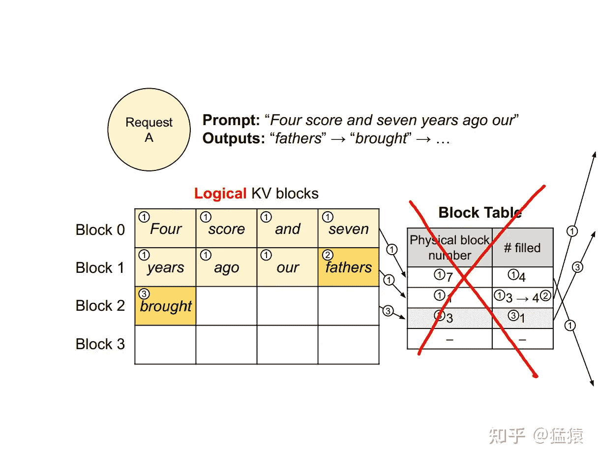

代码如下（一切尽在注释中，`/vllm/sequence.py`）:

```
 def _append_tokens_to_blocks(self, token_ids: List[int]) -&gt; None:&quot;&quot;&quot;
        将token_ids动态填入逻辑块列表中
        Args:
            token_ids: prompt部分的token_ids
        &quot;&quot;&quot;cursor = 0遍历prompt token_ids中的每一个token_idwhile cursor &lt; len(token_ids):如果当前逻辑块列表（`logical_token_blocks`）为空if not self.logical_token_blocks:则先append一个逻辑块，该逻辑块index为0，大小为16，其中的每一个token_id为-1self._append_logical_block()取出逻辑块列表中的最后一个逻辑块last_block = self.logical_token_blocks[-1]如果这最后一个逻辑块中已经没有槽位if last_block.is_full():那么再append一个逻辑块，其大小为16，其中每一个token_id为-1self._append_logical_block()把这个新append的逻辑块取出来last_block = self.logical_token_blocks[-1]检查当前取出的逻辑块中空槽位的数量num_empty_slots = last_block.get_num_empty_slots()用当前的token_ids填充空槽位，直到无法填满为止last_block.append_tokens(token_ids[cursor:cursor +num_empty_slots])cursor += num_empty_slots
```

好，到目前为止，我们就把 `vLLM` 对输入数据做预处理的部分介绍完了，简单总结下：

+ 在 `vLLM` 内部计算逻辑中，1 个 `prompt` 是 1 个 `request`

+ 每个 `prompt` 将被包装成一个 `SequenceGroup` 实例提供给调度器做调度

+ 1 个 `SequenceGroup` 实例下维护着若干个 `Sequence` 实例，对应着“1 个 `prompt` -> 多个 `outputs`"这种更一般性的解码场景。

+ 1 个 `Sequence` 实例下维护着属于自己的逻辑块列表，数据类型为 `List[LogicalTokenBlock]`

## 三、`add_request()`：将 `seq_group` 添加进调度器 `waiting` 队列

写了这么多，你是不是已经忘记上面都说了些什么了，不要紧，我们快速回顾下：

+ 首先，我们明确了 `vLLM` 最重要的推理内核引擎是 `LLMEngine`

+ `LLMEngine` 下有两个最重要的方法：`add_request()` 和 `step()`

+ `add_request()` 负责将每个 `prompt` 都包装成一个 `SequenceGroup` 对象，送入调度器的 `waiting` 队列中等待调度

+ `step()` 负责执行 1 次推理过程，在这个过程中，调度器首先决定哪些 `seq_group` 可以被送去推理，然后 `model_executor` 负责实际执行推理。

现在，在知道 `SequenceGroup` 相关定义的基础上，我们可以来看 `add_request()` 了，我们直接来看代码（一切尽在注释中，为了方便阅读，代码有所省略）：


```
vllm/engine/llm_engine.pydef add_request(self,request_id: str, 每个请求的唯一idprompt: Optional[str], prompt（文字版）sampling_params: SamplingParams, 用于采样的参数（温度、topk等）prompt_token_ids: Optional[List[int]] = None, prompt（input_ids版）arrival_time: Optional[float] = None, 请求到达的时间。如果是None，则用当前系统时间lora_request: Optional[LoRARequest] = None,  如果是用lora模型做推理，相关的lora请求multi_modal_data: Optional[MultiModalData] = None, 每个请求的多模态数据) -> None: """
        将request添加给LLMEngine

        Args:
            request_id: 在vLLM内部，1条prompt算1个请求，会附给1个请求id
            prompt: prompt（文字版）
            sampling_params: 采样参数（温度、topk等）
            prompt_token_ids: prompt（token_id版），没有提供的话vLLM会调用tokenizer来做
            arrival_time: 请求到达的时间。如果是None，则用当前系统时间
            multi_modal_data: 多模态数据（暂时忽略不看）
        """...
============================================================================设置该请求的到达时间============================================================================if arrival_time is None:arrival_time = time.time()...每个KV cache block的大小（默认为16）block_size = self.cache_config.block_size当前seq的id（见后文讲解）seq_id = next(self.seq_counter)获取用于表示<eos>的token_ideos_token_id = self.tokenizer.get_lora_tokenizer(lora_request).eos_token_id============================================================================为当前序列创建Sequence对象，在Sequence对象中也包括对当前序列逻辑块们的管理============================================================================seq = Sequence(seq_id, prompt, prompt_token_ids, block_size,eos_token_id, lora_request)...============================================================================每个prompt被包装成一个SequenceGroup实例============================================================================seq_group = SequenceGroup(request_id, [seq], sampling_params,arrival_time, lora_request, multi_modal_data)============================================================================将seq_group中所有序列添加进scheduler的self.waiting队列中self.waiting是一个双端队列实例，我们可以在队列的两端进行插入/删除操作============================================================================self.scheduler.add_seq_group(seq_group)
```

## 四：`step()`：调度器策略

现在所有的`seq_group`都已经被送入调度器（`Scheduler`）的`waiting`队列中了，接下来我们就来看，在1个推理阶段中，调度器是通过什么策略来决定要送哪些`seq_group`去做推理的，这也是vLLM难啃的硬骨头之一。

调度器相关的代码都在`vllm/core/scheduler.py`中，由于代码逻辑嵌套比较复杂，所以我们依然先通过图解的方式把整个调度流程介绍一遍，然后再看关键的源码细节。

### 4.1 调度器结构

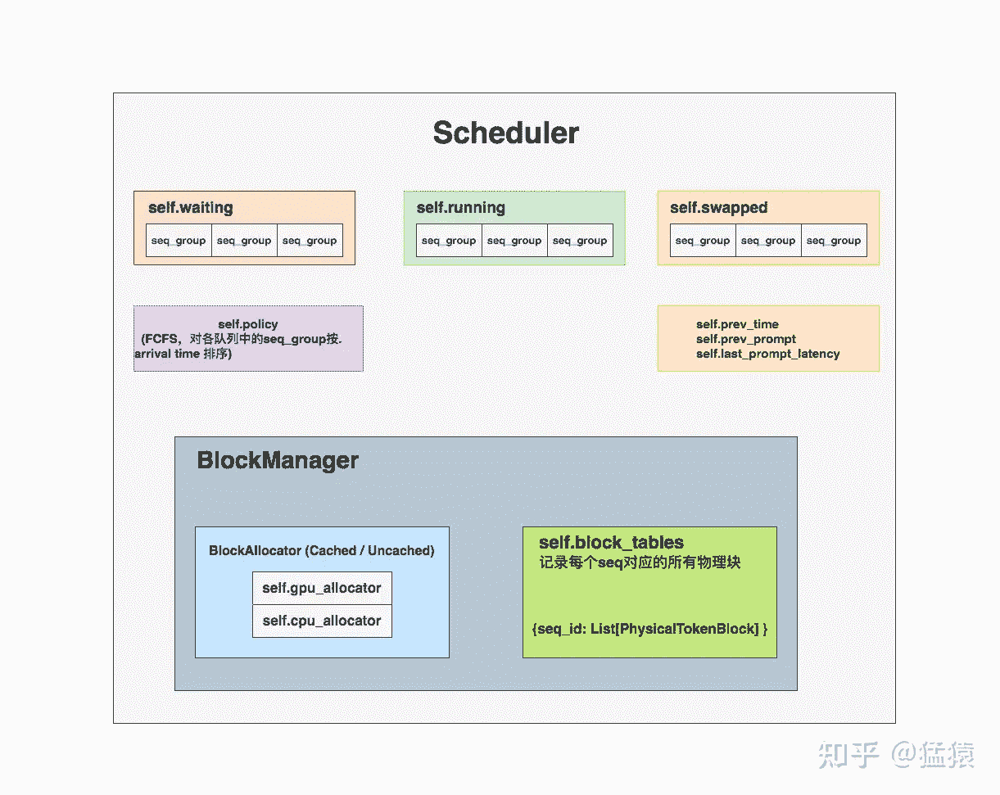

vLLM调度器维护的重要属性如上图所示：

+   `self.waiting`, `self.running`, `self.swapped`：这三个都是`python`的`deque()`实例（双端队列，允许你从队列两侧添加或删除元素）。

+   `waiting`队列用于存放所有还未开始做推理的`seq_group`，“未开始”指连`prefill`阶段都没有经历过。所以`waiting`队列中的`seq_group`只有一个`seq`，即是原始的`prompt`。

+   `running`队列用于存放当前正在做推理的`seq_group`。更准确地说，它存放的是上1个推理阶段被送去做推理的`seq_group`们，在开始新一轮推理阶段时，调度器会根据本轮的筛选结果，更新`running`队列，即决定本轮要送哪些`seq_group`去做推理。

+   `swapped`队列用于存放被抢占的`seq_group`。在2.2节中我们有提过，若一个`seq_group`被抢占，调度器会对它执行`swap`或`recomputation`操作，分别对应着将它送去`swapped`队列或`waiting`队列，在后文我们会详细分析抢占处理的代码

+   `self.policy`：是vLLM自定义的一个`Policy`实例，目标是根据调度器总策略（FCFS，First Come First Serve，先来先服务）原则，对各个队列里的`seq_group`按照其`arrival time`进行排序。相关代码比较好读，所以这里我们只概述它的作用，后续不再介绍它的代码实现。

+   `self.prev_time`：上一次调度发起的时间点，初始化为0。我们知道每执行1次推理阶段前，调度器都要做一次调度，这个变量存放的就是上次调度发起的时间点。

+   `self.prev_prompt`：取值为`True`/`False`，初始化为`False`。若上一次调度时，调度器有从`waiting`队列中取出`seq_group`做推理，即为`True`，否则为`False`。

+   `self.last_prompt_latency`：记录“当前调度时刻（`now`） - 最后一次有从`waiting`队列中取数做推理的那个调度时刻”的差值（并不是每一次调度时，调度器一定都会从`waiting`队列中取`seq_group`，它可能依旧继续对`running`队列中的数据做推理），初始化为0。

目前你可能很难明白这三个属性的作用，不要着急，在后文讲解具体调度流程时，我们会再来看它们。这里只需记住它们的定义即可。

+   `BlockManager`：物理块管理器。这也是vLLM自定义的一个`class`。截止本文写作时，vLLM提供了`BlockSpaceManagerV1`和`BlockSpaceManagerV2`两个版本的块管理器。`V1`是vLLM默认的版本，`V2`是改进版本（但还没开发完，例如不支持`prefix caching`等功能）。所以本文依然基于`BlockSpaceManagerV1`进行讲解。物理块管理器这个`class`下又维护着两个重要属性：

+   `BlockAllocator`：物理块分配者，负责实际为`seq`做物理块的分配、释放、拷贝等操作。这也是我们后文要解读的对象。其下又分成`self.gpu_allocator`和`self.cpu_allocator`两种类型，分别管理`gpu`和`cpu`上的物理块。

+   `self.block_tables`：负责维护每个`seq`下的物理块列表，本质上它是一个字典，形式如`{seq_id: List[PhysicalTokenBlock]}`。注意，这里维护者【所有】`seq_group`下`seq`的物理块，而不是单独某一个`seq`的。因为整个调度器都是全局的，其下的`BlockManager`自然也是全局的。

读到这里，你还记得2.3节中我们曾介绍过，每个`Sequence`实例中维护着属于这个`seq`的逻辑块吗？而我们从`self.block_tables`中，又能根据`seq_id`找到这个`seq`对应的物理块。这就实现了“逻辑块 -> 物理块”的映射。在刚开始读代码的时候，很多朋友从直觉上都会觉得`BlockManager`就是用来存储逻辑块和物理块映射的，其实它只负责管理和分配物理块，映射关系潜藏在`seq`中。理解这点对理解代码非常重要。

现在，我们就把调度器（`Scheduler`）的结构理清了。我知道你肯定还有很多疑惑。所以我们马上来看调度策略的具体流程：“对于装在`waiting`、`running`、`swapped`队列中的那些`seq_group`，是根据什么规则决定本次推理阶段该送谁去推理呢？”

### 4.2 整体调度流程

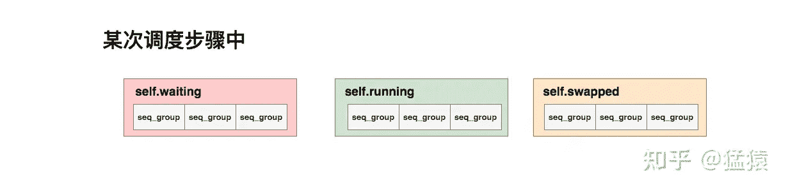

上图刻画了某次调度步骤中三个队列的情况，再复习一下：

+   `waiting`队列中的数据都没有做过`prefill`，每个`seq_group`下只有1个`seq`（`prompt`）

+   `running`队列中存放着上一个推理阶段被送去做推理的所有`seq_group`

+   `swapped`队列中存放着之前调度阶段中被抢占的`seq_group`

`running`队列中的`seq_group`不一定能继续在本次调度中被选中做推理，这是因为`gpu`上`KV cache`的使用情况一直在变动，以及`waiting`队列中持续有新的请求进来的原因。所以调度策略的职责就是要根据这些变动，对送入模型做推理的数据做动态规划。

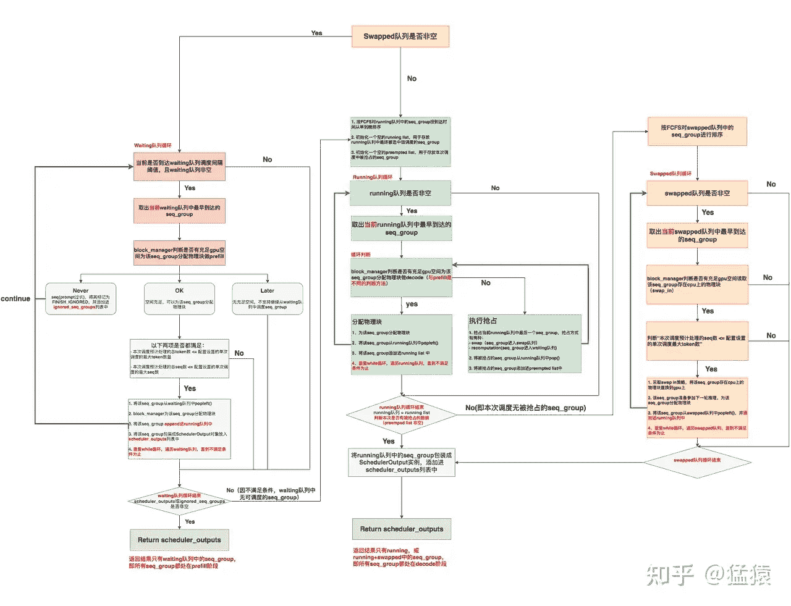

根据源码，我将vLLM调度步骤整理成上述流程图。看着有点复杂是吧，不要担心，我们这就来拆解它。

总结来说：

+   如果当前`swapped`队列为空，那就去检查是否能从`waiting`队列中调度`seq_group`，直到不满足调度条件为止（`gpu`空间不足，或`waiting`队列已为空等）。此时，1个推理阶段中，所有的`seq_group`都处在`prefill`阶段。

+   如果当前`swapped`队列非空，或者无法从`waiting`队列中调度任何`seq_group`时：

+   检查是否能从`running`队列中调度`seq_group`，直到不满足调度条件为止。

+   若本次无新的被抢占的`seq_group`，且`swapped`队列非空，就检查是否能从`swapped`队列中调度`seq_group`，直到不满足调度条件为止。

此时，1个推理阶段中，所有的`seq_group`要么全来自`running`队列，要么来自`running + swapped`队列，它们都处在`decode`阶段。

至此我们要记住vLLM调度中非常重要的一点：在1个推理阶段中，所有的`seq_group`要么全部处在`prefill`阶段。要么全部处在`decode`阶段。

你可能想问：为什么要以`swapped`是否非空为判断入口呢？

这是因为，如果当前调度步骤中`swapped`队列非空，说明在之前的调度步骤中这些可怜的`seq_group`因为资源不足被抢占，而停滞了推理。所以根据FCFS规则，当`gpu`上有充足资源时，我们应该先考虑它们，而不是考虑`waiting`队列中新来的那些`seq_group`。

同理，在图中你会发现，当我们进入对`running`队列的调度时（图中红色分支），我们会根据“本次调度是否有新的被抢占的`seq_group`”，来决定要不要调度`swapped`队列中的数据。这个理由也很简单：在本次调度中，我就是因为考虑到`gpu`空间不足的风险，我才新抢占了一批序列。既然存在这个风险，我就最好不要再去已有的`swapped`队列中继续调度`seq_group`了。

到这里，我们已经把整个调度流程的关键点给说完了。接下来，我们会配合源码，对上图中的细节进行介绍。

### 4.3 `_passed_delay`：判断调度`waiting`队列的时间点

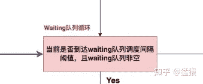

在4.2的流程图中，我们会看到进入`waiting`循环的判断条件之一是：`waiting`队列是否达到调度间隔阈值。这是个什么东西？又为什么要设置这样一个阈值呢？

我们知道模型在做推理时，`waiting`队列中是源源不断有`seq_group`进来的，一旦vLLM选择调度`waiting`队列，它就会停下对`running`/`swapped`中`seq_group`的`decode`处理，转而去做`waiting`中`seq_group`的`prefill`，也即vLLM必须在新来的`seq_group`和已经在做推理的`seq_group`间取得一种均衡：既不能完全不管新来的请求，也不能耽误正在做推理的请求。所以“`waiting`队列调度间隔阈值”就是来控制这种均衡的：

+   调度间隔设置得太小，每次调度都只关心`waiting`中的新请求，这样发送旧请求的用户就迟迟得不到反馈结果。且此时`waiting`队列中积累的新请求数量可能比较少，不利于做`batching`，浪费了并发处理的能力。

+   调度间隔设置得太大，`waiting`中的请求持续挤压，同样对vLLM推理的整体吞吐有影响。

那这个阈值在代码中是怎么控制的呢？还记得4.1中我们画`Scheduler`的结构图时有三个乍一看比较难懂的属性吗（见下图），它们就是用来控制这个阈值的：


`vllm/core/scheduler.py`脚本的`_passed_delay()`函数写了阈值判断的相关逻辑，我们直接看代码（一切尽在注释中）:


```python
def _passed_delay(self, now: float) -> bool:
    """
    判断当下是否可以从waiting队列中调度新请求
    这个函数确保了在调度过程中不会频繁地处理新来的seq_group

    Args:
        now: 当前调度时间点
    """
self.prev_prompt: True/False，记录上一次调度步骤中，是否选择了从waiting队列中做调度
self.prev_time：上次调度步骤时间点（不管是从哪个队列中调度，每次调度都会记录下时间点）若上个调度步骤中，我们选择从waiting队列中做调度，则计算两个调度时刻的间隔
if self.prev_prompt:
    self.last_prompt_latency = now - self.prev_time
用当前调度时间更新prev_time由于目前还不知道本次是否会从waiting队列中调度，因此prev_prompt先设为False
self.prev_time, self.prev_prompt = now, False
Delay scheduling prompts to let waiting queue fill up
delay_factor：用户配置的，用于调整调度间隔阈值的因子。大于0则意味着用户想开启阈值判断
if self.scheduler_config.delay_factor > 0 and self.waiting:
    计算在waiting队列中，最早到达的seq_group的到达时间
    earliest_arrival_time = min([e.metrics.arrival_time for e in self.waiting])
    now - earliest_arrival_time：最早到达waiting队列的seq_group当前“实际”等待的时间
    delay_factor*last_prompt_latency：最早到达waiting队列的请求当前“应该”等待的时间
    只要前者比后者大，或者此时running队列中根本没有请求在跑，就可以进行对waiting做调度
    passed_delay = ((now - earliest_arrival_time) > (self.scheduler_config.delay_factor * self.last_prompt_latency) or not self.running)
    如果你不想开启阈值判断，那就直接返回True
else:
    passed_delay = True
return passed_delay
```

### 4.4 can_allocate：能否为seq_group分配物理块做prefill

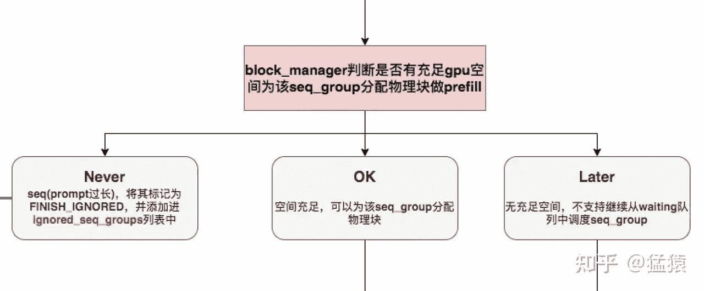

通过了调度时间阈值的判断条件，现在我们顺利从`waiting`中取出一个`seq_group`，我们将对它进行`prefill`操作。所以这里我们必须先判断：`gpu`上是否有充足的空间为该`seq_group`分配物理块做`prefill`，根据4.1中绘制的调度器结构，这个操作当然是由我们的`self.block_manager`来做。

判断的入口代码为`can_allocate = self.block_manager.can_allocate(seq_group)`，配合上面图例，我们直接来看`can_allocate`函数的代码，（一切尽在注释中）:

`vllm/core/block_manager_v1.py`

```python
def can_allocate(self, seq_group: SequenceGroup) -> AllocStatus:
    """
    确实是否可以给这个seq_group分配物理块，返回结果有三种情况：
    - AllocStatus.NEVER：不分配；
    - AllocStatus.OK：可以分配；
    - AllocStatus.LATER：延迟分配
    """
    FIXME(woosuk): Here we assume that all sequences in the group sharethe same prompt. This may not be true for preempted sequences.(这里我们假设一个seq_group下的所有序列的prompt都是相同的)
    取出这个seq_group下处于waiting状态的序列
    seq = seq_group.get_seqs(status=SequenceStatus.WAITING)[0]
    取出这个seq所有的逻辑块
    num_required_blocks = len(seq.logical_token_blocks)
    block上的滑动窗口（可暂时假设其值为None，先忽略不看
    if self.block_sliding_window is not None:
        num_required_blocks = min(num_required_blocks, self.block_sliding_window)
    计算当前所有可用的物理块数量，List[PhysicalTokenBlock]
    num_free_gpu_blocks = self.gpu_allocator.get_num_free_blocks()
    Use watermark to avoid frequent cache eviction.决定是否能为当前seq分配物理块
    如果设备中所有的物理块数量 - 该seq实际需要的物理块数量 < 水位线block数量，则不分配（说明当前seq太长了）
    if (self.num_total_gpu_blocks - num_required_blocks < self.watermark_blocks):
        return AllocStatus.NEVER
    如果设备中可用的物理块数量 - 该seq实际需要的block数量 >= 水位线block数量，则分配
    if num_free_gpu_blocks - num_required_blocks = self.watermark_blocks:
        return AllocStatus.OK
    否则，现在不能分配，但可以延迟分配
    else:
        return AllocStatus.LATER
```

我们对上述代码做一些额外说明：

+   代码第32行：`num_free_gpu_blocks = self.gpu_allocator.get_num_free_blocks()`。这里是在统计当前`gpu`上所有可用的物理块数数量（忘记`gpu_allocator`是什么的朋友，可以再回顾下4.1的调度器结构图）。在`vLLM`中，`gpu_allocator`的类型有两种：

+   `CachedBlockAllocator`：按照`prefix caching`的思想来分配和管理物理块。在原理篇中，我们提过又些`prompts`中可能含有类似`system message`（例如，“假设你是一个能提供帮助的行车导航”）`E`）等`prefix`信息，带有这些相同`prefix`信息的`prompt`完全可以共享用于存放`prefix`的物理块，这样既节省显存，也不用再对`prefix`做推理。

+   `UncachedBlockAllocator`：正常分配和管理物理块，没有额外实现`prefix caching`的功能。

关于这两种`allocator`的具体实现方式，我们将放在源码解读第3篇块管理来做讲解。这里大家只要明白大致定义即可，并不影响我们对调度策略的解读。

+   `self.watermark_blocks`：水位线block数量，它起的是一个预警和缓冲的作用，防止在1次调度中把`gpu`上预留给`KV Cache`的显存空间打得过满，出现一些意外风险（毕竟这个预留的显存空间也是我们估计出来的）。

+   `NEVER`和`LATER`的区别：这两者的相同之处在于，都是因为当前显存空间不够，而无法继续调度`seq_group`。区别在于，`NEVER`是因为这条`seq`实在太长（即`prompt`太长），长到动用了`gpu`上所有的`block`（`num_total_gpu_blocks`）都无法处理它，所以后续步骤中我们会直接把这个`seq`标记为完成，不再处理它；而`LATER`是因为之前可能已经调度了很多`seq_group`，它们占据了相当一部分显存空间，导致`gpu`上剩余的可用`block`（`num_free_gpu_blocks`）无法再处理它，所以我们延迟处理。

### 4.5 can_append_slot：能否为seq_group分配物理块做decode

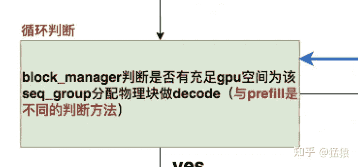

回顾4.2调度器的流程图，你会看到我们从`running`队列中调度`seq_group`时，我们也会判断是否能为该`seq_group`分配物理块。但这时，我们的物理块空间是用来做`decode`的（给每个`seq`分配1个`token`的位置），而不是用来做`prefill`的（给每个`seq`分配若干个`token`的位置），所以这里我们采取的是另一种判断方法`can_append_slot`

更具体来说，`running`队列中`seq_group`下的`n`个`seqs`在上1个推理阶段共生成了`n`个`token`。在本次调度中，我们要先为这`n`个`token`分配物理块空间，用于存放它们在本次调度中即将产生的`KV`值。

好，我们再回到这个`seq_group`的`n`个`seqs`上来，我们知道：

+   当往1个`seq`的物理块上添加1个`token`时，可能有两种情况：

+   之前的物理块满了，所以我新开1个物理块给它

+   之前的物理块没满，我直接添加在最后一个物理块的空槽位上

+   所以，对于1个`seq`来说，最坏的情况就是添加1个物理块；对于`n`个`seqs`来说，最坏的情况就是添加`n`个物理块（想想原理篇中讲过的`copy-on-write`机制）

+   对于1个`seq_group`，除了那些标记为“finish”的`seq`外，其余`seqs`要么一起送去推理，要么一起不送去推理。即它们是集体行动的

所以，判断能否对一个正在`running`的`seq_group`继续做推理的最保守的方式，就是判断当前可用的物理块数量是否至少为`n`。

我们直接看代码（一切尽在注释中）

`vllm/core/block_manager_v1.py`

```python
def can_append_slot(self, seq_group: SequenceGroup) -> bool:
    """
    对于这个seq_group，我们检查对于其中的每一个seq，
    是否能至少分配一个空闲物理块给它
    """
    Simple heuristic: If there is at least one free block for each sequence, we can append.
    num_free_gpu_blocks = self.gpu_allocator.get_num_free_blocks()
    num_seqs = seq_group.num_seqs(status=SequenceStatus.RUNNING)
    return num_seqs <= num_free_gpu_blocks
```

### 4.6 allocate与append_slot：为seq_group分配物理块

当我们判断当前有充足的`gpu KV Cache`空间给对应的`seq_group`做新一轮推理时，我们就可以实际给它分配物理块了。这一块的内容涉及的细节太多（不同的`prefix caching`方式，逻辑块到物理块的映射，物理块释放，物理块的`refcount`即`copy-on-write`机制等等），所以我们把这部分留在源码解读3：块管理中来详细说明。

跳过这块并不影响大家对调度器策略的解读。

### 4.7 preempt：抢占策略

纵观4.2的调度流程，现在我们只剩1个重点没讲了：抢占策略。

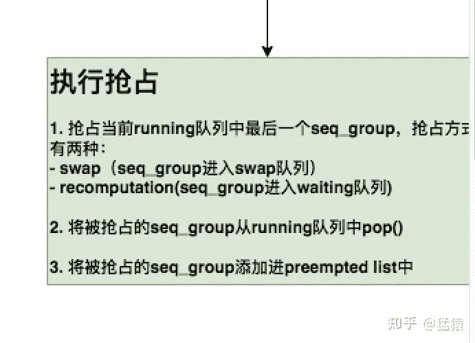

其实在2.2介绍`SequenceGroup`时，我们已经提到了抢占策略的核心逻辑，这里再复制一遍：

在若干个推理阶段后，`gpu`上的资源不够了，这个`seq_group`不幸被调度器抢占（`preemption`），它相关的`KV block`也被`swap out`到`cpu`上。此时所有`seq`的状态变为`swapped`。这里要注意，当一个`seq_group`被抢占时，对它的处理有两种方式：

+   `Swap`：如果该`seq_group`剩余生命周期中并行运行的最大`seq`数量 > 1，此时会采取`swap`策略，即把`seq_group`下【所有】`seq`的`KV block`从`gpu`上卸载到`cpu`上。（`seq`数量比较多，直接把算出的`KV block`抛弃，比较可惜）

+   `Recomputation`：如果该`seq_group`剩余生命周期中并行运行的最大`seq`数量 = 1，此时会采取`recomputation`策略，即把该`seq_group`相关的物理块都释放掉，然后将它重新放回`waiting`队列中(放在最前面)。等下次它被选中推理时，就是从`prefill`阶段开始重新推理了，因此被称为“重计算”。（`seq`数量少，重新计算`KV block`的成本不高）

对“最大生命周期...”这里有疑惑的朋友，回顾下本文2.3（1）。

我们直接来看代码（一切尽在注释中）


`vllm/core/scheduler.py`

```python
def _preempt(self, seq_group: SequenceGroup, 被抢占的seq_group blocks_to_swap_out: Dict[int, int], preemption_mode: Optional[PreemptionMode] = None,) -> None:
    """
    对被抢占的seq_group进行处理，包括修改其下seq状态，做好gpu到cpu块之间的映射等
    """
    If preemption mode is not specified, we determine the mode as follows:
    We use recomputation by default since it incurs lower overhead than swapping. However, when the sequence group has multiple sequences (e.g., beam search), recomputation is not currently supported. In such a case, we use swapping instead.
    FIXME(woosuk): This makes our scheduling policy a bit bizarre. As swapped sequences are prioritized over waiting sequences, sequence groups with multiple sequences are implicitly prioritized over sequence groups with a single sequence.
    TODO(woosuk): Support recomputation for sequence groups with multiple sequences. This may require a more sophisticated CUDA kernel.
    如果没有指定被抢占的类型
    if preemption_mode is None:
        如果这个seq_group在剩余生命周期中并行运行的最大seq数为1
        if seq_group.get_max_num_running_seqs() == 1:
            就将抢占类型定位“recompute”
            preemption_mode = PreemptionMode.RECOMPUTE
        否则定为swap
        else:
            preemption_mode = PreemptionMode.SWAP
=======================================================================
    如果抢占类型是“RECOMPUTE”则去除该seq对对应物理块的引用，同时将该seq状态改为running，放入waiting队列最前面（详情参见self._preempt_by_recompute）
=======================================================================
    if preemption_mode == PreemptionMode.RECOMPUTE:
        self._preempt_by_recompute(seq_group)
=======================================================================
    如果抢占类型是“SWAP“详情参见self._preempt_by_swap）
=======================================================================
    elif preemption_mode == PreemptionMode.SWAP:
        self._preempt_by_swap(seq_group, blocks_to_swap_out)
    else:
        raise AssertionError("Invalid preemption mode.")

def _preempt_by_recompute(self, seq_group: SequenceGroup,) -> None:
    获取这个seq_group下正在running的所有seqs，preemption_mode是RECOMPUTE时需要满足正在running的seqs数量为1
    seqs = seq_group.get_seqs(status=SequenceStatus.RUNNING)
    assert len(seqs) == 1
    for seq in seqs:
        将这条seq的状态从running改成waiting（后续这条seq就要重计算了）
        seq.status = SequenceStatus.WAITING
        释放这条seq对应的物理块即将对应物理块的引用-1，如果此时引用数量为0，说明对应物理块完全自由了，需要再将其放入自由物理块列表中
        self.free_seq(seq)
        因为这条seq需要重计算了，所以将其data对象下_num_computed_tokens设置为0
        seq.reset_state_for_recompute()
    NOTE: For FCFS, we insert the preempted sequence group to the front of the waiting queue.
    将被抢占，且未来需要重计算的序列，放到waiting队列的最前面
    self.waiting.appendleft(seq_group)

def _preempt_by_swap(self, seq_group: SequenceGroup, blocks_to_swap_out: Dict[int, int],) -> None:
=======================================================================
    - 释放该seq_group下所有seq的物理块，并为其分配对应的cpu物理块，
    - 将seq的状态从running改成swapped
=======================================================================
    self._swap_out(seq_group, blocks_to_swap_out)
=======================================================================
    在scheduler的swapped队列中添加该seq_group
=======================================================================
    self.swapped.append(seq_group)

def _swap_out(self, seq_group: SequenceGroup, 需要被swap到cpu上的seq_group blocks_to_swap_out: Dict[int, int],) -> None:
=======================================================================
    检查是否可以将当前seq_group对应的物理块swap到cpu上
    可以的条件：当前seq_group占用的gpu物理块数量 <= cpu上可用的物理块数量
=======================================================================
    if not self.block_manager.can_swap_out(seq_group):
        FIXME(woosuk): Abort the sequence group instead of aborting the entire engine.
        raise RuntimeError("Aborted due to the lack of CPU swap space. Please increase the swap space to avoid this error.")
=======================================================================
    释放该seq_group下所有seq的gpu物理块，并为其创建对应的cpu块mapping：{gpu物理块id：cpu物理块id}
=======================================================================
    mapping = self.block_manager.swap_out(seq_group)
    blocks_to_swap_out.update(mapping)
=======================================================================
    修改该seq_group下所有seq的状态：从running改成swapped
=======================================================================
    for seq in seq_group.get_seqs(status=SequenceStatus.RUNNING):
        seq.status = SequenceStatus.SWAPPED
```

额外说明的一点是，一旦你决定执行`swap out`操作，你就做做好`gpu`物理块->`cpu`物理块之间的映射，这样等之后你想`swap in`时，你才知道去`cpu`上的哪里把这些物理块找回来。

`swap`更多的细节也会涉及到`blockmanager`，所以遗留的细节，我们也放在第三篇中说

### 4.8 调度器核心代码

有了以上的基础（真是庞大的逻辑），我们现在终于能来看调度器中关于一次调度策略的核心代码了，大家可以配合4.2流程图阅读，一切尽在注释中～


# `vllm/core/scheduler.py` `_schedule` 方法

## 初始化

`blocks_to_swap_in`：`{cpu物理块id: gpu物理块id}`
`blocks_to_swap_out`：`{gpu物理块id: cpu物理块id}`
`blocks_to_copy`：`{旧物理块id：[由旧物理块copy-on-write而来的新物理块id]}`

```
blocks_to_swap_in: Dict[int, int] = {}
blocks_to_swap_out: Dict[int, int] = {}
blocks_to_copy: Dict[int, List[int]] = {}
```

Fix the current time.获取当下时间

```
now = time.time()
```

## 处理等待队列

Join waiting sequences if possible.如果 `swapped` 队列为空

```
if not self.swapped:
```

`ignored_seq_groups`：记录因太长（所需的 `blocks` 和总 `blocks` 之间的差值超过阈值了），而无法继续做生成的 `seq_group`，这些 `seq_group` 中的 `seq` 状态都会被标记为 `FINISHED_IGNORED`，表示直接不处理他们

```
ignored_seq_groups: List[SequenceGroup] = []
```

记录本次被调度的 `seq_group`

```
scheduled: List[SequenceGroup] = []
```

The total number of sequences on the fly, including therequests in the generation phase.计算 `Scheduler` `running` 队列中还没有执行完的 `seq` 数量

```
num_curr_seqs = sum(seq_group.get_max_num_running_seqs() for seq_group in self.running)
curr_loras = set(seq_group.lora_int_id for seq_group in self.running) if self.lora_enabled else None
```

Optimization: We do not sort the waiting queue since the preempted sequence groups are added to the front and the new sequence groups are added to the back. `lora` 相关的，可以暂时不看

```
leftover_waiting_sequences = deque()
```

本次调度处理的 `token` 总数

```
num_batched_tokens = 0
```

开启新一次调度（`while` 循环不结束意味着本次调度不结束，跳出 `while` 循环时意味着本次调度结束了）。开启新一次调度的条件：当 `waiting` 队列中有等待处理的请求，且当前时刻可以处理请求

```
while self._passed_delay(now) and self.waiting:
```

取出 `waiting` 队列中的第一个请求，也即最早到达的请求（`seq_group`）

```
seq_group = self.waiting[0]
```

统计该 `seq_group` 中处于 `waiting` 的 `seq` 的数量

```
waiting_seqs = seq_group.get_seqs(status=SequenceStatus.WAITING)
```

从 `waiting` 队列中取出来的 `seq_group`，其 `seq` 数量一定是 1

```
assert len(waiting_seqs) == 1, ("Waiting sequence group should have only one prompt " "sequence.")
```

获取该 `seq` 的序列长度（如果该 `seq_group` 来自之前被抢占的请求，那么这个长度不仅包括 `prompt`，还包括 `output`）

```
num_prefill_tokens = waiting_seqs[0].get_len()
```

如果从 `waiting` 队列中取出的这条 `seq` 的长度 `>` 每次调度能处理的最大序列长度，那么就打印警告信息，同时把这条 `seq` 的状态置为 `FINISHED_IGNORED`，并将对应 `seq_group` 装入 `ignored_seq_groups` 中，然后将其从 `waiting` 列表中移除，不再处理

```
if num_prefill_tokens > self.prompt_limit:
    logger.warning(f"Input prompt ({num_prefill_tokens} tokens) is too " f"long and exceeds limit of {self.prompt_limit}")
    for seq in waiting_seqs:
        seq.status = SequenceStatus.FINISHED_IGNORED
        ignored_seq_groups.append(seq_group)
        self.waiting.popleft()
        continue
```

If the sequence group cannot be allocated, stop.决定是否能给当前 `seq_group` 分配物理块。`can_allocate` 返回值可能有三种：`AllocStatus.NEVER`：不分配；`AllocStatus.OK`：可以分配；`AllocStatus.LATER`：延迟分配

```
can_allocate = self.block_manager.can_allocate(seq_group)
```

若是延迟分配，则说明现在没有足够的 `block` 空间，所以跳出 `while` 循环（不继续对 `waiting` 队列中的数据做处理了）

```
if can_allocate == AllocStatus.LATER:
    break
```

如果不分配，说明 `seq` 长得超出了 `vLLM` 的处理范围，则后续也不再处理它，直接将该 `seq` 状态标记为 `FINISHED_IGNORED`

```
elif can_allocate == AllocStatus.NEVER:
    logger.warning(f"Input prompt ({num_prefill_tokens} tokens) is too " f"long and exceeds the capacity of block_manager")
    for seq in waiting_seqs:
        seq.status = SequenceStatus.FINISHED_IGNORED
        ignored_seq_groups.append(seq_group)  # 记录因为太长而无法处理的 seq_group
        self.waiting.popleft()  # 将该 seq_group 从 waiting 队列中移除
        continue
```

`lora` 推理相关的部分，可暂时忽略

```
lora_int_id = 0
if self.lora_enabled:
    lora_int_id = seq_group.lora_int_id
if (lora_int_id > 0 and lora_int_id not in curr_loras and len(curr_loras) == self.lora_config.max_loras):
    # We don't have a space for another LoRA, so we ignore this request for now.
    leftover_waiting_sequences.appendleft(seq_group)
    self.waiting.popleft()
    continue
```

If the number of batched tokens exceeds the limit, stop. `max_num_batched_tokens`：单次调度中最多处理的 `token` 数量。`num_batched_tokens`：本次调度中累计处理的 `token` 数量。如果后者 `>` 前者，则结束本次调度

```
num_batched_tokens += num_prefill_tokens
if (num_batched_tokens > self.scheduler_config.max_num_batched_tokens):
    break
```

The total number of sequences in the `RUNNING` state should not exceed the maximum number of sequences. `num_new_seqs`：当前 `seq_group` 中状态为“未执行完”的序列的数量。`num_curr_seqs`：当前调度轮次中，状态为“未执行完”的序列总数。如果超过了我们对单次调度能执行的序列总数的阈值，就结束本次调度

```
num_new_seqs = seq_group.get_max_num_running_seqs()
if (num_curr_seqs + num_new_seqs > self.scheduler_config.max_num_seqs):  # 单次迭代中最多处理多少个序列
    break
if lora_int_id > 0:
    curr_loras.add(lora_int_id)
```

走到这一步时，说明当前 `seq_group` 已经通过上述种种验证，可以被加入本次调度中执行了。先将其从 `waiting` 队列中移出

```
self.waiting.popleft()
```

为当前 `seq_group` 分配物理块

```
self._allocate(seq_group)
```

将当前 `seq_group` 放入 `running` 队列中

```
self.running.append(seq_group)
```

记录本次调度累计处理的序列数量

```
num_curr_seqs += num_new_seqs
```

记录本次被调度的 `seq_group`

```
scheduled.append(ScheduledSequenceGroup(seq_group=seq_group, token_chunk_size=num_prefill_tokens))
```

和 `lora` 相关的操作，暂时忽略

```
self.waiting.extendleft(leftover_waiting_sequences)
```

如果本次有被调度的 `seq_group`（`scheduled` 非空）或者本次有被设置为不再处理的 `seq_group` (`ignored_seq_groups` 非空)，就将其包装成 `SchedulerOutputs` 对象

```
if scheduled or ignored_seq_groups:
    self.prev_prompt = True
    scheduler_outputs = SchedulerOutputs(
        scheduled_seq_groups=scheduled,
        prompt_run=True,
        num_batched_tokens=num_batched_tokens,
        blocks_to_swap_in=blocks_to_swap_in,
        blocks_to_swap_out=blocks_to_swap_out,
        blocks_to_copy=blocks_to_copy,
        ignored_seq_groups=ignored_seq_groups,
    )
    return scheduler_outputs
```

## 处理运行队列与抢占

NOTE(woosuk): Preemption happens only when there is no available slot to keep all the sequence groups in the `RUNNING` state. In this case, the policy is responsible for deciding which sequence groups to preempt。

如果 `swap` 队列非空，且本次没有新的需要被发起推理的 `seq_group`，则对 `running` 队列中的 `seq_group`，按照 "`当前时间` - 该 `seq_group` 到达时间"，从早到晚排列 `running` 队列中的 `seq_group`

```
self.running = self.policy.sort_by_priority(now, self.running)
```

Reserve new token slots for the running sequence groups. 初始化一个新的 `running` 队列（`deque()`）。初始化一个抢占列表

```
running: Deque[SequenceGroup] = deque()
preempted: List[SequenceGroup] = []
```

当 `running` 队列非空时

```
while self.running:
```

取出 `running` 队列中最早到来的 `seq_group`

```
seq_group = self.running.popleft()
```

对于 `running` 队列中这个最早到来的 `seq_group`，检查对于其中的每一个 `seq`，是否能至少分配一个物理块给它，如果不能的话（说明要执行抢占操作了，否则马上会没有资源让这个最早到达的 `seq_group` 做完推理）。（注意，这里用了 `while...else`，如果 `while` 条件正常结束，则进入 `else` 内容；如果被 `break`，则不会执行 `else`）

```
while not self.block_manager.can_append_slot(seq_group):
```

如果从 `running` 队列中取出最早到达的 `seq_group` 后，`running` 队列还是非空

```
if self.running:
```

抢占 `running` 队列中最晚到来的 `seq_group`（可怜的被害者）

```
victim_seq_group = self.running.pop()
```

一个 `seq_group` 被抢占后，有 2 中处理方式：
- 如果该 `seq_group` 下只有一个 `seq`，执行【重计算】，将其从 `running` 队列中移除，并清空它的物理块，将其 `seq` 的状态从 `running` -> `waiting`，并加入 `waiting` 队列。后面将重新计算
- 如果该 `seq_group` 下有多个 `seq`，执行【swap】，清空它的 `gpu` 物理块，并为这些物理块做好 `cpu` 物理块映射，这些 `seq` 的 `block_table` 字典中（`{seq_id: block_table}`）的 `block_table` 从 `gpu` 物理块改成 `cpu` 物理块。将其 `seqs` 状态从 `running` -> `swapped`，加入 `swapped` 队列

```
self._preempt(victim_seq_group, blocks_to_swap_out)
preempted.append(victim_seq_group)
```

如果除这个最早到来的 `seq_group` 外，`running` 队列中再没有别的 `seq_group` 了，且此时又没有足够的空间留给这个最早来的 `seq_group` 做推理了，那么只能抢占它。No other sequence groups can be preempted. Preempt the current sequence group.

```
else:
    self._preempt(seq_group, blocks_to_swap_out)
    preempted.append(seq_group)
    break
```

如果此时有足够的空间给 `running` 队列中最早来的 `seq_group` 做推理了

```
else:
```

Append new slots to the sequence group. `seq_group` 里的每个 `seq` 正常做推理。假设现在每个 `seq` 正常生成一个 `token`，我们需要根据每个 `seq` 当前维护的最后一个物理块的情况，决定是否需要分配新的物理块，决定的结果可能如下：
- 物理块 `refcount = 1`，且有充足槽位，则无需分配新物理块
- 物理块 `refcount = 1`，且无充足槽位，分配新的物理块
- 物理块 `refcount > 1`, 采用 `copy-on-write` 机制，分配新物理块，对该 `seq`，用新物理块替换掉其 `block_table` 中维护的最后一个物理块（称为旧物理块）。释放旧物理块（令其 `refcount - 1`）。同时记录下新旧物理块之间的映射，`blocks_to_copy`：`{旧物理块id：[由旧物理块copy-on-write而来的新物理块id]}`

```
self._append_slot(seq_group, blocks_to_copy)
```

自定义的 `running` 队列中添加这个 `seq_group`

```
running.append(seq_group)
```

最终还能在 `running` 队列中运行的 `seq_group`

```
self.running = running
```

## 处理交换队列

Swap in the sequence groups in the `SWAPPED` state if possible. 对于 `swapped` 队列中的 `seq_group`，按照到达时间从早到晚排序

```
self.swapped = self.policy.sort_by_priority(now, self.swapped)
```

如果本次调度没有新安排的被抢占的 `seq_group`（即 `preempted` 为空）

```
if not preempted:
```

计算 `running` 队列中，所有 `seq_group` 下，“到生命周期结束为止最多运行的 `seq` 数量”的总和

```
num_curr_seqs = sum(seq_group.get_max_num_running_seqs() for seq_group in self.running)
```

`lora` 部分，暂时忽略

```
curr_loras = set(seq_group.lora_int_id for seq_group in self.running) if self.lora_enabled else None
```

`lora` 相关的，可以暂时不看

```
leftover_swapped = deque()
```

当 `swapped` 队列非空时

```
while self.swapped:
```

取出 `swap` 队列中最早被抢占的 `seq_group`

```
seq_group = self.swapped[0]
```

`lora` 相关，暂时不看

```
lora_int_id = 0
if self.lora_enabled:
    lora_int_id = seq_group.lora_int_id
if (lora_int_id > 0 and lora_int_id not in curr_loras and len(curr_loras) == self.lora_config.max_loras):
    # We don't have a space for another LoRA, so we ignore this request for now.
    leftover_swapped.appendleft(seq_group)
    self.swapped.popleft()
    continue
```

If the sequence group cannot be swapped in, stop. 判断一个被 `swap` 的 `seq_group` 现在是否能重新 `running` 起来。【判断条件】：当前 `gpu` 上可用的物理块数量 - 重新跑起这个 `seq_group` 需要的物理块数量 >= 水位线物理块数量。其中：后者 = 在被 `swap` 之前它已经使用的物理块数量（去重过了）+ 若能再次跑起来它至少需要的物理块数量。（假设每个 `seq` 至少需要 1 个物理块）

如果不能，则意味着当前没有充足资源处理 `swap` 队列中的 `seq_group`，则直接跳出循环

```
if not self.block_manager.can_swap_in(seq_group):
    break
```

The total number of sequences in the `RUNNING` state should not exceed the maximum number of sequences. 如果对于 `swap` 队列中的这个 `seq_group`，当前 `gpu` 上有充足资源可以让它重新跑起来的话：

```
num_new_seqs = seq_group.get_max_num_running_seqs()
```

如果已超过一次调度中能处理的最大序列数，则不再对该 `seq_group` 进行处理

```
if (num_curr_seqs + num_new_seqs > self.scheduler_config.max_num_seqs):
    break
```

`lora` 部分暂时不看

```
if lora_int_id > 0:
    curr_loras.add(lora_int_id)
```

走到这一步，说明可以对 `swapped` 队列中的这个 `seq_group` 做相关处理了，先把它从队列中移出去

```
self.swapped.popleft()
```

将该 `seq_group` 下所有 `cpu` 块置换回 `gpu` 块，并将其下每个 `seq` 的状态从 `swapped` 改成 `running`

```
self._swap_in(seq_group, blocks_to_swap_in)
```

假设其正常做推理了，假设现在生成了一个 `token`，要如何分配物理块（参见上面注释）

```
self._append_slot(seq_group, blocks_to_copy)
num_curr_seqs += num_new_seqs
self.running.append(seq_group)
self.swapped.extendleft(leftover_swapped)
```

如果本次调度有新安排的被抢占的 `seq_group`（即 `preempted` 不为空），那就准备将最终的 `running` 队列作为 `scheduleroutputs` 返回。

Each sequence in the generation phase only takes one token slot. Therefore, the number of batched tokens is equal to the number of sequences in the `RUNNING` state. 由于每个 `seq` 一次只生成 1 个 `token`，因此 `num_batched_tokens` = 状态为 `running` 的 `seq` 数量

```
num_batched_tokens = sum(seq_group.num_seqs(status=SequenceStatus.RUNNING) for seq_group in self.running)
```

构建 `Scheduleroutputs`

```
scheduler_outputs = SchedulerOutputs(
    scheduled_seq_groups=[ScheduledSequenceGroup(seq_group=running_group, token_chunk_size=1) for running_group in self.running],
    prompt_run=False,
    num_batched_tokens=num_batched_tokens,
    blocks_to_swap_in=blocks_to_swap_in,
    blocks_to_swap_out=blocks_to_swap_out,
    blocks_to_copy=blocks_to_copy,
    ignored_seq_groups=[],
)
return scheduler_outputs
```


## 五、总结

在本文中，我们：

+ 从vLLM批处理的入口函数开始，介绍了其推理内核`LLMEngine`的两个重要函数`add_request()`和`step()`
+ 在`LLMEngine`开始处理请求前（实例化阶段），它会先做一次模拟实验，来估计gpu上需要预留多少显存给KV Cache block。
+ 当`LLMEngine`开始处理请求时(`add_request`)，它会把每个`prompt`当成一个请求，同时把它包装成一个`SequenceGroup`对象。
+ 当`LLMEngine`开始执行1次调度时（`step`），调度器策略(`Scheduler`)会根据实际gpu上KV Cache block的使用情况等要素，来选择要送哪些`seq_group`去做新一轮推理。注意，在1次推理中，所有`seq_group`要么一起做`prefill`，要么一起做`decode`。

目前为止，我们遗留了以下问题：

+ vLLM的物理块管理（`block manager`）的细节，包括物理块结构，逻辑块-物理块映射，物理块新增与释放，`prefix caching`等等
+ `step()`其余步骤：调度器只是决定了要送哪些`seq_group`去做推理，但是“每1个推理阶段结束后，如何根据`output`更新`seq_group`，将其送入下一次调度”这块不是调度器的职责，也是本文没涉及到的。

我们将在本系列后续的文章中，对块管理做详细讲解。在这之后，我们会分别以`parallel sampling`和`beam search`这两种`decode`方式为例，把整个流程传一遍，一起来更好理解vLLM背后的运作逻辑。
