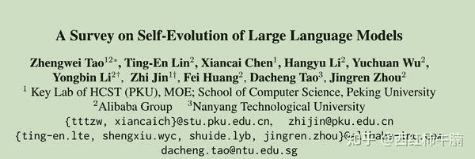
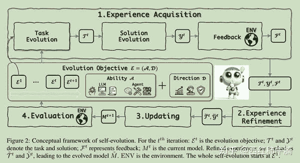
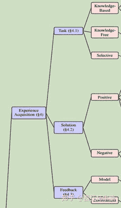
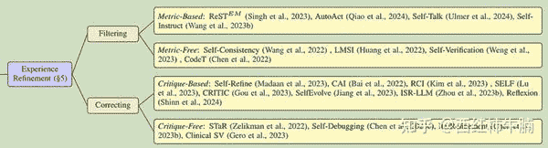

# 大模型的自我进化之路

> 来源：[https://agijuejin.feishu.cn/docx/Yr2FdPHskobVu6xUhvTcpLpOnGf](https://agijuejin.feishu.cn/docx/Yr2FdPHskobVu6xUhvTcpLpOnGf)

> 作者：西红柿牛腩

> 原文：[https://zhuanlan.z](https://zhuanlan.zhihu.com/p/695352464)hihu.com/p/695352...

## 大模型自我进化的概念

大模型需要海量的高质量数据是不争的事实。但是互联网数据没那么多干净的，现在百度微信头条阿里系各家都把自家数据看的比金子都贵，想用我的数据？没门。没有原始数据大模型怎么自我进化（迭代）？

人类怎么自我进化的那？用二十年甚至一生去获取经历（获取海量问题），探寻总结正确经验（修改答案），更新大脑模型，评估反馈（下一次遇到这样的坑还会不会踩）。来自于阿里巴巴的一些大模型专家，总结大模型也可以迭代更新的经验范式，这既是大模型自我进化的框架。

自我进化是指大模型通过自主学习，更新和迭代，使用不断变化的环境和任务。这和人类的自我反馈是吻合的：通过不断的尝试和错误来适应和掌握新技能。大模型的循环迭代过程，可总结成经验获取（Experience Acquisiton），经验提炼（Experience Refinement），更新（updating），评估4个过程。

## 2 经验获取Experience Acquisiton

经验获取，表现在大模型上就是获取新的高质量的数据对: { task: solution }对。

任务演化、解决方案演化和获取反馈。在任务演化中，LLMs策划并演化与演化目标一致的新任务。对于解决方案演化，LLMs制定并实施完成这些任务的策略。最后，LLMs可以选择性地从与环境的互动中收集反馈，以便进一步改进。

大模型可以在1个小时内迭代千万条{ task: solution }对，而人类大多数用一生才总结了几条经验教训。是不是神童/社会精英迭代的速度更快一些？

## 3 经验精炼Experience Refinement

经验精炼阶段，其实是高质量数据{ task: solution }的更新。

模型通过筛选和修正初步得到的经验，提高数据的质量和可靠性，从而更好的适应新信息和环境，无需依赖外部资源。

1、 经验筛选filtering ，确保只有最可靠和高质量的数据被用于后续模型的更新。

经验修正correcting是修正{ task: solution }不匹配的情况。

## 4 模型的更新策略

模型更新是自我衍化过程的关键节点，通过利用精炼后的经验来提升模型性能。更新方法主要包括权重内更新和上下文更新。

权重内更新（In-Weight）：模型权重的调整，包括持续预训练，监督微调等。

上下文内更新（In-Context）：利用外部或者工作记忆来学习经验，是模型能够在不进行昂贵训练的情况下快速适应。

自我进化的核心在于模型能够通过自生成的经验进行迭代学习，在这一过程不需要外部的数据标注或人工干预。这种自主学习的能力，不仅仅显著降低训练成本，还能使模型在处理更为复杂和多样化的任务时表现更高的效率和适应性。通过不断的迭代，LLM大模型可以不断进行自我完善，逐步提高智能水平，最终实现与人类智能相媲美甚至超越人类智能的目标。

[1]A Survey on Self-Evolution of Large Language Models. arXiv:2404.14387v1

发布于 2024-04-30 00:16 ・IP 属地上海