# 一文纵览文生图/文生视频技术发展路径与应用场景

> 来源：[https://agijuejin.feishu.cn/docx/ZyAzdXQDEoha1tx5lm4cGaP6nGf](https://agijuejin.feishu.cn/docx/ZyAzdXQDEoha1tx5lm4cGaP6nGf)

> 作者：Z计划 | Z计划支持大模型创业

> 原文：https://mp.weixin.qq.com/s/pOLIf6JVQ_b8v3T6LcA7Fg

> **「Z计划」 ** **是 智谱 A**I 面向 未上市初创企业与优秀独立开发者/团队，提供 Tokens 赞助、投资支持和技术支持等资源的创新加速计划。 面向全球，持续招募中！🐋（点击报名） 「Z研究」 是围绕该计划的面向大模型领域的投研计划，鼓励自由研究，大胆发言 。同时，本文不为或有提及的智谱公司任何产品做商业推广。如有提及，纯属绕不开。如未提及，也是正常。

人工 智能技术的进步为各行各业带来了革命性的变化，尤其是在图像生成领域。近年来，文生图/文生视频技术的发展已成为计算机视觉和人工智能研究领域的热点。

**首 先， **我们在 这份研究报告中从横向和纵向两个维度梳理了文生图技术的发展脉络，重点分析了四个主流路径：基于 GAN 的方法 、基于 VAE 的 架构、Diffusion Model，以及自回归模型。

每种技术都有其独 特的优势和局限性，它们不仅反映了人工智能领域的快速发展，而且揭示了未来技术创新的可能方向。在此基础之上，本报告还梳理了基于文生图技术成熟的文生视频技术的发展脉络。

**此外， **我们在报告中详细分析了这些模型的核心原理和技术特点。例如，GAN 通过生成器和判别器之间的对抗学习来生成图像，而 VAE 则利用编码器和解码器来学习数据的潜在表示。

在介绍了这些基本概念之后，报告转向更先进的技术，如 Diffusion Model 通过逐步去除加入数据的噪声来重建图像；自回归模型则通过学 习数据的序列依赖性来生成图像等。

**同时， **我们探讨了这些技术的科学基础，还着眼于它们在实际应用中的潜力和挑战。从个人艺术创作到商业设计，从教育工具到社交媒体内容制作，文 生图技术正逐渐改变我们创造和消费视觉内容的方式。

**最后， **我们预测了文生图和文生视频技术的未来发展趋势，包括多模态学习的整合和新的应用场景的探索。

**综**上， 本报告旨在 为所有关心大模型事业的伙伴，提供一个全面而深入的视角，以理解文生图和文生视频技术的发展历程、现状及未来趋势。 🌊

# **目录**

**建议结合要点进行针对性阅读。**

**一、 主流文生图技术发展路径**

1、 横向来看，文生图的主流技术路径可分为4类

2、 纵向来看，主流文生图技术的演进路径

**二、 主流文生视频技术发展路径**

1、 早期发展（2016 年以前）

2、 奠基任务：GAN/VAE/flow-based （2016-2019 年）

3、 自回归模型及扩散模型生成阶段 （2019-2023）

4、 未来发展趋势（2024-?）

5、 视频生成模型 mapping

**三、 应用场景**

1、 基于闭源模型

2、 基于开源模型

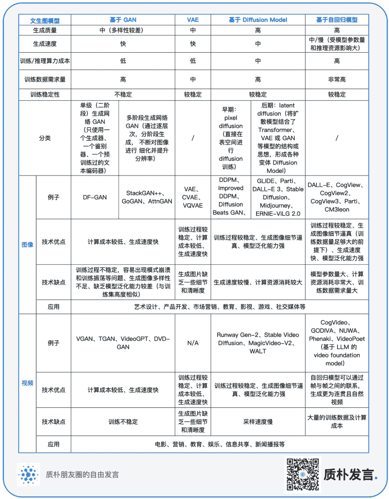

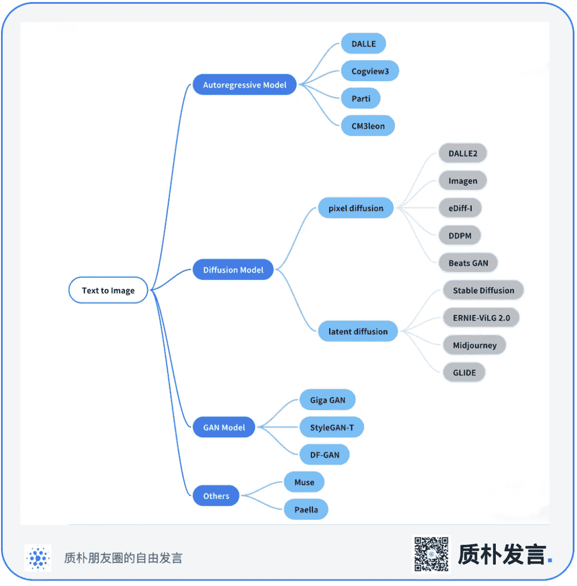

## **主流文生图技术发展路径**

### 1.1 横向来看，文生图的主流技术路径可分为 4 类

1.  **基于 GAN（Generative **Adversarial Network）

1.  发展阶段：2016 年 -2021 年较火热，后续放缓，不再是主流方向

1.  **原理 ：**

1.  GAN 由生成器和判别器构成，通过训练生成器和判别器来进行对抗学习，学习数据的分布，并生成新的数据样本。

1.  其中生成器试图生成与真实数据相似的样本，而判别器则试图区分生成的样本和真实样本（二分类问题）。

1.  生成器和判别器通过博弈论中的对抗过程进行训练，使得生成器不断改进生成的样本，直到判别器无法区分生成的样本和真实样本为止。

1.  **代表模型： **DF-GAN、StackGAN++、GoGAN、AttnGAN

1.  基于 VAE（Variational Autoencoder）

1.  发展阶段：2014 年提出，目前应用广泛，但独立生成图片质量不足，常与 Diffusion Model、自回归模型等架构结合使用

1.  **原理 ：**

1.  **V**AE 本质是一个基于梯度的 encoder-decoder 架构，编码器用来学习数据的潜在变量表示（高斯分布的均值和方差）；

1.  解码器用变分后验来学习生成能力（标准高斯映射到数据样本的能力；而将标准高斯映射到数据样本是自己定义的），生成新的数据样本。

1.  VAE 通过将数据编码为潜在变量的分布，并使用重新参数化技巧来生成新的样本，VAE 的训练过程可以看作是最小化数据的重构误差和潜在变量的 KL 散度。

+   **编码器（Encoder） **：VAE 首先通过编码器将输入数据（如图像）转换成潜在空间中的表示。这个表示不是单个值，而是概率分布的参数（通常是均值和方差）。

+   潜在空间（Latent Space） ：潜在空间的数据表示形式更简洁、抽象，可以在捕捉数据的关键特征的同时大幅降低计算成本。

+   重参数化（Reparameterization） ：为了使模型能够通过梯度下降进行学习，VAE 采用重参数化技巧：从编码器得到的分布中采样，生成可以反向传播的样本。

+   **解码器（Decoder） **：最后，VAE 使用解码器从潜在空间中的样本重建原始数据。

1.  **代表模型： **DF-GAN、StackGAN++、GoGAN、AttnGAN

1.  基于 Diffusion Model

1.  **发**展阶段：2022 年至今，受益于开源模式和参数量较少，研究成本相对低，在学术界和工业界的传播和迭代速度快

1.  原理：Diffusion Model 通过连续添加高斯噪声来破坏训练数据，然后通过消除噪声来学习如何重建数据

1.  **代表模型 **： Stable Diffusion、Midjourney、GLIDE、DALL-E 2、DALL-E 3

1.  基于自回归模型（Auto-regressive Model）

1.  **发**展阶段：2020 年至今，囿于闭源模式和参数量较大，研究成本高，迭代速度慢于 Diffusion Model

1.  **原理：自回归模型 **Encoder 将文本转化成 token，经特征融合后，由训练好的模型 Decoder 输出图像

1.  **代表模型： **DALL-E、CogView、CogView2、Parti、CM3leon

**Dif**fusion Model 和 Auto-regressive LLM 两个技术路线并非完全独立，有融合的趋势， Diffusion 也在不断地吸收和学习来自语言模型的方法，因此目前的主流 Diffusion Model 实际上大量使用 Transformer 的模型架构。

1.引入 Latent Diffusion。

**核心思想： **把 高维数据（如大图像）先降维到一个特征空间（使用 token），然后在这个特征空间上进行扩散过程，然后再把特征空间映射回图像空间。

Latent Diffusion 的研究团队之前主要研究语言模型。他们借鉴了语言模型中的 tokenizer 概念，用于把图像转换为一系列的连续 token，从而使得 Diffusion 模型能更高效地处理复杂数据。

2.把 U-Net 替换为 Transformer。

**核心思想：Transformer 的处理能力和生成能力更强大，而 U-Net 架构是初**期 Diffusion 模型中常用的架构，在处理更复杂任务时存在局限性， 例如：

1.  冗余太大，由于每个 pixel（像素点）都需要取一个 patch（贴片），那么相邻的两个 pixel 的 patch 相似度是非常高的，导致非常多的冗余，降低网络训练速度。

1.  感受野和定位精度不可兼得，当感受野选取比较大的时候，后面对应的 pooling 层的降维倍数就会增大，这样就会导致定位精度降低，但是如果感受野比较小，那么分类精度就会降低。

### 1.2 纵向来看，主流文生图技术的演进路径

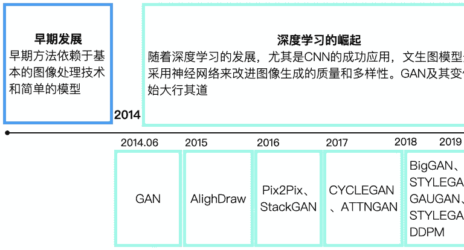

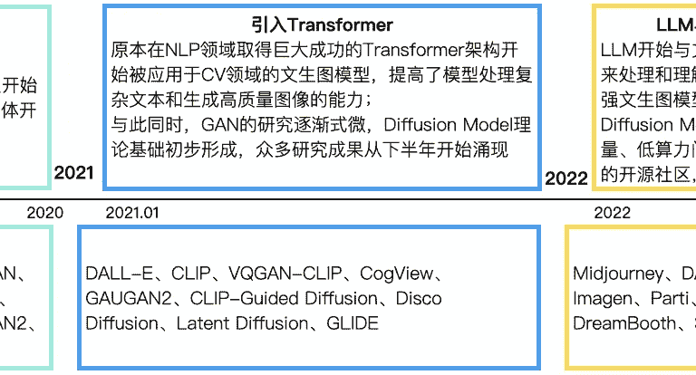

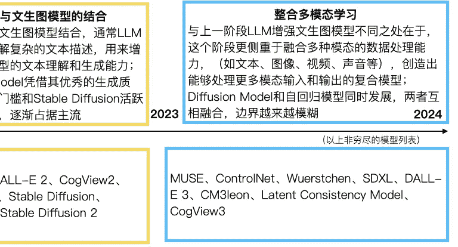

主流文生图技术的演进路径

1、早期发展（2014 年以前）

最初的文生图尝试集中在将简单文本描述转化为图像。这些早期方法依赖于基本的图像处理技术和简单的模型，效果有限，生成的图像质量通常不高。

2、深度学习的崛起（2014 年 - 2018 年）

随着深度学习的发展，尤其是卷积神经网络（CNN）的成功应用，文生图模型开始采用神经网络来改进图像生成的质量和多样性。在这一时期，如 GAN（生成对抗网络）及其变体层出不穷，开始被用于文生图任务，展示了生成更逼真图像的潜力。

3、引入 Transformer（2019 年 - 2021 年）

Transformer 架构，原本在 NLP 领域取得巨大成功，开始被应用于文生图模型，提高模型处理复杂文本和生成高质量图像的能力。

如 OpenAI 的 DALL-E 模型，采用了 Transformer 结构来生成与文本描述匹配的图像，成为这一时期的标志性进展。

与此同时，以 DDPM 为代表的工作，为 Diffusion Model 奠定了理论基础，众多基于 Transformer 和 Diffusion Model 的研究成果从 2021 下半年开始如雨后春笋般涌现。

4、LLM 与文生图模型的结合（2022 年 - 2023 年）

大型语言模型（LLM）如 GPT-3 开始与文生图模型结合，利用 LLM 强大的语言理解能力来提升图像生成的相关性和创造性。

例如 DALL-E 2 和 OpenAI 的 GLIDE 模型，这些模型不仅能生成高质量图像，还能处理更复杂的文本提示。Imagen 和 Parti 等研究成果则展示了模型更进一步，处理多模态输入的潜力。

基于 GAN 的研究热度逐渐消退，基于 Diffusion Model 和基于自回归模型两类技术路线得到长足发展，且技术概念之间持续融合，学术和工业界的诸多工作往往将两种架构优势互补，互相融合。

基于 Diffusion Model 的文生图模型持续迭代，陆续吸收了自回归模型、GAN、VAE 等模型的部分思想；

并且凭借其优秀的生成质量、低算力门槛和 Stable Diffusion 引领的活跃的开源生态等诸多优势，逐渐成为文生图模型的主流。

5、整合多模态学习（2023 年及以后）

与上一阶段“LLM 增强文生图模型”的不同之处在于，这个阶段更侧重于融合多种模态的数据处理能力，（如文本、图像、视频、声音等），创造出能够处理更多模态输入和输出的复合模型。

受益于文生图模型技术的日益成熟，文生视频等多模态生成类模型开始得到长足的发展，例如，利用与训练的文生图模型生成高质量视频。

基于 Diffusion Model 和基于自回归模型的两大主流技术路线，继续同时发展。

**小结：**

文生图模型的演进历史整体上反映了 CV 和 NLP 的融合与发展。从早期的基础尝试到结合了深度学习、Transformer 和大型语言模型的先进方法，文生图模型在技术上实现了巨大的飞跃，不断延伸 AI 在艺术和创造力方面的边界。我们预计，未来的文生图模型将进一步提升在复杂文本理解和高质量图像生成方面的能力，为多模态交互和创意表达提供更加强大的工具。

## **2.**** ****主流文生视频技术发展路径**

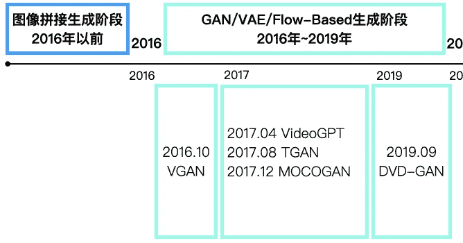

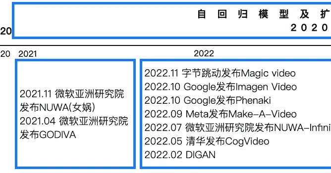

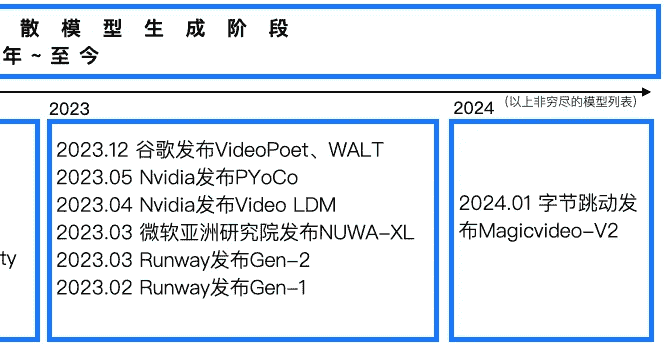

主流文生视频技术的演进路径

文生视频模型通常在非常短的视频片段上进行训练，这意味着它们需要使用计算量大且速度慢的滑动窗口方法来生成长视频。

因此，众所周知，训得的模型难以部署和扩展，并且在保证上下文一致性和视频长度方面很受限。

文生视频的任务面临着多方面的独特挑战。主要有：

+   **计算挑战： **确保帧间空间和时间一致性会产生长期依赖性，从而带来高计算成本，使得大多数研究人员无法负担训练此类模型的费用。

+   **缺乏高质量的数据集： **用于文生视频的多模态数据集很少，而且通常数据集的标注很少，这使得学习复杂的运动语义很困难。

+   **视频字幕的模糊性： **“如何描述视频从而让模型的学习更容易”这一问题至今悬而未决。为了完整描述视频，仅一个简短的文本提示肯定是不够的。一系列的提示或一个随时间推移的故事才能用于生成视频。

在下一节中，我们将分别讨论文生视频领域的发展时间线以及为应对这些挑战而提出的各种方法。 概括来讲，文生视频的工作主要可以分为以下 3 类：

+   提出新的、更高质量的数据集，使得训练更容易。

+   在没有“文本-视频对”的情况下训练模型的方法。

+   计算效率更高的生成更长和更高分辨率视频的方法。

### 2.1 早期发展（2016 年以前，略）

### **2.2 奠基任务： GAN/VAE/flo**w-based（2016-2019 年）

早期研究主要使用基于 GAN 和 VAE 的方法在给定文本描述的情况下自回归地生成视频帧 （如 Text2Filter 及 TGANs-C）。

虽然这些工作为文生视频这一新计算机视觉任务奠定了基础，但它们的应用范围有限，仅限于低分辨率、短距以及视频中目标的运动比较单一、孤立的情况。

**GAN: 模型参数量小，较轻便，**所以更加擅长对单个或多个对象类进行建模。

但由于其训练过程的不稳定性，针对复杂数据集则极具挑战性，稳定性较差、生成图像缺乏多样性。

GAN 代表作：VGAN、TGAN、VideoGPT、MoCoGAN、DVD-GAN、DIGAN

### 2.3 自回归模型及扩散模型生成阶段（2019-2023）

**自回归模型：**

与 GANs 相比，自回归模型具有明确的密度建模和稳定的训练优势，自回归模型可以通过帧与帧之间的联系，生成更为连贯且自然视频。

但是自回 归模型受制于计算资源、训练所需的数据、时间，模型本身参数数量通常比扩散模型大，对于计算资源要求及数据集的要求往往高于其他模型。

**但**因为 transformer 比 diffusion 更适合 scale up，且视频的时间序列结构很适合转化为预测下一帧的任务形态。

**自回归模型发展三个阶段：**

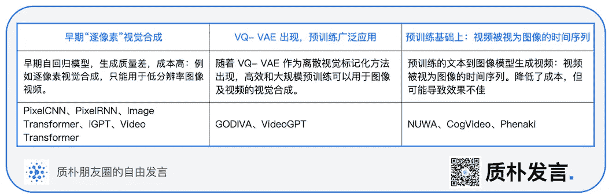

**扩散模型：**

当前主要的文本到视频模式主要采用基于扩散的架构，由于扩散模型在图像生成方面的成功，其启发了基于扩散模型的视频生成的模型。

2022 年 4 月，Video Diffusion Model 的提出标志着扩散模型在视频生成领域的应用，该模型将扩散模型拓展到视频领域。

视频生成中，如基于 Stable Diffusion 的模型，往往使用 2D 图像作为处理单位，并通过添加时间注意力（temporal attention）或时间卷积（temporal convolution）来尝试捕捉视频中的时间序列信息。

然而，这些方法在建模时间维度时通常较为弱效，导致生成的视频动作幅度小，连贯性差。

现阶段，扩散模型已成为 AI 视频生成领域的主流技术路径，由于扩散模型在图像生成方面的成功，其启发了基于扩散模型的视频生成的模型。

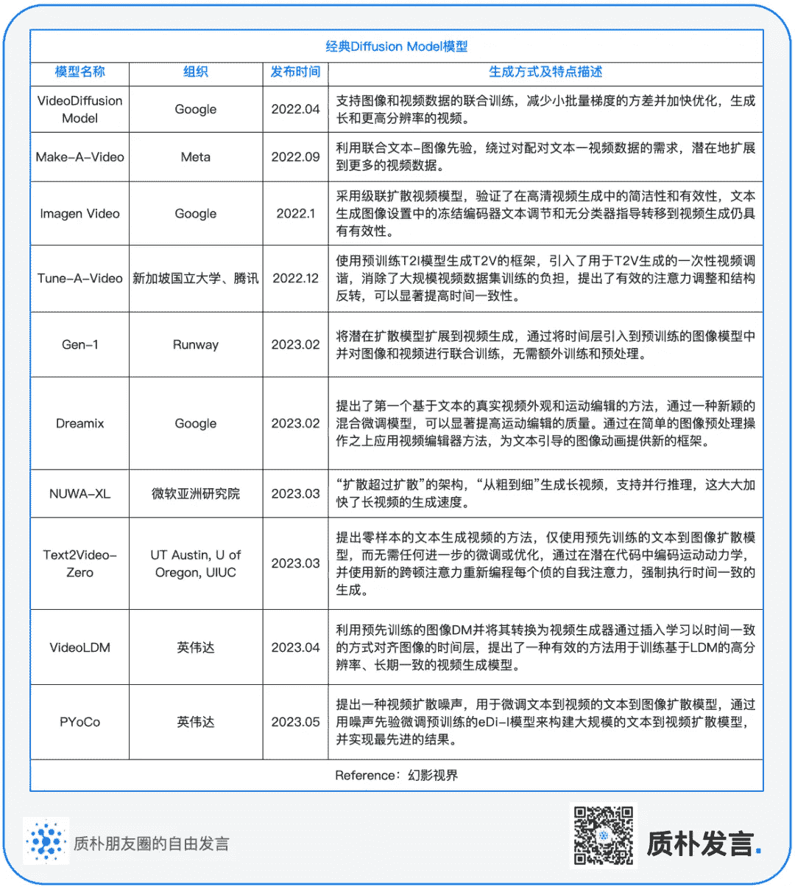

### 2.4 未来发展趋势（2024-？)

基于 Diffusion Model 和基于自回归模型的两大主流技术路线，继续同时发展。

1、视频解编码未来可能被基于 token 的处理方法所替代，但这需要长期的模型改进。

2、基于 token 的神经网络解码速度和 CPU 优化目前是技术发展的瓶颈。

3、未来视频生成和显示可能融合，实现即时编辑和更高效的内容生成。

4、基础模型的提升将促进下游研究和应用效果的提高。

5、开源社区的创造力对技术创新和应用发展起到关键作用。

6、不同基础模型对特定问题的适用性和表现各不相同。

7、随着模型规模和训练数据量的增加，性能会得到提升。数据规模和模型规模应相匹配，以达到最佳性能提升。

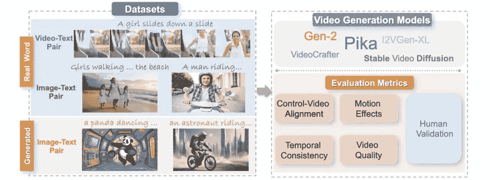

AIGCBench 评估了四个关键维度：控制-视频对齐、运动效果、时间一致性和视频质量。

### 2.5 视频生成模型 mapping

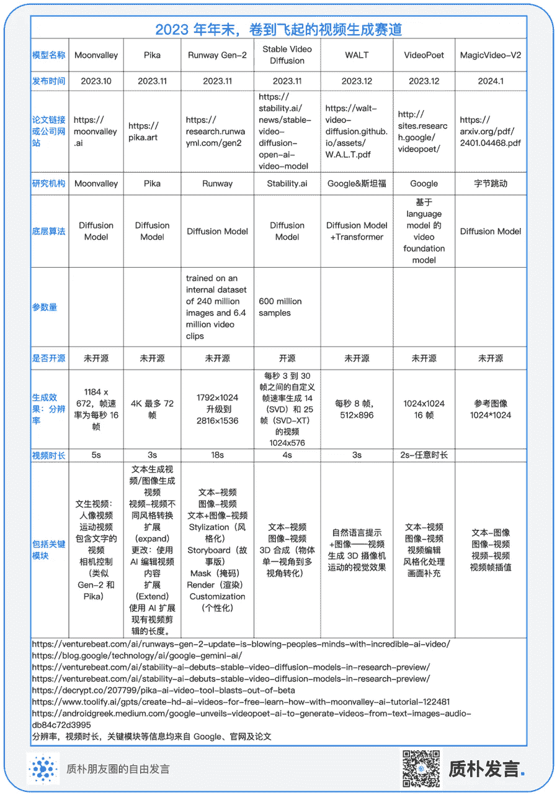

## **3.**** ****应用场景**

### **3.1 基于闭源模型**

**1**、Midjourney: Midjourney V1 (Feb 2022) - Midjourney V6 (Dec 2023)

+   **发展历史： **Midjourney 最早由 David Holz 创立。Midjourney 使用 Discord 平台作为其主要的用户界面，用户通过与 Midjourney bot 进行对话式交互来生成图片。

+    由于用户门槛较低，图像生成质量高，简单的 Prompt（文本提示词）就能生成高品质的图像，这使得它迅速获得了用户的青睐。

+    凭借用户自传播，Midjourney 社区已成为 Discord 上最大的社区频道。截至 2023 年底，Midjourney 已经实现了 1000 万用户和超过 2.5 亿美元的年营收，估值近 100 亿美元。

+   **模型特点： **Midjourney 在 AI 公司价值链上占据了数据层、模型层、应用层整个技术栈，其模型为采用了 CLIP 和 Diffusion 构建的闭源模型。

+    Midjourney 的模型对 –stylize 参数非常敏感，用户可以通过尝试不同的风格化范围来微调图像。此外，模型支持多种测试模型和放大器模型，以提供更多样化的图像生成选项。

+    随着用户量增长，Midjourney 的数据飞轮效应日益明显：通过大量社区活跃用户的正/负反馈，持续迭代其模型、产品和服务。

+   **落地场景：**

+   **2C:**

+   **个人艺术创作 **：业余爱好者可以利用 Midjourney 创造个性化的艺术作品，如绘画、插图等。

+   **社交媒体内容： **用户可生成用于抖音/📕/🛰️等社交媒体平台的图片内容。

+   **教育： **学生和老师可以轻松通过 Midjourney 生成图像辅助学习，如历史事件的视觉呈现、科学概念的图形化等。

+   **娱乐与游戏： **游戏爱好者可以创建自定义的游戏角色或场景，提升游戏体验。

+   **2B:**

+   设计：软件 UI/产品原型/室内/建筑/服装设计等。 例如，Midjourney 可应用于中后台业务中的图标、数据大屏、登录页、官网插图等设计工作。

+   这些应用场景通常要求快速生成较高质量的视觉效果，但不求极致的细节。对于细节要求较高的工作，Midjourney 可作为灵感来源和草稿。

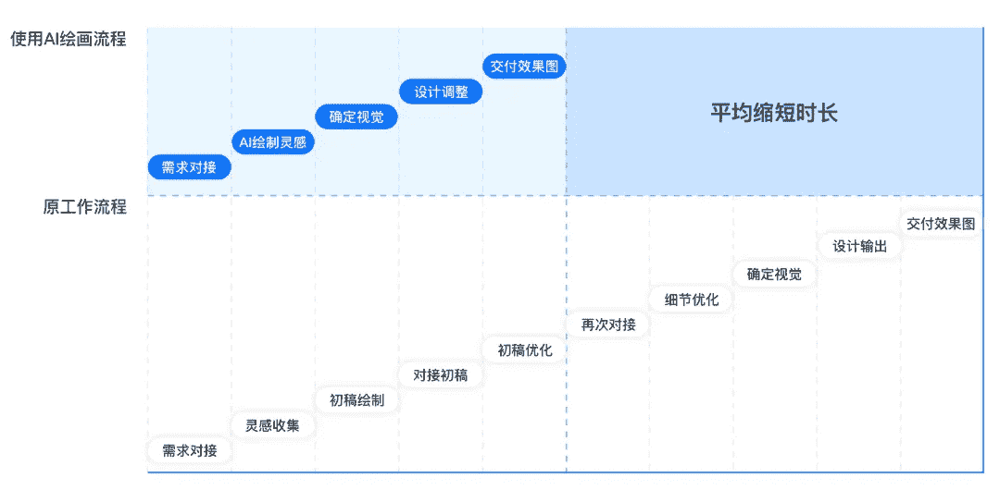

+   营销：低成本大批量生成营销宣传物料。 在业务侧服务场景、新媒体应用、形象宣传等方面，Midjourney 能够提供高质量的视觉素材。

+   例如，UU 跑腿团队使用 Midjourney 生成与家政服务场景相关的宣传图。 从传统的几千～几万之间/套素材，缩减到<2000 元/套素材，实现了一个数量级的降本效果。https://tech.uupt.com/?p=1233

+   艺术：影视制作/二次元动漫/文章配图。 Midjourney 也被用于影视节目的设计工作，例如 KV（关键视觉）设计的前期工作中。

+   根据设计师特定的设计需求，如电台场景的创建、特定风格的实现等，Midjourney 能够根据提供的关键词生成一系列效果图。

+   在此基础上，设计师使用 Upscayl、PS 等工具进行精修，达到商业可用的状态。 https://www.bilibili.com/read/cv26670620/

+   商业化现状：订阅制+梯度定价。 Midjourney 采取 SaaS 订阅制模式，初次使用时用户可以免费生成 25 张照片，之后则需按月或年订阅，价格分别为 10、30、60、120 美元/月或 8、24、48、96 美元/月。

+   用户只有在订阅之后才能拥有使用 Midjourney 创作的图片的版权。2023 年，Midjourney 实现 1 亿美元的年营收。

2、OpenAI: DALL-E

+   **发展历史：**

+   DALL-E：由 OpenAI 于 2021 年初发布，作为结合自然语言处理和图像生成技术的先锋 AI 模型。

+   DALL-E 2：在 2022 年推出，作为 DALL-E 的进阶版本，带来了图像质量和分辨率的显著提升。

+   DALL-E 3：2023 年发布，进一步增强了图像生成的准确性和创造性。

+   **模型特点： **DALL-E 系列基于变换器（Transformer）架构，采用稀疏注意力机制，有效处理大量数据。DALL-E 2 引入了 CLIP 模型，提高文本理解能力； 而 DALL-E 3 则在此基础上进一步优化了细节处理和创意表现。

+   图像生成能力：从理解简单的文本描述到处理复杂的文本指令，DALL-E 系列在生成各种风格和类型的图像方面展现了卓越的能力。

+   **落地场景：**

+   **2**C：与 Midjourney 场景类似。可控性强于 Midjourney，但复杂场景和细节处理能力不如 Midjourney。

+   2B：与 Midjourney 场景类似。

+

+   **商业化现状：**

+   **API 服务： **OpenAI 通过提供 API 服务，使企业和开发者能够将这些强大的图像生成工具集成到自己的应用和服务中。

+   **不同版本的定位： **初代 DALL-E 主要面向艺术和创意产业；而 DALL-E 2 和 DALL-E 3 则更多地服务于专业领域，如影视制作、游戏设计和科学研究。

+   **商业策略： **OpenAI 采取了分层的访问和定价策略，允许不同需求的用户选择适合自己的服务级别。 这种模式为 OpenAI 带来了持续的收入流，并推动了 AI 技术在不同行业的广泛应用。

+   **伦理和合规性： **随着技术的发展，OpenAI 加强了对生成内容的审查，确保其符合伦理和法律标准，以应对公众对 AI 生成内容可能带来的社会和文化影响的担忧。

3、Adobe: Adobe Firefly

+   **发展历史： **Adobe Firefly 是 Adobe 公司于 2023 年 3 月推出的一款 AI 图像生成套件，主要面向大型企业，允许企业使用自身的数据资产来训练自己的 Firefly 大模型，以快速生成可安全商用的图像内容。

+   **模型特点： **Adobe Firefly 基于主流的 Diffusion Model，其核心特点在于训练数据的合规性：

+   用以训练 Firefly 模型的数据内容均来自于 Adobe Stock 图像、公开许可内容和其他版权过期的公共领域内容——Adobe 拥有对这些图像的所有权利；

+   而不会涉及版权纠纷问题（同时，因未经创作者知情或同意抓取图像并用于训练，Stability AI、Midjourney 等人工智能图像生成开发商正面临着日益增加的诉讼）。

+   **落地场景：**

+   **2C： **与 Midjourney 场景类似，但由于 Adobe 产品专业化程度高，使用门槛高，以企业用户为主，在 C 端推广速度远不及 Midjourney。

+   **2B：与 Midjourney 场景类似，但更强调安全性和合规**性，因此较受风险厌恶的大 B 客户青睐。

+   商业化现状：订阅制+梯度定价。 用户在使用 AI 作图时会消耗生成点数，每个点数对应一张图。Adobe 提供给每个用户每月免费的 25 点生成点数， 同时用户也可以选择付费购买额外的点数。

+   截至 2023 年底，Adobe Firefly 的用户已经用这款工具生成了超过 30 亿张图像。目前约有 10%的 Adobe 用户已经使用了 Firefly。

### **3.2 基于开源模型**

**1、Stability AI: Stable Diffusion( August 2022**) - Stable Diffusion XL Turbo( Nov 2023)

+   **发展历史： **Stability AI 专注于开源和社区驱动的模式，将资源投入到具有实际价值和创新性的项目中。公司已经成为时代杂志评选的 100 家最有影响力的公司之一。

+   **模型特点： **Stable Diffusion 系列是 Stability AI 推出的，基于 Diffusion Model 的开源模型，陆续整合了 VAE/GAN/Transformer 等多个模型优势和技术思想。

+   最新一代的 SDXL Turbo 在前一代 Stable Diffusion 的基础上，加入了对抗性蒸馏技术。这项技术通过引入和修改对抗训练，减少模型除噪步骤，提升效率。

+   **落地场景：**

+   **2C： **与 Midjourney 场景类似，但美观度和连续性方面都落后于 Dall-E 3 和 Midjourney。

+   **2B： **与 Midjourney 场景类似。

+   **商业化现状：暂无商业化动作。 **Stability AI 目前还没有明确的商业模式，其主要资金来源是创始人兼 CEO 伊马德·莫斯塔克。

+   公司的使命是构建开源 AI 项目，并支持其他开源小组正在研发的工具。

**2、其他基于 Stable Diff**usion 为代表的开源模型的各种应用：

+   设计工具：Canva Text to Image、CF Spark、稿定 AI、墨刀 AI、MasterGO AI 等

+   图片生成：Leonardo.AI、Yodayo、NightCafe Studio、美图设计室等

+   图片编辑：Remove.bg、Fotor、Pixlr 等

+   图片增强：Cutout Pro、ZMO.ai、magnific.ai 等

**3、基于开源模型的创作社区**

**（聚合了多种开源模型，大多数为 Sta**ble Diffusion 的模型变体）

+   Civitai

+   海艺 AI

+   liblib

主流创作社区各有特色，但共同点在于：

提供了一个平台，让用户可以利用 AI 技术进行图像创作和分享。这些社区通常会集成最新的开源 AI 模型，使用用户 无 需深入了解 AI 技术细节即可创作出质量较高的作品。

**4、AI 视频**

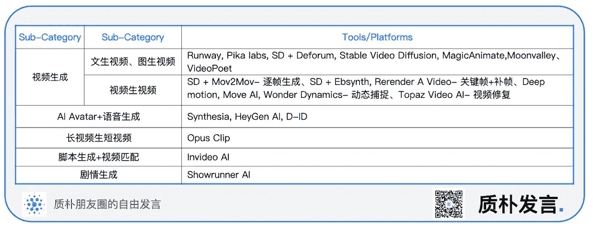

改编自：魔方 AI 空间

未来视频生成的 GPT 时刻应该是生成效果可控

+   为电影制作打造产品

+   为 C 端普通消费者打造产品

文本到视频人工智能模型的应用场景广泛，涵盖了内容创建、社交媒体营销、讲故事与动画制作、个性化内容、视频摘要、电子学习和培训、新闻媒体、电子游戏开发、虚拟助理和聊天机器人、归档与文档保存以及提高内容的可访问性等多个领域。

1.  在内容创建和企业营销中， 这些模型可以帮助快速生成具有视觉吸引力的视频，用于品牌推广和产品演示。

1.  社交媒体影响者可以利用这些工具创建引人注目的内容，增强个人品牌并提升粉丝互动。

1.  在娱乐行业，尤其是动画制作中，文本到视频技术可以在预制作阶段根据脚本或故事板生成初始场景，让创作者专注于创意发展。

1.  个性化视频内容的制作也是这些模型的一个应用， 它们可以根据用户数据生成定制化的视频，提高用户参与度和转化率。

1.  在电子学习和培训领域，这些模型可以将文本内容转换为互动视频，帮助学习者更好地理解和记忆复杂概念。

1.  新闻机构可以利用文本到视频技术快速制作视觉报道，而游戏开发者则可以利用它来创建动画过场和叙事序列。

1.  集成到虚拟助理和聊天机器人中，可以提供更丰富的用户交互体验。此外，这些模型还可以帮助将 历史文本和文档转换为视频，以更吸引人的方式保存和展示信息。

1.  最后，文本到视频技术对于提高内容的可访问性也至关重要，它可以通过音频描述和视觉元素的结合， 帮助视觉障碍者更容易地访问和享受信息 。

1.  这些应用场景不仅展示了文本到视频技术的实用性和效率，也激发了新的创意可能性，为内容创作和媒体制作带来了革命性的变化。

—end—

作者 | Z计划投研组： 严宽 、王谦傲

排版｜ 郑寒、汪柯璇

审核｜李文珏、邓瑞恒

* 本文不代表智谱认同以上任何观点。