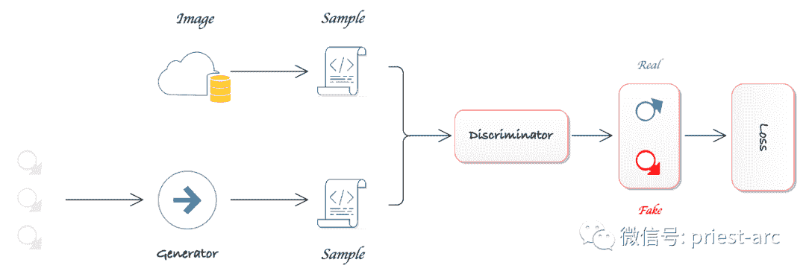
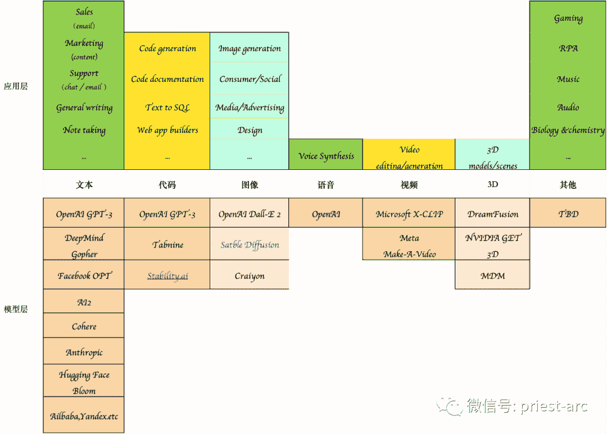

# 一文带你走进 AIGC（生成式人工智能）世界

> 来源：[https://agijuejin.feishu.cn/docx/UqEIdoH6mowQ4Ux0rqPci2kTnO8](https://agijuejin.feishu.cn/docx/UqEIdoH6mowQ4Ux0rqPci2kTnO8)

> 作者：Luga Lee | 架构驿站

> 原文：[https://mp.weixin.](https://mp.weixin.qq.com/s/XUowuW7oEBWd9bNylyJBcg)qq.com/s/XUowuW7o...

Hello folks，我是 Luga，今天我们来聊一下人工智能生态核心技术—— AIGC ，即 “生成式人工智能 ” 。

AI （ 人工智能 ）是一门在过去几十年中不断增长其能力和效用的学科。AI 驱动的工具正逐渐成为主流，例如改进的语音识别、及时翻译以及令人惊叹不止的图像编辑工具，它们使我们能够根据自定义风格轻松地突出显示图像中想要替换的内容。然而，过去几年，OpenAI 的领先进展带领我们进入了一条全新的赛道。

这种变革的前沿便是 AIGC（生成式人工智能）的概念，简而言之，通过一种能够生成大量与人类生成的内容在质量上相媲美的创意内容的人工智能。我们见证了生成型人工智能创造图像（如 DALL-E）、代码（如 Copilot）、文本（如 GPT-3）并与人类进行对话（如 ChatGPT）的能力。OpenAI 在这个领域处于领先地位，虽然也有许多其他著名的竞争对手（商业和开源）在追赶的过程中。

这一进展的意义在于，生成型式人工智能为我们带来了前所未有的创造力和效能。它不仅仅是工具的改进，而是一种能够以人类水平的能力生成内容的技术进步。这将在各个领域产生深远的影响，从艺术和创意产业到编程和沟通方式的改变。

然而，我们也要意识到生成型人工智能领域不仅有 OpenAI 一家公司，还有其他竞争对手在积极追赶。这种竞争将推动技术的进一步发展，使我们能够不断探索和应用生成型人工智能的潜力。

## AIGC（生成式人工智能）历史背景点滴

随着科技的创新性发展，机器学习的力量与无限的想象力无缝地融合在一起，使得 AIGC（生成式人工智能）像雨后春笋般地进入了计算机科学的领域，以创造具有人类品质的非凡艺术、音乐和叙事。

与传统的人工智能不同，AIGC（生成式人工智能）从现有的示例中汲取灵感，并利用所训练的知识来产生全新而令人惊叹的创作。

与此同时，随着技术的进步和对大量数据的处理能力，AIGC（生成式人工智能）已经取得了长足的进展。科学家们开发了特殊技术，如变分自动编码器和生成对抗网络，使机器能够创造出几乎与人类一样优秀的作品。但这只是个开始！在未来，AIGC（生成式人工智能）有可能彻底改变我们体验事物的方式。想象一下，能够体验完全真实且个性化定制的虚拟现实世界，或者听到那些触动你心灵、以前从未想象过的歌曲。AIGC（生成式人工智能）有能力释放我们的想象力，将新的创意带入现实生活中。

## 什么是 AIGC（生成式人工智能） ？

AIGC（生成式人工智能）是指一类人工智能系统，其能够生成新的内容、图像、音频或文本等。与传统的任务导向型人工智能系统不同，生成式人工智能更加注重创造性和自主性。

AIGC（生成式人工智能）主要基于深度学习和神经网络技术，通过学习大量的数据和模式来生成新的内容。其中，最具代表性的生成式人工智能模型就是生成对抗网络（Generative Adversarial Networks，GANs）。GANs 由一个生成器网络和一个判别器网络组成，它们相互竞争并共同进步，以产生逼真的生成样本。

AIGC（生成式人工智能）在多个领域都有应用，如图像生成、文本生成、音频生成等。例如，在图像生成方面，生成式对抗网络可以学习大量真实图像数据的分布特征，并生成具有相似特征的新图像。在文本生成方面，生成式人工智能可以学习文本数据的语义和语法结构，并生成具有连贯性和多样性的新文本。

## AIGC（生成式人工智能）基础架构

AIGC（生成式人工智能）架构是指用于构建和部署生成性人工智能模型的整体结构和组件。虽然可以根据不同的用例和需求进行变化，但典型的生成人工智能架构通常包括以下关键组件：

1、 数据处理层

数据处理层是 AIGC 模型中的一个关键组件，承担了收集、准备和处理数据的重要任务。该层的功能包括从多种来源收集数据、进行数据清理和规范化，并进行特征提取，以为模型训练和生成输出做好准备。

2、 生成模型层

作为 AIGC 模型中的另一关键组件之一，生成模型层承担了使用机器学习模型生成新内容或数据的任务。该层的功能包括选择适合特定用例的生成模型、使用相关数据对模型进行训练，并进行微调以优化性能。

3、反馈和改进层

此层的主要目标是持续提高生成模型的准确性和效率。该层专注于收集用户反馈、分析生成的数据，并利用这些见解来推动模型的改进。

4、部署和集成层

部署 和集成层 涉及将生成模型成功集成并部署到最终的产品或系统中。该层的任务包括建立适当的生产基础设施、无缝地将模型与应用程序系统集成，并监控模型的性能。

我们以 Generative Adversarial Networks (GANs) 生成对抗网络为例，其简要的架构参考图如下所示：

基于上面的参考架构， 生成对抗网络（GAN）是由生成器和鉴别器两个主要组件组成的模型。 生成器负责生成合成数据样本，而鉴别器的作用是区分真实数据和生成数据。

生成对抗网络通过对抗的方式进行训练，即生成器和鉴别器相互竞争和博弈。生成器的目标是生成与真实数据无法区分的数据样本，从而挑战鉴别器，并提高鉴别器区分真实数据和生成数据的能力。

具体而言，生成器接受随机噪声作为输入，并通过一系列转换和变换操作逐步生成合成数据样本。生成器的目标是使生成的样本尽可能接近真实数据分布，以欺骗鉴别器。生成器的训练目标是最小化生成数据被鉴别器判别为生成数据的概率。

鉴别器是一个二分类模型，其目标是对给定的数据样本进行分类，判断其是真实数据还是生成数据。鉴别器通过对真实数据和生成数据进行对比学习，不断优化自身的判别能力。鉴别器的训练目标是最大化对真实数据和生成数据的正确分类概率。

在训练过程中，生成器和鉴别器交替进行更新和优化。生成器通过生成更逼真的数据样本来挑战鉴别器，而鉴别器通过不断学习和调整判别能力来区分真实数据和生成数据。这种对抗性的训练过程将逐渐使生成器生成接近真实数据的样本，同时鉴别器的判别能力也得到提升。

## AIGC（生成式人工智能）应用鸟瞰全景

目前，AIGC 市场正处于迅速发展和竞争激烈的阶段，吸引了许多公司和组织进入这个领域。

在 AIGC 市场中，OpenAI 是一个重要的参与者。他们的生成性人工智能模型，如 GPT-3 和 DALL-E，已经引起了广泛的关注和应用。OpenAI 的技术在不同领域展示了出色的生成能力，包括图像、文本和代码生成。他们的技术在创意产业、编程辅助工具等领域具有巨大的潜力。

除了 OpenAI，还有其他公司和组织在 AIGC 市场上崭露头角。一些大型科技公司，如 Google、Microsoft 和 Facebook，也在积极开展相关研究和开发，试图推动生成性人工智能技术的进步。此外，许多初创公司和研究实验室也在不同领域进行着相关的工作，努力开发出独特的生成性人工智能解决方案。

下面的示意图描述了为每个类别提供支持的平台层以及将在其上构建的潜在应用程序类型。在 AIGC 市场中，存在多个支持平台，这些平台为开发者和用户提供了生成性人工智能技术的基础设施和工具。具体可参考如下所示：

1、文本-Text

在 AIGC 市场中，文本生成被认为是最高级的领域。然而，由于自然语言的复杂性，正确性和质量成为了挑战。目前的 AIGC 模型在通用的短/中形式写作方面表现出色（尽管通常用于迭代或初稿），但随着时间的推移，随着模型的改进，我们可以期待看到更高质量的输出、更长的内容以及更好的垂直特定调整。

为了提高文本生成的质量，研究人员和开发者正在努力改进 AIGC 模型。通过引入更多的训练数据、改进模型架构和优化训练算法等方式来增强模型的表现能力。随着这些改进的逐步实施，我们可以预计到未来会有更精确、更流畅、更一致的文本生成结果。

2、代码-Code

在 AIGC 场景中，代码生成具有巨大的潜力，在短期内可能对开发人员的生产力产生重大影响。代码生成技术的发展使得开发人员能够更快速、更高效地生成代码，从而加快了软件开发过程。

不仅如此，代码生成还将使非开发人员更容易创造性地使用代码。对于那些没有编程背景但需要使用代码的人来说，代码生成工具可以降低他们学习编程的门槛。他们可以通过简单的输入或配置，生成满足自己需求的代码，实现自己的创意和想法。这将促进更多人参与到软件开发和创新的过程中，推动技术的普及和创造力的释放。

3、图像-Image

图像生成是一个相对较新的领域，但它已经像病毒一样迅速传播开来，尤其在社交媒体平台上，生成的图像比纯文本更具吸引力和趣味性！人们热衷于在 🛰️、Twitter等社交媒体上分享由生成性人工智能模型创造的图像作品。

随着图像生成技术的不断发展，我们目睹了各种具有不同审美风格的图像模型的涌现。这些模型通过学习大量的图像数据集，能够生成栩栩如生、多样化的图像内容。图像生成作为一种引人入胜的现象，已经在社交媒体和其他领域中迅速传播开来。具有不同审美风格的图像模型和用于编辑和修改图像的技术的出现，进一步推动了这一领域的发展。

4、语音-Voice

然而，就像图像生成一样，今天的语音合成模型为实用应用程序的进一步细化或最终输出提供了一个良好的起点。通过使用深度学习和生成性人工智能技术，语音合成模型能够学习大量的语音数据，并生成自然流畅的语音输出。

随着技术的不断发展和改进，我们已经看到语音合成在消费者和企业应用中取得了显著的进展。现代的语音合成模型能够产生更加自然、富有表现力的语音，减少了机械感，并且在语音的音色、语调和语速等方面更加接近人类的质量。

5、 视频和 3D 模型

视频和 3D 模型正在迅速崛起，引发了人们对广泛创意市场的潜力感到兴奋。这些模型在电影、游戏、虚拟现实、建筑和实体产品设计等领域展现出了巨大的影响力。

随着技术的进步，视频和 3D 模型正变得越来越普及和易于创建。人们可以利用各种工具和软件来创建、编辑和共享精美的视频和 3D 模型。这种大规模创意市场的发展给了艺术家、设计师和创作者们更多的机会来表达自己的创意和想法。

6、其他领域

虽然 AIGC 在音频和音乐领域中的应用较为常见和成熟，但在生物学和化学等领域中的应用仍处于探索和发展阶段。以下是一些 AIGC 在这些领域中的潜在应用，例如生物学研究，AIGC 可以应用于生物学研究中的数据分析和模式识别；药物研发，AIGC 可以在药物研发过程中发挥作用；化学合成，AIGC 可以在化学合成领域中提供辅助和优化；生态学研究，AIGC 可以在生态学研究中发挥作用，特别是在物种分布模式和生态系统模拟方面。

Reference ：

[1] https://towardsdatascience.com/cgan-conditional-generative-adversarial-network-how-to-gain-control-over-gan-outputs-b30620bd0cc8

Adiós !

··································

**📣 📣 📣**

**对**云原生网关 Traefik 感兴趣的朋友们，可以加入下面的 TraefikLab 中国社区 🛰️群进行技术探讨～

Hello folks，我是 Luga，Traefik Ambassador，Jakarta EE Ambassador， 一个 10 年+ 技术老司机，从 IT 屌丝折腾到码畜，最后到“酱油“架构师。如果你喜欢技术，不喜欢呻吟，那么恭喜你，来对地方了，关注我，共同学习、进步、超越～