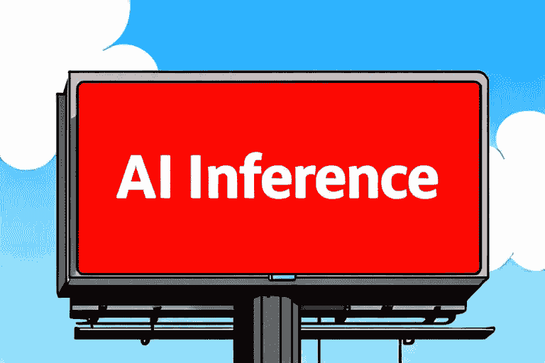
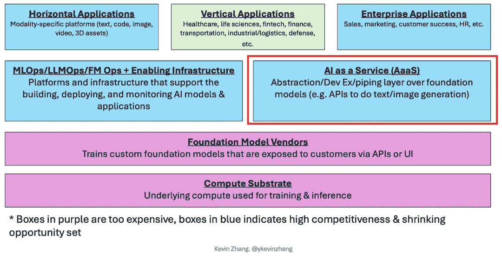
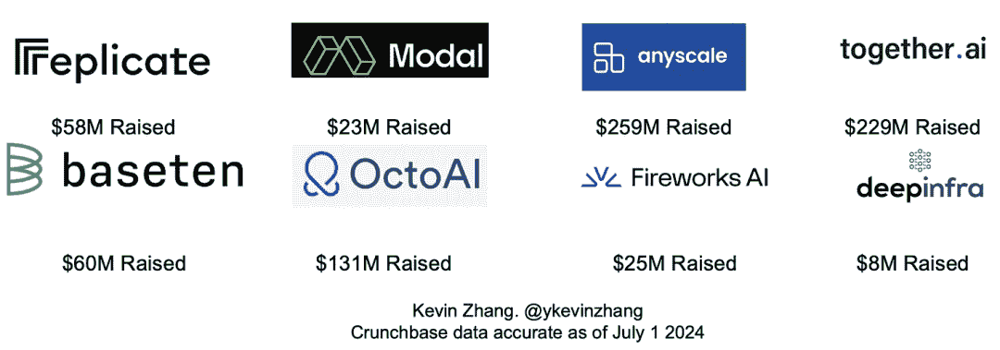
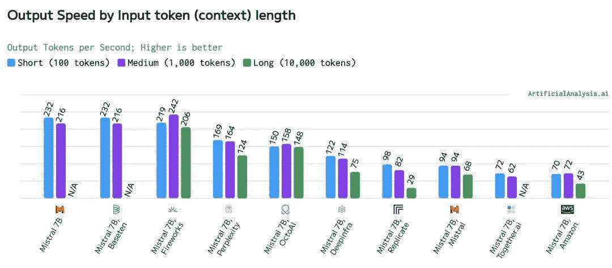
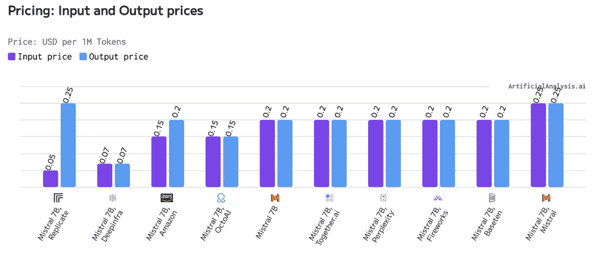
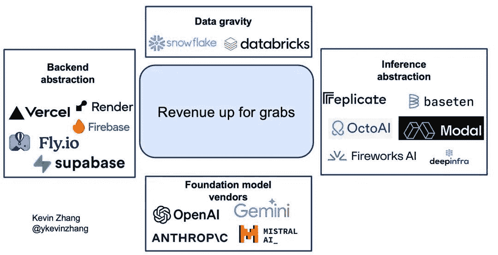
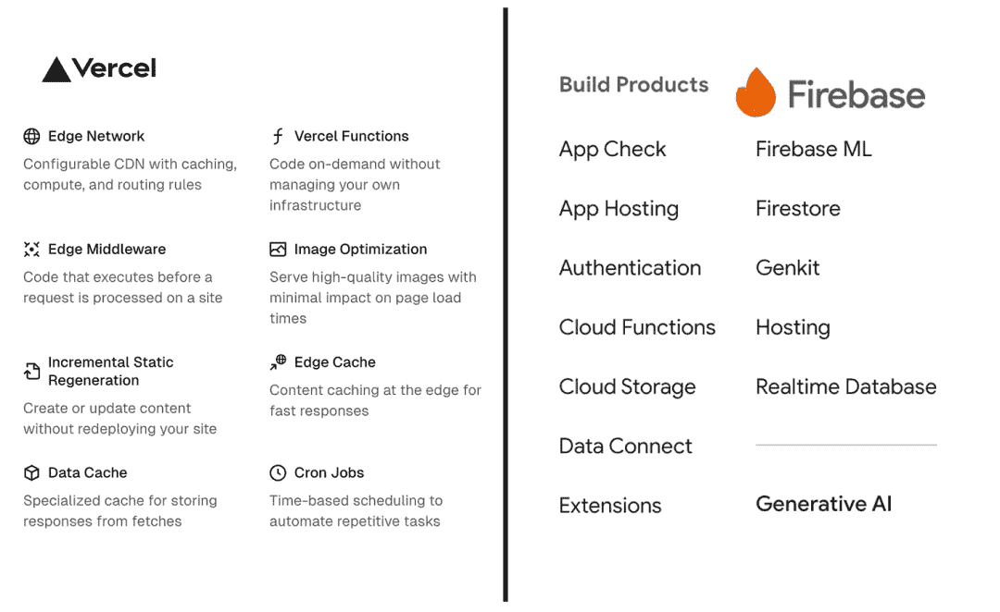

# 生成式AI推理企业的市场机遇、竞争与未来

> 来源：[https://agijuejin.feishu.cn/docx/Jd4dd0hp1oxz5ux1FV8cpiewnBb](https://agijuejin.feishu.cn/docx/Jd4dd0hp1oxz5ux1FV8cpiewnBb)

> 作者：KEVIN ZHANG

> 翻译：杨婷、张雪聃 | OneFlow

> 原文： [https://mp.weixin.](https://mp.weixin.qq.com/s/HIFQT5pRukAjJ-m8ToQzxA)qq.com/s/HIFQT5pR...

头图由SiliconCloud平台生成

在生成式人工智能时代的投资选择中，风投公司对“铲子型”初创企业的浓厚兴趣，这些企业的业务涵盖了模型微调、可观测性分析、以及人工智能的“抽象化”服务（例如，将AI Inference作为服务）等。人们预测，随着初创公司和企业将人工智能技术纳入其产品组合，他们可能不愿意或无法在内部构建这些技术能力，因此更倾向于购买，而非自建。

本文中，作者将深入探讨AaaS （人工智能即服务）初创公司，并特别关注AI推理（inference）初创公司（见下文红框）。本文主要内容如下：

+   为何需要AI推理抽象化。

+   各个推理抽象平台的开发者体验、性能和价格不断趋同，这意味着平台的快速商品化。

+   残酷的竞争动态，并且当前可利用的总市场规模（TAM）实际上高度受限。

+   考虑投资AI推理公司时，投资者主要需要关注以下几点：首先，需要相信TAM有巨大的扩展潜力；其次，需要相信公司能够扩展其产品线；最后，需要看到潜在的并购（M&A）机会。我认为，只有大型基金才有能力在这个层面进行投资或竞争。

+   使用AI推理抽象平台等可组合构建模块的初创公司将在短期内受益，但从长远来看，这些公司可能会遇到问题。

这是作者深入剖析生成性人工智能公司技术架构各层次系列文章的开篇之作。本文作者 Kevin Zhang 是一名投资人。

（本文由OneFlow编译发布，转载请联系授权。原文：https://eastwind.substack.com/p/a-deep-dive-on-ai-inference-startup s；LinkedIn ：htt ps://www.linkedin.com/in/ykevinzhang/ ）

# **1**** ****为何需要 AI 推理抽象化？**

要想充分理解AI推理公司的必要性，我们可以将公司过去部署AI模型所需经历的流程与现在推理抽象公司提供的便捷性和快速上市优势相比较。

**之前**

想要超越基础模型API（例如OpenAI、Anthropic）限制的公司正在面临种种挑战。在工程领域，他们需要应对构建和维护基础设施的挑战（例如，GPU集群的编排、操作系统/CUDA/配置管理、监控和可观测性）。即使这些集群已经搭建并运行，他们还需要针对最大化资源利用率、系统弹性以及缩短冷启动时间等问题进行优化。

**现在 **

公司无需承担聘请专业人才构建和管理GPU推理集群的高额成本，而可以直接利用AI基础设施抽象服务。这样，公司便能轻松部署和使用标准化或定制化的AI模型，并通过API接口调用这些模型。服务提供商负责处理扩展和缩减等技术复杂性，同时在基础计算费用上加收一定费用。

# **2**** ****AI推理初创公司应运而生！ **

鉴于上述技术十分繁杂，许多初创公司应运而生，他们致力于化繁为简，帮助客户更快地在其产品中集成AI功能（部分相关公司已在下方列出）。我将重点讨论那些专注于推理功能的初创公司，而非提供全套服务（包括推理、训练和微调）的公司。

这里有几个要点需要注意：

+   开发者体验大体分为两种层次的复杂性

+   顶尖竞争者在价格和性能上十分接近，这表明未来在这些方面难以形成差异化

# **3**** **AI推理提供商正在权衡开发者体验

就开发者体验和用户友好性而言，评估AI推理平台的公司需要在两种抽象层次之间做选择：一种是仅提供API接口的平台，另一种是提供一定程度可定制选项的平台。

Replicate、Fireworks AI和Deepinfra等仅提供API服务的初创公司，已经简化了访问模型的复杂程度，以便用户可以直接通过API调用来使用模型，这种体验与OpenAI等基础模型供应商提供的开发者体验相似。因此，这些平台通常不允许定制选项，比如为特定模型选择特定的GPU。不过，Replicate通过Cog提供了部署自定义模型等额外功能。

与此同时，Modal和Baseten提供了一种介于两者之间的体验，开发者可以有更多的“调节选项”来控制他们的基础设施，但相比从头构建自定义基础设施，这仍然是一种更简便的体验。这种更细粒度的控制级别使得Modal和Baseten能够支持超出简单文本完成和图像生成之外的应用案例。

更有趣的是，所提供的“调节选项”的类型是相似的：

+   容器镜像配置：Modal使用Python定义镜像，而Baseten使用YAML文件。熟悉Docker的开发者对此应该并不陌生。

+   GPU资源：Modal使用Python装饰器来定义GPU资源或并发级别，而Baseten同样使用YAML文件。

使用过这两种抽象层的解决方案后，我发现大多数有能力的工程师应该能够在几个小时内设置好这些服务，相比之下，搭建自定义基础设施可能需要几天甚至几周的时间。因此，选择合适平台更多取决于开发者的“偏好”以及最终用户所需的控制程度。在这两种情况下，客户都无需聘请专门的DevOps团队。

# **4**** ****价格与性能已趋同 **

除开发者体验之外，性能和价格也是重要的考量因素。对于语言大模型的工作负载，性能主要取决于吞吐量（每秒生成的词元数量）、时延（首个词元的生成时间）以及稳定性/正常运行时间。在这方面，大多数顶级平台对于常见用例来说都已经“足够好”，这表明AI推理正迅速走向商品化。

为说明这种商品化现象，我用 Artificial Analysis （2024年7月6日提取的数据）来衡量不同推理平台的相对性能。我使用了当时广受欢迎的Mistral 7B模型，该模型在发布时是一个强大的不到十亿参数的语言大模型（尽管现在已被Meta的Llama 3 8B超越）。为简洁起见，我将只强调词元生成吞吐量的比较（ Artificial Analysis 有更全面的基准测试）。在这里，我们看到性能数据呈现出“聚集”现象（首先是Mistral/Baseten/Fireworks，其次是Perplexity/OctoAI，然后是其他所有平台）。需要特别指出的是，尽管大多数平台对于流媒体等用例已经足够，但对于函数调用等用例，其中输入和输出的长度可能很长，这就需要进一步的讨论和考量。

性能的相似性源于目前大多数优化技术已经为大家所熟知，而且很大一部分性能差异可以通过明确的产品选择来解释（例如，Fireworks AI之所以更快，是因为它只支持自定义基础模型的一个子集）。

现在，大多数平台的性能都有了很大提升，下一个重要的维度是价格。这一部分也出现了一种趋同现象。这里需要指出一个重点， 尽管定价相似，但利润率并不相同。

从定价的角度来看，大多数初创公司长期内将无法承受其销售成本。资金更雄厚的公司能够运行多种实验（例如，预配置的吞吐量与按需支付，不同的基础设施设置），这样能够获取更多的使用数据，从而更高效地优化整个GPU成本。正如我们稍后将看到的，这种动态，对风投策略有重大影响。对此感兴趣的人可阅读SemiAnalysis的Dylan Patel的精彩文章，文章深入剖析了AI推理领域残酷的价格战现象。

# **5**** **替代品的威胁以及对有限收入的争夺

面对激烈的竞争，AI推理公司的出路在哪里呢？我们可以退一步，从更宏观的角度来审视这个问题，借鉴Michael Porter的“五力模型”中的概念，特别是替代品的威胁这一方面。

**基础模型供应商 **：目前，大多数基础模型供应商都有很多性能不同，价格不同的模型。OpenAI等公司还提供微调服务。从实施角度来看，在大多数使用案例中，直接从供应商购买无疑是最简单的。假设价格一致，那么客户只有在担心供应商锁定、对性能有特殊要求或需要使用特定模型时，才应考虑使用AaaS。

**数据重力（数据湖仓平台） **：Databricks收购了MosaicML和Snowflake的Arctic系列模型，这表明两家公司都有明确的向AI推理领域扩展的野心。鉴于这两家公司已经通过其数据湖和数据仓库产品获得了大多数企业客户的数据，因此，为这些数据提供推理服务便是水到渠成的了。所以，虽然Databricks和Snowflake目前的竞争力不如我们的初创企业，但它们未来将会妨碍AI推理抽象领域的竞争者扩展高级市场。

**后端抽象化 **：我认为，真**正的竞争来自于Vercel和Render等PaaS公司（以及**云超大规模公司的自有平台，如Google Firebase）。这些平台已经为客户提供了部署现代Web应用所需的基本后端原语（函数即服务、数据库、缓存、身份验证、基本监控和可观察性等）。因此，这些服务扩展到生成性AI是非常合理的，而且实际上已经在实践了——Vercel通过其AI SDK提供AI服务，Google Firebase则通过Vertex AI提供AI服务。我认为，市场动态在这里变成了一场竞赛—— 是现有的PaaS最终主导AI 工作流 ，还是AI推理公司能够将抽象技术作为突破口，扩展到计算领域？ 企业不太可能会为需要的组件选择不同的供应商（PaaS、AI推理公司、向量数据库公司等）。

这就把我们引向了下一个问题：到底有多少收入可以争夺？以PaaS市场为例，整个类别的收入可能低于20亿美元（Heroku截至2022年的ARR大约为5亿美元，而当前 PaaS的新星Vercel的ARR大约为1亿美元）。我们可以合理推测，当前生成式AI抽象化的收入总额远低于10亿美元（鉴于PaaS包含多种服务）。

##

# **6**** **投资者要有怎样的信念才能在这个领域投资？

鉴于当前AI推理领域的竞争动态以及最近这几轮高额入场价格，投资者必须坚定三个基本信念：大规模TAM扩展、产品扩展以及通过并购来降低下行风险。对于想在这个领域投资的基金，我还将提供一些思考材料。

**TAM扩张 **

即使我们用10亿美元来估算AI推理市场，这也只能得到50亿美元的回报（假设收入是5倍）。这基本上能达到独角兽公司（估值超过10亿美元的高成长科技公司）的退出水平！投资者必须相信TAM或有显著的扩展，以证明投资进入价格的合理性。

我同意这个观点。SaaS的未来是将有更多的公司为较小的市场构建解决方案，而这些SaaS产品可能需要在其产品中部署AI。即使在更小的规模上，也会出现长尾效应，即由独立创业者或小团队运营的公司实现大量营利（Sam Altman甚至认为AI有可能使得单人创业者也能成为做出独角兽公司）。虽然我认为单人独角兽很难实现，但开发者离开大公司或初创公司，去建立更盈利的小型软件企业，已经成为一种趋势。

这一部分开发者可能想尽可能地简化开发堆栈——如果我们当前的推理平台可以提供整个计算体验，那么供应商的选择就变得非常简单了。虽然这些较小的客户会有更高的流失率，但我认为，潜在的收益已经足够吸引风投公司进行投资。

**产品扩展 **

当前的生成式AI领域极其分散，这意味着想实现AI功能的团队需要使用许多不同的供应商，比如从开发/测试平台（如LangSmith）到RAG平台（如LlamaIndex）再到向量数据库和AI推理平台，但使用抽象化平台的要义就在于化繁为简！如果团队需要管理这么多供应商，那就不是真正的简化。因此，比提供完整的AI功能（如模型微调）更重要的是AI推理平台扩展并提供完整的“传统”后端抽象平台（如Vercel 和 Google Firebase），并且提供完整平台的速度要比PasS平台推出自己的AI解决方案更快。除提升产品竞争力外，这也能使我们的AaaS公司有更多收入。

**通过并购来降低下行风险 **

最后一点，之前曾有过并购先例——Heroku被Salesforce收购，Envolve（Firebase）被Google收购，Parse被Meta收购。我认为，市场的发展方向是出现一个大赢家（就像Vercel通过其Next.js目前成为事实上的PaaS一样。）和许多收购。除超大规模云公司（AWS、Azure、GCP），还有许多其他公司将AI推理平台视作可行的收购目标（如 Databricks、Snowflake、CoreWeave、DigitalOcean、Cloudflare），因此，下行风险至少在一定程度上可以得到减少。目前的主要问题是反垄断环境（如Adobe放弃了对Figma的收购），这可能会阻止超大规模公司进行更大的收购，从而限制未满足最低条件的初创公司的退出规模。

**最好的基金策略是什 么？ **

基于上述情况，AI推理市场（通过股权或债务）成为了资本游戏：

+   AI推理供应商需要变得更加“全栈”，成为软件开发人员的一站式商店。这需要大量的研发投入。

+   由于开发人员使用平台时的用户体验和性能指标越来越趋同，所以获胜的关键在于分销（大量的销售和市场费用）。

+   为了使产品和市场契合（或获得用量增长），平台至少需要在短期内通过补贴获客。

所有这些获胜的因素都需要大量的资本支撑。对风投公司而言，相对于“普通”SaaS 公司部署所需的数千万美元，他们面临的危险在于要向AI推理公司投入数亿美元，以确保他们的投资最终能够获得良好回报。因此，这一层的投资最终变成了仅限于大型基金的游戏，因为只有它们拥有在增长阶段保持所有权所需的资金储备。

##

# **7**** **提升抽象化水平将改变软件开发的性质

无论谁是AI抽象技术的最终赢家，趋势都很明确，即未来的软件开发将以越来越高的抽象水平进行。这对使用这些抽象层构建AI功能的初创公司意味着什么呢？

短期内，这对初创公司来说是一个福音，因为使用AI推理平台的公司将能够更快地将其产品推向市场。显然，分销的挑战更大，但我们目前仍处于AI采纳应用阶段，并不是所有软件公司都在充分利用AI驱动的销售和市场工具（如Clay），所以在分销方面还有一些优势（尽管这种优势有时限）。

长期看，分销和现有关系会越来越重要。假设公司可以快速迭代产品功能（并从竞争对手那里复制顶级功能），那么很多软件类别将变得相对同质化。因此，最终获胜的将是那些已经掌控了分销和客户“数据重力”的现有公司，以及能够在这段短暂的机会窗口中成长为现有公司的初创公司。

其他人都在看

+   [800+页免费“大模型”电子书](http://mp.weixin.qq.com/s?__biz=MzU5ODY2MTk3Nw==&mid=2247493221&idx=1&sn=0c75b8115f4d4a27c8a5d6505a0a4986&chksm=fe426853c935e145d21abd30e0ceb29486c9e306032dfcb3d071ce34d171425c11341a57d7bf&scene=21#wechat_redirect)

+   文生图王者登场：SD3 Medium正式开源

+   大模型产品化第一年：战术、运营与战略

+   国产大模型新标杆！DeepSeek V2重磅升级

+   比肩Midjourney-v6，无GPU跑可图Kolors

+    20+公司AI产品分析；工程师的LLM使用痛点

+   国产大模型免费用！开发者Token自由实现了