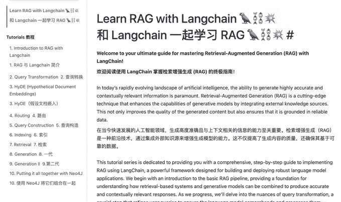

# 一个基于LangChain 实现RAG（检索增强型生成）的指南！

> 来源：[https://agijuejin.feishu.cn/docx/JZUGdFPBloECbOxl4N3cqcVVn7T](https://agijuejin.feishu.cn/docx/JZUGdFPBloECbOxl4N3cqcVVn7T)

通过本指南可以学习，如何使用 LangChain 构建和部署使用 RAG 技术的大模型应用

教程涵盖了从基础的 RAG 流程到实际应用的各个环节，包括查询转换、假设文档嵌入（HyDE）、路由机制、查询构建与索引策略、检索技术、以及最终的生成阶段等

<https://www.sakunaharinda.xyz/ragatouille-book/intro.html>