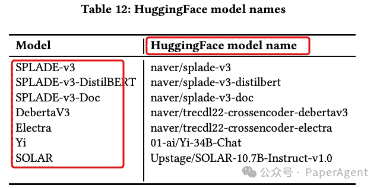
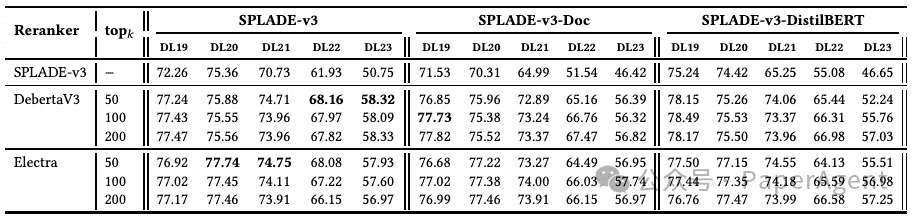
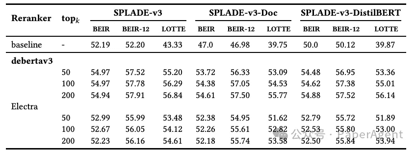
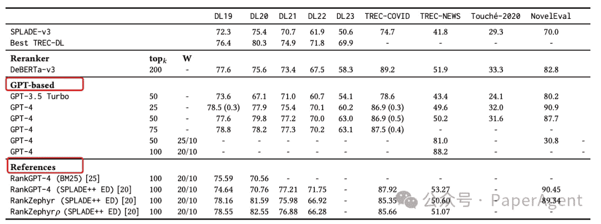
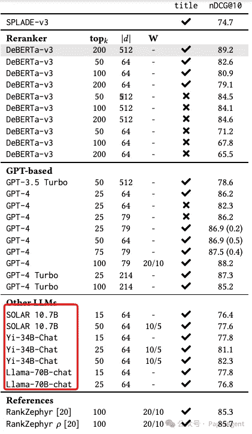
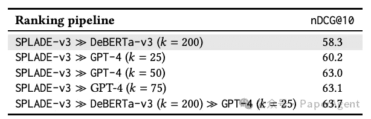
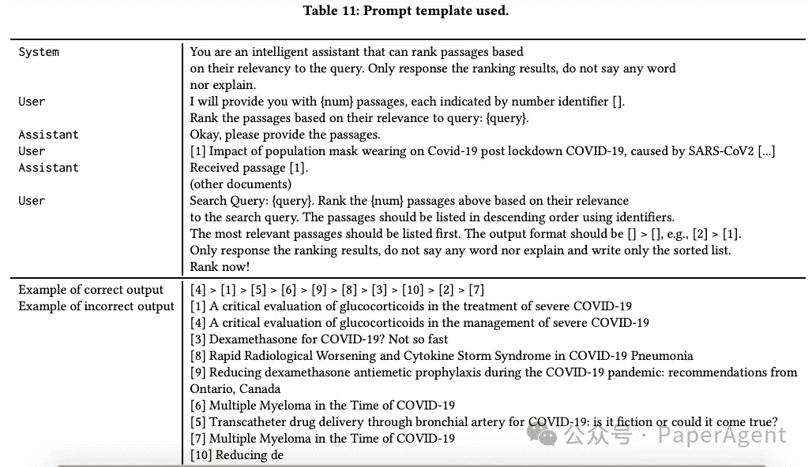

# RAG重排哪家强？Cross-Encoder VS LLM Reranker

> 来源：[https://agijuejin.feishu.cn/docx/TDN8dxOBBo3x5WxsjSQcYxshnVb](https://agijuejin.feishu.cn/docx/TDN8dxOBBo3x5WxsjSQcYxshnVb)

> 作者：PaperAgent

> 原文：https://mp.weixin.qq.com/s/c28t6iK4443D4Ey6IaUwHg

重排模型显著提升了信息检索（IR）系统的质量。传统重排方法依赖于手工定义的特征和特定的学习排序损失函数。随着BERT等模型的出现，交叉编码器（Cross-Encoder ）成为了标准的重排工具。近年，大型语言模型（LLMs）也被证明是有效的零样本（zero-shot）重排器。

**因此，做出了一项深入**研究：在重新排列有效的** SPLADE检索器 的背景下， 比较 了 LLMs重排器（**LLMs As ReRankers）与 交叉编码器（Cross-Encoders） 。在TREC深度学习数据集和诸如BEIR和LoTTE等跨领域数据集上进行了大规模评估，得出如下结论：

+   交叉编码重排器在领域内和领域外数据集上的行为略有不同。

+   与基于LLM的重排器相比，交叉编码器保持竞争力，并且效率更高。

+   **O**pen LLM在性能上不如GPT**-**4，但在某些约束条件下（例如，小提示）仍然展现出良好的排序能力。【 后半句的结论好像有点不对，有兴趣的小伙伴可以看下文的实验对比数据分析下 】



## **五大维度详细实验评估**

### **交叉 编码器的领域内评估**

**最好的第一阶段模型通常会导致最好的最终性能，但**是重排器缩小了三个检索器之间最初的差距。

+   对比了SPLADE模型的不同变体（SPLADE-v3, SPLADE-v3-DistilBERT, SPLADE-v3-Doc）在TREC深度学习数据集（DL19-DL23）上的表现。

+   分析了不同重排器（基于DeBERTa-v3和ELECTRA的模型）对这些SPLADE模型结果的影响。

+   重排不同数量文档（用top𝑘表示）对模型性能的影响，发现增加重排的文档数量通常有利于提升性能，尤其是对于效果较差的模型。

各种SPLADE模型与各种重排器的领域内评估 （nDCG@10）



### **交叉编码器的领域外评估**

+   在BEIR和LoTTE数据集上评估了交叉编码器的性能。

+   发现在领域外设置中，DeBERTa-v3重排器一致性地优于基于ELECTRA的模型。

+   增加重排的文档数量同样在领域外数据集上对提升模型性能有积极作用 。

**跨领域评估（nDCG@10）**



### **LLM作为重排器**

+   评估了OpenAI的GPT-3.5 Turbo和GPT-4作为零样本重排器的性能，但成本限制了实验的规模。

+   GPT-4在某些数据集上的表现与DeBERTa-v3相当，甚至更好 ，尤其是在DL23和NovelEval数据集上。

+   对于GPT-4，滑动窗口机制可能不是必需的 ，文档截断机制通常能够提供与滑动窗口机制相当或更好的结果。

+   **GPT-4与其他TREC参****与者的结果以及** RankZephyr模型 的结果进行了比较，这些结果通常非常具有竞争力，但通常是通过 结合多种模型 获得的。

**在SPLADE-v3（强基线）基础上，作为零样本重排器的基**于GPT的模型评估——nDCG@10。



### TREC-COVID数据集上的详细比较

进一步比较了DeBERTa-v3重排器与OpenAI LLMs以及开放模型的性能。

+   发现GPT-4在处理非常短的文档时表现非常好 ，即使文档被截断以适应提示长度。

+   标题对不同重排器的影响，发 **现标题对于LLMs特别有用 **，尤其是当文档较短时。

**封闭模型与开放模型的比较： **

+   使用开放LLMs（如SOLAR、Yi-34B-Chat和Llama-70B-chat）作为零样本重排器的结果。

+   开放模型的结果与OpenAI模型相比表现较差 ，但通过减少提示中的文本量（通过减小top𝑘）可以获得有趣的结果。

+   **原文的话，感觉有问题 **： Indeed, some models (e.g., Yi-34B-Chat) can achieve decent results (up to 82 nDCG@10), especially compared to GPT-3.5 Turbo, but k must be smaller (around 10-15).

**在TREC-COVID上的交叉编码器、开放性和封闭**性LLMs的比较（nDCG@10）。  "|d|" 表示截断长度，"title" 表示该字段是否在评估中使用或不使用（x）。



### 重排管道（Reranking Pipeline）

+   LLMs可以用于从交叉编码器输出的结果中重新排序文档。 使用LLMs进行重排可以提高最终效果。

+   基于LLM的重排器不一定非得替代交叉编码器 ，而是作为信息检索系统在有效性-效率谱系中的新“竞争者”。

使用LLMs的级联管道（在TREC DL23上的nDCG@10）



LLMs As Rerankers的Prompt模版



```
https://arxiv.org/pdf/2403.10407
A Thorough Comparison of Cross-Encoders and LLMs for Reranking SPLADE
```

**推荐阅读**

+   • 对齐LLM偏好的直接偏好优化方法：DPO、IPO、KTO

+   • 2024：ToB、Agent、多模态

+   • TA们的RAG真正投产了吗？（上）

+   • [A](http://mp.weixin.qq.com/s?__biz=Mzk0MTYzMzMxMA==&mid=2247485322&idx=1&sn=71ffb345fca514aa5ce2848cb2c9f071&chksm=c2ce3dfbf5b9b4edd5b98e45c6179890bdea748fb5220636d25f42006954ea5c81afa8735725&scene=21#wechat_redirect)gent到多模态Agent再到多模态Multi-Agents系统的发展与案例讲解（1.2万字，20+文献，27张图）

---

欢迎关注我的👸号“ **PaperAgent **”， 每天一篇大模型（LLM）文章来锻炼我们的思维，简单的例子，不简单的方法，提升自己。