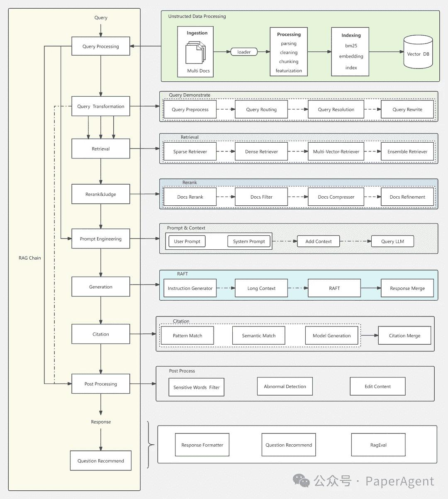
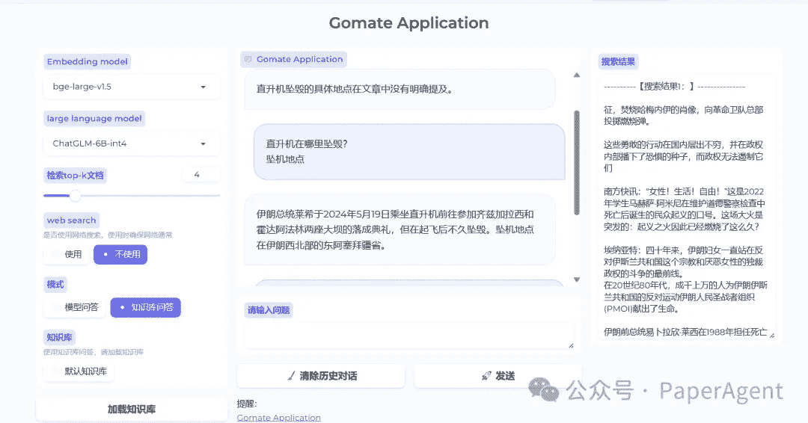

# RAG新框架GoMate：可靠的输入，可信的输出

> 来源：[https://agijuejin.feishu.cn/docx/GRaNd5xJooNmDPxsZ3sce7NWnrb](https://agijuejin.feishu.cn/docx/GRaNd5xJooNmDPxsZ3sce7NWnrb)

> 作者：PaperAgent

> 原文：https://mp.weixin.qq.com/s/BWC0eNKoeO2YtGy93Mw0qw

GoMate 是一款配置化模块化的RAG（ Retrieval-Augmented Gen**eration ） 框架**，它 的设计核心在于其高度的可配置性和模块化，旨在提供 可靠的输入与可信的输出 （“ Reliable input,Trusted output ”）。

整个框架提供一个从数据输入到最终响应输出的完整流程，涵盖了数据处理、查询理解、信息检索、结果优化、上下文理解、内容生成、后处理和评估等多个方面



1.  **数据准备 **：包括数据摄入、清洗、分块、嵌入和索引。

1.  **查询理解 **：涉及查询的预处理、转换、路由和重写。

1.  **信息检索 **：通过不同的检索器（密集、多向量、稀疏、集成）进行信息检索。

1.  **结果优化 **：包括结果的重排、判断、压缩、细化和过滤。

1.  **上下文与提示 **：通过提示工程和上下文添加来增强查询理解。

1.  **生成响应 **：使用语言模型（如RAG链和RAFT）生成长上下文响应。

1.  **后处理 **：对生成的内容进行编辑、敏感词过滤和异常检测。

1.  **响应输出 **：格式化响应并进行问题推荐。

1.  **评估反馈 **：通过RagEval等工具进行效果评估。

**GoMate效果体验： **

```
可以配置本地模型路径
class ApplicationConfig:
    llm_model_name = &#x27;/data/users/searchgpt/pretrained_models/chatglm3-6b&#x27;  # 本地模型文件 or huggingface远程仓库
    embedding_model_name = &#x27;/data/users/searchgpt/pretrained_models/bge-reranker-large&#x27;  # 检索模型文件 or huggingface远程仓库
    vector_store_path = &#x27;./storage&#x27;
    docs_path = &#x27;./data/docs&#x27;

python app.py
```

浏览器访问：127.0.0.1:7860



**对于RAG各**模块的更多技术，PaperAgent团队 RAG专栏 进行过详细的归纳总结：高级RAG之36技（术）。

```
36技试看私信获取：RAG专栏     https://github.com/gomate-community/GoMate
```

**推荐阅读**

+   • 对齐LLM偏好的直接偏好优化方法：DPO、IPO、KTO

+   • 2024：ToB、Agent、多模态

+   • [RAG全景图：从RAG启蒙到高级RAG之](http://mp.weixin.qq.com/s?__biz=Mzk0MTYzMzMxMA==&mid=2247487375&idx=1&sn=e16bc2fdaac04e58e99cfd2a1dc0b0cb&chksm=c2ce35fef5b9bce80dcf0a70b753707036fe7f962d7888d60396490841a538b0f46e952f53f0&scene=21#wechat_redirect)36技，再到终章Agentic RAG！

+   • [A](http://mp.weixin.qq.com/s?__biz=Mzk0MTYzMzMxMA==&mid=2247485322&idx=1&sn=71ffb345fca514aa5ce2848cb2c9f071&chksm=c2ce3dfbf5b9b4edd5b98e45c6179890bdea748fb5220636d25f42006954ea5c81afa8735725&scene=21#wechat_redirect)gent到多模态Agent再到多模态Multi-Agents系统的发展与案例讲解（1.2万字，20+文献，27张图）

---

欢迎关注我的👸号“ **PaperAgent **”， 每天一篇大模型（LLM）文章来锻炼我们的思维，简单的例子，不简单的方法，提升自己。