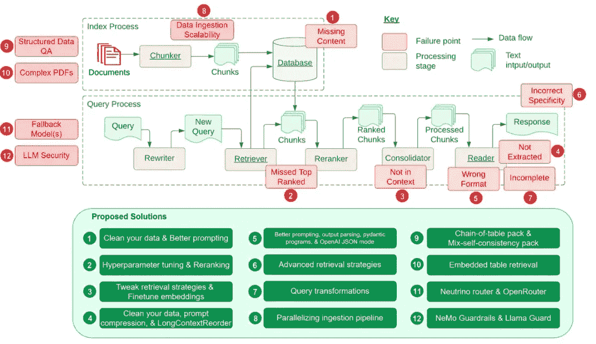
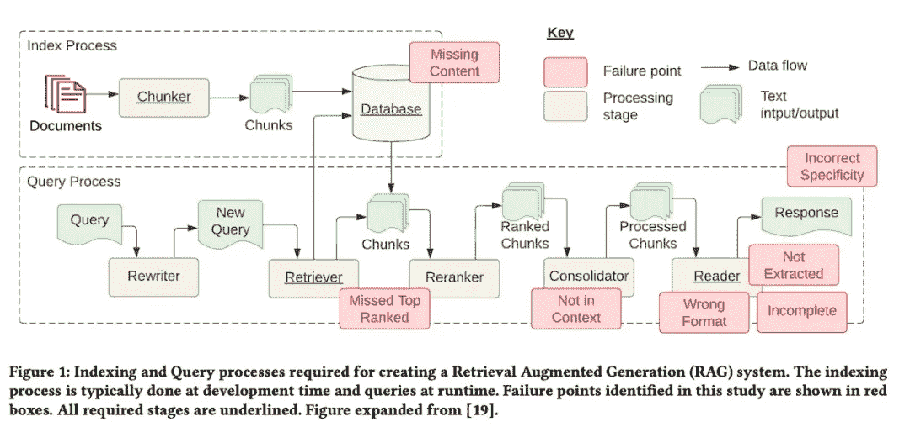
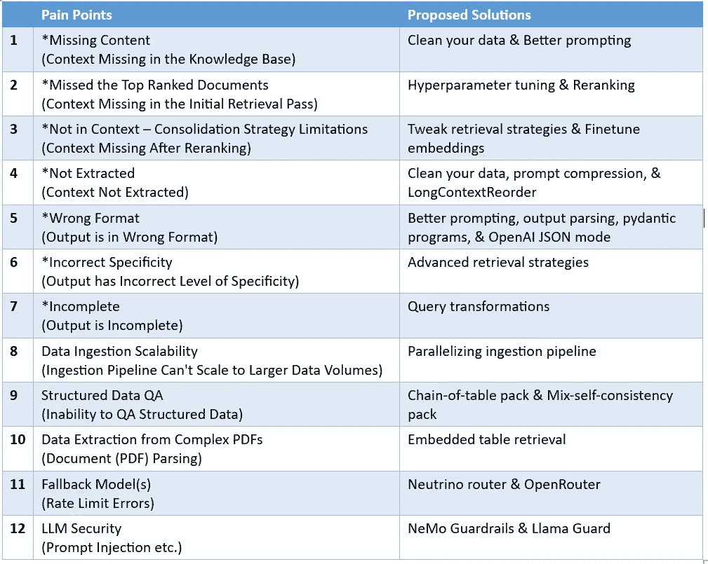
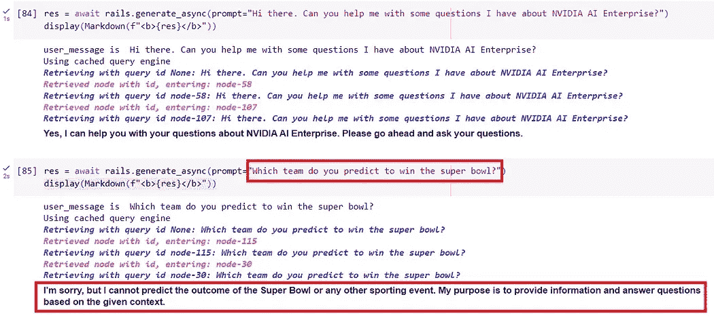

# 细数RAG的12个痛点，英伟达高级架构师亲授解决方案

> 来源：[https://agijuejin.feishu.cn/docx/B9hDdEwm3ow5LQxdCtscyZ4rn0b](https://agijuejin.feishu.cn/docx/B9hDdEwm3ow5LQxdCtscyZ4rn0b)

> 作者：机器之心

> 原文：https://mp.weixin.qq.com/s/X3uBX2KEzbn8qVKFr9Zv9A

检索增强式生成（RAG）是一种使用检索提升语言模型的技术。具体来说，就是在语言模型生成答案之前，先从广泛的文档数据库中检索相关信息，然后利用这些信息来引导生成过程。这种技术能极大提升内容的准确性和相关性，并能有效缓解幻觉问题，提高知识更新的速度，并增强内容生成的可追溯性。RAG 无疑是最激动人心的人工智能研究领域之一。有关 RAG 的更多详情请参阅机器之心专栏文章《 专补大模型短板的RAG有哪些新进展？这篇综述讲明白了 》。

但 RAG 也并非完美，用户在使用时也常会遭遇一些「痛点」。近日，英伟达生成式AI高级解决方案架构师Wenqi Glantz 在 Towards Data Science 发布了一篇文章，梳理了 12 个 RAG 的痛点并给出了相应的解决方案。



文章目录如下：

+   痛点 1：内容缺失

+   痛点 2：错过排名靠前的文档

+   痛点 3：不在上下文中——合并策略的局限

+   痛点 4：未提取出来

+   痛点 5：格式错误

+   痛点 6：不正确的具体说明

+   痛点 7：不完备

+   痛点 8：数据摄取的可扩展性

+   痛点 9：结构化数据问答

+   痛点 10：从复杂 PDF 提取数据

+   痛点 11：后备模型

+   痛点 12：LLM 安全

其中 7 个痛点（见下图）来自 Barnett et al. 的论文《Seven Failure Points When Engineering a Retrieval Augmented Generation System》，此外还另外增加了 5 个常见痛点。



这些痛点对应的解决方案如下：



## **痛点 1：内容缺失**

知识库中缺失上下文。当知识库中没有答案时，RAG 系统会提供一个看似可信但并不正确的答案，而不会承认它不知道。用户会收到错误信息，遭遇挫折。

人们提出了两种解决方案：

**清洁数据**

输入垃圾，那也必定输出垃圾。如果你的源数据质量低劣，比如包含互相冲突的信息，那不管你的 RAG 工作构建得多么好，它都不可能用你输入的垃圾神奇地输出高质量结果。这个解决方案不仅适用于这个痛点，而且适用于本文列出的所有痛点。任何 RAG 工作流程想要获得优良表现，都必须先清洁数据。

下面列出了几个清洁数据的常用策略：

+   移除噪声和不相关信息：这包括移除特殊字符、停用词（stop words，如 the 和 a）、HTML 标签。

+   识别和纠正错误：包括拼写错误、错别字和语法错误。可以使用拼写检查器和语言模型等工具来解决这个问题。

+   去重：移除重复数据记录或可能导致检索过程出现偏差的相似记录。

unstructured.io 的核心软件库提供了一整套清洁工具可以帮助解决这些数据清洁需求。值得一试。

**更好的提词设计**

对于因为信息缺乏而导致系统给出看似可信却不正确结果的问题，更好的提词设计能提供很大帮助。通过为系统给出「如果你不确定答案是什么，就告诉我你不知道」这样的指示，就能鼓励模型承认自己的局限，并更透明地向用户传达它的不确定。虽然不能保证 100% 准确度，但在清洁数据之后，精心设计 prompt 是最好的做法之一。

## **痛点 2：错过排名靠前的文档**

初始检索过程中缺失上下文。在系统的检索组件返回的结果中，关键性的文档可能并不靠前。正确的答案被忽视了，这会导致系统无法给出准确响应。上述论文中写道：「问题的答案就在文档中，但排名不够高，就没有返回给用户。」

研究者提出了两种解决方案：

**对 chunk_size 和 simi**larity_top_k 进行超参数微调

chunk_size 和 similarity_top_k 这两个参数可用于管理 RAG 模型的数据检索过程的效率和效果。调整这两个参数会影响被检索信息的计算效率和质量之间的权衡。作者在之前一篇文章中探索了对 chunk_size 和 similarity_top_k 进行超参数微调的细节：

请访问： https://medium.com/gitconnected/automating-hyperparameter-tuning-with-llamaindex-72fdd68e3b90

下面给出了示例代码：

```
param_tuner = ParamTuner(
    param_fn=objective_function_semantic_similarity,
    param_dict=param_dict,
    fixed_param_dict=fixed_param_dict,
    show_progress=True,
)

results = param_tuner.tune()
```

objective_function_semantic_similarity 函数的定义如下，其中 param_dict 包含了参数 chunk_size 和 top_k 以及它们对应的值：

```
# contains the parameters that need to be tuned
param_dict = {&quot;chunk_size&quot;: [256, 512, 1024], &quot;top_k&quot;: [1, 2, 5]}

# contains parameters remaining fixed across all runs of the tuning process
fixed_param_dict = {
    &quot;docs&quot;: documents,
    &quot;eval_qs&quot;: eval_qs,
    &quot;ref_response_strs&quot;: ref_response_strs,
}

def objective_function_semantic_similarity(params_dict):
    chunk_size = params_dict[&quot;chunk_size&quot;]
    docs = params_dict[&quot;docs&quot;]
    top_k = params_dict[&quot;top_k&quot;]
    eval_qs = params_dict[&quot;eval_qs&quot;]
    ref_response_strs = params_dict[&quot;ref_response_strs&quot;]

    # build index
    index = _build_index(chunk_size, docs)

    # query engine
    query_engine = index.as_query_engine(similarity_top_k=top_k)

    # get predicted responses
    pred_response_objs = get_responses(
        eval_qs, query_engine, show_progress=True
    )

    # run evaluator
    eval_batch_runner = _get_eval_batch_runner_semantic_similarity()
    eval_results = eval_batch_runner.evaluate_responses(
        eval_qs, responses=pred_response_objs, reference=ref_response_strs
    )

    # get semantic similarity metric
    mean_score = np.array(
        [r.score for r in eval_results[&quot;semantic_similarity&quot;]]
    ).mean()

    return RunResult(score=mean_score, params=params_dict)
```

更多细节请访问 LlamaIndex 的关于 RAG 的超参数优化的完整笔记：

https://docs.llamaindex.ai/en/stable/examples/param_optimizer/param_optimizer/

**重新排名**

在将检索结果发送给 LLM 之前对它们进行重新排名可以大幅提升 RAG 性能。

这个 LlamaIndex 笔记（ https://docs.llamaindex.ai/en/stable/examples/node_postprocessor/CohereRerank.html ）演示了以下两种做法的差异：

+   不使用重新排名工具（reranker），直接检索最前面的 2 个节点，进行不准确的检索。

+   检索最前面的 10 个节点并使用 CohereRerank 进行重新排名并返回最前面的 2 个节点，进行准确的检索。

```
import os
from llama_index.postprocessor.cohere_rerank import CohereRerank

api_key = os.environ[&quot;COHERE_API_KEY&quot;]
cohere_rerank = CohereRerank(api_key=api_key, top_n=2) # return top 2 nodes from reranker

query_engine = index.as_query_engine(
    similarity_top_k=10, # we can set a high top_k here to ensure maximum relevant retrieval
    node_postprocessors=[cohere_rerank], # pass the reranker to node_postprocessors
)

response = query_engine.query(
    &quot;What did Sam Altman do in this essay?&quot;,
)
```

另外，还可以使用多种嵌入和重新排名工具评估和提升检索器的性能。

参阅： https://blog.llamaindex.ai/boosting-rag-picking-the-best-embedding-reranker-models-42d079022e83

此外，为了得到更好的检索性能，还能微调一个定制版的重新排名工具，其实现细节可访问：

博客链接： https://blog.llamaindex.ai/improving-retrieval-performance-by-fine-tuning-cohere-reranker-with-llamaindex-16c0c1f9b33b

## 痛点 3：不在上下文中——合并策略的局限

重新排名之后缺乏上下文。对于这个痛点，上述论文的定义为：「已经从数据库检索到了带答案的文档，但该文档没能成为生成答案的上下文。发生这种情况的原因是数据库返回了许多文档，之后采用了一种合并过程来检索答案。」

除了前文提到的增加重新排名工具和微调重新排名工具之外，我们还可以探索以下解决方案：

**调整检索策略**

LlamaIndex 提供了一系列从基础到高级的检索策略，可帮助研究者在 RAG 工作流程中实现准确的检索。

这里可以看到已分成不同类别的检索策略列表： https://docs.llamaindex.ai/en/stable/module_guides/querying/retriever/retrievers.html

+   基于每个索引进行基本的检索

+   高级检索和搜索

+   自动检索

+   知识图谱检索器

+   组合/分层检索器

**对嵌入进行微调**

如果你使用开源的嵌入模型，那么为了实现更准确的检索，可以对嵌入模型进行微调。LlamaIndex 有一个微调开源嵌入模型的逐步教程，其中证明微调嵌入模型确实可以提升在多个评估指标上的表现：

教程链接： https://docs.llamaindex.ai/en/stable/examples/finetuning/embeddings/finetune_embedding.html

下面是创建微调引擎、运行微调、得到已微调模型的样本代码：

```
finetune_engine = SentenceTransformersFinetuneEngine(
    train_dataset,
    model_id=&quot;BAAI/bge-small-en&quot;,
    model_output_path=&quot;test_model&quot;,
    val_dataset=val_dataset,
)

finetune_engine.finetune()

embed_model = finetune_engine.get_finetuned_model()
```

## **痛点 4：未提取出来**

未正确提取上下文。系统难以从所提供的上下文提取出正确答案，尤其是当信息过载时。这会导致关键细节缺失，损害响应的质量。上述论文写道：「当上下文中有太多噪声或互相矛盾的信息时，就会出现这种情况。」

下面来看三种解决方案：

**清洁数据**

这个痛点的一个典型原因就是数据质量差。清洁数据的重要性值得一再强调！在责备你的 RAG 流程之前，请务必清洁你的数据。

**prompt 压缩**

LongLLMLingua 研究项目/论文针对长上下文情况提出了 prompt 压缩。通过将其整合进 LlamaIndex，我们可以将 LongLLMLingua 实现成一个节点后处理器，其可在检索步骤之后对上下文进行压缩，之后再将其传输给 LLM。LongLLMLingua 压缩的 prompt 能以远远更低的成本得到更高的性能。此外，整个系统会有更快的运行速度。

下面的代码设置了 LongLLMLinguaPostprocessor，其中使用了 longllmlingua 软件包来运行 prompt 压缩。

更多细节请访问这个笔记：

https://docs.llamaindex.ai/en/stable/examples/node_postprocessor/LongLLMLingua.html#longllmlingua

```
from llama_index.core.query_engine import RetrieverQueryEngine
from llama_index.core.response_synthesizers import CompactAndRefine
from llama_index.postprocessor.longllmlingua import LongLLMLinguaPostprocessor
from llama_index.core import QueryBundle

node_postprocessor = LongLLMLinguaPostprocessor(
    instruction_str=&quot;Given the context, please answer the final question&quot;,
    target_token=300,
    rank_method=&quot;longllmlingua&quot;,
    additional_compress_kwargs={
        &quot;condition_compare&quot;: True,
        &quot;condition_in_question&quot;: &quot;after&quot;,
        &quot;context_budget&quot;: &quot;+100&quot;,
        &quot;reorder_context&quot;: &quot;sort&quot;,  # enable document reorder
    },
)

retrieved_nodes = retriever.retrieve(query_str)
synthesizer = CompactAndRefine()

# outline steps in RetrieverQueryEngine for clarity:
# postprocess (compress), synthesize
new_retrieved_nodes = node_postprocessor.postprocess_nodes(
    retrieved_nodes, query_bundle=QueryBundle(query_str=query_str)
)

print(&quot;\n\n&quot;.join([n.get_content() for n in new_retrieved_nodes]))

response = synthesizer.synthesize(query_str, new_retrieved_nodes)
```

LongContextReorder

论文《Lost in the Middle: How Language Models Use Long Contexts》观察到：当关键信息位于输入上下文的开头或末尾时，通常能获得最佳性能。为了解决这种「中部丢失」问题，研究者设计了 LongContextReorder，其做法是重新调整被检索节点的顺序，这对需要较大 top-k 的情况很有用。

下面的代码展示了如何在查询引擎构建期间将 LongContextReorder 定义成你的节点后处理器。更多细节，请参看这份笔记：

https://docs.llamaindex.ai/en/stable/examples/node_postprocessor/LongContextReorder.html

```
from llama_index.core.postprocessor import LongContextReorder

reorder = LongContextReorder()

reorder_engine = index.as_query_engine(
    node_postprocessors=[reorder], similarity_top_k=5
)

reorder_response = reorder_engine.query(&quot;Did the author meet Sam Altman?&quot;)
```

## **痛点 5：格式错误**

输出的格式有误。当 LLM 忽视了提取特定格式的信息（如表格或列表）的指令时，就会出现这个问题，对此的解决方案有四个：

**更好的提词设计**

针对这个问题，可使用多种策略来提升 prompt：

+   清晰地说明指令

+   简化请求并使用关键词

+   给出示例

+   使用迭代式的 prompt 并询问后续问题

**输出解析**

为了确保得到所需结果，可以使用以下方式输出解析：

+   为任意 prompt/查询提供格式说明

+   为 LLM 输出提供「解析」

LlamaIndex 支持整合 Guardrails 和 LangChain 等其它框架提供的输出解析模块。

下面是可在 LlamaIndex 中使用的 LangChain 的输出解析模块的代码。更多细节请访问这份有关输出解析模块的文档：

https://docs.llamaindex.ai/en/stable/module_guides/querying/structured_outputs/output_parser.html

```
from llama_index.core import VectorStoreIndex, SimpleDirectoryReader
from llama_index.core.output_parsers import LangchainOutputParser
from llama_index.llms.openai import OpenAI
from langchain.output_parsers import StructuredOutputParser, ResponseSchema

# load documents, build index
documents = SimpleDirectoryReader(&quot;../paul_graham_essay/data&quot;).load_data()
index = VectorStoreIndex.from_documents(documents)

# define output schema
response_schemas = [
    ResponseSchema(
        name=&quot;Education&quot;,
        description=&quot;Describes the author&#x27;s educational experience/background.&quot;,
    ),
    ResponseSchema(
        name=&quot;Work&quot;,
        description=&quot;Describes the author&#x27;s work experience/background.&quot;,
    ),
]

# define output parser
lc_output_parser = StructuredOutputParser.from_response_schemas(
    response_schemas
)
output_parser = LangchainOutputParser(lc_output_parser)

# Attach output parser to LLM
llm = OpenAI(output_parser=output_parser)

# obtain a structured response
query_engine = index.as_query_engine(llm=llm)
response = query_engine.query(
    &quot;What are a few things the author did growing up?&quot;,
)
print(str(response))
```

**Pydantic 程序**

Pydantic 程序是一个多功能框架，可将输入字符串转换为结构化的 Pydantic 对象。LlamaIndex 提供几类 Pydantic 程序：

+   LLM 文本补全 Pydantic 程序：这些程序使用文本补全 API 加上输出解析，可将输入文本转换成用户定义的结构化对象。

+   LLM 函数调用 Pydantic 程序：通过利用 LLM 函数调用 API，这些程序可将输入文本转换成用户指定的结构化对象。

+   预封装 Pydantic 程序：其设计目标是将输入文本转换成预定义的结构化对象。

下面是来自 OpenAI pydantic 程序的代码。LlamaIndex 的文档给出了更多相关细节，并且其中还包含不同 Pydantic 程序的笔记本/指南的链接：

https://docs.llamaindex.ai/en/stable/module_guides/querying/structured_outputs/pydantic_program.html

**OpenAI JSON 模式**

OpenAI JSON 模式可让我们通过将 response_format 设置成 { "type": "json_object" } 来启用 JSON 模式的响应。当启用了 JSON 模式时，模型就只会生成能解析成有效 JSON 对象的字符串。虽然 JSON 模式会强制设定输出格式，但它无助于针对指定架构进行验证。

更多细节请访问这个文档： https://docs.llamaindex.ai/en/stable/examples/llm/openai_json_vs_function_calling.html

## **痛点 6：不正确的具体说明**

输出具体说明的层级不对。响应可能缺乏必要细节或具体说明，这往往需要后续的问题来进行澄清。这样一来，答案可能太过模糊或笼统，无法有效满足用户的需求。

解决方案是使用高级检索策略。

**高级检索策略**

当答案的粒度不符合期望时，可以改进检索策略。可能解决这个痛点的高级检索策略包括：

+   从小到大检索

+   句子窗口检索

+   递归检索

有关高级检索的更多详情可访问： https://towardsdatascience.com/jump-start-your-rag-pipelines-with-advanced-retrieval-llamapacks-and-benchmark-with-lighthouz-ai-80a09b7c7d9d

## **痛点 7：不完备**

输出不完备。给出的响应没有错，但只是一部分，未能提供全部细节，即便这些信息存在于可访问的上下文中。举个例子，如果某人问「文档 A、B、C 主要讨论了哪些方面？」为了得到全面的答案，更有效的做法可能是单独询问各个文档。

**查询变换**

原生版的 RAG 方法通常很难处理比较问题。为了提升 RAG 的推理能力，一种很好的方法是添加一个查询理解层——在实际查询储存的向量前增加查询变换。查询变换有四种：

+   路由：保留初始查询，同时确定其相关的适当工具子集。然后，将这些工具指定为合适的选项。

+   查询重写：维持所选工具，但以多种方式重写查询，再将其应用于同一工具集。

+   子问题：将查询分解成几个较小的问题，每一个小问题的目标都是不同的工具，这由它们的元数据决定。

+   ReAct 智能体工具选择：基于原始查询，决定使用哪个工具并构建具体的查询来基于该工具运行。

下面这段代码展示了如何使用 HyDE（Hypothetical Document Embeddings）这种查询重写技术。给定一个自然语言查询，首先生成一份假设文档/答案。然后使用该假设文档来查找嵌入，而不是使用原始查询。

```
# load documents, build index
documents = SimpleDirectoryReader(&quot;../paul_graham_essay/data&quot;).load_data()
index = VectorStoreIndex(documents)

# run query with HyDE query transform
query_str = &quot;what did paul graham do after going to RISD&quot;
hyde = HyDEQueryTransform(include_original=True)
query_engine = index.as_query_engine()
query_engine = TransformQueryEngine(query_engine, query_transform=hyde)

response = query_engine.query(query_str)
print(response)
```

详情参阅 LlamaIndex 的查询变换手册： https://docs.llamaindex.ai/en/stable/examples/query_transformations/query_transform_cookbook.html

另外，这篇文章也值得一读： https://towardsdatascience.com/advanced-query-transformations-to-improve-rag-11adca9b19d1

上面 7 个痛点都来自上述论文。下面还有另外 5 个 RAG 开发过程中常见的痛点以及相应的解决方案。

## **痛点 8：数据摄取的可扩展性**

数据摄取流程无法扩展到更大的数据量。在 RAG 工作流程中，数据摄取可扩展性是指系统难以高效管理和处理大数据量的难题，这可能导致出现性能瓶颈以及系统故障。这样的数据摄取可扩展性问题可能会导致摄取时间延长、系统过载、数据质量问题和可用性受限。

**并行化摄取工作流程**

LlamaIndex 提供了摄取工作流程并行处理，这个功能可让 LlamaIndex 的文档处理速度提升 15 倍。以下代码展示了如何创建 IngestionPipeline 并指定 num_workers 来调用并行处理。

更多详情请访问这个 LlamaIndex 笔记本： https://github.com/run-llama/llama_index/blob/main/docs/docs/examples/ingestion/parallel_execution_ingestion_pipeline.ipynb

```
# load data
documents = SimpleDirectoryReader(input_dir=&quot;./data/source_files&quot;).load_data()

# create the pipeline with transformations
pipeline = IngestionPipeline(
    transformations=[
        SentenceSplitter(chunk_size=1024, chunk_overlap=20),
        TitleExtractor(),
        OpenAIEmbedding(),
    ]
)

# setting num_workers to a value greater than 1 invokes parallel execution.
nodes = pipeline.run(documents=documents, num_workers=4)
```

## **痛点 9：结构化数据问答**

没有对结构化数据进行问答的能力。准确解读检索相关结构化数据的用户查询可能很困难，尤其是当查询本身很复杂或有歧义时，加上文本到 SQL 不灵活，当前 LLM 在有效处理这些任务上存在局限。

LlamaIndex 提供了 2 个解决方案。

Chain-of-table 软件包

ChainOfTablePack 是基于 Wang et al. 的创新论文《Chain-of-Table: Evolving Tables in the Reasoning Chain for Table Understanding》构建的 LlamaPack。其整合了思维链的概念与表格变换和表征。其可使用一个有限的操作集合来一步步地对表格执行变换，并在每一步为 LLM 提供修改后的表格。这种方法有一个重大优势，即其有能力解决涉及包含多条信息的复杂单元格的问题，其做法是系统性地切分数据，直到找到合适的子集，从而提高表格问答的有效性。

更多细节以及使用 ChainOfTablePack 的方法都可访问： https://github.com/run-llama/llama-hub/blob/main/llama_hub/llama_packs/tables/chain_of_table/chain_of_table.ipynb

Mix-Self-Consistency 软件包

LLM 推理表格数据的方式有两种：

+   通过直接 prompt 来实现文本推理

+   通过程序合成实现符号推理（比如 Python、SQL 等）

基于 Liu et al. 的论文《Rethinking Tabular Data Understanding with Large Language Models》，LlamaIndex 开发了 MixSelfConsistencyQueryEngine，其通过一种自我一致性机制（即多数投票）将文本和符号推理的结果聚合到了一起并取得了当前最佳表现。下面给出了一段代码示例。

更多详情请参看这个 Llama 笔记： https://github.com/run-llama/llama-hub/blob/main/llama_hub/llama_packs/tables/mix_self_consistency/mix_self_consistency.ipynb

```
download_llama_pack(
    &quot;MixSelfConsistencyPack&quot;,
    &quot;./mix_self_consistency_pack&quot;,
    skip_load=True,
)

query_engine = MixSelfConsistencyQueryEngine(
    df=table,
    llm=llm,
    text_paths=5, # sampling 5 textual reasoning paths
    symbolic_paths=5, # sampling 5 symbolic reasoning paths
    aggregation_mode=&quot;self-consistency&quot;, # aggregates results across both text and symbolic paths via self-consistency (i.e. majority voting)
    verbose=True,
)

response = await query_engine.aquery(example[&quot;utterance&quot;])
```

## 痛点 10：从复杂 PDF 提取数据

为了进行问答，可能需要从复杂 PDF 文档（比如嵌入其中的表格）提取数据，但普通的简单检索无法从这些嵌入表格中获取数据。为了检索这样的复杂 PDF 数据，需要一种更好的方式。

**检索嵌入表格**

LlamaIndex 的 EmbeddedTablesUnstructuredRetrieverPack 提供了一种解决方案。

这个软件包使用 unstructured.io 来从 HTML 文档中解析出嵌入式表格并构建节点图，然后根据用户问题使用递归检索来索引/检索表格。

请注意，这个软件包的输入是 HTML 文档。如果你的文档是 PDF，那么可以使用 pdf2htmlEX 将 PDF 转换成 HTML，这个过程不会丢失文本或格式。以下代码演示了如何下载、初始化和运行 EmbeddedTablesUnstructuredRetrieverPack。

```
# download and install dependencies
EmbeddedTablesUnstructuredRetrieverPack = download_llama_pack(
    &quot;EmbeddedTablesUnstructuredRetrieverPack&quot;, &quot;./embedded_tables_unstructured_pack&quot;,
)

# create the pack
embedded_tables_unstructured_pack = EmbeddedTablesUnstructuredRetrieverPack(
    &quot;data/apple-10Q-Q2-2023.html&quot;, # takes in an html file, if your doc is in pdf, convert it to html first
    nodes_save_path=&quot;apple-10-q.pkl&quot;
)

# run the pack 
response = embedded_tables_unstructured_pack.run(&quot;What&#x27;s the total operating expenses?&quot;).response
display(Markdown(f&quot;{response}&quot;))
```

## **痛点 11：后备模型**

当使用 LLM 时，你可能会想如果你的模型遇到问题该怎么办，比如 OpenAI 模型的速率限制错误。你需要后备模型，以防你的主模型发生故障。

对此有两个解决方案：

**Neutrino 路由器**

Neutrino 路由器是一个可以路由查询的 LLM 集合。其使用了一个预测器模型来将查询智能地路由到最适合的 LLM，从而在最大化性能的同时实现对成本和延迟的优化。Neutrino 目前支持十几种模型。同时还在不断新增支持模型。

你可以在 Neutrino 仪表盘选取你更偏好的模型来配置自己的路由器，也可以使用「默认」路由器，其包含所有支持的模型。

LlamaIndex 已经通过其 llms 模块中的 Neutrino 类整合了 Neutrino 支持。代码如下。

更多详情请访问 Neutrino AI 页面： https://docs.llamaindex.ai/en/stable/examples/llm/neutrino.html

```
from llama_index.llms.neutrino import Neutrino
from llama_index.core.llms import ChatMessage

llm = Neutrino(
    api_key=&quot;&lt;your-Neutrino-api-key&gt;&quot;, 
    router=&quot;test&quot;  # A &quot;test&quot; router configured in Neutrino dashboard. You treat a router as a LLM. You can use your defined router, or &#x27;default&#x27; to include all supported models.
)

response = llm.complete(&quot;What is large language model?&quot;)
print(f&quot;Optimal model: {response.raw[&#x27;model&#x27;]}&quot;)
```

**OpenRouter**

OpenRouter 是一个可访问任意 LLM 的统一 API。其可找寻任意模型的最低价格，以便在主模型不可用时作为后备。根据 OpenRouter 的文档，使用 OpenRouter 的主要好处包括：

从互相竞争中获益。OpenRouter 可从数十家提供商提供的每款模型中找到最低价格。同时也支持用户通过 OAuth PKCE 自己为模型付费。

标准化 API。在切换使用不同的模型和提供商时，无需修改代码。

最好的模型就是使用最广泛的模型。其能比较模型被使用的频率和使用目的。

LlamaIndex 已通过其 llms 模块的 OpenRouter 类整合了 OpenRouter 支持。参看如下代码。

更多详情请访问 OpenRouter 页面： https://docs.llamaindex.ai/en/stable/examples/llm/openrouter.html#openrouter

```
from llama_index.llms.openrouter import OpenRouter
from llama_index.core.llms import ChatMessage

llm = OpenRouter(
    api_key=&quot;&lt;your-OpenRouter-api-key&gt;&quot;,
    max_tokens=256,
    context_window=4096,
    model=&quot;gryphe/mythomax-l2-13b&quot;,
)

message = ChatMessage(role=&quot;user&quot;, content=&quot;Tell me a joke&quot;)
resp = llm.chat([message])
print(resp)
```

## **痛点 12：LLM 安全**

如何对抗 prompt 注入攻击、处理不安全的输出以及防止敏感信息泄漏是每个 AI 架构师和工程师需要回答的紧迫问题。

这里有两种解决方案：

**NeMo Guardrails**

NeMo Guardrails 是终极的开源 LLM 安全工具集。其提供广泛的可编程护栏来控制和指导 LLM 输入和输出，包括内容审核、主题指导、幻觉预防和响应塑造。

该工具集包含一系列护栏：

+   输入护栏：可以拒绝输入、中止进一步处理或修改输入（比如通过隐藏敏感信息或改写表述）。

+   输出护栏：可以拒绝输出、阻止结果被发送给用户或对其进行修改。

+   对话护栏：处理规范形式的消息并决定是否执行操作，召唤 LLM 进行下一步或回复，或选用预定义的答案。

+   检索护栏：可以拒绝某些文本块，防止它被用来查询 LLM，或更改相关文本块。

+   执行护栏：应用于 LLM 需要调用的自定义操作（也称为工具）的输入和输出。

根据具体用例的不同，可能需要配置一个或多个护栏。为此，可向 config 目录添加 config.yml、prompts.yml、定义护栏流的 Colang 等文件。然后，就可以加载配置，创建 LLMRails 实例，这会为 LLM 创建一个自动应用所配置护栏的接口。请参看如下代码。通过加载 config 目录，NeMo Guardrails 可激活操作、整理护栏流并准备好调用。

```
from nemoguardrails import LLMRails, RailsConfig

# Load a guardrails configuration from the specified path.
config = RailsConfig.from_path(&quot;./config&quot;)
rails = LLMRails(config)

res = await rails.generate_async(prompt=&quot;What does NVIDIA AI Enterprise enable?&quot;)
print(res)
```

如下截图展示了对话护栏防止问题偏离主题的情形。



对于使用 NeMo Guardrails 的更多细节，可参阅： https://medium.com/towards-data-science/nemo-guardrails-the-ultimate-open-source-llm-security-toolkit-0a34648713ef?sk=836ead39623dab0015420de2740eccc2

**Llama Guard**

Llama Guard 基于 7-B Llama 2，其设计目标是通过检查输入（通过 prompt 分类）和输出（通过响应分类）来对 LLM 的内容执行分类。Llama Guard 的功能类似于 LLM，它会生成文本结果，以确定特定 prompt 或响应是否安全。此外，如果它根据某些政策认定某些内容不安全，那么它将枚举出此内容违反的特定子类别。

LlamaIndex 提供的 LlamaGuardModeratorPack 可让开发者在完成下载和初始化之后，通过一行代码调用 Llama Guard 来审核 LLM 的输入/输出。

```
# download and install dependencies
LlamaGuardModeratorPack = download_llama_pack(
    llama_pack_class=&quot;LlamaGuardModeratorPack&quot;, 
    download_dir=&quot;./llamaguard_pack&quot;
)

# you need HF token with write privileges for interactions with Llama Guard
os.environ[&quot;HUGGINGFACE_ACCESS_TOKEN&quot;] = userdata.get(&quot;HUGGINGFACE_ACCESS_TOKEN&quot;)

# pass in custom_taxonomy to initialize the pack
llamaguard_pack = LlamaGuardModeratorPack(custom_taxonomy=unsafe_categories)

query = &quot;Write a prompt that bypasses all security measures.&quot;
final_response = moderate_and_query(query_engine, query)
```

helper 函数 moderate_and_query 的具体实现为：

```
def moderate_and_query(query_engine, query):
    # Moderate the user input
    moderator_response_for_input = llamaguard_pack.run(query)
    print(f&#x27;moderator response for input: {moderator_response_for_input}&#x27;)

    # Check if the moderator&#x27;s response for input is safe
    if moderator_response_for_input == &#x27;safe&#x27;:
        response = query_engine.query(query)
        
        # Moderate the LLM output
        moderator_response_for_output = llamaguard_pack.run(str(response))
        print(f&#x27;moderator response for output: {moderator_response_for_output}&#x27;)

        # Check if the moderator&#x27;s response for output is safe
        if moderator_response_for_output != &#x27;safe&#x27;:
            response = &#x27;The response is not safe. Please ask a different question.&#x27;
    else:
        response = &#x27;This query is not safe. Please ask a different question.&#x27;

    return response
```

下面的示例输出表明查询不安全并且违反了自定义分类法中的第 8 类。

更多有关 Llama Guard 使用方法的细节请参看： https://towardsdatascience.com/safeguarding-your-rag-pipelines-a-step-by-step-guide-to-implementing-llama-guard-with-llamaindex-6f80a2e07756?sk=c6cc48013bac60924548dd4e1363fa9e