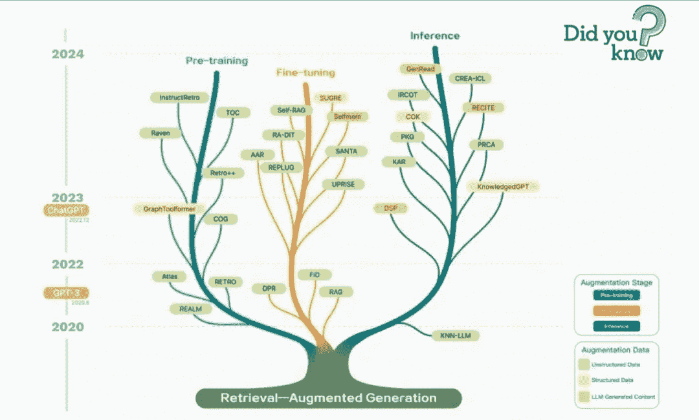
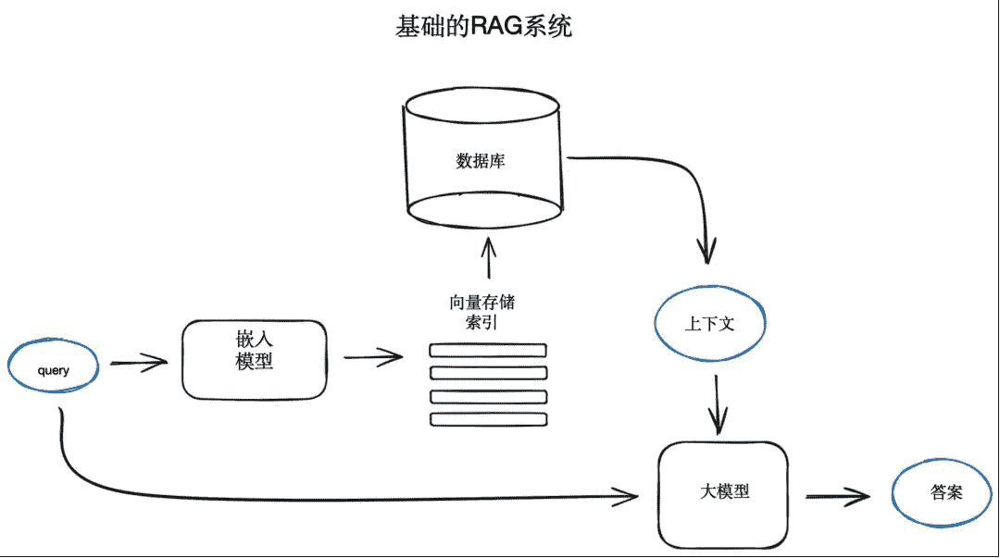
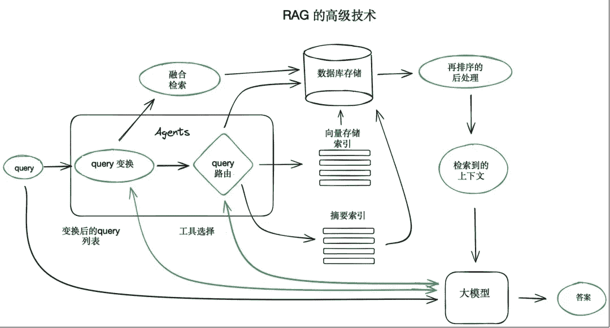
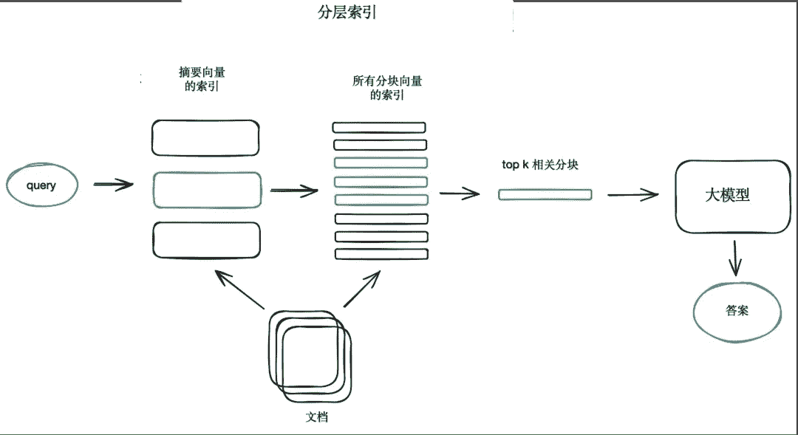
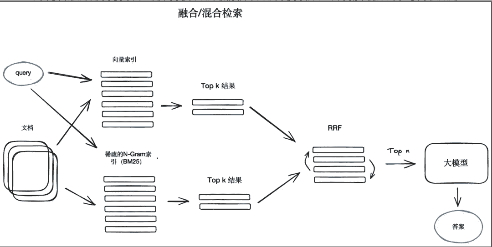
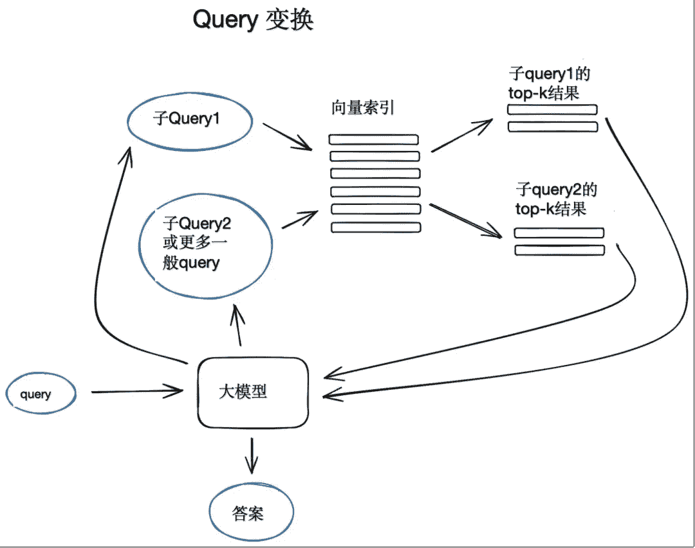
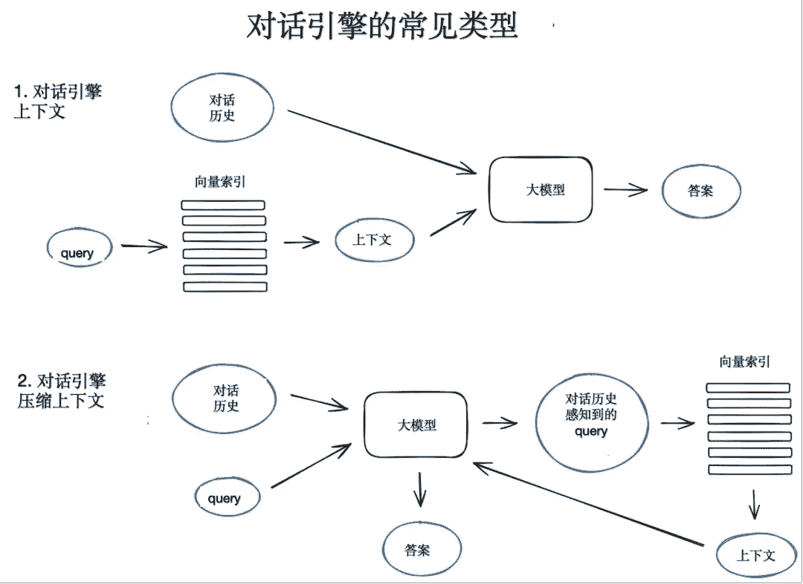
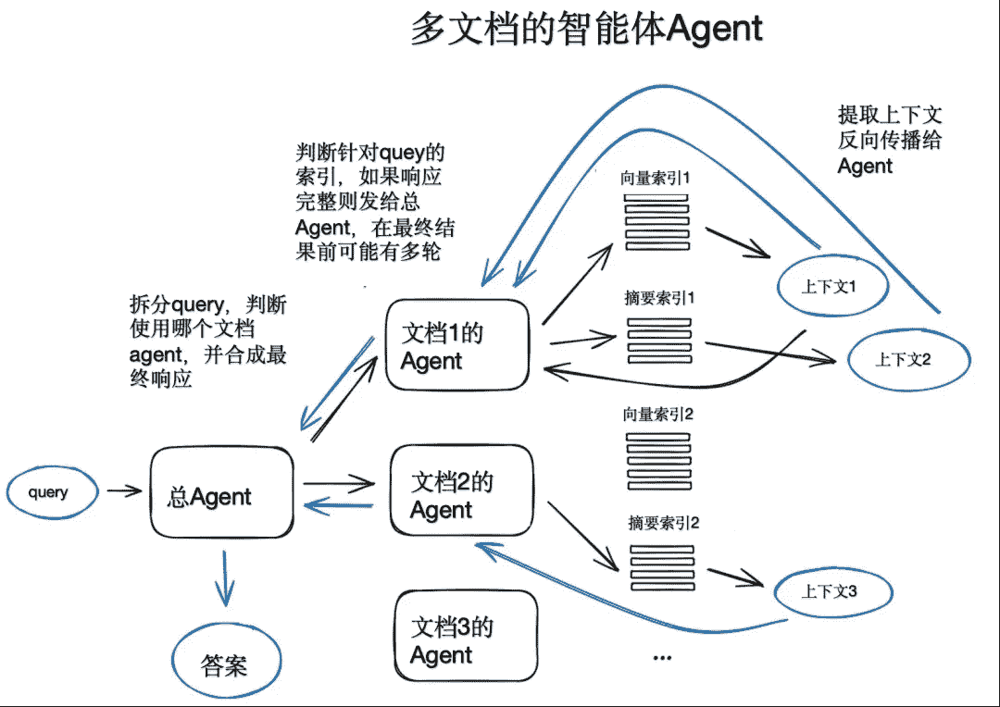
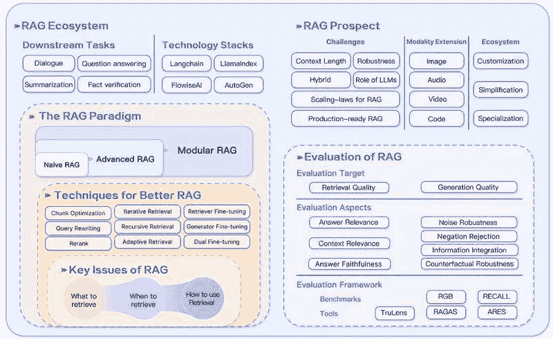

# 大模型系列——解读RAG

> 来源：[https://agijuejin.feishu.cn/docx/TWjVdc9L6oF9aDx6ff3cN9QXn3F](https://agijuejin.feishu.cn/docx/TWjVdc9L6oF9aDx6ff3cN9QXn3F)

> 作者： 半吊子全栈工匠 | 喔家ArchiSelf

> 原文：https://mp.weixin.qq.com/s/jkhu_W1e7o50SFkAu6YRrQ

RAG 是2023年最流行的基于 LLM 的应用系统架构。有许多产品几乎完全建立在 RAG 之上，覆盖了结合网络搜索引擎和 LLM 的问答服务，到成千上万个数据聊天的应用程序。很多人将RAG和Agent 作为大模型应用的两种主流架构，但什么是RAG呢？RAG又涉及了哪些具体的技术呢？

## **1. 什么是RAG**

RAG即检索增强生成，为 LLM 提供了从某些数据源检索到的信息，并基于此修正生成的答案。RAG 基本上是 Search + LLM 提示，可以通过大模型回答查询，并将搜索算法所找到的信息作为大模型的上下文。查询和检索到的上下文都会被注入到发送到 LLM 的提示语中。

嵌入式搜索引擎可以通过 Faiss 来实现，向量搜索领域成为了RAG的一个助力。像pinecone[ 这样的向量数据](http://mp.weixin.qq.com/s?__biz=MzAwOTcyNzA0OQ==&mid=2658978665&idx=1&sn=10512636ac46b2df414ec862e7699841&chksm=80d3564fb7a4df59a43529f2f005c1db65dce7d1225634be5ccd5e817572c383fbe605db063a&scene=21#wechat_redirect)库可以构建开源搜索索引，为输入文本增加了额外的存储空间，还增加了一些其他工具。关于向量数据库，可以参考 解读向量数据库 。

面向RAG的开发框架，对于基于 LLM 的流水线和应用程序，有两个最著名的开源工具—— LangChain 和 LlamaIndex，分别是在2022年10月和11月创建的，随着 ChatGPT 爆发，也在2023年获得了大量采用。LlamaIndex 和 LangChain 都是令人惊叹的开源项目，它们的发展速度非常快。



## **2. 基础的 RAG 技术**

RAG 系统的起点一般是一个文本文档的语料库，简单看起来是这样的: 把文本分割成块，然后把这些分块嵌入到向量与transformer编码器模型，把所有这些向量建立索引，最后创建一个 LLM 提示语，告诉模型回答用户的查询，给出在搜索步骤中找到的上下文。在运行时，我们用相同的编码器模型完成用户查询的 向量化 ，然后执行这个查询向量的索引搜索，找到top-k 的结果，从数据库中检索到相应的文本块，并提供给 LLM 提示语Prompt作为上下文。



在OpenAI 平台上，提示词Prompt可以是这样的:

```
def question_answering(context, query):
    prompt = f&quot;&quot;&quot; my query text...                
                &quot;&quot;&quot;

    response = get_completion(instruction, prompt, model=&quot;gpt-3.5-turbo&quot;)
    answer = response.choices[0].message[&quot;content&quot;]
    return answer
```

关于提示词和提示词工程的更多介绍可以参考OpenAI 的提示词工程手册以及 解读提示工程（Prompt Engineering） 。

显然，尽管 OpenAI 在LLM 市场上处于领先地位，但还是有很多替代方案，比如 Anthroic 的 Claude，还有最近流行的更小但功能强大的模型，比如 Mistral，微软的 Phi-2 以及许多开源选项，比如 Llama2，OpenLLaMA，Falcon等都可以用来开发面向RAG的大模型产品。

## **3. RAG中的高级技术**

尽管并不是所有RAG系统中的高级技术都可以轻松地在一张图中可视化，但给出一个描述核心步骤和算法的方案还是有意义的。



### **3.1. 分块和矢量化**

首先，要创建一个向量索引表示我们的文档内容，然后在运行时搜索所有这些向量和查询向量之间最小距离对应的最接近语义。

由于transformer模型有固定的输入序列长度，即使输入上下文的窗口很大，一个或几个句子的向量也比一个在几页文本上取平均值的向量更能代表它们的语义意义 ，所以数据分块是一个有意义的技术。把初始文档分成一定大小的块，同时又不失去它们的意义，也就是把文本分成句子或段落，而不是把一个句子分成两部分。而且，已经有了各种能够执行此任务的文本分割器实现。例如，在 LlamaIndex 中，NodeParser 就提供了一些高级选项，如定义自己的文本分割器、元数据、节点/块关系等。

数据块的大小是一个需要考虑的参数，它取决于使用的嵌入模型及其token容量，标准的transformer编码模型，如BERT 的句子转换器，最多只能使用512个token，OpenAI ada-002能够处理更长的序列，如8191个token，但这里的折衷是足够的上下文，让 LLM 能够推理以及特定的足够文本嵌入，以便有效地执行搜索。

下一步是选择一个模型来生产所选块的嵌入，同样有很多方法，例如搜索优化的模型（ bge-large 或者E5 系列），MTEB 排行榜可以得到最新的一些方法信息。关于文档分块和向量化步骤的端到端实现，可以具体地参考https://docs.llamaindex.ai/en/latest/module guides/loading/ingestion pipeline/root.html#。

### **3.2. 搜索的索引**

面向RAG的大模型应用的关键部分是用于搜索的索引，它存储前面得到的向量化内容。当然，查询总是首先向量化，对于 top k 分块也是一样的。最简单的实现使用一个平铺的索引，在查询向量和所有块向量之间进行距离计算并遍历。

一个合适的搜索索引，为了在一万多个元素的尺度上有效地检索而优化，需要一个向量索引， faiss，nmslib 或 annoy等使用一些近似最近邻方式实现，如聚类，树或 HNSW 算法。还有一些受管理的解决方案，比如 ElasticSearch以及向量数据库，它们负责处理数据摄取的流水线。

根据索引的选择，数据和搜索需求还可以将元数据与向量一起存储，然后使用元数据过滤器在某些日期或数据源中搜索信息。LlamaIndex 支持许多向量存储索引，也支持其他更简单的索引实现，如列表索引、树索引和关键字表索引。

如果有许多文档，就需要能够有效地在其中进行搜索，找到相关信息，并将其聚合在一个带有源引用的答案中。对于大型数据库，一个有效的方法是创建两个索引，一个由摘要组成，另一个由文档块组成，然后分两个步骤进行搜索，首先通过摘要过滤掉相关文档，然后再通过相关组进行搜索。



另一种方法是要求 LLM 为每个块生成一个问题，并将这些问题嵌入到向量中，在运行时对这个问题的向量索引执行查询搜索(在索引中用问题向量替换块向量) ，然后路由到原始文本块并将它们作为 LLM 获得答案的上下文发送。这种方法提高了搜索质量，因为与实际块相比，查询和假设问题之间具有更高的语义相似性。还有一种被称为 HyDE 的反向逻辑方法, 要求一个 LLM 生成一个假设的给定查询的响应，然后使用它的向量和查询向量来提高搜索质量。

为了获得更好的搜索质量而检索更小的块，就要为 LLM 添加周围的上下文。有两种选择，一个是句子窗口检索，即在检索到的较小块周围按句子展开上下文，另一个是父文档检索，即递归地将文档分割成若干较大的父块，其中包含较小的子块。

在句子窗口检索方案中，文档中的每个句子都是单独嵌入，这为上下文余弦距离搜索提供了很高的准确性。在获取最相关的单个句子之后， 为了 更好地推理找到的上下文，在检索到的句子之前和之后将上下文窗口扩展为k个句子，然后将这个扩展的上下文发送给 LLM。

父文档检索与句子窗口检索非常相似，都是搜索更细粒度的信息，然后在将上下文提供给 LLM 进行推理之前扩展过的上下文窗口。文档被拆分成引用较大父块中的较小子块。具体而言，文档被分割成块的层次结构，然后最小的叶子块被发送到索引。在检索期间，获取较小的块，然后如果在top-k 检索的块中有超过 n 个块链接到同一个父节点(较大的块) ，就用这个父节点替换提供给 LLM 的上下文。需要注意的是，搜索仅在子节点索引中执行。

还有一个相对较老的思路，可以像 tf-idf 或BM25这样的稀疏检索算法那样从现代语义或向量搜索中获取最佳结果，并将其结合在一个检索结果中。这里唯一的技巧是将检索到的结果与不同的相似度得分恰当地结合起来，这个问题通常借助于Reciprocal Rank 融合算法（RRF）来解决，对检索到的结果重新排序以得到最终的输出。



在 LangChain中，这是在集成检索器类中实现的，例如，一个 Faiss 矢量索引和一个基于 BM25的检索器，并使用 RRF 进行重新排序。在 LlamaIndex 中，也是以一种非常类似的方式完成的。

混合或融合搜索通常在考虑查询和存储文档之间有语义相似性和关键字匹配的情况下，将两种互补的搜索算法结合起来，提供更好的检索结果。

### **3.3. Rerank和过滤**

在得到了检索结果后，需要通过过滤来重新排序。LlamaIndex 提供了多种可用的后处理程序，根据相似度评分、关键词、元数据过滤掉结果，或者用其他模型对结果进行重新排序，比如基于句子transformer的交叉编码器、 根据元数据(比如日期最近性)内聚重新排序等等。这是将检索到的上下文提供给 LLM 以获得结果答案之前的最后一步。

### **3.4. query变换**

查询转换是一系列使用 LLM 作为推理引擎来修改用户输入以提高检索质量的技术，有很多不同的技术选择。

如果查询很复杂，LLM 可以将其分解为几个子查询。例如，如果问“ 在Github上Langchain 或 LlamaIndex 上哪个有更多颗星?”，不太可能在语料库中找到直接的对比，将这个问题分解为两个子查询是有意义的，前提是要有更简单和更具体的信息检索，例如 “ Langchain 在 Github 上有多少颗星?”“Llamaindex 在 Github 上有多少颗星?”它们将并行执行，然后将检索到的上下文组合在一个提示语中，以便 LLM 合成对初始查询的最终答案。在 Langchain 作为多查询检索器，在 Llamaindex 作为子问题查询引擎。



后退提示（Step-back prompting）使用 LLM 生成一个更一般的查询，为此检索获得一个更一般或更高级别的上下文，以便将原始查询的答案建立在这个上下文上。此外，还将执行对原始查询的检索，并在最后的应答生成步骤中将两个上下文提供给 LLM。LangChain 有一个参考实现https://github.com/langchain-ai/langchain/blob/master/cookbook/stepback-qa.ipynb。query重写使用 LLM 重新制定初始查询，以提高检索效率。LangChain 和 LlamaIndex 都有实现，但 LlamaIndex 参考实现更强大https://llamahub.ai/l/llama packs-fusion retriever-query_rewrite。

如果使用多个来源来生成一个答案，要么是由于初始查询的复杂性，需要必须执行多个子查询，然后将检索到的上下文合并到一个答案中，要么是在多个文档中发现了单个查询的相关上下文，能够准确地反向引用。 可以将这个引用任务插入到提示语中，并要求 LLM 提供所使用源的 id， 然 后将生成的响应部分与索引中的原始文本块匹配，Llamaindex 为这种情况提供了一种有效的基于模糊匹配的解决方案。

### **3.5. 聊天引擎**

构建一个可以在单个查询中多次运行RAG系统的一个重要特性是聊天逻辑，考虑到对话上下文，就像在 LLM 时代之前的经典聊天机器人一样。这是支持后续问题，重复指代，或任意用户命令相关的以前对话上下文所必需的。查询压缩技术可以同时考虑聊天上下文和用户查询。有几种方法可以实现上下文压缩，一种流行且相对简单的 ContextChatEngine，首先检索与用户查询相关的上下文，然后将其连同聊天历史从存缓发送给 LLM，让 LLM 在生成下一个答案时能够意识到前一个上下文。



更复杂的实现是 CondensePlusContextMode，在每次交互中，聊天历史记录和最后一条消息被压缩成一个新的查询，然后这个查询进入索引，检索到的上下文被传递给 LLM连同原始用户消息来生成一个答案。

### **3.6. query 路由**

Query路由是由 LLM 驱动的决策步骤，在给定用户查询的情况下，决定接下来做什么。这些选项通常是总结、针对某些数据索引执行搜索或尝试多种不同的路由，然后在一个答案中综合它们的输出。

Query路由还可以用于选择索引，或者更广泛的数据存储，将用户查询发送到何处，例如，经典的向量存储和图形数据库或关系数据库。对于多文档存储来说，一个非常经典的情况是一个摘要索引和另一个文档块向量索引。

定义Query路由包括设置它可以做出的选择。路由选择是通过一个 LLM 调用来执行的，它以预定义的格式返回结果，用于将查询路由到给定的索引。如果采用了代理的方式，则将查询路由到子链甚至其他代理，如下面的多文档代理方案所示。LlamaIndex 和 LangChain 都支持Query路由。

### 3.7. RAG中的智能体Agent

智能体Agent几乎自第一个 LLM API 发布以来就一直存在，其想法是为一个能够推理的 LLM 提供一套工具以及需要完成的任务。这些工具可能包括一些确定性函数，比如任何代码函数或外部 API，甚至包括其他代理，这种 LLM 链接思想就是 LangChain 来源。

代理本身就是一个巨大的话题，OpenAI 助手基本上已经实现了很多围绕 LLM 所需的工具，也许最重要的是函数调用 API。后者提供了将自然语言转换为对外部工具或数据库查询的 API 调用的功能。在 LlamaIndex 中，有一个 OpenAIAgent 类将这种高级逻辑与 ChatEngine 和 QueryEngine 结合在一起，提供基于知识和上下文感知的聊天功能，以及一次性调用多个 OpenAI 函数的能力，这确实带来了智能代理的使用方式。



以多文档代理为例，在每个文档上会初始化一个代理(OpenAIAgent) ，能够进行文档摘要和经典的 QA 机制，以及一个顶级总代理，负责将查询路由到文档代理和最终答案合成。每个文档代理都有两个工具ーー向量存储索引和摘要索引，并根据路由查询决定使用哪个工具。该体系结构由每个相关代理做出大量的路由决策。这种方法的好处是能够比较不同的解决方案或实体，这些解决方案或实体在不同的文档及其摘要以及经典的单一文档摘要和QA 机制中进行了描述，这基本上涵盖了最常见的与文档集聊天的使用场景。

该方案由于在内部使用 LLM 进行了多次来回迭代，因此速度有点慢。 为了防万一，LLM 调用 通过 RAG 流水线中最长的搜索操作来优化速度。 因此，对于大型多文档存储，可以对该方案进行一些简化，使其具有可伸缩性。

### **3.8. 响应合成**

响应合成是任何 RAG 流水线的最后一步，根据检索的所有上下文和初始用户查询生成一个答案。最简单的方法是将所有获取的上下文(高于某个相关性阈值)与查询一起连接并提供给 LLM。但是，还有其他更复杂的选项涉及多个 LLM 调用，以细化检索到的上下文并生成更好的答案。响应合成的主要方法有：

1.  通过逐块向LLM发送检索到的上下文来迭代地细化答案；

1.  总结检索到的上下文以适应提示；

1.  根据不同的上下文块生成多个答案，然后将其连接或总结。

有关响应合成的更多信息，可以参考文档中的示例https://docs.llamaindex.ai/en/stable/module guides/querying/response synthesizers/root.html。

## 4. 面向RAG的编码器和大模型微调

对 RAG 流水线中涉及的深度学习模型进行一些微调，一个 是 负责嵌入质量从而提高上下文检索质量的 Transformer Encoder，另一个负责利用提供的上下文来回答用户查询的 LLM。 可以使用 GPT-4这样的高端 LLM 来生成高质量的合成数据集。 但是应该始终注意到，采用一个大型数据集进行训练的开源模型，并使用小型合成数据集进行快速调优，可能会削 弱模型的总体能力。

较新版本的transformer编码器优化搜索是相当有效的，bge-large-en-v1.5即便在笔记本电脑环境中仍能够有较大的检索质量提升。

### **4.1编码器微调**

一个很好的老选择是有一个交叉编码器。如果不完全信任基本编码器，交叉编码器可以对检索到的结果重新排序。它的工作原理是把查询和每个最高k个检索到的文本块传递给交叉编码器，用一个标记分隔，然后对它进行微调，相关的块输出为1，不相关的块输出为0。这种调整过程可以参考https://docs.llamaindex.ai/en/latest/examples/finetuning/cross encoder finetuning/cross encoder finetuning.html#。

### **4.2 大模型微调**

最近 OpenAI 开始提供 LLM 微调 API，LlamaIndex 有一个关于在 RAG 设置中微调 GPT-3.5-turbo 以“提取”一些 GPT-4知识的教程。基本思路是获取一个文档，使用 GPT-3.5-turbo 生成一系列问题，然后使用 GPT-4根据文档内容生成这些问题的答案即构建一个基于 GPT4的 RAG 流水线 ，然后在问答对的数据集上对 GPT-3.5-turbo 进行微调。通过对 RAG 流水线的评估，可以初步确定经过微调的 GPT 3.5-turbo 模型比原始模型能够更好地利用所提供的上下文来生成其答案。

在论文 RA-DIT: Meta AI Research 的检索增强双指令优化中，有一种更为复杂的方法，提出了一种在查询、上下文和答案这个三元组上同时优化 LLM 和检索器(原论文中的双重编码器)的技术。这种技术被用于通过微调 API 和 Llama2开源模型来微调 OpenAI LLM (在原论文中) ，导致知识密集型任务指标增加约5% (与使用 RAG 的 Llama265B 相比) ，并且常识推理任务增加了几个百分点。有关实施细节，可以参考https://docs.llamaindex.ai/en/stable/examples/finetuning/knowledge/finetune retrieval aug.html#fine-tuning-with-retrieval-augmentation。

## **5. 面向RAG的性能评估**

有几个框架都可以应用于RAG 系统的性能评估，指标包括总体答案相关性、答案溯源性、可信度和检索到的上下文相关性等等。

Ragas框架,使用可信度和答案相关性作为 RAG 检索部分生成答案的质量指标和经典的上下文准召率。评估框架 Truelens 建议采用检索与查询的上下文相关性、答案溯源性以及与查询的答案相关性，将这三个指标作为 RAG 系统的性能评估三元组。其中，关键且最可控的指标是检索到的上下文相关性，其次是答案相关性和溯源性。

LangChain 有一个非常先进的评估框架 LangSmith，可以实现自定义的评估器，还可以跟踪 RAG 流水线的运行状态，以使系统更加透明。而在LlamaIndex 中有一个rag_evaluator的包，提供了一个简便工具使用公共数据集来评估RAG系统。

## **6. 小结**

RAG 系统的主要挑战除了答案的相关性和可信度之外，还有就是速度。然而，还有很多其他事情需要考虑，比如基于网络搜索的 RAG，与Agent架构的深度融合，以及关于 LLM 长期记忆的一些方式方法。即便如此，RAG 仍然有着广泛的应用范围，我们在使用RAG落地应用的时候， 希望本文中提到的这些技术能够对大家有所帮助。



【参考资料 与 关联阅读】

+   https://docs.llamaindex.ai/en/stable/api reference/service context/node parser.html

+   https://huggingface.co/spaces/mteb/leaderboard

+   https://huggingface.co/BAAI/bge-large-en-v1.5

+   https://huggingface.co/intfloat/multilingual-e5-large

+   http://boston.lti.cs.cmu.edu/luyug/HyDE/HyDE.pdf

+   https://plg.uwaterloo.ca/~gvcormac/cormacksigir09-rrf.pdf

+   https://python.langchain.com/docs/modules/data connection/retrievers/MultiQueryRetriever

+   https://docs.llamaindex.ai/en/stable/examples/query engine/sub question query engine.html

+   https://github.com/langchain-ai/langchain/blob/master/cookbook/stepback-qa.ipynb

+   https://docs.ragas.io/en/latest/index.html

+   https://arxiv.org/pdf/2310.01352.pdf

+   https://github.com/truera/trulens/tree/main

+   https://docs.smith.langchain.com/

+   https://github.com/run-llama/llama-

+   hub/tree/dac193254456df699b4c73dd98cdbab3d1dc89b0/llama hub/llama packs/rag_evaluator

+   [如何构建基于大模型的App](http://mp.weixin.qq.com/s?__biz=MzAwOTcyNzA0OQ==&mid=2658978464&idx=1&sn=8b9c617bced2b5ce012fb1f4aa87c086&chksm=80d35786b7a4de901400ffe4db5061c08df2912b4b49466e91a9f52813f22f3137e41802abc9&scene=21#wechat_redirect)

+   Qcon2023: 大模型时代的技术人成长（简）

+   论文学习笔记：增强学习应用于OS调度

+    《深入浅出Embedding》随笔

+   [LLM的工程实践思考](http://mp.weixin.qq.com/s?__biz=MzAwOTcyNzA0OQ==&mid=2658978144&idx=1&sn=e8bff055687f7e7ad17baca58dc26c23&chksm=80d35446b7a4dd507b02832851e2308a276edc328f3e79bca0f3ae931ab27db69aeccd8d7c8d&scene=21#wechat_redirect)

+   [解读大模型的微调](http://mp.weixin.qq.com/s?__biz=MzAwOTcyNzA0OQ==&mid=2658978125&idx=1&sn=b342e9c10734c1f7cd124ebc88aa75a8&chksm=80d3546bb7a4dd7d9c74dabd6046d1ccea01592760a8add3d71b2f75fa68712093a4834e6d88&scene=21#wechat_redirect)

+    [解读向量数据库](http://mp.weixin.qq.com/s?__biz=MzAwOTcyNzA0OQ==&mid=2658978665&idx=1&sn=10512636ac46b2df414ec862e7699841&chksm=80d3564fb7a4df59a43529f2f005c1db65dce7d1225634be5ccd5e817572c383fbe605db063a&scene=21#wechat_redirect)

+   [解读ChatGPT中的RLHF](http://mp.weixin.qq.com/s?__biz=MzAwOTcyNzA0OQ==&mid=2658977979&idx=1&sn=4d66d662595d9aba355e0564df545370&chksm=80d3559db7a4dc8b96a5f3ac4d01b53a2601d5e1dcb51789ee3d9974ec9ae5f028c3e469b5a5&scene=21#wechat_redirect)

+   解读大模型（LLM）的token

+   解读提示工程（Prompt Engineering）

+   [解读Toolformer](http://mp.weixin.qq.com/s?__biz=MzAwOTcyNzA0OQ==&mid=2658977935&idx=1&sn=9dd162f270f7c17a673291c0f136cf8c&chksm=80d355a9b7a4dcbf3ab824ac6de5c27d94a11455a681ebeb98a211e9b58ff867ddddf33d1c8d&scene=21#wechat_redirect)

+   [解读TaskMatrix.AI](http://mp.weixin.qq.com/s?__biz=MzAwOTcyNzA0OQ==&mid=2658977922&idx=1&sn=2f67513b540485d0177ded24c0807bcc&chksm=80d355a4b7a4dcb2495ab97febd0ac88cd0780e0d8e4b3bbc369250304289e289f71b0a76f0c&scene=21#wechat_redirect)

+    [解读LangChain](http://mp.weixin.qq.com/s?__biz=MzAwOTcyNzA0OQ==&mid=2658978479&idx=1&sn=47d6d226a3ac6cc08980e7562ae09fce&chksm=80d35789b7a4de9f3ba9a3eeb21c6c812b0f7fe43cee47fc38368ed31a1346114a67daa3cd30&scene=21#wechat_redirect)

+   [解读LoRA](http://mp.weixin.qq.com/s?__biz=MzAwOTcyNzA0OQ==&mid=2658978719&idx=1&sn=52183b612a2586d407ba9c9006027078&chksm=80d356b9b7a4dfaf127df71ca4834513eb9454988a5aa488f24938e04283353c376660e8516c&scene=21#wechat_redirect)

+   大模型应用框架之Semantic Kernel

+   [浅析多模态机器学习](http://mp.weixin.qq.com/s?__biz=MzAwOTcyNzA0OQ==&mid=2658978122&idx=1&sn=baf54b7a1a0758e19bf6a3622a43d8fb&chksm=80d3546cb7a4dd7ab9b857ea75bcc3e361cb68489ff5c43ff4d8ab65b2da838b46621b2936b1&scene=21#wechat_redirect)

+    [大模型应用于数字人](http://mp.weixin.qq.com/s?__biz=MzAwOTcyNzA0OQ==&mid=2658978589&idx=1&sn=cb8e7a54f5675ec65d07f7555f16b4eb&chksm=80d3563bb7a4df2d9dcb13a4491d27e33117ff90ca25e2416ab2a36fa4757ca9478635dd38f3&scene=21#wechat_redirect)

+   [深度学习架构的对比分析](http://mp.weixin.qq.com/s?__biz=MzAwOTcyNzA0OQ==&mid=2658978063&idx=1&sn=f934c531bacfe1bf6c95ccbdababe439&chksm=80d35429b7a4dd3f8df5f8c439bd98420c13d4a115c609a60370a6e09ad7c667c4a8c95418c1&scene=21#wechat_redirect)

+   [老码农眼中的大模型（LLM）](http://mp.weixin.qq.com/s?__biz=MzAwOTcyNzA0OQ==&mid=2658977916&idx=1&sn=d38f03af2b3916251e9a8577d995e065&chksm=80d3555ab7a4dc4c0c919ce0a678adc9f3018d81994dc072e698cfa481665ec8faf788d606be&scene=21#wechat_redirect)

+   [系统学习大模型的20篇论文](http://mp.weixin.qq.com/s?__biz=MzAwOTcyNzA0OQ==&mid=2658978109&idx=1&sn=4d15334a5cccc300a18686b1dd2a2098&chksm=80d3541bb7a4dd0df321e516ad40c8e849dde084328b61259f4b17f5d24280686305a87fa8b5&scene=21#wechat_redirect)