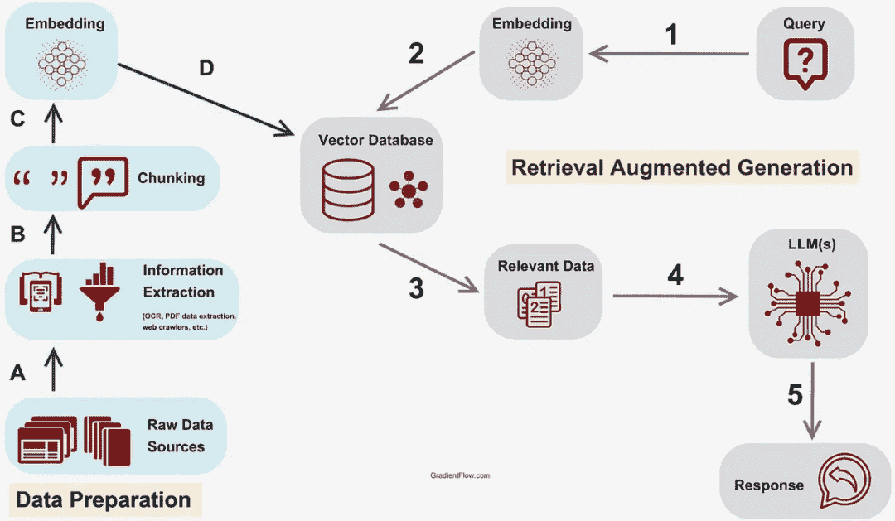
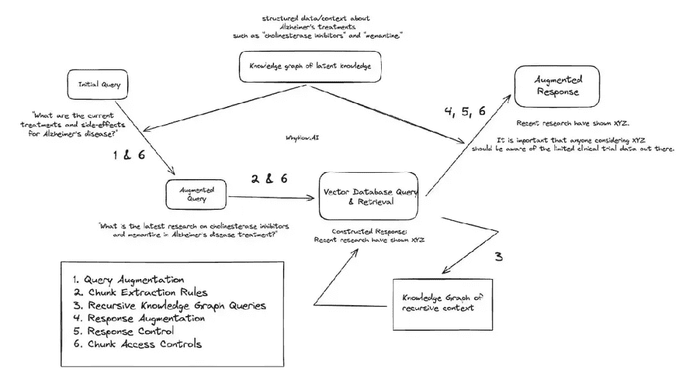

# 在大模型RAG系统中应用知识图谱

> 来源：[https://agijuejin.feishu.cn/docx/XzKsd95FLo51hixiKKycPcpunKc](https://agijuejin.feishu.cn/docx/XzKsd95FLo51hixiKKycPcpunKc)

> 作者：半吊子全栈工匠 | 喔家ArchiSelf

> 原文：https://mp.weixin.qq.com/s/SuXieoIz4ern5Ve3WrRJxQ

【引子】 关于大模型及其应用方面的文章层出不穷，聚焦于自己面对的问题，有针对性的阅读会有很多的启发，本文源自Whyhow.ai 上的一些文字和示例。对于在大模型应用过程中如何使用知识图谱比较有参考价值，特汇总分享给大家。

在基于大模型的RAG应用中，可能会出现不同类型的问题，通过知识图谱的辅助可以在不同阶段增强RAG的效果，并具体说明在每个阶段如何改进答案和查询。知识图谱更类似于结构化数据存储，而不是仅仅是一个用于各种目的的结构化数据的一般存储，可以利用它在 RAG 系统中战略性地注入人类推理。

## **1. RAG简介**

对于复杂的 RAG 和多跳数据检索的一般场景，如下图[所示, 关于RAG的更多信](http://mp.weixin.qq.com/s?__biz=MzAwOTcyNzA0OQ==&mid=2658978863&idx=1&sn=73746b3a4453e27ed0f2d2ff28840c82&chksm=80d35109b7a4d81fef96f451ae279ec18cb0c12f6f0353e5ca0563929c682719cd00cb5e5dd0&scene=21#wechat_redirect)息可以参考《 大模型系列——解读RAG 》。

使用上图所示的阶段来介绍知识图谱支持的 RAG 过程中不同的步骤:

+   阶段1——预处理: 这指的是在查询被用于帮助从向量数据库中提取数据块之前对其进行处理

+   阶段2/D——数据块提取: 这是指从数据库中检索最相关的信息块

+   阶段3-5——后处理: 这指的是为准备检索到的信息以生成答案而执行的过程

在不同阶段应该使用哪些知识图谱技术呢？

## 2.知识图谱在RAG各阶段的应用

### **2.1 阶段一：查询增强**

查询增强是 在从向量数据库中进行检索之前，向查询添加上下文。此策略用于在缺少上下文的情况下增加查询并修复错误查询。这也可以用来注入一个我们的世界观，明确如何定义或看待某些共同或基础术语。

在许多情况下，我们可能对特定术语有自己的世界观。例如，一家旅游科技公司可能希望确保开箱即用 LLM 能够理解“海滨”住宅和“靠近海滩”住宅代表非常不同类型的房产，不能互换使用。在预处理阶段注入这个上下文有助于确保 RAG系统中的这种区别能够提供准确的响应。

从历史上看，知识图谱在企业搜索系统中的一个常见应用是帮助建立首字母缩略词词典，以便搜索引擎能够有效地识别提出的问题或文档/数据存储中的首字母缩略词。这在第一阶段可以用于多跳推理。

### **2.2 阶段二：数据块提取**

文档层次结构是指创建文档层次结构和在向量数据库中导航块的规则。这用于快速识别文档层次结构中的相关块，并使我们能够使用自然语言创建规则，规定查询在生成响应之前必须引用哪些文档/块。

此阶段我们可以使用多个知识图谱。一个知识图谱可以是文档描述的层次结构，引用存储在向量数据库中的块。第二个知识图可以用于规则导航文档层次结构。例如，考虑一个风险基金的 RAG 系统。我们可以写一个自然语言规则，确定性地应用于查询规划代理“回答一个关于投资者义务的问题，首先检查投资者在投资组合清单中投资了什么，然后检查该投资组合的法律文件。”

上下文字典创建用于在向量数据库中导航块的概念结构和规则，有助于理解哪些文档块包含重要主题。这类似于书后的索引。上下文词典本质上是元数据的知识图谱。此字典可用于维护块导航规则，可以包括一个自然语言规则，例如“任何与快乐概念相关的问题，你必须 详尽地 搜索 所有相关的数据块，由上下文字典定义。由 Query Planning Agent 中的 LLM 代理将其转换为知识图谱的查询，以增加要提取的块。这种规则的建立还可以确保块提取的一致性。

这与简单的元数据搜索有何不同？除了提高速度之外，如果文档是简单的，可能意义不大。但是，在某些情况下，我们可能希望确保将特定的信息块标记为与某个概念相关，即使该概念可能未在该块中提及或暗示。这可能发生在讨论正交信息(即与特定概念有争议或不一致的信息)的情况。上下文词典使得与不明显的信息块建立明确的关联变得容易。

### 2.3 阶段三：递归知识图谱查询

这是用来结合信息提取和存储连贯的答案。LLM 向知识图谱查询答案。这在功能上类似于CoT过程，其中外部信息存储在知识图谱中，以帮助确定下一步的调查。

基本上是一次又一次 的 运行数据块提取，检索提取的信息，并存储在一个知识图谱中，以强制连接来揭示关系。 建立关系并将信息保存在知识图谱中之后，再次使用从知识图谱中提取的完整上下文运行查询。 如果上下文不足，请再次将提取的答案保存在相同的知识图谱中，以强制执行更多的 连 接并清洗。

如果数据不断地流入系统，并且希望确保随着时间的推移使用新的上下文更新答案，那么这一点尤其有用。

### **2.4 阶段四之一：响应增强**

响应增强是根据最初从矢量数据库生成的查询添加上下文。这用于添加必须存在于任何答案中的附加信息，这些附加信息涉及一个未能检索到或在矢量数据库中不存在的特定概念。这对于在基于提到或触发的某些概念的回答中包含免责声明或警告特别有用。

一个有趣的推测途径也可以包括使用答案增强作为一种方式，对于面向消费者的 RAG 系统，当某些答案提到某些产品时，可以包含个性化广告的答案。

### **2.5 阶段四之二：响应规则**

响应规则是根据知识图谱设置的规则重新排序。这是用来强制执行关于可以生成的答案的一致规则。这对信任和安全有影响，我们可能希望消除已知的错误或危险的答案。

Llamaindex 有一个有趣的例子，它使用维基百科的知识图谱来复核一个 LLM 的基本真理。尽管 Wikipedia 不能作为内部 RAG 系统的基本事实的来源，但是您可以使用客观的行业或常识知识图谱来防止 LLM 的幻觉。

### 2.6 阶段五：数据块访问控制和个性化

知识图谱可以强制执行关于用户可以根据其权限检索哪些块的规则。例如，假设一家医疗保健公司正在构建一个 RAG 系统，该系统包含对敏感临床试验数据的访问。他们只希望拥有特权的员工能够从向量存储中检索敏感数据。通过将这些访问规则作为属性存储在知识图谱的数据上，它们可以告诉 RAG 系统只检索特权块(如果允许用户这样做的话)。

知识图谱可用于为用户的每个响应实现个性化。例如，考虑一个企业 RAG 系统，如果希望为每个办公室的每个员工、团队或部门定制响应。当生成一个答案时，RAG 系统可以咨询 知识图谱，以了解哪些块包含基于用户角色和位置的最相关信息。

我们需要同时包含上下文，以及上下文对于每个答案意味着什么。然后，可能希望将该上下文作为提示或答案增强包括在内。该策略可以建立在块访问控制的基础上。一旦 RAG 系统确定了与该特定用户最相关的数据，它还可以确保该用户确实拥有访问该数据的权限。

## **3.一个用例**

用医学领域的一个例子来进一步阐述RAG系统中如何应用知识图谱。示例问题如下: “阿尔茨海默病治疗的最新研究是什么?” 然后可以采取以下步骤，以知识图谱增强RAG 系统。我们不认为每个 RAG 系统都必须需要以下所有步骤，但这些用例在复杂的 RAG 用例中相对常见。

在这里，描述知识图谱在所有技术(查询增强、数据块提取规则、递归知识图谱查询、响应增强、响应控制、块访问控制)环节的应用示例。

### **3.1 查询增强**

对于“阿尔茨海默氏症治疗的最新研究是什么?” 这个query，通过访问知识图谱，LLM 代理可以持续检索关于最新的阿尔茨海默病治疗的结构化数据，如“胆碱酯酶抑制剂”和“盐酸美金胺”，RAG 系统将进一步提出更具体的问题: “关于胆碱酯酶抑制剂和盐酸美金胺治疗阿尔茨海默病的最新研究是什么?”

### 3.2 文件层次和矢量数据库检索

使用文档层次结构，识别哪些文档和数据块与“胆碱酯酶抑制剂”和“盐酸美金胺”最相关，并返回相关的答案。

关于“胆碱酯酶抑制剂”的相关块提取规则有助于指导查询引擎提取最有用的块。文档层次结构帮助查询引擎快速识别与副作用相关的文档，并开始提取文档中的块。上下文字典帮助查询引擎快速识别与“胆碱酯酶抑制剂”相关的块，并开始提取与此主题相关的块。一条关于“胆碱酯酶抑制剂”的既定规则指出，查询胆碱酯酶抑制剂的副作用也应检查与 X 酶相关的块。这是因为 X 酶是一个众所周知的副作用，不能被忽略，并相应地包括相关的块。

### **3.3 递归知识图谱查询**

使用递归知识图谱查询，初始查询返回称为“ XYZ 效应”的“记忆时间”的副作用。“ XYZ 效应”作为上下文存储在一个单独的知识图中，用于递归上下文。LLM 被要求使用 XYZ 效果的附加上下文检查新增加的查询。根据过去格式化的答案来衡量结果，它确定需要更多关于 XYZ 效应的信息来构成一个令人满意的答案。然后，它在知识图谱中的 XYZ 效应节点内执行更深入的搜索，从而执行多跳查询。

在 XYZ 效应节点中，它发现关于临床试验 A 和临床试验 B 的信息，它可以包括在答案中。

### **3.4 数据块控制访问**

尽管临床试验 A & B 都包含有益的上下文，但是与临床试验 B 节点相关的元数据标签指出，用户对该节点的访问受到限制。因此，一个常设的控制访问规则可以防止临床试验 B 节点被包含在对用户的响应中。

只有关于临床试验 A 的信息才会返回给 LLM，以帮助其制定返回的答案。

### **3.5 响应增强**

作为后处理步骤，还可以选择使用特定于医疗行业的知识图谱来增强后处理输出。例如，您可以包括特定于 盐酸美金胺 治疗的默认健康警告，或包括与临床试验 A 相关的任何其他信息。

### **3.6 数据块个性化**

由于用户是研发部门的初级员工，临床试验 B 的信息不对用户开放，所以附加了一个说明，禁止用户访问临床试验 B 的信息，并要求向高级经理询问更多信息。

## **4. 一点思考**

使用知识图谱而非向量数据库进行查询增强的一个优点是，知识图可以对已知关系的某些关键主题和概念进行一致性检索。我们把个性化定义为用户和矢量数据库之间信息流的控制，但是个性化也可以理解为用户特征的封装。

知识图谱可以反映更广泛的用户特征集合的存储，可以用于一系列的个性化工作。在某种程度上，一个知识图谱是一个外部数据存储(即外部 LLM 模型) ，它更容易以一致的形式提取(即知识图谱数据能够以一种更模块化的方式插入，播放和删除)。如果实现了物联网中的数字孪生，知识图谱很可能成为代表这种系统和模型之间的模型个性化的最佳手段。

关于物联网和数字孪生的相关内容，可以参考拙作《一书读懂物联网》一书。

【参考资料与关联阅读】

+   https://www.seobythesea.com/2019/08/augmented-search-queries/

+   https://docs.llamaindex.ai/en/stable/examples/query engine/multi doc auto retrieval/multi doc auto retrieval.html

+   https://medium.com/enterprise-rag/a-first-intro-to-complex-rag-retrieval-augmented-generation-a8624d70090

+   https://medium.com/data-science-at-microsoft/creating-a-metadata-graph-structure-for-in-memory-optimization-2902e1b9b254

+   https://neo4j.com/developer-blog/knowledge-graphs-llms-multi-hop-question-answering/

+   https://medium.com/@haiyangli 38602/make-meaningful-knowledge-graph-from-opensource-rebel-model-6f9729a55527

+   [面向知识图谱的大模型应用](http://mp.weixin.qq.com/s?__biz=MzAwOTcyNzA0OQ==&mid=2658978885&idx=1&sn=7cf63e04e65ad8c1cc1467d87cf30ed8&chksm=80d35163b7a4d87586b7d8adc79294b45303083f509710c5ae51630ce35e9db4e8726fa33e4d&scene=21#wechat_redirect)

+   [如何构建基于大模型的App](http://mp.weixin.qq.com/s?__biz=MzAwOTcyNzA0OQ==&mid=2658978464&idx=1&sn=8b9c617bced2b5ce012fb1f4aa87c086&chksm=80d35786b7a4de901400ffe4db5061c08df2912b4b49466e91a9f52813f22f3137e41802abc9&scene=21#wechat_redirect)

+   Qcon2023: 大模型时代的技术人成长（简）

+   论文学习笔记：增强学习应用于OS调度

+    《深入浅出Embedding》随笔

+   [LLM的工程实践思考](http://mp.weixin.qq.com/s?__biz=MzAwOTcyNzA0OQ==&mid=2658978144&idx=1&sn=e8bff055687f7e7ad17baca58dc26c23&chksm=80d35446b7a4dd507b02832851e2308a276edc328f3e79bca0f3ae931ab27db69aeccd8d7c8d&scene=21#wechat_redirect)

+   [解读大模型的微调](http://mp.weixin.qq.com/s?__biz=MzAwOTcyNzA0OQ==&mid=2658978125&idx=1&sn=b342e9c10734c1f7cd124ebc88aa75a8&chksm=80d3546bb7a4dd7d9c74dabd6046d1ccea01592760a8add3d71b2f75fa68712093a4834e6d88&scene=21#wechat_redirect)

+    [解读向量数据库](http://mp.weixin.qq.com/s?__biz=MzAwOTcyNzA0OQ==&mid=2658978665&idx=1&sn=10512636ac46b2df414ec862e7699841&chksm=80d3564fb7a4df59a43529f2f005c1db65dce7d1225634be5ccd5e817572c383fbe605db063a&scene=21#wechat_redirect)

+   [解读ChatGPT中的RLHF](http://mp.weixin.qq.com/s?__biz=MzAwOTcyNzA0OQ==&mid=2658977979&idx=1&sn=4d66d662595d9aba355e0564df545370&chksm=80d3559db7a4dc8b96a5f3ac4d01b53a2601d5e1dcb51789ee3d9974ec9ae5f028c3e469b5a5&scene=21#wechat_redirect)

+   解读大模型（LLM）的token

+   解读提示工程（Prompt Engineering）

+   [解读Toolformer](http://mp.weixin.qq.com/s?__biz=MzAwOTcyNzA0OQ==&mid=2658977935&idx=1&sn=9dd162f270f7c17a673291c0f136cf8c&chksm=80d355a9b7a4dcbf3ab824ac6de5c27d94a11455a681ebeb98a211e9b58ff867ddddf33d1c8d&scene=21#wechat_redirect)

+   [解读TaskMatrix.AI](http://mp.weixin.qq.com/s?__biz=MzAwOTcyNzA0OQ==&mid=2658977922&idx=1&sn=2f67513b540485d0177ded24c0807bcc&chksm=80d355a4b7a4dcb2495ab97febd0ac88cd0780e0d8e4b3bbc369250304289e289f71b0a76f0c&scene=21#wechat_redirect)

+    [解读LangChain](http://mp.weixin.qq.com/s?__biz=MzAwOTcyNzA0OQ==&mid=2658978479&idx=1&sn=47d6d226a3ac6cc08980e7562ae09fce&chksm=80d35789b7a4de9f3ba9a3eeb21c6c812b0f7fe43cee47fc38368ed31a1346114a67daa3cd30&scene=21#wechat_redirect)

+   [解读LoRA](http://mp.weixin.qq.com/s?__biz=MzAwOTcyNzA0OQ==&mid=2658978719&idx=1&sn=52183b612a2586d407ba9c9006027078&chksm=80d356b9b7a4dfaf127df71ca4834513eb9454988a5aa488f24938e04283353c376660e8516c&scene=21#wechat_redirect)

+   [解读RAG](http://mp.weixin.qq.com/s?__biz=MzAwOTcyNzA0OQ==&mid=2658978863&idx=1&sn=73746b3a4453e27ed0f2d2ff28840c82&chksm=80d35109b7a4d81fef96f451ae279ec18cb0c12f6f0353e5ca0563929c682719cd00cb5e5dd0&scene=21#wechat_redirect)

+   大模型应用框架之Semantic Kernel

+   [浅析多模态机器学习](http://mp.weixin.qq.com/s?__biz=MzAwOTcyNzA0OQ==&mid=2658978122&idx=1&sn=baf54b7a1a0758e19bf6a3622a43d8fb&chksm=80d3546cb7a4dd7ab9b857ea75bcc3e361cb68489ff5c43ff4d8ab65b2da838b46621b2936b1&scene=21#wechat_redirect)

+    [大模型应用于数字人](http://mp.weixin.qq.com/s?__biz=MzAwOTcyNzA0OQ==&mid=2658978589&idx=1&sn=cb8e7a54f5675ec65d07f7555f16b4eb&chksm=80d3563bb7a4df2d9dcb13a4491d27e33117ff90ca25e2416ab2a36fa4757ca9478635dd38f3&scene=21#wechat_redirect)

+   [深度学习架构的对比分析](http://mp.weixin.qq.com/s?__biz=MzAwOTcyNzA0OQ==&mid=2658978063&idx=1&sn=f934c531bacfe1bf6c95ccbdababe439&chksm=80d35429b7a4dd3f8df5f8c439bd98420c13d4a115c609a60370a6e09ad7c667c4a8c95418c1&scene=21#wechat_redirect)

+   [老码农眼中的大模型（LLM）](http://mp.weixin.qq.com/s?__biz=MzAwOTcyNzA0OQ==&mid=2658977916&idx=1&sn=d38f03af2b3916251e9a8577d995e065&chksm=80d3555ab7a4dc4c0c919ce0a678adc9f3018d81994dc072e698cfa481665ec8faf788d606be&scene=21#wechat_redirect)

+   [系统学习大模型的20篇论文](http://mp.weixin.qq.com/s?__biz=MzAwOTcyNzA0OQ==&mid=2658978109&idx=1&sn=4d15334a5cccc300a18686b1dd2a2098&chksm=80d3541bb7a4dd0df321e516ad40c8e849dde084328b61259f4b17f5d24280686305a87fa8b5&scene=21#wechat_redirect)