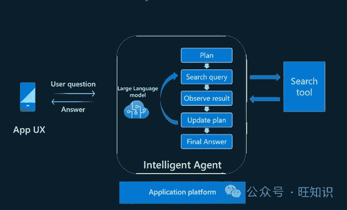
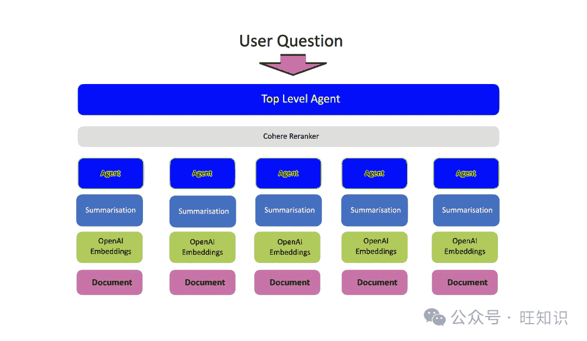

# RAG智能体：开启信息处理与知识探索的革命之旅！

> 来源：[https://agijuejin.feishu.cn/docx/VWnodYrInokIF7xSQIncQiurnrb](https://agijuejin.feishu.cn/docx/VWnodYrInokIF7xSQIncQiurnrb)
> 作者：张长旺 | 旺知识
> 原文：https://mp.weixin.qq.com/s/0P8Ddez3b22vXo8cmbp7Bg

ChatGPT、Midjourney等生成式人工智能（GenAI）在文本生成、文本到图像生成等任务中表现出令人印象深刻的性能。然而，生成模型也不能避免其固有的局限性，包括产生幻觉的倾向，在数学能力弱，而且缺乏可解释性。因此，提高他们能力的一个可行办法是让他们能够与外部世界互动，以不同的形式和方式获取知识，从而提高所生成内容的事实性和合理性。

检索增强生成（Retrieval-Augmented Generation, RAG）技术研究旨在提供更有依据、更依赖事实的信息来帮助解决生成式AI的幻觉倾向、专业力弱等固有缺陷。RAG最新科研综述可以参考：面向AI内容生成的检索增强生成(RAG)技术全面综述：背景、基础、进阶、应用、展望。

检索增强生成智能体(Agentic RAG)的核心是将智能和自主性注入到RAG框架中。这就像是给一个普通的RAG系统进行了重大升级，将其转变为一个能够自主决策并采取行动以实现特定目标的自主智能体。本文帮助理解RAG智能体方法并了解它如何彻底改变我们处理信息的方式。


作为对照，您可以参考我们以前的相关文章来了解经典RAG系统的特性和特点：

+ [高级检索增强生成技术(RAG)全面指南：原理、分块、编码、索引、微调、Agent、展望](http://mp.weixin.qq.com/s?__biz=Mzg5NTc2OTcyOQ==&mid=2247487603&idx=1&sn=7c0d41bf3287989505d862e7d9e64a63&chksm=c00a1d9df77d948bf122d9021f6cf6054d6a30a313b07fc3696205fff7db50b1a1cfc3098d6a&scene=21#wechat_redirect)
+ 检索增强生成技术(RAG)深度优化指南：原理、挑战、措施、展望

## 1 - RAG智能体特性特点

### 上下文至上
传统RAG实现的最大局限之一是它们无法真正理解并考虑更广泛的对话上下文。而RAG智能体则被设计成具有上下文感知能力。它们可以把握对话的微妙之处，考虑历史，并相应地调整行为。这意味着更连贯和相关的回应，就像智能体真正参与了一场自然对话一样。

### 智能检索策略
RAG系统过去依赖静态规则进行检索，RAG智能体比规则那聪明多了。它们采用智能检索策略，动态评估用户的查询、可用工具（数据来源）和上下文线索，以确定最合适的检索行动。就像有一个知道在哪里找到你需要的信息的私人助手一样。

### 多智能体协作
复杂的查询通常涉及多个文档或数据源，在RAG智能体的世界里，我们有多智能体协作的能力。想象一下有多个专门的智能体，每个智能体都是自己领域或数据源的专家，共同合作并综合他们的发现，为用户提供全面的回应。就像有一组专家一起解决你最棘手的问题一样。

### 智能推理
RAG智能体不仅擅长检索信息；它们还配备了远远超越简单检索和生成的推理能力。这些智能体可以对检索到的数据进行评估、校正和质量检查，确保用户收到的输出是准确可靠的。不再担心获取到可疑信息了！

### 生成后验证
RAG智能体可以进行生成后的检查。它们可以验证生成内容的真实性，甚至运行多次生成并为用户选择最佳结果。

### 适应性与学习
RAG智能体架构可以设计成包含学习机制，使智能体能够随着时间的推移适应和改进其性能。这就像有一个系统，你使用得越多，它就越聪明、越高效！

## 2 - RAG智能体参考架构

好了，现在我们已经对RAG智能体的基本原理有了很好的理解，让我们深入探讨一下使整个系统运行的参考架构。



在这个架构的核心，我们有RAG智能体——智能指挥官，负责接收用户查询并决定适当的行动方针。把它想象成交响乐团的指挥，协调所有不同的乐器（工具）以创造和谐的表演。

现在，这个智能体并不孤单。它配备了一套工具，每个工具都与特定的一组文档或数据源相关联。这些工具就像是专门的智能体或函数，可以从各自的数据源中检索、处理和生成信息。

例如，假设你有工具1，负责访问和处理财务报表，以及工具2，处理客户数据。RAG智能体可以根据你的查询动态选择和组合这些工具，使其能够从多个来源合成信息，为你提供全面的回应。

检索的信息来自于自定义文档和数据源。这些信息可以是结构化的或非结构化的，包括数据库、知识库、文本文档和多媒体内容等。它们是工具处理的原材料。

现在，假设你向智能体提出了一个涉及多个领域或数据源的复杂问题：RAG智能体规划整个过程，确定使用哪些工具，从相关的数据源检索相关信息，并生成针对你查询的最终回应。

在整个过程中，智能体利用智能推理、上下文感知和生成后验证技术，确保你收到的输出不仅准确，而且符合你的需求。

当然，这只是参考架构的简化表示。在现实世界中，RAG智能体的实现可能涉及其他组件，例如语言模型、知识库和其他支持系统，具体取决于特定的用例和需求。

## 3 - RAG智能体开发实例

我们这里实现一个RAG智能体的实例(arXiv文章检索智能体)来具体说明RAG智能体的开发实现。

### 3.1 开发架构

这里RAG智能体的开发架构是为每份文档设置一个文档智能体，每个文档智能体都能在自己的文档中进行问题解答和总结。然后建立一个顶级智能体（元智能体），管理所有低级文档智能体。



### 3.2 开发技术栈

+ `Langchain`: 更具体地说是 `LCEL`：开发 LLM 应用程序的协调框架
+ `OpenAI`: 提供大语言模型 ( LLM ) 服务
+ `FAISS-cpu`: 向量存储

### 3.3 数据源

在这里，我们将利用`ArxivLoader`来检索发表在arXiv上的文章的元数据。

### 3.4 代码实现

安装所需的依赖项：

```
!pip install -qU langchain langchain_openai langgraph arxiv duckduckgo-search
!pip install -qU faiss-cpu pymupdf
```

设置环境变量：

```
from google.colab import userdata
from uuid import uuid4
import os
#
os.environ['OPENAI_API_KEY'] = userdata.get('OPENAI_API_KEY')
os.environ["LANGCHAIN_TRACING_V2"] = "true"
os.environ["LANGCHAIN_PROJECT"] = f"AIE1 - LangGraph - {uuid4().hex[0:8]}"
os.environ["LANGCHAIN_API_KEY"] =  userdata.get('LANGCHAIN_API_KEY')
```

使用LCEL实例化简单检索链：

```
from langchain.text_splitter import RecursiveCharacterTextSplitter
from langchain_community.document_loaders import ArxivLoader
from langchain_community.vectorstores import FAISS
from langchain_openai import OpenAIEmbeddings

# Load the document pertaining to a particular topic
docs = ArxivLoader(query="Retrieval Augmented Generation", load_max_docs=5).load()

# Split the dpocument into smaller chunks
text_splitter = RecursiveCharacterTextSplitter.from_tiktoken_encoder(
    chunk_size=350, chunk_overlap=50
)

chunked_documents = text_splitter.split_documents(docs)
#
# Instantiate the Embedding Model
embeddings = OpenAIEmbeddings(model="text-embedding-3-small",openai_api_key=os.environ['OPENAI_API_KEY'])
# Create Index- Load document chunks into the vectorstore
faiss_vectorstore = FAISS.from_documents(
    documents=chunked_documents,
    embedding=embeddings,
)
# Create a retriver
retriever = faiss_vectorstore.as_retriever()
```

生成RAG提示：

```
from langchain_core.prompts import ChatPromptTemplate

RAG_PROMPT = """\
Use the following context to answer the user's query. If you cannot answer the question, please respond with 'I don't know'.

Question:
{question}

Context:
{context}
"""

rag_prompt = ChatPromptTemplate.from_template(RAG_PROMPT)
```

建立 LC EL RAG 链：

```
from operator import itemgetter
from langchain.schema.output_parser import StrOutputParser
from langchain.schema.runnable import RunnablePassthrough


retrieval_augmented_generation_chain = (
    {"context": itemgetter("question") 
 | retriever, "question": itemgetter("question")}
 | RunnablePassthrough.assign(context=itemgetter("context"))
 | {"response": rag_prompt | openai_chat_model, "context": itemgetter("context")}
)
#
retrieval_augmented_generation_chain
```

################### RESPONSE ###############################

```
  context: RunnableLambda(itemgetter('question'))
           | VectorStoreRetriever(tags=['FAISS', 'OpenAIEmbeddings'], vectorstore=<langchain_community.vectorstores.faiss.FAISS object at 0x7de64bd18f40>),
  question: RunnableLambda(itemgetter('question'))
}
| RunnableAssign(mapper={
    context: RunnableLambda(itemgetter('context'))
  })
| {
    response: ChatPromptTemplate(input_variables=['context', 'question'], messages=[HumanMessagePromptTemplate(prompt=PromptTemplate(input_variables=['context', 'question'], template="Use the following context to answer the user's query. If you cannot answer the question, please respond with 'I don't know'.\n\nQuestion:\n{question}\n\nContext:\n{context}\n"))])
              | ChatOpenAI(client=<openai.resources.chat.completions.Completions object at 0x7de64d033850>, async_client=<openai.resources.chat.completions.AsyncCompletions object at 0x7de64d032b60>, openai_api_key=SecretStr('**********'), open_proxy=''),
    context: RunnableLambda(itemgetter('context'))
  }
```

运行测试 ：


```
await retrieval_augmented_generation_chain.ainvoke({"question" : "What is Retrieval Augmented Generation?"})

##################### REPONSE #############################
{'response': AIMessage(content='Retrieval Augmented Generation is a text generation paradigm that combines deep learning technology with traditional retrieval technology. It has achieved state-of-the-art performance in many NLP tasks by explicitly acquiring knowledge in a plug-and-play manner, leading to scalability and potentially alleviating the difficulty of text generation. It involves generating text from retrieved human-written references rather than generating from scratch.', response_metadata={'token_usage': {'completion_tokens': 73, 'prompt_tokens': 2186, 'total_tokens': 2259}, 'model_name': 'gpt-3.5-turbo', 'system_fingerprint': 'fp_b28b39ffa8', 'finish_reason': 'stop', 'logprobs': None}),
 'context': [Document(page_content='grating translation memory to NMT models (Gu\net al., 2018; Zhang et al., 2018; Xu et al., 2020;\nHe et al., 2021). We also review the applications\nof retrieval-augmented generation in other genera-\ntion tasks such as abstractive summarization (Peng\net al., 2019), code generation (Hashimoto et al.,\n2018), paraphrase (Kazemnejad et al., 2020; Su\net al., 2021b), and knowledge-intensive generation\n(Lewis et al., 2020b). Finally, we also point out\nsome promising directions on retrieval-augmented\ngeneration to push forward the future research.\n2\nRetrieval-Augmented Paradigm\nIn this section, we first give a general formulation\nof retrieval-augmented text generation. Then, we\ndiscuss three major components of the retrieval-\naugmented generation paradigm, including the re-\narXiv:2202.01110v2  [cs.CL]  13 Feb 2022\nInput\nSources \n(Sec. 2.2):\nTraining \nCorpus\nExternal Data\nUnsupervised \nData\nMetrics\n(Sec. 2.3):\nSparse-vector \nRetrieval\nDense-vector \nRetrieval\nTask-specific \nRetrieval\nRetrieval Memory\nGeneration Model\nSec. 4: Machine \nTranslation\nSec. 5: Other \nTasks\nData \nAugmentation\nAttention \nMechanism\nSkeleton & \nTemplates\nInformation Retrieval', metadata={'Published': '2022-02-13', 'Title': 'A Survey on Retrieval-Augmented Text Generation', 'Authors': 'Huayang Li, Yixuan Su, Deng Cai, Yan Wang, Lemao Liu', 'Summary': 'Recently, retrieval-augmented text generation attracted increasing attention\nof the computational linguistics community. Compared with conventional\ngeneration models, retrieval-augmented text generation has remarkable\nadvantages and particularly has achieved state-of-the-art performance in many\nNLP tasks. This paper aims to conduct a survey about retrieval-augmented text\ngeneration. It firstly highlights the generic paradigm of retrieval-augmented\ngeneration, and then it reviews notable approaches according to different tasks\nincluding dialogue response generation, machine translation, and other\ngeneration tasks. Finally, it points out some important directions on top of\nrecent methods to facilitate future research.'}),
  Document(page_content='augmented generation as well as three key com-\nponents under this paradigm, which are retrieval\nsources, retrieval metrics and generation models.\nThen, we introduce notable methods about\nretrieval-augmented generation, which are orga-\nnized with respect to different tasks. Specifically,\non the dialogue response generation task, exem-\nplar/template retrieval as an intermediate step has\nbeen shown beneficial to informative response gen-\neration (Weston et al., 2018; Wu et al., 2019; Cai\net al., 2019a,b). In addition, there has been growing\ninterest in knowledge-grounded generation explor-\ning different forms of knowledge such as knowl-\nedge bases and external documents (Dinan et al.,\n2018; Zhou et al., 2018; Lian et al., 2019; Li et al.,\n2019; Qin et al., 2019; Wu et al., 2021; Zhang et al.,\n2021). On the machine translation task, we summa-\nrize the early work on how the retrieved sentences\n(called translation memory) are used to improve\nstatistical machine translation (SMT) (Koehn et al.,\n2003) models (Simard and Isabelle, 2009; Koehn\nand Senellart, 2010) and in particular, we inten-\nsively highlight several popular methods to inte-\ngrating translation memory to NMT models (Gu\net al., 2018; Zhang et al., 2018; Xu et al., 2020;\nHe et al., 2021). We also review the applications', metadata={'Published': '2022-02-13', 'Title': 'A Survey on Retrieval-Augmented Text Generation', 'Authors': 'Huayang Li, Yixuan Su, Deng Cai, Yan Wang, Lemao Liu', 'Summary': 'Recently, retrieval-augmented text generation attracted increasing attention\nof the computational linguistics community. Compared with conventional\ngeneration models, retrieval-augmented text generation has remarkable\nadvantages and particularly has achieved state-of-the-art performance in many\nNLP tasks. This paper aims to conduct a survey about retrieval-augmented text\ngeneration. It firstly highlights the generic paradigm of retrieval-augmented\ngeneration, and then it reviews notable approaches according to different tasks\nincluding dialogue response generation, machine translation, and other\ngeneration tasks. Finally, it points out some important directions on top of\nrecent methods to facilitate future research.'}),
  Document(page_content='recent methods to facilitate future research.\n1\nIntroduction\nRetrieval-augmented text generation, as a new\ntext generation paradigm that fuses emerging deep\nlearning technology and traditional retrieval tech-\nnology, has achieved state-of-the-art (SOTA) per-\nformance in many NLP tasks and attracted the at-\ntention of the computational linguistics community\n(Weston et al., 2018; Dinan et al., 2018; Cai et al.,\n2021). Compared with generation-based counter-\npart, this new paradigm has some remarkable ad-\nvantages: 1) The knowledge is not necessary to be\nimplicitly stored in model parameters, but is explic-\nitly acquired in a plug-and-play manner, leading\nto great scalibility; 2) Instead of generating from\nscratch, the paradigm generating text from some re-\ntrieved human-written reference, which potentially\nalleviates the difficulty of text generation.\nThis paper aims to review many representative\napproaches for retrieval-augmented text generation\ntasks including dialogue response generation (We-\nston et al., 2018), machine translation (Gu et al.,\n2018) and others (Hashimoto et al., 2018). We\n∗All authors contributed equally.\nfirstly present the generic paradigm of retrieval-\naugmented generation as well as three key com-\nponents under this paradigm, which are retrieval\nsources, retrieval metrics and generation models.\nThen, we introduce notable methods about', metadata={'Published': '2022-02-13', 'Title': 'A Survey on Retrieval-Augmented Text Generation', 'Authors': 'Huayang Li, Yixuan Su, Deng Cai, Yan Wang, Lemao Liu', 'Summary': 'Recently, retrieval-augmented text generation attracted increasing attention\nof the computational linguistics community. Compared with conventional\ngeneration models, retrieval-augmented text generation has remarkable\nadvantages and particularly has achieved state-of-the-art performance in many\nNLP tasks. This paper aims to conduct a survey about retrieval-augmented text\ngeneration. It firstly highlights the generic paradigm of retrieval-augmented\ngeneration, and then it reviews notable approaches according to different tasks\nincluding dialogue response generation, machine translation, and other\ngeneration tasks. Finally, it points out some important directions on top of\nrecent methods to facilitate future research.'}),
  Document(page_content='A Survey on Retrieval-Augmented Text Generation\nHuayang Li♥,∗\nYixuan Su♠,∗\nDeng Cai♦,∗\nYan Wang♣,∗\nLemao Liu♣,∗\n♥Nara Institute of Science and Technology\n♠University of Cambridge\n♦The Chinese University of Hong Kong\n♣Tencent AI Lab\nli.huayang.lh6@is.naist.jp, ys484@cam.ac.uk\nthisisjcykcd@gmail.com, brandenwang@tencent.com\nlemaoliu@gmail.com\nAbstract\nRecently, retrieval-augmented text generation\nattracted increasing attention of the compu-\ntational linguistics community.\nCompared\nwith conventional generation models, retrieval-\naugmented text generation has remarkable ad-\nvantages and particularly has achieved state-of-\nthe-art performance in many NLP tasks. This\npaper aims to conduct a survey about retrieval-\naugmented text generation. It firstly highlights\nthe generic paradigm of retrieval-augmented\ngeneration, and then it reviews notable ap-\nproaches according to different tasks including\ndialogue response generation, machine trans-\nlation, and other generation tasks. Finally, it\npoints out some promising directions on top of\nrecent methods to facilitate future research.\n1\nIntroduction\nRetrieval-augmented text generation, as a new\ntext generation paradigm that fuses emerging deep\nlearning technology and traditional retrieval tech-', metadata={'Published': '2022-02-13', 'Title': 'A Survey on Retrieval-Augmented Text Generation', 'Authors': 'Huayang Li, Yixuan Su, Deng Cai, Yan Wang, Lemao Liu', 'Summary': 'Recently, retrieval-augmented text generation attracted increasing attention\nof the computational linguistics community. Compared with conventional\ngeneration models, retrieval-augmented text generation has remarkable\nadvantages and particularly has achieved state-of-the-art performance in many\nNLP tasks. This paper aims to conduct a survey about retrieval-augmented text\ngeneration. It firstly highlights the generic paradigm of retrieval-augmented\ngeneration, and then it reviews notable approaches according to different tasks\nincluding dialogue response generation, machine translation, and other\ngeneration tasks. Finally, it points out some important directions on top of\nrecent methods to facilitate future research.'})]}
```


# 增加智能体工具配置

通常情况下，我们需要为智能体配备工具，以帮助回答问题和添加外部知识。 LangChain社区Repo中有大量工具，但我们将只使用其中几个，以便观察LangGraph在运行中的循环特性！

在这里，我们将添加 Duck Duck Go网络搜索和 A rxiv:

```
from langchain_community.tools.ddg_search import DuckDuckGoSearchRun
from langchain_community.tools.arxiv.tool import ArxivQueryRun
from langgraph.prebuilt import ToolExecutor
tool_belt = [
    DuckDuckGoSearchRun(),
    ArxivQueryRun()
]

tool_executor = ToolExecutor(tool_belt)
```

## 初始化Openai函数调用

```
from langchain_core.utils.function_calling import convert_to_openai_function
#
model = ChatOpenAI(temperature=0)
#
functions = [convert_to_openai_function(t) for t in tool_belt]
model = model.bind_functions(functions)
```

## 配置LangGraph

LangGraph 利用状态图（`StatefulGraph`），使用 `AgentState` 对象在图的各个节点之间传递信息。

这个 `AgentState` 对象是一个存储在 `TypedDict` 中的对象，其中包含关键信息，而值则是 `BaseMessages` 序列，每当状态发生变化时，它就会被附加到该序列中：

```
from typing import TypedDict, Annotated, Sequence
import operator
from langchain_core.messages import BaseMessage

class AgentState(TypedDict):
  messages: Annotated[Sequence[BaseMessage], operator.add]
```

### 构建节点

`call_model` 是一个用于调用模型的节点

`call_tool` 是调用工具的节点

```
from langgraph.prebuilt import ToolInvocation
import json
from langchain_core.messages import FunctionMessage


def call_model(state):
  messages = state["messages"]
  response = model.invoke(messages)
  return {"messages" : [response]}


def call_tool(state):
  last_message = state["messages"][-1]


  action = ToolInvocation(
      tool=last_message.additional_kwargs["function_call"]["name"],
      tool_input=json.loads(
          last_message.additional_kwargs["function_call"]["arguments"]
      )
  )


  response = tool_executor.invoke(action)


  function_message = FunctionMessage(content=str(response), name=action.tool)


  return {"messages" : [function_message]}
```

### 构建工作流

```
from langgraph.graph import StateGraph, END

workflow = StateGraph(AgentState)

workflow.add_node("agent", call_model)
workflow.add_node("action", call_tool)
workflow.nodes
########################RESPONSE############################
{'agent': RunnableLambda(call_model), 'action': RunnableLambda(call_tool)}
```

#### 设置工作流入口

```
workflow.set_entry_point("agent")
```

#### 设置条件路由边

```
def should_continue(state):
  last_message = state["messages"][-1]

  if "function_call" not in last_message.additional_kwargs:
    return "end"

  return "continue"

workflow.add_conditional_edges(
    "agent",
    should_continue,
    {
        "continue" : "action",
        "end" : END
    }
)
```

#### 将条件边连接到代理节点和行动节点上

```
workflow.add_edge("action", "agent")
```

#### 编译工作流

```
app = workflow.compile()
#
app
#
################### RESPONSE ###############################
CompiledGraph(nodes={'agent': ChannelInvoke(bound=RunnableLambda(call_model)
| ChannelWrite(channels=[ChannelWriteEntry(channel='agent', value=None, skip_none=False), ChannelWriteEntry(channel='messages', value=RunnableLambda(...), skip_none=False)]), config={'tags': []}, channels={'messages': 'messages'}, triggers=['agent:inbox'], mapper=functools.partial(<function _coerce_state at 0x7de64d4c9ab0>, <class '__main__.AgentState'>)), 'action': ChannelInvoke(bound=RunnableLambda(call_tool)
| ChannelWrite(channels=[ChannelWriteEntry(channel='action', value=None, skip_none=False), ChannelWriteEntry(channel='messages', value=RunnableLambda(...), skip_none=False)]), config={'tags': []}, channels={'messages': 'messages'}, triggers=['action:inbox'], mapper=functools.partial(<function _coerce_state at 0x7de64d4c9ab0>, <class '__main__.AgentState'>)), 'agent:edges': ChannelInvoke(bound=RunnableLambda(runnable), config={'tags': ['langsmith:hidden']}, channels={'messages': 'messages'}, triggers=['agent']), 'action:edges': ChannelInvoke(bound=ChannelWrite(channels=[ChannelWriteEntry(channel='agent:inbox', value='action', skip_none=True)]), config={'tags': ['langsmith:hidden']}, channels={'messages': 'messages'}, triggers=['action']), '__start__': ChannelInvoke(bound=ChannelWrite(channels=[ChannelWriteEntry(channel='__start__', value=None, skip_none=False), ChannelWriteEntry(channel='messages', value=RunnableLambda(...), skip_none=False)]), config={'tags': ['langsmith:hidden']}, channels={None: '__start__:inbox'}, triggers=['__start__:inbox']), '__start__:edges': ChannelInvoke(bound=ChannelWrite(channels=[ChannelWriteEntry(channel='agent:inbox', value=None, skip_none=False)]), config={'tags': ['langsmith:hidden']}, channels={'messages': 'messages'}, triggers=['__start__'])}, channels={'messages': <langgraph.channels.binop.BinaryOperatorAggregate object at 0x7de64de19e70>, 'agent:inbox': <langgraph.channels.any_value.AnyValue object at 0x7de64de19fc0>, 'action:inbox': <langgraph.channels.any_value.AnyValue object at 0x7de64de1a080>, '__start__:inbox': <langgraph.channels.any_value.AnyValue object at 0x7de64de1ad10>, 'agent': <langgraph.channels.ephemeral_value.EphemeralValue object at 0x7de64de1b2b0>, 'action': <langgraph.channels.ephemeral_value.EphemeralValue object at 0x7de64de1b880>, '__start__': <langgraph.channels.ephemeral_value.EphemeralValue object at 0x7de64de18340>, '__end__': <langgraph.channels.last_value.LastValue object at 0x7de64de18490>, <ReservedChannels.is_last_step: 'is_last_step'>: <langgraph.channels.last_value.LastValue object at 0x7de64de1b670>}, output='__end__', hidden=['agent:inbox', 'action:inbox', '__start__', 'messages'], snapshot_channels=['messages'], input='__start__:inbox', graph=<langgraph.graph.state.StateGraph object at 0x7de64de18880>)
```

## 运行测试1

运行测试1："什么是大型语言模型中的 RAG？它是何时出现的？"


```python
from langchain_core.messages import HumanMessage

inputs = {"messages" : [HumanMessage(content="What is RAG in the context of Large Language Models? When did it break onto the scene?")]}

response = app.invoke(inputs)
print(response)
############################RESPOSNE #########################
{'messages': [HumanMessage(content='What is RAG in the context of Large Language Models? When did it break onto the scene?'),
  AIMessage(content='', additional_kwargs={'function_call': {'arguments': '{"query":"RAG in the context of Large Language Models"}', 'name': 'duckduckgo_search'}}, response_metadata={'token_usage': {'completion_tokens': 25, 'prompt_tokens': 171, 'total_tokens': 196}, 'model_name': 'gpt-3.5-turbo', 'system_fingerprint': 'fp_b28b39ffa8', 'finish_reason': 'function_call', 'logprobs': None}),
  FunctionMessage(content="Large language models (LLMs) are incredibly powerful tools for processing and generating text. However, they inherently struggle to understand the broader context of information, especially when dealing with lengthy conversations or complex tasks. This is where large context windows and Retrieval-Augmented Generation (RAG) come into play. These advanced, generalized language models are trained on vast datasets, enabling them to understand and generate human-like text. In the context of RAG, LLMs are used to generate fully formed responses based on the user query and contextual information retrieved from the vector DBs during user queries. Querying In the rapidly evolving landscape of language models, the debate between Retrieval-Augmented Generation (RAG) and Long Context Large Language Models (LLMs) has garnered significant attention. Retrieval-augmented generation (RAG) is an AI framework for improving the quality of LLM-generated responses by grounding the model on external sources of knowledge to supplement the LLM's internal representation of information. Implementing RAG in an LLM-based question answering system has two main benefits: It ensures that the model has ... RAG stands for R etrieval- A ugmented G eneration. RAG enables large language models (LLM) to access and utilize up-to-date information. Hence, it improves the quality of relevance of the response from LLM. Below is a simple diagram of how RAG is implemented.", name='duckduckgo_search'),
  AIMessage(content="RAG stands for Retrieval-Augmented Generation in the context of Large Language Models (LLMs). It is an AI framework that improves the quality of LLM-generated responses by grounding the model on external sources of knowledge to supplement the LLM's internal representation of information. RAG enables LLMs to access and utilize up-to-date information, thereby improving the relevance and quality of the responses generated by the model. RAG broke onto the scene in the rapidly evolving landscape of language models as a way to enhance the capabilities of LLMs in understanding and generating human-like text.", response_metadata={'token_usage': {'completion_tokens': 117, 'prompt_tokens': 491, 'total_tokens': 608}, 'model_name': 'gpt-3.5-turbo', 'system_fingerprint': 'fp_3bc1b5746c', 'finish_reason': 'stop', 'logprobs': None})]}
```

```python
response['messages'][-1].content


####### RESPONSE #####################
RAG stands for Retrieval-Augmented Generation in the context of Large Language Models (LLMs). It is an AI framework that improves the quality of LLM-generated responses by grounding the model on external sources of knowledge to supplement the LLM's internal representation of information. RAG enables LLMs to access and utilize up-to-date information, thereby improving the relevance and quality of the responses generated by the model. RAG broke onto the scene in the rapidly evolving landscape of language models as a way to enhance the capabilities of LLMs in understanding and generating human-like text.
```

运行测试2 ： "谁是检索增强生成论文的主要作者，他们在哪所大学就读？"

```python
question = "Who is the main author on the Retrieval Augmented Generation paper - and what University did they attend?"

inputs = {"messages" : [HumanMessage(content=question)]}
#
response = app.invoke(inputs)
print(response['messages'][-1].content)
################# RESPONSE ##############################
The main author on the "Retrieval Augmented Generation" paper is Huayang Li. Unfortunately, the University they attended is not mentioned in the summary provided.
```

运行测试3 ： "谁是检索增强一代论文的主要作者？"

```python
question = "Who is the main author on the Retrieval Augmented Generation paper?"

inputs = {"messages" : [HumanMessage(content=question)]}

response = app.invoke(inputs)
print(response['messages'][-1].content)
################# RESPONSE ##############################
The main authors on the paper "A Survey on Retrieval-Augmented Text Generation" are Huayang Li, Yixuan Su, Deng Cai, Yan Wang, and Lemao Liu.
```

## 4 - RAG智能体应用前景

既然我们已经了解了基础知识，让我们谈谈RAG智能体如何在各个领域和组织中扩展和发展。因为坦率地说，对智能语言生成和信息检索能力的需求只会不断增长。

**企业知识管理：** 想象一下有一支RAG智能体团队专门致力于帮助你的组织管理其庞大的知识资源。这些智能体可以专门用于处理不同领域或部门，实现对多个数据源的信息高效访问和综合。谈论打破壁垒，促进跨职能协作！

**客户服务与支持：** 老实说，处理客户查询和支持请求可能是一个真正头痛的问题，特别是当它们涉及跨多个知识库或文档来源的复杂问题时。但是通过RAG智能体，你可以拥有真正理解这些复杂查询的智能体，从各种来源检索相关信息，并提供准确和个性化的回应，实现差异化的客户体验！

**智能助理与对话人工智能：** 你是否曾希望你的虚拟助手能够真正理解并回应你复杂的查询，而不会丢失上下文？好吧，这正是RAG智能体要做的。通过将这种方法整合到智能助手和对话人工智能系统中，你可以让它们进行更自然、更引人入胜的对话体验。就像有一个真实的伴侣，但没有尴尬的沉默。

**研究与科学探索：** 想象一下有一个智能体，可以筛选大量的科学文献、实验数据和研究发现，从这些多样化的来源中综合知识，发现新的见解并生成突破性的假设。RAG智能体可能是推动科学发现达到新高度的秘密武器。

**内容生成和创意写作：** RAG智能体可能成为你在生成高质量、连贯和符合上下文的内容方面的新伙伴。这些智能体可以在各种文本来源上接受训练，使它们能够在创作过程中为你提供帮助，同时培养原创性和创造力。

**教育与电子学习：** 在教育和电子学习领域，RAG智能体可以彻底改变我们对个性化学习经验的看法。这些智能体可以适应个人学习者的需求，检索相关的教育资源，并生成定制的解释和学习材料，将学习过程推向新高度。

**医疗保健与医学信息学：** 想象一下有一个RAG智能体，可以从多个来源，如研究论文、临床指南和患者数据中获取和综合医学知识。这些智能体可以帮助医疗保健专业人员做出明智的决策，提供准确和最新的信息，同时确保患者隐私和数据安全。

**法律和法规合规：** 在法律和法规领域，理解和解释复杂的法律文件和判例非常重要，而RAG智能体可能会改变游戏规则。这些智能体可以检索和分析相关的法律信息，促进研究、案件准备和合规监督。

## 5 - RAG智能体挑战机遇

尽管RAG智能体方法具有巨大的潜力，但要确保其成功采用和持续发展，必须解决一些很重要的挑战。让我们更仔细地看看其中一些障碍。

**数据质量和管理：** RAG智能体的性能严重依赖于基础数据源的质量和管理。如果数据不完整、不准确或不相关，那么这些智能体生成的输出也会反映这一点。确保数据的完整性、准确性和相关性对于生成可靠和可信任的输出至关重要。必须实施有效的数据管理策略和质量保证机制，以确保一切顺利运行。

**可扩展性和效率：** 随着智能体、工具和数据源的数量不断增加，可扩展性和效率变得至关重要。我们谈论的是管理系统资源、优化检索过程，并确保智能体之间的无缝通信。如果这些方面处理不当，即使是最先进的RAG智能体系统也可能变得迟缓和低效。没有人想要一个缓慢而不响应的人工智能助手。

**可解释性和可说明性：** 虽然RAG智能体可提供智能响应，但确保其决策过程的透明度和可解释性至关重要。开发可解释的模型和技术，解释代理的推理过程和所使用的信息来源，可以增强信任感和责任感。毕竟，你不会希望在不了解人工智能如何得出结论的情况下盲目听从它的建议。

**隐私和安全：** RAG智能体系统可能处理敏感或机密数据，引发隐私和安全方面的担忧。必须实施强大的数据保护措施、访问控制和安全通信协议，以保护敏感信息并维护用户隐私。你最不想看到的就是你的机密数据泄露。

**道德考量：** RAG智能体的开发和部署引发了有关偏见、公平性和潜在滥用的道德问题。制定道德准则、进行彻底测试和实施防止意外后果的保障措施对于负责任的采用至关重要。我们不希望我们的人工智能助手发展出任何歧视性或有害的倾向。

尽管存在这些挑战，RAG智能体的未来为创新和增长提供了令人兴奋的机遇。在多智能体协调、强化学习和自然语言理解等领域的持续研究和开发可以进一步提升RAG智能体的能力和适应性。

此外，将RAG智能体与其他新兴技术（如知识图谱、本体论和语义网技术）结合起来，可以开辟知识表达和推理的新途径，实现更复杂和上下文感知的语言生成。

想象一下拥有RAG智能体，它可以无缝地导航和利用庞大的知识图谱，建立联系和推断，这对人类而言几乎是不可能实现的。就像有一个超级助手，不仅可以检索信息，还可以理解信息中的错综复杂的关系。

随着组织和行业拥抱RAG智能体技术，共同努力和知识分享对于推动其广泛采用和解决共同挑战至关重要。通过培育研究人员、开发人员和从业者的社区，RAG智能体生态系统可以茁壮成长，从而产生开创性的应用程序和解决方案，彻底改变我们与和利用信息的方式。

## 6 - 拥抱RAG智能体范式

RAG智能体方法不仅仅是另一个时髦词汇或短暂的趋势——它代表着语言生成和信息检索领域的一种范式转变。 通过弥合传统RAG实现与自主智能体的智能之间的差距，RAG智能体解决了过去的局限，并为信息真正触手可及的未来铺平了道路。

具有上下文感知、智能检索、多智能体协作和推理能力等功能，RAG智能体提供了一种曾经被认为是科幻小说的复杂性和适应性水平。 从企业知识管理和客户服务到科学研究和内容生成，RAG智能体的应用是广泛而深远的。 想象一下拥有一支智能体团队，致力于帮助你驾驭庞大的信息海洋，当你需要时检索到你需要的信息，并以一种有意义的方式呈现出来。

当然，伴随着巨大的力量而来的是巨大的责任，我们不能忽视这项技术所面临的挑战。 数据质量、可扩展性、可解释性、隐私和道德考量都是必须克服的障碍，以确保RAG智能体系统的负责任开发和部署。 拥抱RAG智能体范式不仅仅是采用一种新技术；它是在人类与机器之间寻求理解和发现的过程中培育一种共生关系。它是利用智能体的力量来增强我们自身能力的过程，使我们能够解决复杂的问题并发现几年前还无法想象的见解。

所以，让我们毫不犹豫地投入到RAG智能体的世界中，拥抱智能信息检索和生成技术的下一代。

## 参考资料


# RAG 技术参考文献

1. [面向AI内容生成的检索增强生成(RAG)技术全面综述：背景、基础、进阶、应用、展望](http://mp.weixin.qq.com/s?__biz=Mzg5NTc2OTcyOQ==&mid=2247488827&idx=1&sn=4a2949be591cdd8ffe2922b66bb098e8&chksm=c00a18d5f77d91c34a50e1de69d9be23adf2e740dd2a900e7e0bc7690f87159a8a12d98494ea&scene=21#wechat_redirect)
2. Bijit Ghosh, Agentic RAG, https://medium.com/@bijit211987/agentic-rag-81ed8527212b.
3. [检索增强生成(RAG)技术创新进展：自我检索、重排序](http://mp.weixin.qq.com/s?__biz=Mzg5NTc2OTcyOQ==&mid=2247487812&idx=1&sn=4f9f15ea09332f0c2d16eacb5e9616a4&chksm=c00a1caaf77d95bcbdf86d7e62b2df2b9dad414805559277faa7e9755a31e7cfe9d7ed845bfe&scene=21#wechat_redirect)[、前瞻检索、系统2注意力、多模态RAG 高级检](http://mp.weixin.qq.com/s?__biz=Mzg5NTc2OTcyOQ==&mid=2247487603&idx=1&sn=7c0d41bf3287989505d862e7d9e64a63&chksm=c00a1d9df77d948bf122d9021f6cf6054d6a30a313b07fc3696205fff7db50b1a1cfc3098d6a&scene=21#wechat_redirect)索增强生成技术(RAG)全面指南：原理、分块、编码、索引、微调、Agent、展望
4. Plaban Nayak, Implementing Agentic RAG using Langchain, https://medium.com/the-ai-forum/implementing-agentic-rag-using-langchain-b22af7f6a3b5.
5. [Agent检索增强生成：突破传统RAG局限，构建更加智能、贴近事实的LLM应用！](http://mp.weixin.qq.com/s?__biz=Mzg5NTc2OTcyOQ==&mid=2247487777&idx=1&sn=831bb15c292c1001643d73858214c59e&chksm=c00a1ccff77d95d9a117b0310897bf0317924c7aafa29d772aa6dc43883711f60b1676b69c72&scene=21#wechat_redirect)
