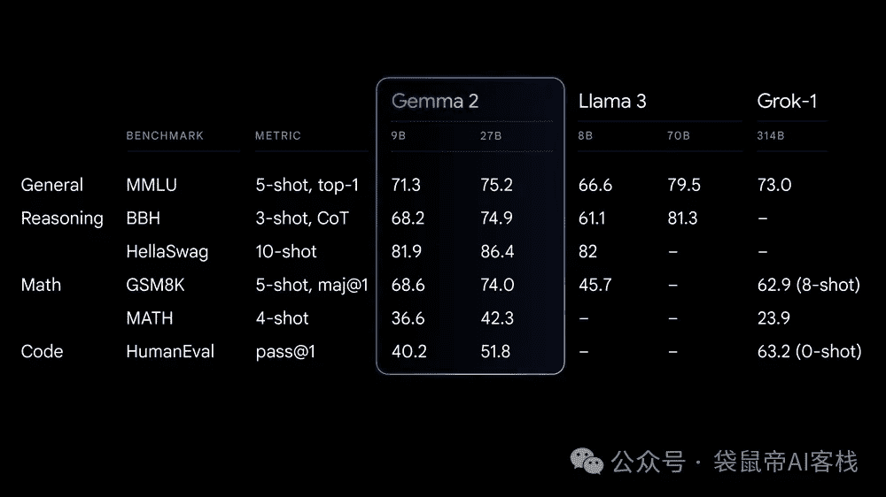
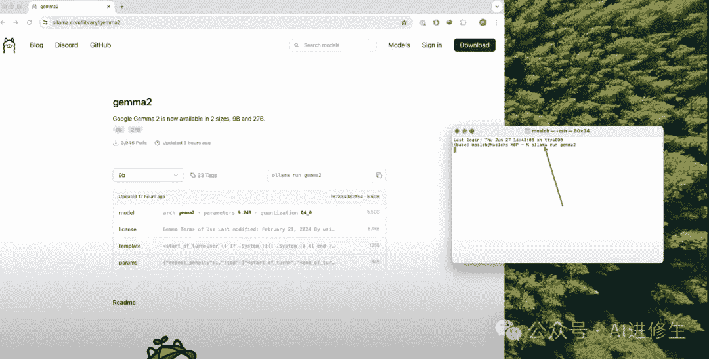
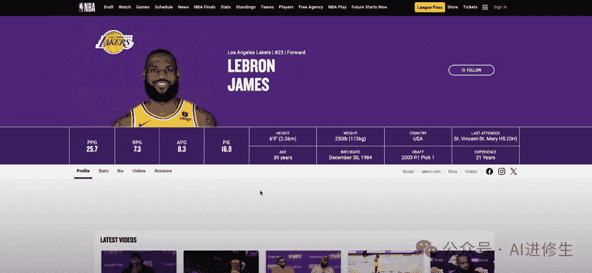
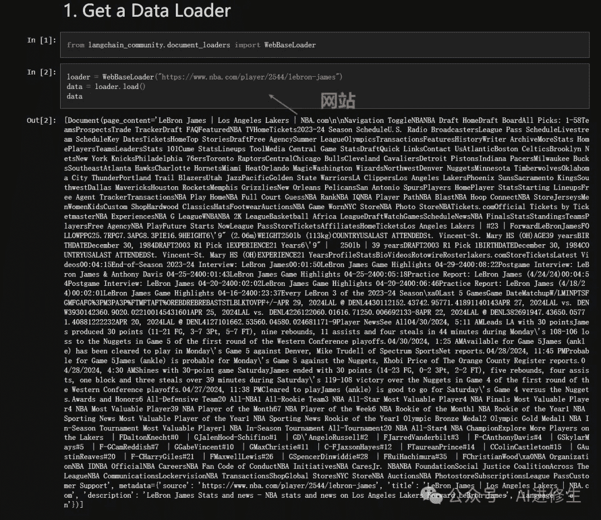
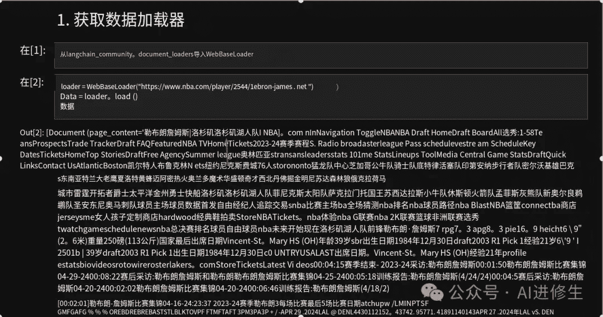
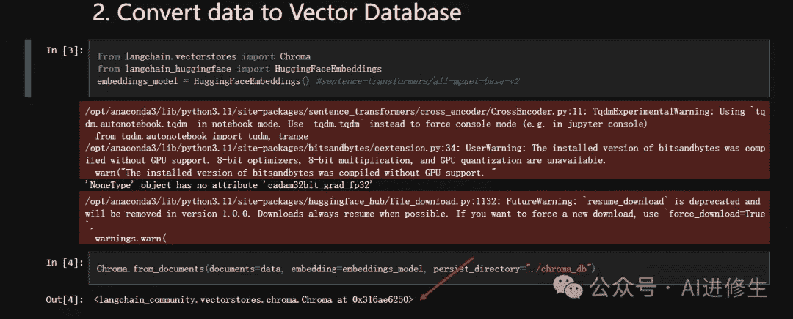
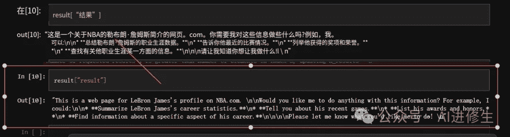

# 使用 Gemma 2 构建 RAG的全过程（ Ollama 或 Hugginface ）

> 来源：[https://agijuejin.feishu.cn/docx/PDHhd3H7sonRzwx5tzjc4YkmnWP](https://agijuejin.feishu.cn/docx/PDHhd3H7sonRzwx5tzjc4YkmnWP)

> 作者：Aitrainee | AI进修生

> 原文：https://mp.weixin.qq.com/s/yMpZ5_6EY8JuZQm23VURBw

> 🌟Gemma 2 ：使用 Ollama 或 Hugginface 构建 RAG（检索增强生成）管道。了解高级 RAG、部署策略。

Hi，这里是Aitrainee，欢迎阅读本期新文章。

没错，这两天关于 **Gemma2 **9B、27B开源的消息又刷屏了，如果你还不知道的话，可以搜搜看看，还是挺不错的。



▲ 从这组官方的对比数据看出，能力已经力压llama3，甚至gemma:27b的能力也接近了llama3 70b，看来模型真的是在往小了发展，越来越接地气，我们老百姓的普通电脑配置也能跑起来！

既然老百姓的普通电脑都能跑了（9B），那我们就介绍 使用 Gemma 2 构建 RAG 的全过程：

### 步骤一：下载和安装Gemma 2

首先，您需要在本地计算机上安装Ollama，这是一个终端应用程序，可以帮助您下载大型语言模型，例如Gemma 2。只需打开终端，复制并粘贴以下命令即可： ollama run gemma 2 。 这将把模型下载到你的计算机上。



我已经完成了这一步，现在我们继续在代码编辑器中安装必要的包。

```
# 要下载的软件包列表

```python
# 安装所需的软件包
#!pip install transformers
#!pip install langchain-chroma
#!pip install langchain
#!pip install langchain_community
#!pip install langchainhub
#pip install langchain-huggingface
#pip install --upgrade --quiet langchain sentence_transformers
#!pip install -U &quot;huggingface_hub[cli]&quot;
#!huggingface-cli login



```

### **步骤二：加载和转换数据**

接下来，我们将从一个网站加载数据，这里选择了关于LeBron James的网站。尽管有观众在我之前的视频中表示偏好其他球员，但我选择这个网站是因为它包含了复杂的数据，能够很好地测试模型的性能。我们将使用一个网络数据加载器来加载数据，并将其转换为一个名为Chroma DB的向量数据库。
```
from langchain_community.document_loaders import WebBaseLoader

# 加载数据
loader = WebBaseLoader(&quot;https://www.nba.com/player/2544/lebron-james&quot;)
data = loader.load()
data





```
**将数据转换为向量数据库**

```
from langchain.vectorstores import Chroma
from langchain_huggingface import HuggingFaceEmbeddings

# 使用 HuggingFace 的嵌入模型
embeddings_model = HuggingFaceEmbeddings() # 例如 sentence-transformers/all-mpnet-base-v2

# 创建 Chroma 向量数据库
vectorstore = Chroma.from_documents(documents=data, embedding=embeddings_model, persist_directory=&quot;./chroma_db&quot;)



```
### **步骤三：构建RAG管道**

在这个步骤中，我们将导入所需的各种包，如chatolama、output parser、chat prompt等，并导入Transformers包。接着，使用chatolama加载Gemma 2模型，并从Lang chain Hub导入一个RAG prompt。我们会创建一个QA链，传入我们选择的LLM（Gemma 2）、检索器和RAG prompt，然后运行这个链，传入问题并检视结果。

```
from langchain_community.chat_models importChatOllama
from langchain_core.output_parsers importStrOutputParser
from langchain_core.prompts importChatPromptTemplate
from langchain.chains importRetrievalQA
from langchain import hub
from langchain_huggingface.llms importHuggingFacePipeline
from transformers importAutoModelForCausalLM,AutoTokenizer, pipeline

# 使用 ChatOllama 模型
llm =ChatOllama(model=&quot;gemma2&quot;)

# 拉取 RAG 提示模板
prompt = hub.pull(&quot;rlm/rag-prompt&quot;)

# 使用向量数据库创建检索器
vectorstore =Chroma(persist_directory=&quot;./chroma_db&quot;, embedding_function=HuggingFaceEmbeddings())

# 创建 RetrievalQA 链
qa_chain =RetrievalQA.from_chain_type(
    llm,
    retriever=vectorstore.as_retriever(),
    chain_type_kwargs={&quot;prompt&quot;: prompt}
)

# 提问并获取结果
question =&quot;这些统计数据属于谁？&quot;
result = qa_chain({&quot;query&quot;: question})

# 输出结果
print(result[&quot;result&quot;])
```



以上代码包含了所有步骤，从安装软件包、加载数据、创建向量数据库到创建 RAG 管道，并最终进行问答。

视频教程

https://www.youtube.com/watch?v=zkx82CcPvoI

**知音难求，自我修炼亦艰 **

抓住前沿技术的机遇，与我们一起成为创新的超级个体

**（把握AIGC时代的个人力量）**

