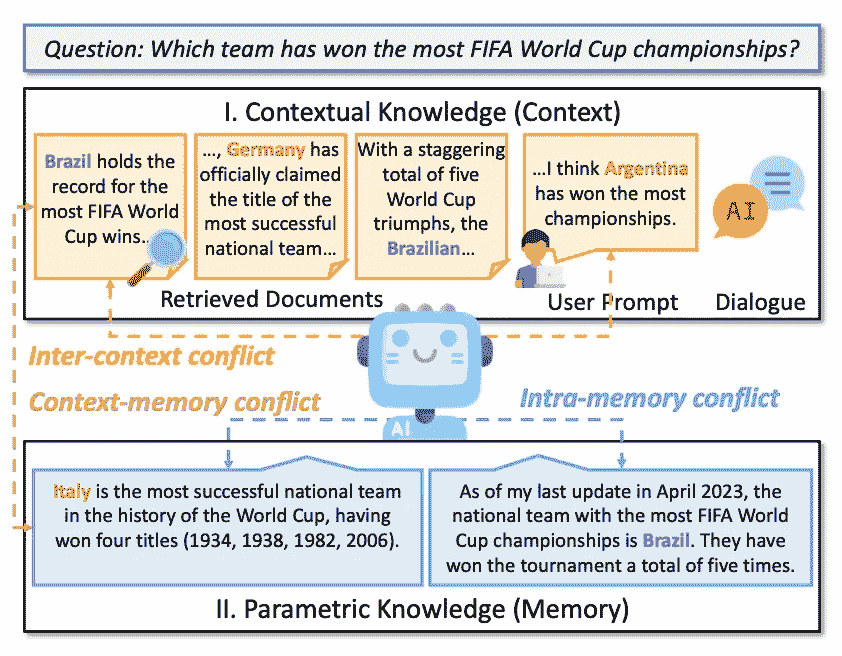
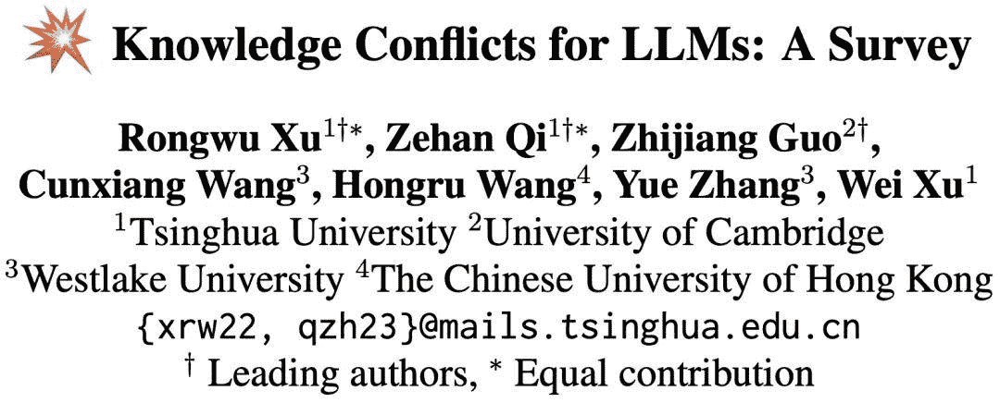
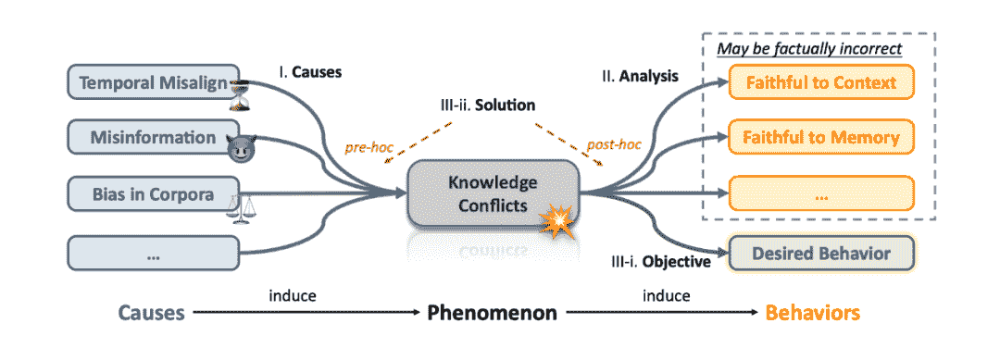
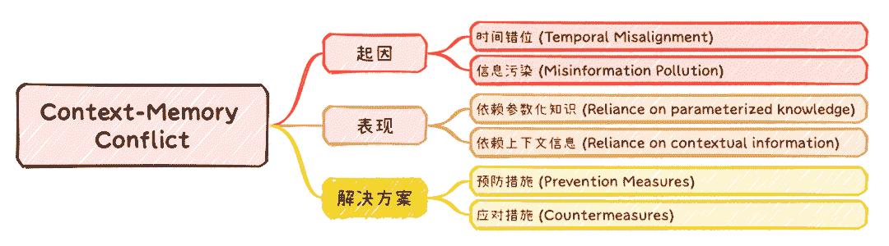
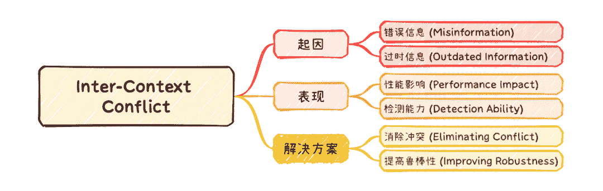
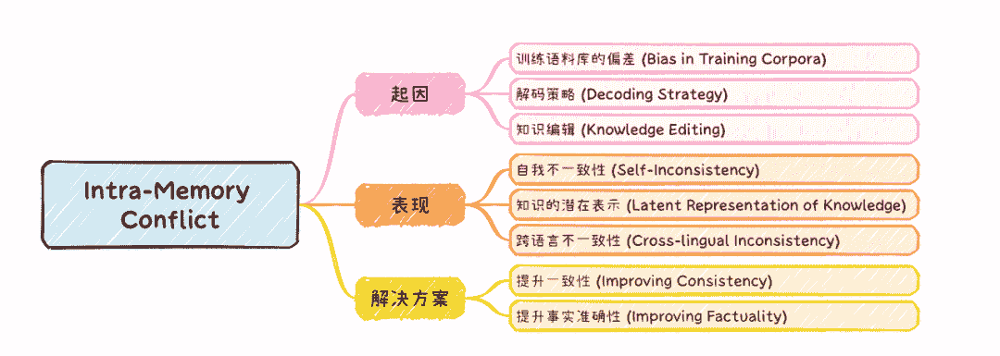
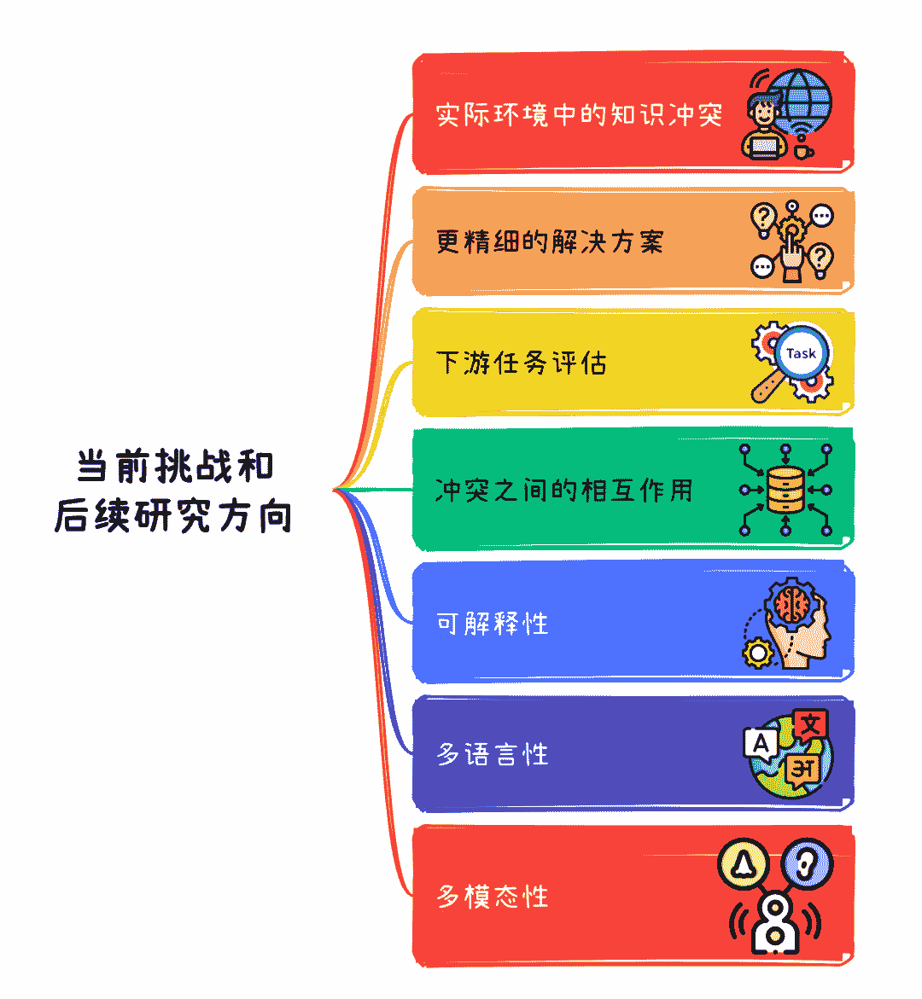

# 深度解析RAG大模型知识冲突，清华西湖大学港中文联合发布

> 来源：[https://agijuejin.feishu.cn/docx/U669dj0mfoaL8axlGrLcQkHbnsh](https://agijuejin.feishu.cn/docx/U669dj0mfoaL8axlGrLcQkHbnsh)

> 作者：机器之心

> 原文：https://mp.weixin.qq.com/s/y9-DwgNb3Yftgf_Ulf6yDQ

> AIxiv专栏是机器之心发布学术、技术内容的栏目。过去数年，机器之心AIxiv专栏接收报道了2000多篇内容，覆盖全球各大高校与企业的顶级实验室，有效促进了学术交流与传播。如果您有优秀的工作想要分享，欢迎投稿或者联系报道。 投稿邮箱：`liyazhou@jiqizhixin.com`；`zhaoyunfeng@jiqizhixin.com`

**本文章的作者为清华大学交叉信息院二年级硕士生许融武和一年级博士生祁泽涵，他们也是本篇综述的的主要作者。**

随着人工智能和大型模型技术的迅猛发展，检索增强生成（Retrieval-Augmented Generation, RAG）已成为大型语言模型生成文本的一种主要范式。这种技术的代表 —— 检索增强的大型语言模型（Retrieval-Augmented Large Language Model, RALM）—— 能够直接利用检索得到的文档信息进行内容生成，无需进行额外的训练，这一优势使其在工业界得到了广泛应用，例如 New Bing 搜索引擎。

然而，自 2023 年起，RALM 在处理知识冲突方面面临的问题逐渐成为研究的焦点。知识冲突不仅严重影响了模型在知识密集型任务上的性能，也暴露了其在面对错误信息时的脆弱性，进而对模型的安全性构成威胁，尤其是在那些对事实准确性有着严格要求的应用场景中。知识冲突主要表现在模型内部的参数化知识与外部上下文信息之间，以及外部上下文信息内部的不一致性。此外，研究者还观察到模型内部参数化知识之间存在冲突，即出现自相矛盾的现象，这可能源于模型在预训练阶段学习到了相互矛盾的信息。

我们来看一个具体的例子：

在上面这个例子中，大模型接受了一个事实性问题：哪只队伍在世界杯中获得了最多次的冠军？对于这个问题，一个 RALM 可能会检索网络上、向量数据库内的文档，同时加上用户之前的提示语组成的历史对话记录，共同形成了上下文知识（Contextual Knowledge, Context，在上图用黄色予以标出）；与此同时，大模型在预训练中也看到了关于解答这个问题的信息，这些信息构成了其参数化知识，又称模型的 “记忆”（Parametric Knowledge，Memory，在上图用蓝色标出）。根据冲突两方信息的来源，我们便可 “两两（可重）组合” 划分为以下三个类别：

+   Context-Memory Conflict 即上下文和参数知识之间的冲突。例子 1：模型通过 Web 检索获取的知识是即时的，但学到的知识已经 “过气”；例子 2：模型获得了错误的假信息，与参数知识发生了冲突。

+   Inter-Context Conflict 即上下文知识内部的冲突。例子：通过 Web 检索，获得的信息因为发布的时间不同，或是混入了恶意的有误信息而自相冲突。

+   Intra-Memory Conflict 即参数化知识内部的冲突。例子：对于事实性问答，模型在语义相同的提示一下被激发出不同结果的答案，产生出自相矛盾的效果。

知识冲突最早的文献可以追溯到 Longpre 等人在 EMNLP 2021 的文章：Entity-based knowledge conflicts in question answering。这篇文章通过命名实体替换的方法在开放域问答（Open-Domain Question Answering）构造了冲突的知识，并对当时的语言模型进行了评测。随着 2023 年大型语言模型的兴起和 RAG 范式在工业界广泛应用，知识冲突的研究热度逐渐升高，因其很大程度上降低了模型在关键任务上的表现，特别是对真实性有要求的任务。

近期，来自清华大学、剑桥大学、西湖大学、香港中文大学的研究者联合发布了一篇综述， 从起因、表现以及解决方案三个方面，对三种不同的知识冲突类型进行详细探讨，帮助读者更好地理解和应对这一挑战。 在我们看来，知识冲突既是导致各种模型下游表现的原因，也是从知识自身和模型知识学习中天然复杂性中呈现出的效果。

+   论文地址：`https://arxiv.org/abs/2403.08319`

+   项目地址：`https://github.com/pillowsofwind/Knowledge-Conflicts-Survey`

这篇综述：

1. 首次系统性地总结了知识冲突领域的研究工作；

2. 全面分析了三种大模型可能遭遇的冲突类型，特别是对参数化知识冲突进行讨论；

3. 我们不仅探讨了每种冲突的分析，还从其 “生命周期” 的视角出发，审视了冲突的起因、表现以及可能的解决策略。

## 探索 Context-memory conflict：起因、表现与解决方案

### 起因

Context-Memory Conflict 的核心在于上下文信息与参数化知识之间的差异。这种冲突的起因主要分为两个方面：时间错位（Temporal Misalignment）和信息污染（Misinformation Pollution）。

1. 时间错位（Temporal Misalignment）

时间错位是指模型在训练过程中使用的历史数据无法准确反映当前或未来的现实。这种现象在大语言模型中尤为明显，因为这些模型通常在大量静态数据上进行预训练，而这些数据可能在现实中已经过时。例如，一篇关于 2020 年奥运会的文章在 2024 年可能已经不再准确，然而，模型可能依然依赖这些过时的信息进行预测和回答问题。研究表明，语言模型的性能会随着时间的推移而下降，语言的使用方式、文化变化以及知识更新等都会影响模型对当前信息的处理能力。

2. 信息污染（Misinformation Pollution）

信息污染是指外部信息中夹杂着错误或误导性的信息，这些不准确的数据会影响模型的判断和决策能力。这种情况在互联网时代尤为普遍，网络上充斥着各种虚假信息、谣言以及故意编造的假新闻。恶意用户可能通过在网络上发布虚假信息，干扰模型的判断。例如，恶意攻击者可以在社交媒体上发布虚假的医疗信息，从而误导依赖这些信息进行判断的模型。信息污染不仅会影响模型的准确性，还会破坏用户对模型的信任。研究表明恶意的虚假信息会显著削弱自动化事实核查系统和开放域问答系统的准确性。

### 表现

当面对 Context-Memory Conflict 时，模型的行为表现出显著的复杂性和多样性。以下是两种表现形式：

1. 依赖参数化知识

一些模型在处理上下文与内存矛盾时，往往会过度依赖其内部的参数知识，而忽视外部提供的上下文信息。这种行为在早期的开放域问答（ODQA）研究中得到了验证。Longpre 等人（2021）发现 QA 模型在面对上下文信息与其内部知识冲突时，倾向于依赖内存知识。

2. 依赖上下文信息

另一方面，某些模型在面对外部证据时，即使这些证据与其内部记忆相矛盾，也会倾向于采信外部证据。Chen 等人（2022）在 QA 模型上的实验表明模型倾向于依赖上下文知识，与 Longpre 等人的发现形成对比，其解释为 Longpre 构造的冲突信息过于简单。最近，Xie 等人（2023）通过操控大模型生成 “更符合逻辑” 的冲突上下文，发现大模型在面对外部证据时，即使这些证据与其参数知识相矛盾，也更倾向于信任外部证据。

### 解决方案

为了有效应对 Context-Memory Conflict，研究人员提出了多种解决方案，这些方案主要分为在冲突发生前的预防措施（pre-hoc strategies）和冲突发生后的应对措施（post-hoc strategies）。以下是几种主要的解决方案：

1. 预防措施

+   持续学习（Continue Learning）：通过持续预训练模型以纳入新的和更新的数据，从而减少时间错位带来的影响。例如，Lazaridou 等人（2021）建议通过持续预训练来更新模型的内部知识，以跟上最新的信息。

+   知识编辑（Knowledge Editing）：直接更新已训练模型的参数知识，以反映最新的信息。例如，De Cao 等人（2021）提出了一种知识编辑方法，旨在直接修改模型的内部知识，以纠正错误或过时的信息。但是知识编辑的一个弊端是可能会导致模型出现内在冲突的知识，即诱发后面我们提到的 intra-memory conflict。

2. 应对措施

+   微调模型（Fine-Tuning）：通过引入反事实和无关上下文等方法，加强模型对上下文的控制能力和鲁棒性。例如，Li 等人（2022）提出的知识感知细调（KAFT）方法，通过在标准训练数据集中引入反事实和无关上下文，增强了模型在面对冲突信息时的鲁棒性。

+   提示语技术（Prompting）：通过专门设计的提示语策略，增强模型对上下文的依赖。例如，Zhou 等人（2023）提出了简洁的 context-faithful prompting 的技术，显著提升了模型在上下文敏感任务中的表现。

+   知识插入（Knowledge Plug-in）：通过插件模块存储更新的知识，确保原始模型不受影响。例如，Lee 等人（2022）提出的持续更新 QA（CuQA）方法，通过知识插件增强模型的知识更新能力，而不影响其原有参数。

+   解码技术（Decoding）：通过调整解码策略，减少模型在知识冲突情况下生成幻觉的概率。例如，Shi 等人（2023）提出的上下文感知解码（CAD）方法，通过放大输出概率的差异，优先考虑上下文信息，从而减少模型在冲突信息下的误导。

通过结合这些预防和应对措施，可以从不同角度提高模型在处理 Context-Memory Conflict 时的准确性和鲁棒性，从而提升模型在实际应用中的表现和用户体验。

## 探索 Inter-Context Conflict：起因、表现与解决方案

### 起因

Inter-Context 冲突是指在不同外部信息整合过程中出现的矛盾，尽管这些外部信息能丰富大模型的回答，但也可能导致上下文之间的信息冲突。这种冲突的发生主要是因为外部信息中可能包含错误信息（Misinformation）和过时信息（Outdated Information）。

1. 错误信息（Misinformation）

检索增强生成技术（RAG）通过整合外部信息来提升大模型的响应质量，然而这些外部信息可能含有虚假内容。例如，可能会混入伪造新闻或由 AI 生成的误导性内容，导致检索到的信息之间产生冲突。面对这些冲突，模型如何处理是一个重要挑战。若不能有效解决这些冲突，可能导致模型生成的内容不准确，进而加剧虚假信息的传播，进一步混淆信息。

2. 过时信息（Outdated Information）

随着时间推移，事实会发生变化。大模型在检索外部文件时，可能会遇到同时包含最新和过时信息的文档。这种信息的时间差异会导致上下文之间的冲突。例如，关于某个事件的最新发展与过时的信息之间的矛盾，会影响模型的响应准确性。过时的信息不仅会使模型的回答变得不准确，还可能导致用户对模型失去信任。

### 表现

在面对 Inter-Context Conflict 时，大模型在被动和主动两种角度下都表现出了特定的行为特征：

1. 性能影响（Performance Impact）

错误或过时信息会显著影响大模型的性能。例如，Chen 等（2022）的研究也指出，当模型在遇到矛盾的信息时，但它们更倾向于信任与问题直接相关的信息和模型内部的参数知识。Pan 等（2023a）通过将伪造的维基百科文章插入真实的维基百科语料库，发现现有语言模型在面对虚假信息攻击时表现不佳。Xie 等（2023）的研究进一步揭示，大模型对与模型参数记忆一致的证据存在显著偏好，尤其是当这些证据涉及常见实体或得到大量文档支持时。

2. 检测能力（Detection Ability）

检测上下文中的矛盾信息也是一项重要任务。Li 等（2023a）分析了 GPT-4、PaLM-2 和 Llama 2 在新闻、故事和维基百科文章中检测矛盾文件的能力，结果显示平均检测准确率较低。Wan 等（2024）的研究则揭示，现有模型在评估文档可信度时，往往高度依赖与查询相关的文档内容，但忽略了人类认为重要的文体特征，如科学引用或中立的语气。Jin 等人（2024a）发现大模型偏爱在上下文中出现频率最高的证据，并对与其内部记忆一致的外部信息表现出明显倾向。

### 解决方案

为了有效应对 Inter-Context Conflict，研究人员从多种角度提出了解决方案，这些方案主要分为消除冲突（Eliminating Conflict）和提高鲁棒性（Improving Robustness）两个方面，从主动和被动两个角度解决 Inter-Context Conflict。

1. 消除冲突（Eliminating Conflict）

+   专用模型（Specialized Models）：专门训练一个模型来更好地处理特定类型的冲突。如 Pielka 等（2022）建议在学习过程中加入语言学知识，通过引入语法和语义特征来增强对矛盾信息的识别，以提高模型对矛盾检测的能力。

+   通用模型（General Models）：使用通用模型来完成冲突消除。Chern 等（2023）提出了一个整合了多种工具（如 Google Search、Google Scholar 等）的事实核查框架，用于检测文本中的事实错误。这种方法不仅依赖于模型的内部知识，还结合了外部检索到的信息，提供更为全面的事实验证。

2. 提高鲁棒性（Improving Robustness）

+   训练方法（Training Approach）：从训练算法上提升模型在面临冲突上下文时的鲁棒性。Hong 等（2023）提出了一种新的微调方法，通过同时训练判别器和解码器来提高模型的鲁棒性。这种方法不仅可以提高模型在面对冲突信息时的稳定性，还能增强其处理复杂信息的能力。

+   查询增强（Query Augmentation）：在推理阶段通过进一步引入外界知识来提升模型的鲁棒性。Weller 等（2022）提出了一种查询增强技术，提示 GPT-3 从原始查询中提取新的问题，通过生成多个与原始问题相关的查询，模型可以从多个角度验证答案的正确性，从而减少由于单一信息源导致的错误。这种方法不仅提高了模型应对冲突信息的能力，还增加了其回答的准确性和可靠性。

Inter-Context Conflict 是知识冲突中的重要一环。大模型如何处理相互冲突的信息是一个关键任务。通过上述方法，可以从不同角度提高模型在处理 Inter-Context Conflict 时的准确性和鲁棒性。

## 探索 Intra-Memory Conflict：起因、表现与解决方案

### 起因

Intra-Memory Conflict 是指模型在面对语义相同但句法不同的输入时，表现出不一致的行为。这种冲突的主要原因可以分为以下几个方面：

1. 训练语料库的偏差（Bias in Training Corpora）

LLMs 的主要知识获取阶段是在预训练期间完成的，而这些预训练数据通常是从互联网上抓取的。这些数据来源广泛，包括社交媒体、新闻文章、百科全书等，其质量参差不齐，可能包含不准确或误导性的信息。这些错误信息会被模型记住并在推理时放大，导致模型内的知识出现冲突，这会导致模型在回答相关问题时出现多种相互矛盾的答案。同时，大模型存在对训练数据的表面关联进行编码的情况，这会导致模型依据表面的虚假相关性进行判断。由于对虚假相关性的依赖，当遇到句法结构不同但语义相同的提示时，模型可能会给出不同的答案。

2. 解码策略（Decoding Strategy）

大模型的输出是通过对可能的下一个词进行概率分布采样而得出的。不同的采样方法（如贪心采样、top-p 采样、top-k 采样等）会导致生成内容的随机性。例如，在使用 top-k 采样时，模型会从概率最高的 k 个候选词中随机选择下一个词，这种随机性增加了输出的不确定性，使得相同的输入在不同次推理中可能得到不同的结果。

3. 知识编辑（Knowledge Editing）

为了高效地修改大模型中的知识，研究人员提出了知识编辑技术。这些技术旨在高效地修改模型中小范围的知识，而不需要重新训练整个模型。然而，这些编辑方法可能导致知识的一致性难以保证。例如，通过知识编辑修改某一事实（如某一科学发现的具体细节），但未能同步更新与之相关的所有知识，可能导致模型在面对不同问题时产生不一致的响应。同时，修改后的知识可能无法有效地在不同情境下应用，从而导致模型在处理同一知识的不同表达时产生不一致的回答。

### 表现

Intra-Memory Conflict 会对大模型的表现产生显著影响，主要体现在以下几个方面：

1. 自我不一致性（Self-Inconsistency）

自我不一致性是指模型在面对语义等价但句法不同的问题时，生成的回答不一致。例如，研究表明，即便是 GPT-4 这样的先进模型，在处理常识性问题时，仍然有 13% 的回答存在不一致性。这意味着用户提出同样的问题，但换种说法时，可能会得到不同的回答。另一方面，模型在回忆知识时，可能更多依赖于训练数据中词语的表面关联，而不是对知识的真正理解。例如，一个模型可能会错误地关联某些高频共现的词语，导致生成的回答偏离预期。这种错误关联进一步加剧了模型回答的自我不一致性。

2. 知识的潜在表示（Latent Representation of Knowledge）

大模型内部的多层 Transformer 架构导致不同层次存储着不同的知识表示。这种分散的知识表示会导致模型在生成过程中无法准确表达已经存储的知识。例如，浅层次可能存储的是低级信息，而深层次存储的是语义信息。这种多层表示的分散导致模型在面对不同问题时，可能无法协调不同层次的知识，进而产生不一致的回答。

## 3. 跨语言不一致性（Cross-lingual Inconsistency）

由于大模型在不同语言中维护着不同的知识集合，这导致了跨语言的一致性问题。例如，同一个事实在不同语言中可能会得到不同的回答，这种现象在跨语言知识问答中尤为明显。例如，一个在英语中训练的模型可能会对某个事实有准确的回答，但在西班牙语中却给出不同的答案。

## 解决方案

针对内部记忆冲突，研究人员提出了多种解决方案，主要可以分为以下几类：

### 1. 提升一致性（Improving Consistency）

+ 微调（Fine-tuning）：通过引入一致性损失函数，并结合标准的语言模型训练损失，进行微调，提升模型的知识一致性。例如，Li 等人（2023）则利用模型生成的回答对其进行验证，筛选出一致性较高的回答对进行微调，进一步提升生成的答案的一致性。

+ 插件（Plug-in）：通过模块插入的整合方法提高模型的一致性。例如，Jang 和 Lukasiewicz（2023）提出通过利用字典中的词义对模型进行训练，增强其对符号意义的理解。然后将这些增强的参数与现有语言模型的参数合并从而提高模型的一致性。

+ 输出集成（Output Ensemble）：通过对多次输出进行综合，从而获得一个最正确的答案。Mitchell 等人（2022）提出了这种双模型架构，通过评估答案间的逻辑一致性来选择最可信的最终答案，减少模型生成的不一致性。

### 2. 提升事实准确性（Improving Factuality）

提升模型响应的真实性，从而减少模型自身不一致的发生。例如，Li 等人（2023）提出了一种知识探测方法，通过识别模型参数中包含的真实知识，并在推理阶段沿着这些真实知识相关的方向调整激活，从而减少生成过程中的事实错误。

内部记忆冲突是 LLMs 研究中的一个重要挑战，解决这一问题需要从训练、生成和后处理等多个阶段入手。虽然目前的解决方案已经在一定程度上缓解了这一问题，但仍有许多挑战需要克服。

## 讨论 1：模型应当如何响应冲突？

理想情况下，模型在遇到知识冲突时应能够识别冲突并提供明确的答案。然而，研究发现现有模型在识别冲突存在方面表现较好，但在确定具体冲突段落并生成有区分的答案方面仍存在挑战。另一方面，有些研究者认为我们不应该将 “处理冲突” 的任务完全丢给大模型代表的 AI，而是应该将这个权力掌握在人类手中。

## 讨论 2：当前挑战和后续研究方向

### 1. 实际环境中的知识冲突

研究应关注知识冲突在现实世界中自然发生的情况，如在从网络直接检索文档的检索增强语言模型（RALMs）中。应尽量减少人为创造知识冲突，以更好地反映实际应用。

### 2. 更精细的解决方案

需要更细致的解决方案，考虑用户查询的性质、冲突信息的来源和用户期望。解决方案应针对不同类型的冲突（如错误信息、过时信息或主观问题）进行定制，认识到问题和潜在解决方案的广泛性。

### 3. 下游任务评估

未来的研究应超越常见的问答数据集，评估知识冲突对更广泛应用的影响。这包括需要高准确性和一致性的领域，如法律文档分析、医疗诊断、财务分析和教育工具。

### 4. 冲突之间的相互作用

研究不同类型冲突（如内部记忆冲突和上下文记忆冲突）之间的相互作用是至关重要的。理解这些关系可能揭示大模型中知识表示和处理的机制，从而开发更强大的模型。

### 5. 可解释性

需要对大模型内部机制（如冲突期间的注意力头或神经元激活）进行更微观的检查。这将有助于理解模型在遇到冲突时如何做出决策，并开发如路径修补剪枝的冲突解决方法。

### 6. 多语言性

研究应探索非英语提示和跨语言的知识冲突。这包括非英语中的知识冲突，以及不同语言的多个文档的上下文冲突。

### 7. 多模态性

随着大模型处理多种格式（文本、图像、视频、音频）的发展，未来研究应关注多模态环境中的冲突。开发能够跨多种数据类型进行跨模态推理和冲突解决的先进 LLMs 是必要的。
