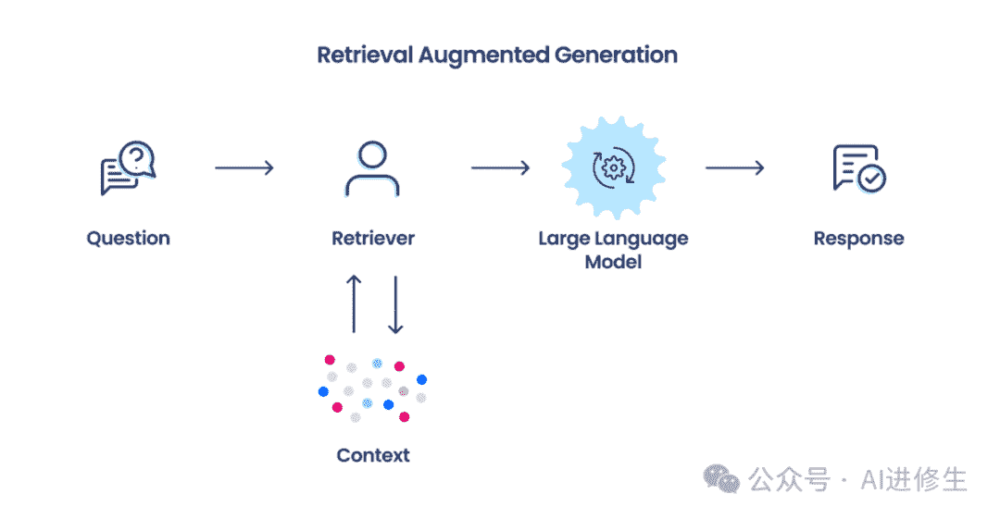
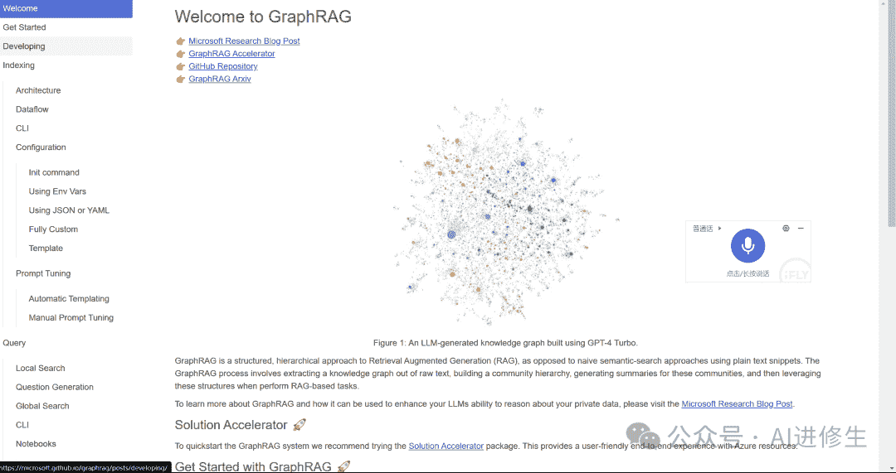
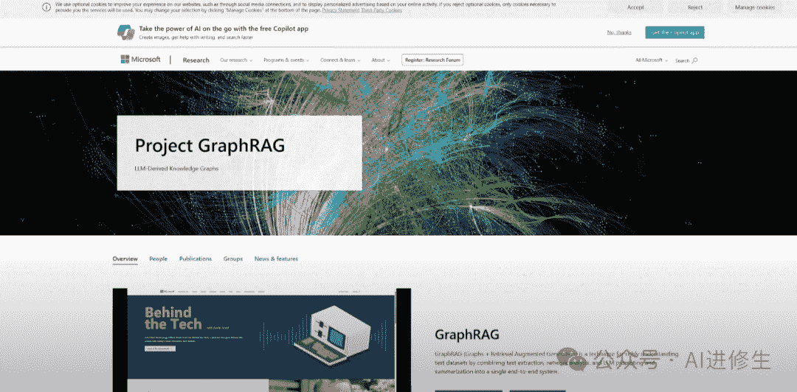
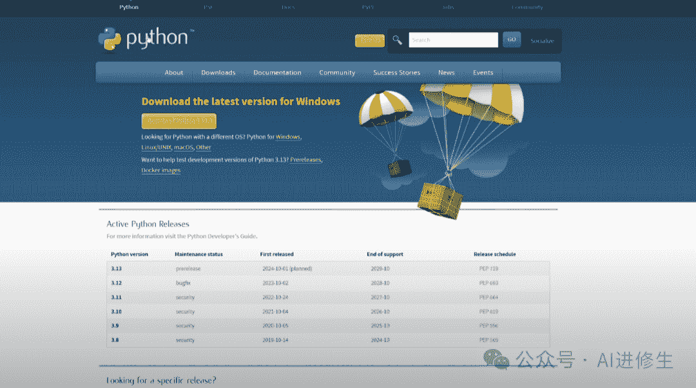
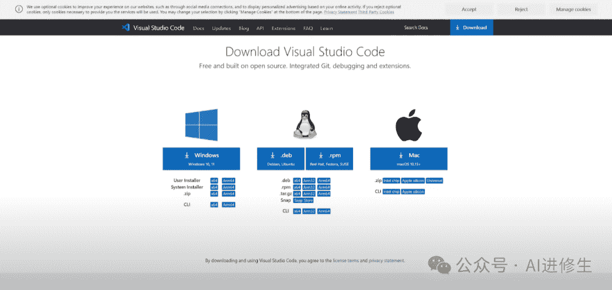
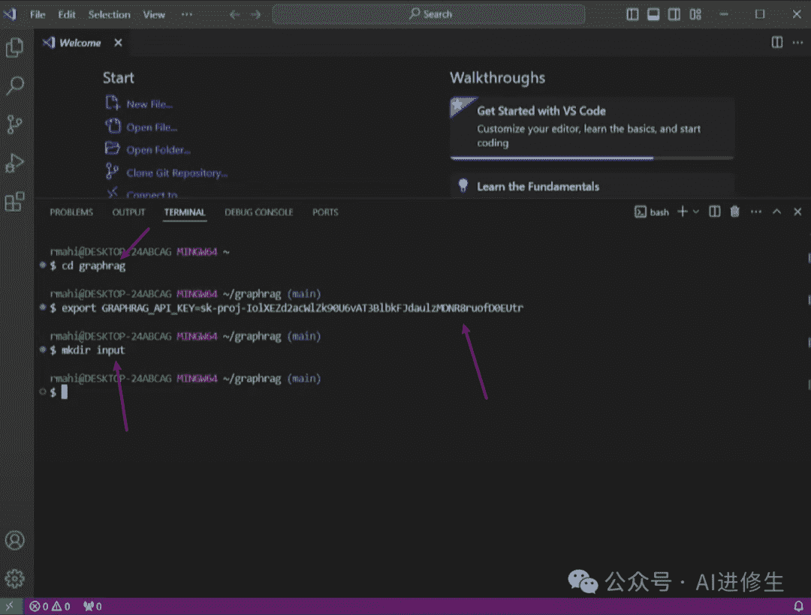
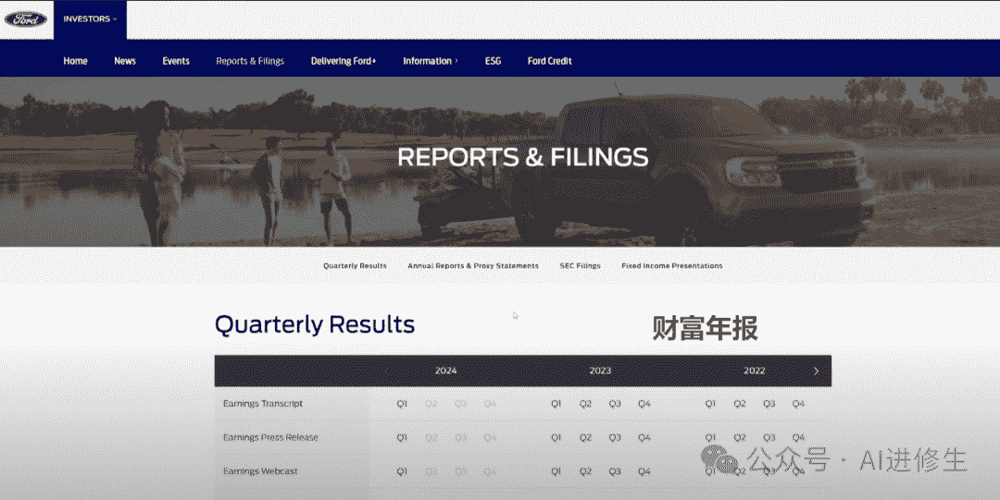
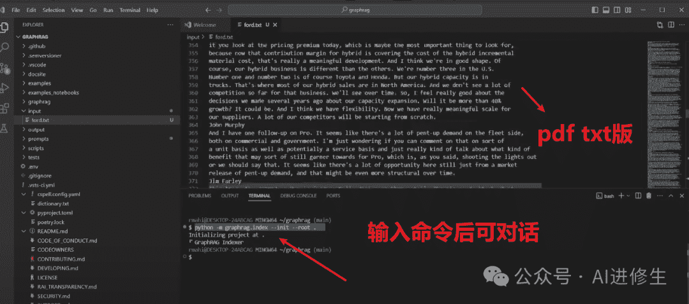
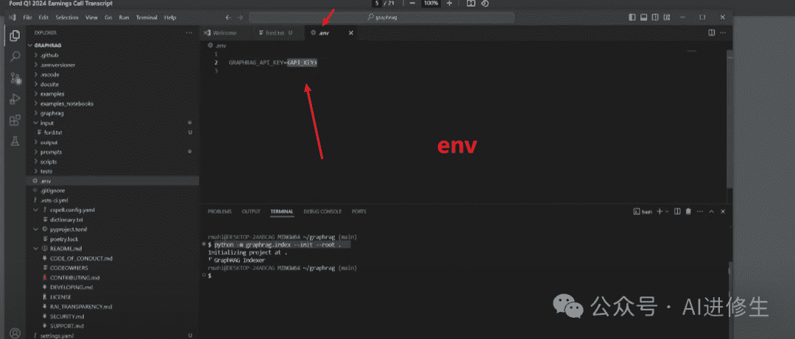

# GraphRAG：终极 RAG 引擎 - 语义搜索、嵌入、矢量搜索等等！

> 来源：[https://agijuejin.feishu.cn/docx/MflJd7UEaoxEW3xmn3AcLhZUnVw](https://agijuejin.feishu.cn/docx/MflJd7UEaoxEW3xmn3AcLhZUnVw)

> 作者：Aitrainee | AI进修生

> 原文：https://mp.weixin.qq.com/s/FO9TAhT_RaPv75oITNcywg

> 🌟解锁 GraphRAG 的力量：用于高级语义搜索、嵌入、矢量搜索等的终极 RAG 引擎！

github：https://github.com/microsoft/graphrag

Hi，这里是Aitrainee，欢迎 阅读本期新文章。

我刚刚发现了 目前最好的完全开源的RAG系统 ，微软AI推出的GraphRAG。GraphRAG是一个数据管道和转换套件，利用各种大型语言模型的强大功能，从非结构化文本中提取有意义的结构化数据。

在介绍GraphRAG之前，我需要解释一下RAG的基本概念。

RAG（Retrieval-Augmented Generation）是一种自然语言处理方法，通过外部知识增强现有的大型语言模型，以便在回答需要特定知识的问题时，提供更相关的答案。

这种方法被广泛使用，因为它不仅是最经济实惠的方法，还能减少大型语言模型的幻觉倾向，使生成的内容更贴近上下文信息。

除了用于问答，RAG还可以用于很多自然语言处理任务，例如从文本中提取信息、推荐、情感分析和摘要，这些都可以在私有本地存储中完成。 那么，GraphRAG和传统的基准RAG系统有何不同呢？

GraphRAG结合了图结构和RAG， 它将文本提取、网络分析、大型语言模型的提示和摘要整合成一个强大的系统 。

**与简单的文**本搜索方法不同，GraphRAG使用 知识图谱 来提取和组织信息，从而提高响应的准确性和相关性，尤其是在处理复杂或私密的数据集时。它通过连接分散的信息片段，提供综合的见解，显著优于基准RAG技术。

现在我们了解了RAG和GraphRAG的基本概念，接下来 我将展示如何开始使用GraphRAG，并了解其一些功能。 我强烈推荐大家观看这个由项目创作者演示的视频，它会更详细地解释GraphRAG的工作原理。

▲ 项目创作者演示的视频

https://www.youtube.com/watch?v=jCjyaQL-7mA&t=0s

**如何开始使用GraphRAG **

让我们开始安装使其在你计算机上运行所需的先决条件。 首先，你需要确保已安装Python的最新版本，并确保已安装PIP。

然后，你需要克隆该存储库并进入VS Code，这是我推荐的集成开发环境。

打开VS Code的新窗口，打开终端，输入PIP install graph rag安装相关包。接着输入cd graph rag进入目录，并输入export graph rag_API_key填入你的API密钥。

你需要创建一个输入文件夹以存放所有文件或文档。你可以在终端中输入mkdir input来创建文件夹，

然后打开VS Code，点击“文件”->“打开文件夹”，选择克隆的存储库目录，你会看到创建的输入文件夹。接着将一份今年的福特财务报告放入该文件夹，以便使用GraphRAG进行分析。

在下一个步骤中，输入命令python -m graph rag index以对当前文档进行索引，然后将可以开始与该文档进行对话。

每次处理新文件时都需要进行索引。 你还可以在.env文件中粘贴你的API密钥，如果使用其他模型，可以在此处进行配置。 配置完成后，保存文件并运行代码。

最后，运行以下命令以启动对话： python -m graph rag query。 这将初始化查询或输入，并设置为根文件夹，接着输入查询。 这样就可以在本地访问和使用RAG系统。 我强烈推荐使用Ollama，它易于设置，只需设置端点即可。

下面提供官方的 **文档介绍、相关资源、部署教程 **等，进一步支撑你的行动，以提升本文的帮助力。

# **GraphRAG 项目**

👉 使用 GraphRAG Accelerator 解决方案

👉 微软研究博客文章

👉 阅读文档

👉 GraphRAG 发表的论文

## **简介**

GraphRAG 是一个旨在利用大语言模型（LLMs）从非结构化文本中提取结构化数据的数据处理工具套件。

要了解更多关于 GraphRAG 及其如何增强 LLM 处理私有数据能力的信息，请访问 微软研究博客文章 .

## **快速入门**

建议使用 Solution Accelerator 包，该包提供了与 Azure 资源的端到端用户体验。

## **代码库指南**

此代码库展示了如何利用知识图谱记忆结构来增强 LLM 输出。请注意，提供的代码仅作为示范用途，不是微软官方支持的产品。

## **深入探索**

+   • 关于贡献指南，请参见 CONTRIBUTING.md

+   • 关于 GraphRAG 的开发信息，请参见 DEVELOPING.md

+   • 欢迎在 GitHub 讨论区 参与讨论和反馈意见！

## **提示调优**

为了使 GraphRAG 在使用您的数据时达到最佳效果，我们强烈建议按照文档中的 提示调优指南 进行调整。

## **责任 AI 常见问题**

请参阅 RAI_TRANSPARENCY.md 了解以下内容：

+   • GraphRAG 是什么？

+   • GraphRAG 能做什么？

+   • GraphRAG 的预期用途是什么？

+   • GraphRAG 如何评估？使用了哪些性能指标？

+   • GraphRAG 的局限性是什么？用户如何将其影响降到最低？

+   • 哪些操作因素和设置有助于 GraphRAG 的有效和负责任使用？

视频教程

https://www.youtube.com/watch?v=kHZHMzv3Shg

参考链接：

Github Repo：github.com/microsoft/graphrag

博客文章：microsoft.github.io/graphrag

项目页面：microsoft.com/en-us/research/project/graphrag/

研究论文：arxiv.org/pdf/2404.16130

**知音难求，自我修炼亦艰**

抓住前沿技术的机遇，与我们一起成为创新的超级个体

**（把握AIGC时代的个人力量）**

