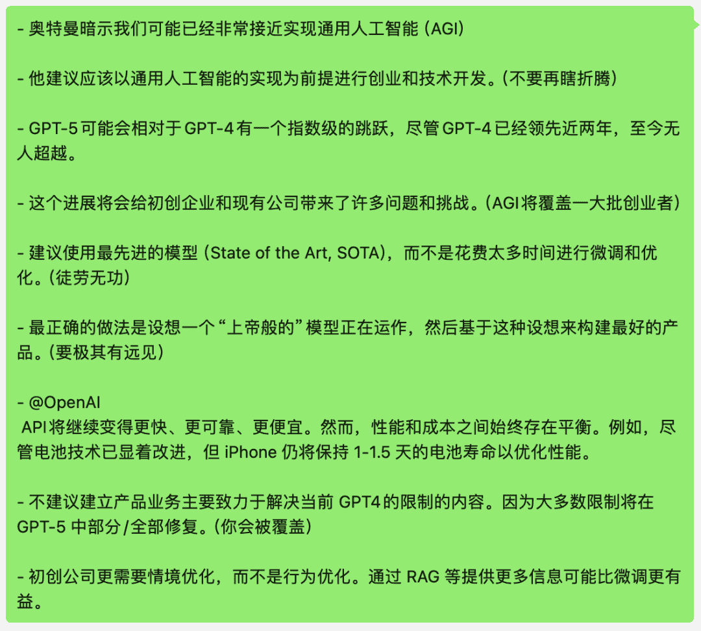
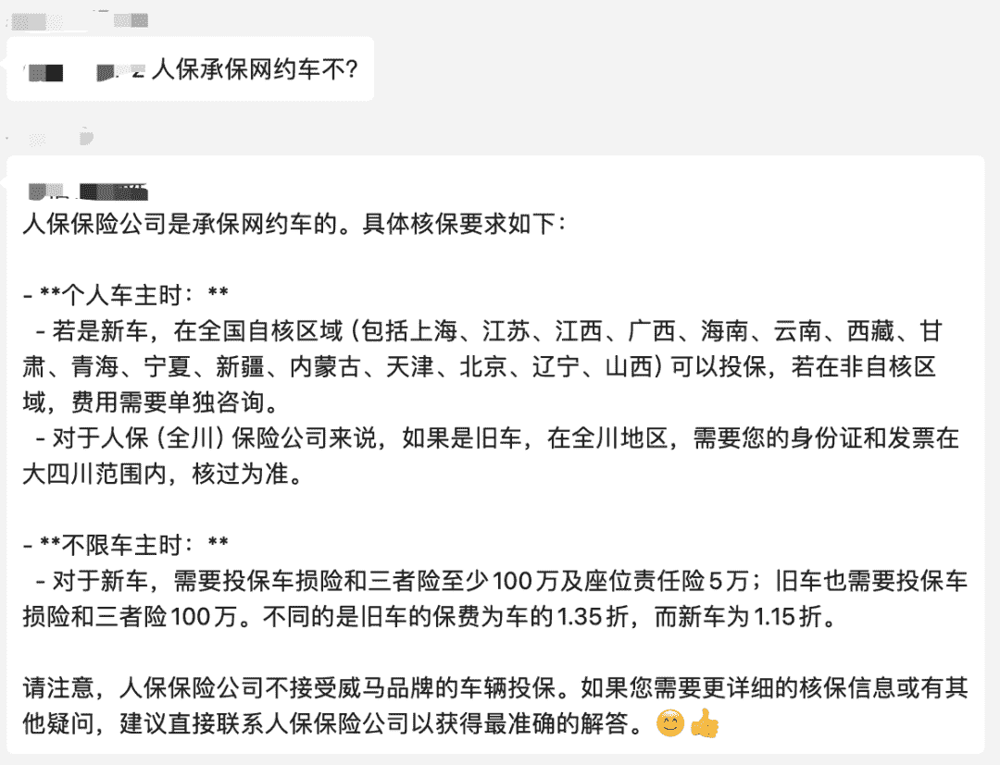
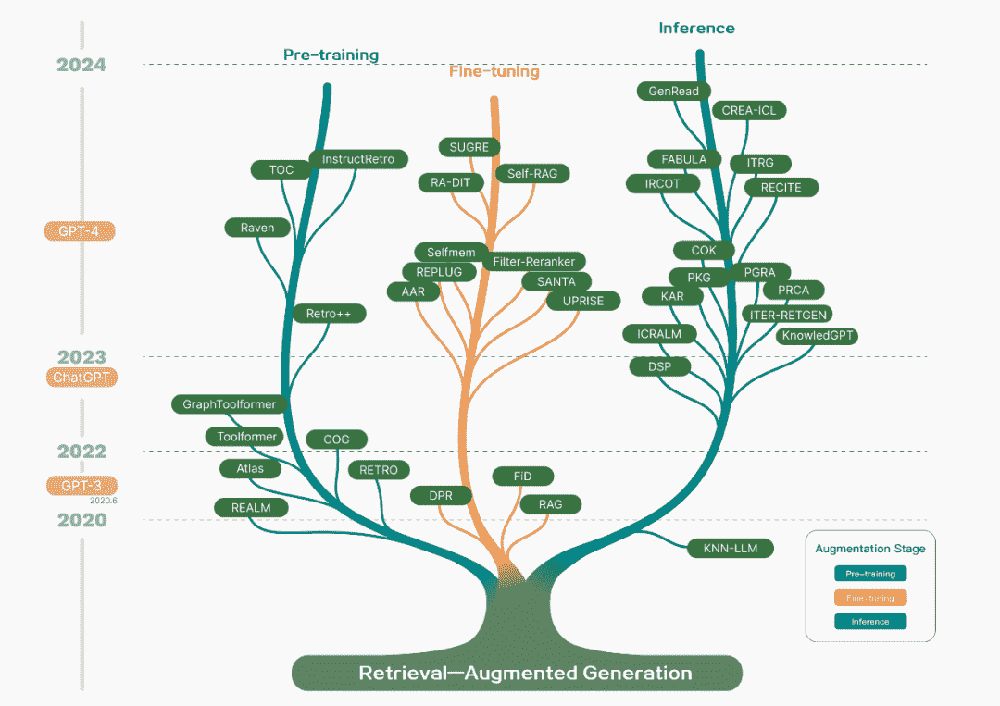
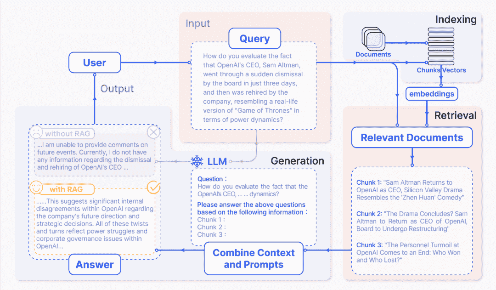
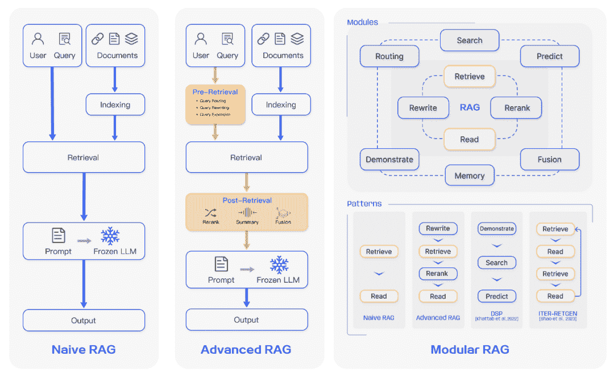
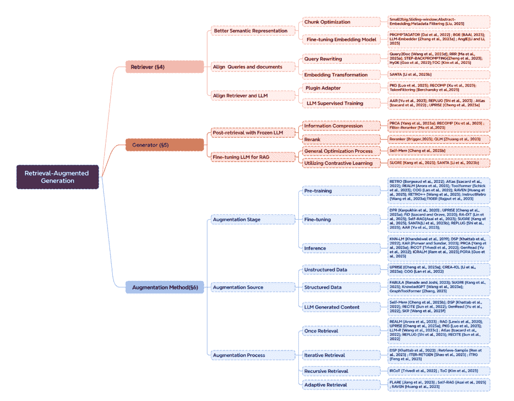
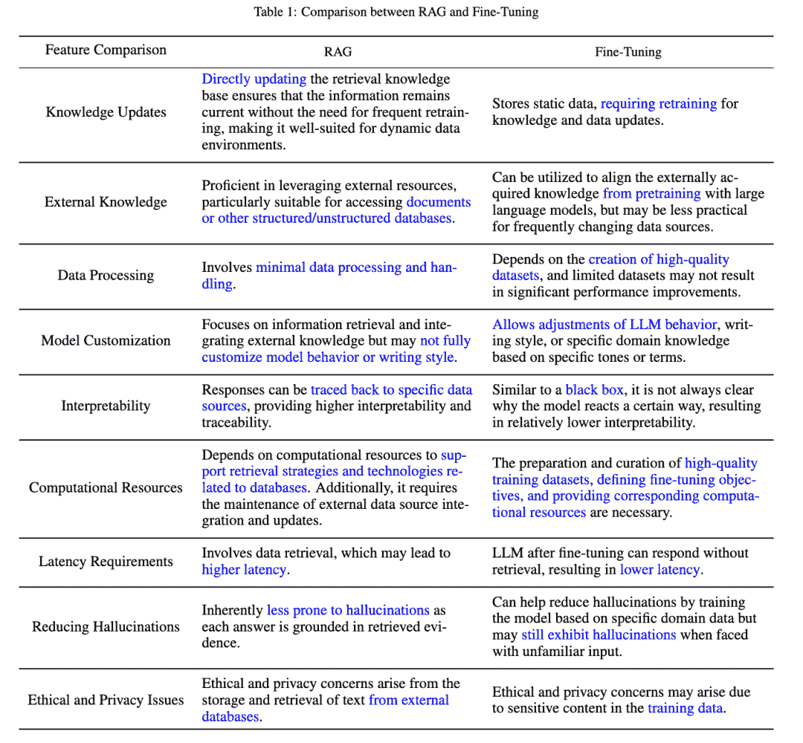
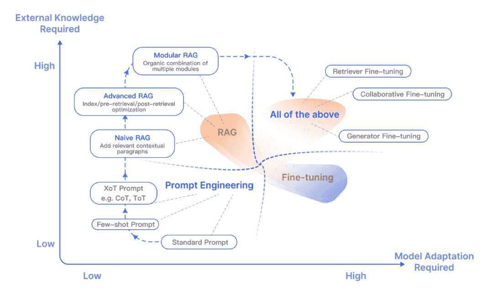
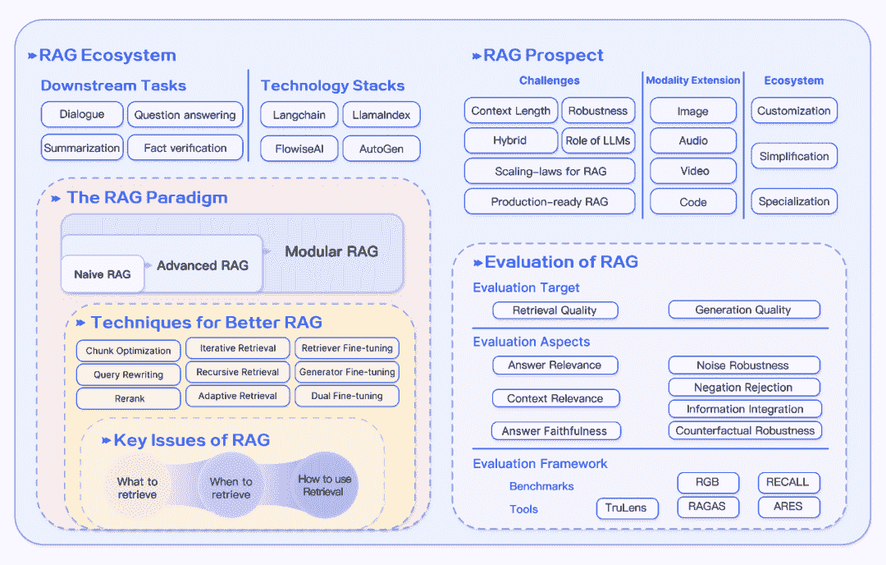

# 一文看懂RAG：大语言模型落地应用的未来

> 来源：[https://agijuejin.feishu.cn/docx/OCtgdJKnToX8Qmx1wxUcT4L1nqf](https://agijuejin.feishu.cn/docx/OCtgdJKnToX8Qmx1wxUcT4L1nqf)

> 作者：产品欧sir

> 原文：https://mp.weixin.qq.com/s/0mzAzXzRtxjuphvt9aGdQA

RAG是什么？为什么要关注RAG？RAG技术为何如此重要？

在看本文之前相信大家都会有这样的疑问，不言而喻对于一个不懂技术或者刚接触大语言模型的肯定都会有点懵的。

下面这篇文本就是对RAG的技术原理、历史发展、应用方法、应用场景和未来的发展方向的完整解读。

> 文本内容源自论文：《Retrieval-Augmented Generation for Large Language Models: A Survey》

首先让GPT回答下上面的问题：

什么是RAG？

"RAG"（Retrieval-Augmented Generation）是一个自然语言处理（NLP）技术，主要用于提高语言模型的效果和准确性。它结合了两种主要的NLP方法：检索（Retrieval）和生成（Generation）。

检索（Retrieval）： 这一部分的工作是从大量的文本数据中检索出与输入问题最相关的信息。它通常使用一个检索系统，比如基于BERT的模型，来在大规模的文档集合（例如维基百科）中寻找与输入相关的文段。

生成（Generation）： 生成部分则使用类似GPT的语言模型，它会根据检索到的信息来生成响应或回答。这个过程涉及理解检索到的内容，并在此基础上生成连贯、相关且信息丰富的文本。

RAG模型的关键在于它结合了这两种方法的优点：检索系统能提供具体、相关的事实和数据，而生成模型则能够灵活地构建回答，并融入更广泛的语境和信息。这种结合使得RAG模型在处理复杂的查询和生成信息丰富的回答方面非常有效。这种技术在问答系统、对话系统和其他需要理解和生成自然语言的应用中非常有用。

## 为什么要关注RAG？

关注RAG（Retrieval-Augmented Generation）的原因在于它在处理复杂自然语言处理（NLP）任务方面的高效性和创新性。以下是几个主要原因：

增强回答的质量和准确性：通过结合检索和生成两种方法，RAG能够提供更准确、详细和具体的回答。这对于需要准确信息的应用（如问答系统、知识库、教育工具）尤其重要。

处理大量和多样化的数据：RAG可以处理和理解庞大的数据集，如维基百科或其他专业数据库。这使得它能够在生成回答时引用广泛的信息源。

提高语言模型的通用性：RAG通过结合现有知识（检索出的数据）和生成能力（语言模型的创造性输出），提高了模型在各种主题和领域中的表现。

创新的研究和应用潜力：作为自然语言处理领域的一个创新点，RAG开启了研究新方法和探索新应用的可能性，比如在个性化内容生成、自动新闻报道、智能助手等方面。

提升用户体验：在用户交互方面，如聊天机器人或虚拟助手，RAG能够提供更自然、连贯且信息丰富的对话体验。

促进自然语言理解的发展：RAG的研究和应用有助于推动整个自然语言处理领域的发展，提高模型在理解复杂语言和上下文方面的能力。

总体来说，RAG代表了NLP领域的一个重要发展方向，其技术进步对许多行业和应用产生了积极影响。

在此之前OpenAI的每次更新都会让很多创业型公司倒闭或者直接停掉之前基于大语言模型的产品创新方向。

OpenAI创始人Sam 奥特曼在YC W24 启动会上的演讲要点如下：

其中有一点也说明了，初创公司真正是落地在LLMs的落地应用层面，而更应用关注的是RAG增强检索能力。做大模型的人都知道微调成本是十分高的，而RAG检索能力会消耗更低的成本并且收获比微调更好的效果！

真正的RAG检索才是轻量级落地场景探索的方向，比如我们最近在做的保险项目就是利用基于大模型的RAG增强检索能力实践的：

---

## RAG发展的四个阶段

大型语言模型（LLMs）如GPT系列在自然语言处理方面取得了显著的成功，Super-GLUE等各种基准测试中表现出色。

尽管有了这些进展，LLMs仍然存在显著的局限性，特别是在处理特定领域或高度专业化的查询时，一个常见问题是产生错误的信息，或者称为“幻觉”。

特别是当查询超出模型的训练数据或需要最新信息时。

所以说在直接将LLMs部署运行到生产环境中时，其就是一个黑盒，鬼知道它会输出什么的结果...

解决这些问题的一种有希望的方法是检索增强生成（RAG），它将外部数据检索整合到生成过程中，从而提高模型提供准确和相关回答的能力。

RAG于2020年中期由Lewis等人提出，是LLMs领域中的一种范式，可增强生成任务。

具体而言，RAG包括一个初始的检索步骤，LLMs在此步骤中查询外部数据源以获取相关信息，然后才回答问题或生成文本。

这个过程不仅为后续的生成阶段提供信息，还确保回答基于检索到的证据，从而显著提高了输出的准确性和相关性。

在推断阶段动态检索来自知识库的信息使RAG能够解决生成事实错误内容的问题，通常被称为“幻觉”。

将RAG整合到LLMs中已经迅速被采用，并成为完善聊天机器人能力和使LLMs更适用于实际应用的关键技术。

RAG的演进轨迹在四个不同阶段展开，如下图所示。

### 2017年创始阶段

在2017年的创始阶段，与Transformer架构的出现相一致，主要重点是通过预训练模型（PTM）来吸收额极的知识以增强语言模型。这个时代见证了RAG的基础工作主要集中在优化预训练方法上。

在这个初始阶段之后，出现了相对沉寂的时期，与RAG相关的研究进展较少。

随后chatGPT的出现标志着LLMs领域的重要时刻，社区的重点转向利用LLMs的能力来实现更高的可控性和解决不断变化的需求。

因此，大部分RAG工作集中在推断上，只有少数工作致力于微调过程。

随着LLMs能力的不断提高，特别是GPT-4的推出，RAG技术的格局发生了重大变化。重点转向了RAG和微调的优势相结合的混合方法，同时也有少数人继续关注优化预训练方法。

尽管RAG研究迅速增长，但该领域缺乏系统的整合和抽象，这使得理解RAG进展的全面情况变得困难。

本论文旨在概述整个RAG过程，并包括当前和未来的RAG研究方向，通过详细考察LLMs中的检索增强来实现这一目标。

因此，本文的目标是全面总结和组织技术原理、发展历史、内容以及尤其是出现LLMs后的相关方法和应用，以及RAG的评估方法、应用场景和未来的发展方向。

## RAG的定义及工作流

下图中展示了一个典型的 RAG 应用工作流程：

用户向 ChatGPT 查询最近引起广泛关注的事件（例如，OpenAI首席执行官的突然解雇和复职），这些事件引发了大量的公众讨论。

作为最著名和广泛使用的LLMs，受限于其预训练数据，ChatGPT缺乏对最新事件的了解。

RAG通过从外部知识库中检索最新的文档摘录来解决这一问题。

在这种情况下，它获取了与查询相关的一些新闻文章。这些文章连同最初的问题被合并成一个丰富的提示，使ChatGPT能够合成一个知情的回答。

这个示例说明了RAG的过程，展示了它通过实时信息检索来增强模型的响应能力。

从技术上讲，RAG已经通过各种创新方法得到丰富，这些方法解决了关键问题，例如“要检索什么”、“何时检索”和“如何使用检索到的信息”。

关于“要检索什么”的研究已经从简单的标记检索和实体检索发展到更复杂的结构，如块和知识图研究重点放在检索的粒度和数据结构的级别上。

粗粒度带来更多的信息，但精度较低。

检索结构化文本提供了更多信息，但效率较低。

关于“何时检索”的问题已经产生了各种策略，从单一检索到自适应检索和多次检索，再到高频率检索的方法。

## RAG增强检索的框架

RAG研究范式不断发展，本节主要描述了其发展过程。我们将其分为三种类型：基础RAG （ Naive RAG） 、高级RAG （ Advanced RAG） 和模块化RAG （ Modular RAG） 。下图简单的说明了这三种RAG的工作流程：

### 基础RAG

基础RAG是检索增强生成（RAG）范式的最早形式之一，其基本概念是将外部检索与大型语言模型（LLMs）的生成能力结合在一起。在基础RAG中，检索通常是基于查询的，并且用于检索外部知识库或数据源中的相关信息。

一旦获得了检索到的信息，它们可以与LLMs的内部知识结合在一起，以生成更准确和相关的文本或回答。

然而，基础RAG虽然在改善LLMs的性能方面取得了一定的成功，但也存在一些限制和不足之处。其中一些主要限制包括：

- 不适应多模态数据：基础RAG主要关注文本数据的检索和生成，对于多模态数据（例如图像、音频）的处理能力有限。
- 缺乏对话性：基础RAG通常是单向生成，难以实现复杂的对话或多轮问答。
- 效率低下：在某些情况下，基础RAG可能需要大量的检索操作，导致效率下降。

由于这些限制，研究人员开始探索更高级的RAG范式，以克服这些问题并提高RAG的性能和适用性。这导致了高级RAG和模块化RAG的发展，这些范式在各种应用中得到了广泛的应用。

### 高级RAG

高级RAG是检索增强生成（RAG）范式的进化形式，其目的是克服基础RAG的一些限制，并进一步提高性能和适用性。

在高级RAG中，研究人员采用了一系列创新性方法和技术，以应对复杂的自然语言处理任务和挑战。

以下是高级RAG的一些关键特点和创新：

- 多模态支持：高级RAG不仅限于文本数据，还可以处理多模态数据，例如图像、音频和视频。这使得高级RAG在各种多媒体应用中具有广泛的用途。
- 对话性增强：高级RAG具备更强大的对话处理能力，可以实现更复杂的对话和多轮问答。这使其在聊天机器人和虚拟助手等应用中表现出色。
- 自适应检索策略：高级RAG引入了更智能的检索策略，可以根据上下文和任务自动调整何时进行检索以及何时使用检索到的信息。这提高了效率和性能。
- 知识融合：高级RAG能够更好地将外部知识与内部知识融合，以生成更具洞察力和相关性的文本。这对于知识密集型任务特别有用。

高级RAG代表了RAG范式的进一步发展，具有更广泛的应用领域和更强大的性能。它在自然语言处理和人工智能领域中取得了重要的突破，并在各种实际应用中得到了广泛的采用。

### 模块化RAG

模块化RAG是检索增强生成（RAG）的另一种演进形式，目的是提供更大的定制性和灵活性，以满足不同应用场景的需求。

与基础RAG和高级RAG相比，模块化RAG更注重将RAG系统分解为各种独立的组件，每个组件负责特定的任务或功能。

以下是模块化RAG的一些关键特点和概念：

- 组件化架构：模块化RAG将RAG系统分解为多个独立的组件，例如检索组件、生成组件和评估组件。这些组件可以根据需要进行组合和替换，以实现定制化的RAG系统。
- 可插拔性：模块化RAG允许研究人员或开发者轻松地添加新的组件或替换现有的组件，以适应不同的任务和数据源。这提高了系统的可扩展性和适应性。
- 自定义管道：模块化RAG允许用户构建自定义的处理管道，根据特定的任务需求配置不同的组件。这使得RAG系统可以灵活地应对各种应用场景。
- 集成外部工具：模块化RAG还支持集成外部工具和资源，例如不同的知识库、检索引擎或生成模型。这扩展了系统的数据和功能来源。

模块化RAG强调了灵活性和可定制性，使研究人员和开发者能够更好地适应不同的应用需求。

这种方法在构建复杂的自然语言处理系统时非常有用，可以根据具体任务的要求构建定制的RAG系统。

## RAG中的核心组件

RAG的核心组件分为三个部分：检索（Retrieval）、增强（Augmentation）、生成（Generation），其分类结构如下图：

### 检索（Retrieval）

检索是检索增强生成（RAG）框架的核心组件之一，它负责从外部数据源或知识库中获取与用户查询相关的信息。

检索的质量和效率对于RAG系统的性能至关重要，因为它直接影响生成的文本或回答的准确性和相关性。

以下是与检索相关的一些关键概念和技术：

- 检索策略：RAG系统需要确定何时进行检索以及如何选择要检索的信息。检索策略可以根据任务和上下文进行调整，以提高系统的效率和性能。
- 检索粒度：检索可以以不同的粒度进行，从单个标记或实体到更大的文本块或知识图。选择适当的检索粒度取决于任务的要求和数据的结构。
- 检索方法：有多种检索方法可供选择，包括基于关键字的检索、实体检索、自然语言查询和知识图检索等。每种方法都有其适用的情境和优势。
- 检索效率：高效的检索是关键因素之一，尤其是在实时应用中。优化检索过程以降低延迟和资源消耗是重要任务之一。
- 外部数据源：RAG系统可以从各种外部数据源中进行检索，包括互联网上的文档、知识库、数据库和API。选择合适的数据源对于获取准确和丰富的信息至关重要。

在RAG框架中，检索与生成和增强技术密切合作，以生成最终的文本或回答。

因此，检索的质量和效率对于整个RAG系统的性能和效果至关重要。

### 增强（Augmentation）

RAG中的增强技术是RAG框架的第三个核心组件，它的作用是进一步提升生成的质量和效果，以确保生成的文本或回答准确、相关且合乎要求。增强技术通过不同方式与检索和生成协同工作，以优化RAG系统的性能。

以下是与RAG中的增强技术相关的一些关键概念和方法：

- 文本修正：增强技术可以用于修正生成的文本，以确保其准确性和合理性。这可以通过自动文本校对、语法纠正和事实验证等方式实现。
- 知识融合：一些RAG系统具备将外部知识融合到生成文本中的能力。这可以通过将检索到的知识与生成的文本进行有机结合来实现。
- 上下文增强：增强技术可以利用上下文信息来优化生成文本的相关性。这包括利用对话历史、用户偏好和任务上下文等信息。
- 控制生成风格：一些RAG系统允许用户控制生成文本的风格、语气和表达方式。这提供了更高度定制化的生成能力。
- 多模态增强：在生成多模态内容时，增强技术可以确保不同模态之间的一致性和相关性，以提供更丰富的用户体验。
- 实时更新：一些RAG系统具备实时更新的能力，可以从外部数据源获取最新信息，并及时反映在生成的文本中。这对于需要及时更新的任务非常重要。

增强技术的选择和应用取决于特定任务和应用场景的要求。通过合理利用增强技术，RAG系统可以提供更具洞察力和相关性的生成文本，从而提高用户满意度和系统的实用性。

### 生成（Generation）

生成是检索增强生成（RAG）框架的另一个核心组件，它负责根据检索到的信息和用户查询生成最终的文本或回答。生成的质量和效果直接影响着RAG系统的性能和可用性。

以下是与生成相关的一些关键概念和技术：

- 生成模型：RAG系统通常使用生成模型来生成文本或回答。这些模型可以是预训练的语言模型（如GPT系列），也可以是其他生成模型。生成模型的选择取决于任务的要求和性能需求。
- 文本生成：生成模型将检索到的信息和用户查询转化为自然语言文本。生成文本的质量取决于模型的能力以及输入信息的准确性和相关性。
- 控制生成：一些RAG系统具备生成文本的控制能力，允许用户指定特定的风格、语气或其他要求。这提供了更高度定制化的生成能力。
- 多模态生成：一些高级RAG系统具备生成多模态内容的能力，包括图像、音频和视频。这拓展了RAG的应用领域。
- 对话生成：一些RAG系统用于对话生成，能够实现复杂的对话和多轮问答。这在聊天机器人和虚拟助手等应用中特别有用。
- 评估生成：生成的质量通常需要经过评估来衡量，以确保生成的文本准确、相关且合乎要求。评估方法和指标对于RAG系统的性能评估至关重要。

在RAG框架中，生成与检索和增强技术协同工作，以生成最终的输出。生成的能力和质量对于RAG系统的整体性能和用户体验至关重要。

## RAG vs. Fine-Tuning

RAG（检索增强生成）与微调（Fine-Tuning）是两种不同的大型语言模（LLM）优化方法，它们在应用和效果上有所不同：

RAG与其他模型优化方法的比较：

### RAG的优势

- 更灵活的知识获取：RAG允许从外部数据源实时检索信息，因此可以获取最新的、领域特定的知识，而微调通常依赖于静态的预训练数据。
- 避免“幻觉”问题：RAG通过检索外部信息来验证生成的文本，可以减少生成不准确信息的问题，这在微调中可能更容易出现。
- 多模态支持：RAG可以轻松支持多模态内容的生成，包括文本、图像、音频等，而微调通常专注于文本生成。

### 微调的优势

- 更高的一致性：微调通常可以生成更一致的文本，因为它基于预训练模型，而RAG的一致性取决于检索的准确性。
- 更广泛的应用：微调适用于各种自然语言处理任务，包括文本分类、命名实体识别、情感分析等，而RAG更侧重于生成任务。
- 训练效率：微调可以比RAG更高效，因为不需要在每个查询上进行检索操作。

总的来说，RAG和微调各有其优势和适用场景。选择哪种方法取决于具体的任务需求和性能要求。未来的发展可能会探索两种方法的结合，以充分利用它们的优势，并改进大型语言模型的性能。

## RAG系统的评估

RAG（检索增强生成）系统的评估是确保其性能和效果的关键步骤。这里将介绍RAG系统的评估方法和指标，以帮助衡量其生成文本或回答的质量和相关性。

以下是与RAG评估相关的一些关键概念和方法：

- 生成质量评估：评估RAG生成的文本的质量是重要任务之一。常用的评估方法包括自动评估指标（如BLEU、ROUGE等）、人工评估和事实验证。这些方法可以帮助衡量生成文本的流畅性、准确性和相关性。
- 检索效果评估：评估RAG检索的效果是另一个关键方面。这包括检索的准确性、召回率和效率。检索效果的好坏直接影响生成文本的质量。

## 评估维度与方法

### 用户满意度评估

了解用户对RAG系统的满意度和体验也是重要的评估维度。这可以通过用户调查、用户反馈和用户交互数据来实现。

### 多模态评估

对于生成多模态内容的RAG系统，评估方法需要考虑不同模态之间的一致性和相关性。这可以通过多模态评估指标来实现。

### 实时性评估

对于需要实时更新的RAG任务，评估方法需要考虑信息更新的及时性和效率。

### 基准测试集

为了进行客观的评估，通常会使用基准测试集来进行实验和比较不同的RAG系统。这些基准测试集包含了多样化的任务和查询，以涵盖不同的应用场景。

评估方法和指标的选择取决于具体的任务和应用场景。综合使用多种评估方法可以更全面地了解RAG系统的性能和效果。评估结果可以指导系统的改进和优化，以满足用户的需求。

# 未来展望

RAG（检索增强生成）技术在不断发展和演进，未来有许多潜在的发展方向和前景。

## 挑战识别和解决

未来的研究可以致力于识别和解决RAG技术面临的挑战，特别是在知识检索、生成文本质量和多模态支持方面的挑战。这包括改进检索准确性、提高生成文本的一致性和深化多模态整合。

## 多模态扩展

随着多模态内容的需求不断增长，未来的研究可以探索如何更好地支持多模态生成，包括文本、图像、音频等。这涉及到跨模态信息的有效整合和生成技术的改进。

## 实时知识更新

对于需要及时更新的任务，未来的研究可以集中在如何实现实时知识检索和更新，以确保生成的文本始终保持最新和准确。

## 增强RAG生态系统

RAG技术的发展可以促进建立更加完善的RAG生态系统，包括更多的开源工具、资源和应用场景。这将有助于更广泛地推广和应用RAG技术。

## 融合知识图谱

未来的研究可以考虑如何更好地融合知识图谱等结构化知识源，以进一步提高RAG系统的性能和效果。

总的来说，RAG技术具有广阔的研究前景和应用前景。未来的研究将继续探索新的方法和技术，以不断改进和扩展RAG系统的功能和性能，从而更好地满足各种知识密集型任务和应用场景的需求。

# 结论

RAG技术已经成为大型语言模型（LLM）领域的重要技术之一，通过将外部知识检索与文本生成相结合，可以显著提高模型的性能和可用性。

RAG技术的发展经历了不同阶段，包括Naive RAG、Advanced RAG和Modular RAG，每个阶段都有不同的特点和优势。

RAG技术的核心组成部分包括检索、生成和增强，这些组成部分相互协作，形成一个有效的RAG框架。

评估RAG系统的方法和指标包括生成质量评估、检索效果评估、用户满意度评估等多个方面，综合考虑这些方面可以更全面地评估系统的性能。

未来的研究方向包括解决RAG技术面临的挑战、扩展到多模态内容、实现实时知识更新和建立更完善的RAG生态系统。

RAG技术具有广阔的发展前景和应用潜力，可以在各种知识密集型任务和应用场景中发挥重要作用。

通过不断的研究和创新，RAG技术将进一步提高大型语言模型的性能和可用性，推动自然语言处理领域的发展。

---

更多优质项目和实战案例可加入星球查看

