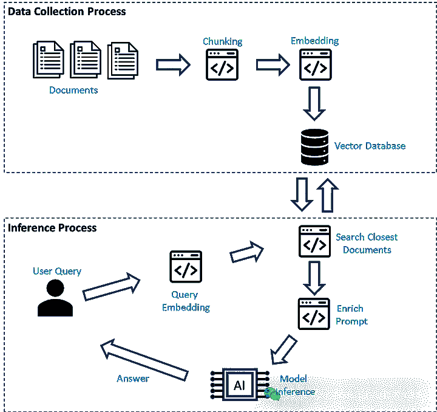
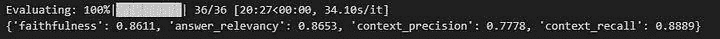
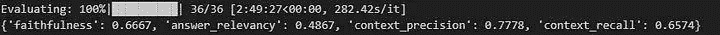
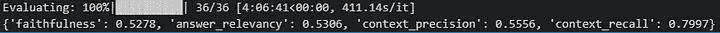
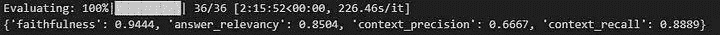

# RAG流程优化（微调）的4个基本策略

> 来源：[https://agijuejin.feishu.cn/docx/QBreda7HBoKYwnxUW3ocU2etnbh](https://agijuejin.feishu.cn/docx/QBreda7HBoKYwnxUW3ocU2etnbh)

> 作者：P**nHub兄弟网站 | DeepHub IMBA

> 原文：https://mp.weixin.qq.com/s/r_NLZxmAI7G58JGgHKFNbg

在本文中，我们将介绍使用私有数据优化检索增强生成(RAG)的四种策略，可以提升生成任务的质量和准确性。通过使用一些优化策略，可以有效提升检索增强生成系统的性能和输出质量，使其在实际应用中能够更好地满足需求。

## RAG简单回顾

RAG主要有两个过程。第一个是“数据收集过程”，它收集来自不同来源的数据，将其转换为文本，将其分割成较小的、连贯的和语义相关的部分，并将结果存储在矢量数据库中。第二个是“推理过程”，它从用户查询开始，然后使用第一个过程的结果来识别相关的数据块，最后丰富模型的上下文以获得输出。



我们先总结RAG过程中的可以优化的关键点:

1、分块方法:优化块大小确保有意义和上下文相关的数据段。

2、嵌入模型:选择和微调模型以改进语义表示。

3、向量搜索方法:选择有效的相似度量和搜索参数。

4、提供模型的最后提示:制作有效提示以提高输出质量。

## RAG的A/B测试

A/B测试可以比较每个组件具有不同配置的两个版本，确定哪个版本的性能更好。它分别运行两个版本，并根据预定义的指标测量它们的性能。那么我们如何衡量指标呢?什么指标?为了回答这个问题，我们使用了论文“RAGAS: Automated Evaluation of Retrieval Augmented Generation”种提出了三个关键指标:

真实性:检查答案中的信息是否与上下文给出的信息相匹配。如果答案所说的一切都可以直接从上下文中找到或推断出来，那么答案就是可靠的。

相关性:检查生成的答案是否完整，并直接回答所问的问题。信息是否正确无关紧要。例如，如果问题是“葡萄牙的首都是什么?”，答案是“里斯本是葡萄牙的首都”，这个答案是相关的，因为它直接回答了这个问题。如果答案是“里斯本是一个美丽的城市，有很多景点”，它可能是部分相关的，但包含了回答问题不直接需要的额外信息。这个指标确保了答案的重点和切中要害。

上下文相关性:检查上下文提供的信息在多大程度上有助于回答问题。这个指标可以确保只包括必要的和相关的细节，并删除任何额外的、不相关的、无助于直接回答问题的信息。该指标确保所提供的信息对回答问题有直接帮助，避免了不必要的细节。这个度量也被称为上下文精度。

除此以外，还添加了一个新指标:

上下文召回:这个指标衡量上下文和实际答案之间的一致性，与上下文相关性相同;但是，使用的不是生成的答案，而是实际的答案。一个基本真理是得到这个度规所必需的。为了评估这些策略的有效性，我根据ColdF的数据准备了一套10个带有实际答案的问题。

真实性和答案相关性是生成器度量标准，分别衡量幻觉和答案对问题的直接程度。

上下文相关性和上下文召回是检索度量，分别度量从向量数据库检索正确数据块和获得所有必要信息的能力。

下面开始使用`LangChain`来实现RAG流程，我们先安装库:

```
 pip install ollama==0.2.1
 pip install chromadb==0.5.0
 pip install transformers==4.41.2
 pip install torch==2.3.1
 pip install langchain==0.2.0
 pip install ragas==0.1.9
```

下面是使用`LangChain`的代码片段:

```
 # Import necessary libraries and modules
 from langchain.embeddings.base import Embeddings
 from transformers import BertModel, BertTokenizer, DPRQuestionEncoder, DPRQuestionEncoderTokenizer, RobertaModel, RobertaTokenizer
 from langchain.prompts import ChatPromptTemplate
 from langchain_text_splitters import MarkdownHeaderTextSplitter
 import requests
 from langchain_chroma import Chroma
 from langchain import hub
 from langchain_core.runnables import RunnablePassthrough
 from langchain_core.output_parsers import StrOutputParser
 from langchain_community.chat_models import ChatOllama
 from operator import itemgetter
 
 # Define a custom embedding class using the DPRQuestionEncoder
 class DPRQuestionEncoderEmbeddings(Embeddings):
    show_progress: bool = False
    &quot;&quot;&quot;Whether to show a tqdm progress bar. Must have `tqdm` installed.&quot;&quot;&quot;
     
    def __init__(self, model_name: str = &#x27;facebook/dpr-question_encoder-single-nq-base&#x27;):
        # Initialize the tokenizer and model with the specified model name
        self.tokenizer = DPRQuestionEncoderTokenizer.from_pretrained(model_name)
        self.model = DPRQuestionEncoder.from_pretrained(model_name)
         
    def embed(self, texts):
        # Ensure texts is a list
        if isinstance(texts, str):
            texts = [texts]
         
        embeddings = []
        if self.show_progress:
            try:
                from tqdm import tqdm
                iter_ = tqdm(texts, desc=&quot;Embeddings&quot;)
            except ImportError:
                logger.warning(
                    &quot;Unable to show progress bar because tqdm could not be imported. &quot;
                    &quot;Please install with `pip install tqdm`.&quot;
                )
                iter_ = texts
        else:
            iter_ = texts
 
        for text in iter_:
            # Tokenize the input text
            inputs = self.tokenizer(text, return_tensors=&#x27;pt&#x27;)
            # Generate embeddings using the model
            outputs = self.model(**inputs)
            # Extract the embedding and convert it to a list
            embedding = outputs.pooler_output.detach().numpy()[0]
            embeddings.append(embedding.tolist())
         
        return embeddings
     
    def embed_documents(self, documents):
        return self.embed(documents)
     
    def embed_query(self, query):
        return self.embed([query])[0]
 
 # Define a template for generating prompts
 template = &quot;&quot;&quot;
 ### CONTEXT
 {context}
 
 ### QUESTION
 Question: {question}
 
 ### INSTRUCTIONS
 Answer the user&#x27;s QUESTION using the CONTEXT markdown text above.
 Provide short and concise answers.
 Base your answer solely on the facts from the CONTEXT.
 If the CONTEXT does not contain the necessary facts to answer the QUESTION, return &#x27;NONE&#x27;.
 &quot;&quot;&quot;
 
 # Create a ChatPromptTemplate instance using the template
 prompt = ChatPromptTemplate.from_template(template)
 
 # Fetch text data from a URL
 url = &quot;https://raw.githubusercontent.com/cgrodrigues/rag-intro/main/coldf_secret_experiments.txt&quot;
 response = requests.get(url)
 if response.status_code == 200:
    text = response.text
 else:
    raise Exception(f&quot;Failed to fetch the file: {response.status_code}&quot;)
 
 # Define headers to split the markdown text
 headers_to_split_on = [
    (&quot;#&quot;, &quot;Header 1&quot;)
 ]
 
 # Create an instance of MarkdownHeaderTextSplitter with the specified headers
 markdown_splitter = MarkdownHeaderTextSplitter(
    headers_to_split_on, strip_headers=False
 )
 
 # Split the text using the markdown splitter
 docs_splits = markdown_splitter.split_text(text)
 
 # Initialize a chat model
 llm = ChatOllama(model=&quot;llama3&quot;)
 
 # Create a Chroma vector store from the documents using the custom embeddings
 vectorstore = Chroma.from_documents(documents=docs_splits, embedding=DPRQuestionEncoderEmbeddings())
 
 # Create a retriever from the vector store
 retriever = vectorstore.as_retriever()
 
 # Define a function to format documents for display
 def format_docs(docs):
    return &quot;\n\n&quot;.join(doc.page_content for doc in docs)
 
 # Create a retrieval-augmented generation (RAG) chain
 rag_chain = (
    {&quot;context&quot;: retriever | format_docs, &quot;question&quot;: RunnablePassthrough()}
    | RunnablePassthrough.assign(context=itemgetter(&quot;context&quot;))
    | {&quot;answer&quot;: prompt | llm | StrOutputParser(),
        &quot;context&quot;: itemgetter(&quot;context&quot;)}
 )
 
 # Invoke the RAG chain with a question
 result = rag_chain.invoke(&quot;Who led the Experiment 1?&quot;)
 print(result)
```

使用下面代码来评估指标:


```
# Import necessary libraries and modules
 import pandas as pd
 from datasets import Dataset
 from ragas import evaluate
 from ragas.metrics import (
        context_precision,
        faithfulness,
        answer_relevancy,
        context_recall
 )
 from langchain_community.chat_models import ChatOllama
 
 def get_questions_answers_contexts(rag_chain):
    """ Read the list of questions and answers and return a
        ragas dataset for evaluation """
    # URL of the file
    url = 'https://raw.githubusercontent.com/cgrodrigues/rag-intro/main/coldf_question_and_answer.psv'
 
    # Fetch the file from the URL
    response = requests.get(url)
    data = response.text
   
    # Split the data into lines
    lines = data.split('\n')
 
    # Split each line by the pipe symbol and create tuples
    rag_dataset = []
 
    for line in lines[1:10]: # Only 10 first questions
        if line.strip(): # Ensure the line is not empty
            question, reference_answer = line.split('|')
            result = rag_chain.invoke(question)
            generated_answer = result['answer']
            contexts = result['context']
 
            rag_dataset.append({
                "question": question,
                "answer": generated_answer,
                "contexts": [contexts],
                "ground_truth": reference_answer
            })
 
           
    rag_df = pd.DataFrame(rag_dataset)
    rag_eval_datset = Dataset.from_pandas(rag_df)
     
    # Return the lragas dataset
    return rag_eval_datset
 
 def get_metrics(rag_dataset):
    """ For a RAG Dataset calculate the metrics faithfulness,
        answer_relevancy, context_precision and context_recall """
    # The list of metrics that we want to evaluate
    metrics = [
        faithfulness,
        answer_relevancy,
        context_precision,
        context_recall
    ]
         
    # We will use our local ollama with the LLaMA 3 model
    langchain_llm = ChatOllama(model="llama3")
    langchain_embeddings = DPRQuestionEncoderEmbeddings('facebook/dpr-question_encoder-single-nq-base')
 
    # Return the metrics
    results = evaluate(rag_dataset, metrics=metrics, llm=langchain_llm, embeddings=langchain_embeddings)
    return results
 
 # Get the RAG dataset
 rag_dataset = get_questions_answers_contexts(rag_chain)
 
 # Calculate the metrics
 results = get_metrics(rag_dataset)
 print(results)
```

如果你的代码正常运行了，应该返回下面这样的结果

```
{
   'faithfulness': 0.8611, 
   'answer_relevancy': 0.8653, 
   'context_precision': 0.7778, 
   'context_recall': 0.8889
}
```



前两个指标与模型相关，要改进这些指标，有必要更改语言模型或为模型提供信息的提示；后两个指标与检索相关，要改进这些指标，有必要研究文档的存储、索引和选择方式。

下面我们开始进行改进

## 分块

分块方法确保数据被分割成最优的检索段。对不同块大小进行实验，以在太小(缺少上下文)和太大(检索系统冗余)之间找到平衡。在基线中，我们根据每个实验对文档进行分组;这意味着实验的某些部分可能会被稀释，而不会在最终的嵌入中表现出来。解决这种情况的一种方法是使用父文档检索器。这个方法不仅检索特定的相关文档片段或段落，还检索它们的父文档。这种方法确保了相关片段周围的上下文得到保存。下面的代码用于测试这种方法:

```
# Import necessary libraries and modules
 from langchain.retrievers import ParentDocumentRetriever
 from langchain.storage import InMemoryStore
 from langchain.text_splitter import RecursiveCharacterTextSplitter
 
 
 # Create the parent document retriever
 parent_document_retriever = ParentDocumentRetriever(
    vectorstore = Chroma(collection_name="parents",
                          embedding_function=DPRQuestionEncoderEmbeddings('facebook/dpr-question_encoder-single-nq-base')),
    docstore = InMemoryStore(),
    child_splitter = RecursiveCharacterTextSplitter(chunk_size=200),
    parent_splitter = RecursiveCharacterTextSplitter(chunk_size=1500),
 )
 
 parent_document_retriever.add_documents(docs_splits)
 
 
 # Create a retrieval-augmented generation (RAG) chain
 rag_chain_pr = (
    {"context": parent_document_retriever | format_docs, "question": RunnablePassthrough()}
    | RunnablePassthrough.assign(context=itemgetter("context"))
    | {"answer": prompt | llm | StrOutputParser(),
        "context": itemgetter("context")}
 )
 
 # Get the RAG dataset
 rag_dataset = get_questions_answers_contexts(rag_chain_pr)
 
 # Calculate the metrics
 results = get_metrics(rag_dataset)
 print(results)
```

结果如下：



这种改变降低了性能，通过指标我们可以看到，上下文召回率下降表明检索过程不正确，上下文没有完整的信息。真实性和答案相关性度量的变化源于复杂的上下文。所以我们需要尝试其他的分块和检索方法

## 嵌入模型

嵌入模型将文本块转换为密集的向量表示。不同的模型可以在不同的主题上进行训练，选择一个正确的模型可以改进嵌入。嵌入方法的选择应考虑计算效率和嵌入质量之间的平衡。

这里比较了不同的嵌入模型，如`Dense Passage Retrieval`，`Sentence-BERT`，或`Chroma`的默认模型(`all-MiniLM-L6-v2`。每个模型都有自己的长处，在特定于领域的数据上对它们进行评估有助于确定哪个模型提供了最准确的语义表示。

我们定义一个新类`SentenceBertEncoderEmbeddings`。这个新类实现了模型`Sentence-BERT`模型。这个新类将取代我们之前的嵌入，`DPRQuestionEncoderEmbeddings`，

```
# Import necessary libraries and modules
 import pandas as pd
 from datasets import Dataset
 from ragas import evaluate
 from ragas.metrics import (
        context_precision,
        faithfulness,
        answer_relevancy,
        context_recall
 )
 from langchain_community.chat_models import ChatOllama
 from sentence_transformers import SentenceTransformer
 
 
 # Define a custom embedding class using the DPRQuestionEncoder
 class SentenceBertEncoderEmbeddings(Embeddings):
    show_progress: bool = False
    """Whether to show a tqdm progress bar. Must have `tqdm` installed."""
     
    def __init__(self, model_name: str = 'paraphrase-MiniLM-L6-v2'):
        # Initialize the tokenizer and model with the specified model name
        self.model = SentenceTransformer(model_name)
         
    def embed(self, texts):
        # Ensure texts is a list
        if isinstance(texts, str):
            texts = [texts]
         
        embeddings = []
        if self.show_progress:
            try:
                from tqdm import tqdm
                iter_ = tqdm(texts, desc="Embeddings")
            except ImportError:
                logger.warning(
                    "Unable to show progress bar because tqdm could not be imported. "
                    "Please install with `pip install tqdm`."
                )
                iter_ = texts
        else:
            iter_ = texts
 
        for text in iter_:
            embeddings.append(self.model.encode(text).tolist())
         
        return embeddings
     
    def embed_documents(self, documents):
        return self.embed(documents)
     
    def embed_query(self, query):
        return self.embed([query])[0]
 
 
 # Create a Chroma vector store from the documents using the custom embeddings
 vectorstore = Chroma.from_documents(documents=docs_splits, embedding=SentenceBertEncoderEmbeddings())
 
 # Create a retriever from the vector store
 retriever = vectorstore.as_retriever()
 
 # Create a retrieval-augmented generation (RAG) chain
 rag_chain_ce = (
    {"context": retriever | format_docs, "question": RunnablePassthrough()}
    | RunnablePassthrough.assign(context=itemgetter("context"))
    | {"answer": prompt | llm | StrOutputParser(),
        "context": itemgetter("context")}
 )
 
 # Get the RAG dataset
 rag_dataset = get_questions_answers_contexts(rag_chain_ce)
 
 # Calculate the metrics
 results = get_metrics(rag_dataset)
 print(results)
```

结果如下：



可以看到性能也下降了。这是因为`DPR`具有比`Sentence-BERT`更高的检索精度，使其更适合我们的情况，其中精确的文档检索是至关重要的。当切换到`Sentence-BERT`时，“真实性”和“答案相关性”指标的显著下降突出了为要求高检索精度的任务选择合适的嵌入模型的重要性。同时也说明不同类型的RAG任务可能需要特定领域的嵌入模型。

## 向量搜索方法

向量搜索方法基于相似性度量检索最相关的块。常用的方法包括欧几里得(L2)距离、余弦相似度等。改变这种搜索方法可以提高最终输出的质量。

代码如下:


```
# Import necessary libraries and modules
 import pandas as pd
 from datasets import Dataset
 from ragas import evaluate
 from ragas.metrics import (
        context_precision,
        faithfulness,
        answer_relevancy,
        context_recall
 )
 from langchain_community.chat_models import ChatOllama
 
 # Create a Chroma vector store from the documents
 # using the custom embeddings and also changing to
 # cosine similarity search
 vectorstore = Chroma.from_documents(collection_name=&quot;dist&quot;,
                                    documents=docs_splits,
                                    embedding=DPRQuestionEncoderEmbeddings(),
                                    collection_metadata={&quot;hnsw:space&quot;: &quot;cosine&quot;})
 
 # Create a retriever from the vector store
 retriever = vectorstore.as_retriever()
 
 # Create a retrieval-augmented generation (RAG) chain
 rag_chain_dist = (
    {&quot;context&quot;: retriever | format_docs, &quot;question&quot;: RunnablePassthrough()}
    | RunnablePassthrough.assign(context=itemgetter(&quot;context&quot;))
    | {&quot;answer&quot;: prompt | llm | StrOutputParser(),
        &quot;context&quot;: itemgetter(&quot;context&quot;)})
 
 # Get the RAG dataset
 rag_dataset = get_questions_answers_contexts(rag_chain_dist)
 
 # Calculate the metrics
 results = get_metrics(rag_dataset)
 print(results)
```



可以看到“真实性”得到了提高，使用余弦相似度进行向量搜索增强了检索文档与查询的对齐，即使“上下文精度”降低了。总体上较高的“信度”和“上下文召回率”表明余弦相似度在这种情况下是一种更有效的向量搜索方法，支持向量搜索方法选择在优化检索性能方面的重要性。

## 输入模型的最后提示

最后的提示构造涉及到将检索到的数据集成到模型的查询中。提示符中的微小变化会显著影响结果，使其成为一个反复试验的过程。在提示中提供示例可以引导模型获得更准确和相关的输出，提示词的修改不涉及代码的改变，所以这里我们就不进行演示了

## 总结

优化检索增强生成(RAG是一个迭代过程，它在很大程度上取决于应用程序的特定数据和上下文。我们探讨了四种关键优化方向:细化分块方法、选择和微调嵌入模型、选择有效的向量搜索方法以及制作精确的提示。这些组件中的每一个都在提高RAG系统的性能方面起着至关重要的作用。

优化RAG的过程是需要持续的测试的，从失败中学习，以及做出明智的调整。需要采用迭代方法，才能定制出适合自己的AI解决方案，更有效地满足特定需求。还有最重要的一点成功的关键在于理解现有的数据，尝试不同的策略，并不断改进的流程。

---

### MORE

kaggle比赛交流和组队

加我的🛰️，邀你进群


