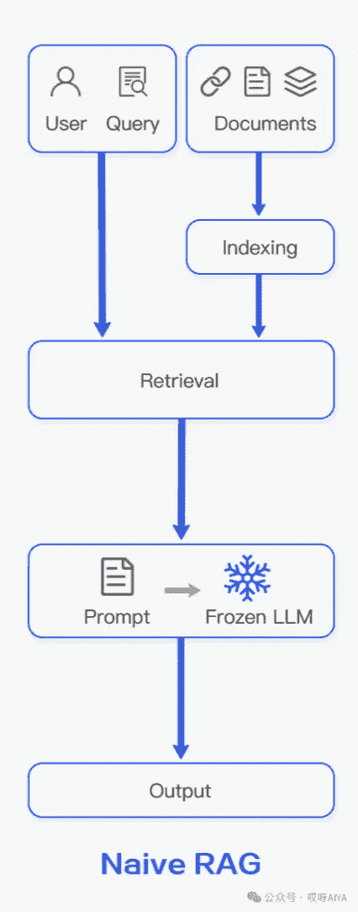

# 搭建RAG系统就这么简单：LangChain|RAG是什么？

> 来源：[https://agijuejin.feishu.cn/docx/Q0ejdcQ7soT2d8xqy7FcBCCCn9f](https://agijuejin.feishu.cn/docx/Q0ejdcQ7soT2d8xqy7FcBCCCn9f)

> 作者：哎呀AIYA

> 原文：https://mp.weixin.qq.com/s/xA-_4szPnYM_D1jK3kRyxQ

hi！这里是一个专注大模型应用的频道，介绍大模型基础、创作、RAG、Agent，每天学习一小点LLM不再迷惑，欢迎关注！


# **RAG是什么**

"RAG"（Retrieval-Augmented Generation）是一种结合了检索（Retrieval）和生成（Generation）的人工智能技术，它在大模型中被需要的原因包括：

**知识丰富性： **大模型通过RAG可以访问大量的外部知识库，这有助于提高模型回答问题的准确性和深度。

**实时信息获取： **由于大模型通常是在大量数据上预训练的，它们可能不包含最新的信息。RAG可以通过检索最新的数据来弥补这一点。

**减少偏见和错误： ** 通过检索可靠的信息源，RAG有助于减少模型生成的偏见或错误信息。

**提高泛化能力： **RAG可以使模型在面对未见过的问题或领域时，通过检索相关信息来提高其泛化能力。

**应对长尾问题： **对于那些低频或非常规的问题，RAG可以通过检索来提供更加准确的答案，而不需要模型在训练数据中直接学习到。

RAG是一种强大的技术，它通过结合检索和生成的优势，使得大模型能够提供更加准确、丰富和及时的信息。随着技术的发展，RAG在大模型中的应用将继续扩展，以满足不断增长的复杂性和多样性需求。

基础的RAG任务包含以下模块，包括：数据读取处理，Index，检索，prompt拼接，大模型推理。如下图所示：



# **环境搭建**

在搭建RAG系统中，我们将使用到以下包：

+

```
pip install langchain_community tiktoken langchain-openai langchainhub chromadb langchain
```

# **数据读取 **

我们使用 WebBaseLoader模块处理数据，它采用urllib从 Web URL 加载 HTML 并使用BeautifulSoup解析出文本。

```
import bs4
from langchain_community.document_loaders import WebBaseLoader
loader = WebBaseLoader(
    web_paths=(&quot;https://data.eastmoney.com/report/zw_stock.jshtml?encodeUrl=35LdZWW1ERIe7AWLlyVZFHptPNDUH2qN4gEfzUIhYsc=&quot;,
               &quot;https://data.eastmoney.com/report/zw_stock.jshtml?encodeUrl=OPw8X34UDWQq6g0u70KgHW6e5Ad8C5kc3TYV6t9BZsw=&quot;,
               &quot;https://data.eastmoney.com/report/zw_stock.jshtml?encodeUrl=OPw8X34UDWQq6g0u70KgHbx8/qX6gdD4f6j3/4IEWIA=&quot;
    ),
    bs_kwargs=dict(
        parse_only=bs4.SoupStrainer(
            class_=(&quot;detail-header&quot;, &quot;newsContent&quot;)  # 根据网页信息不同调整需要保留的字段
        )
    ),
)
blog_docs = loader.load()  # 数据读取
```

# **文本切块**

我们将文档拆分为 512 个字符的块，块之间有 128个字符的重叠。重叠有助于降低当前文本与其相关的上下文分离的概率。我们使用 RecursiveCharacterTextSplitter ，它将使用常用分隔符（如换行符）递归拆分文档，直到每个块的大小合适。

```
# Split
from langchain.text_splitter import RecursiveCharacterTextSplitter
text_splitter = RecursiveCharacterTextSplitter.from_tiktoken_encoder(
    chunk_size=512,
    chunk_overlap=128)

# Make splits
splits = text_splitter.split_documents(blog_docs)
```

# **创建 索引（Indexing）**

这个模块首先创建一个向量模块向量模型可以随意选择，后面将介绍怎么选择向量模型，本篇采用了 OpenAIEmbeddings() ； 然后创建一个向量库，用于储存文本和文本向量：

```
# Index
from langchain_openai import OpenAIEmbeddings
from langchain_community.vectorstores import Chroma
vectorstore = Chroma.from_documents(documents=splits,
                                    embedding=OpenAIEmbeddings())
```

# **创建检索器**

构建一个检索器，用于通过向量相似度检索片段，检索召回是整个系统的关键，决定了结果的上限：

```
retriever = vectorstore.as_retriever(search_type=&quot;similarity&quot;, search_kwargs={&quot;k&quot;: 6}))

# 测试一下检索的片段
retrieved_docs = retriever.invoke(&quot;东方财富营收是多少&quot;)
len(retrieved_docs)
```

# **创建模型**

在这个部分，我们将创建两个模块，一是PROMPT模板，这个是根据任务来确定，相同的模型一个好的prompt会得到更好的结果；二是大模型模块，这个是整个系统的中央大脑，决定着整个系统是否智能，例子中使用的gpt-3.5-turbo，使用自己的模型可以看这篇文章 RAG：Langchain中使用自己的LLM大模型 ；

```
from langchain import hub
from langchain_openai import ChatOpenAI

prompt = hub.pull(&quot;rlm/rag-prompt&quot;)
# LLM
llm = ChatOpenAI(model_name=&quot;gpt-3.5-turbo&quot;, temperature=0.01)
```

# **RAG生成流程**

前面已经构建好了索引、检索器、PROMPT模板和大模型，现在我们需要将整个过程组合起来：

```
from langchain_core.output_parsers import StrOutputParser
from langchain_core.runnables import RunnablePassthrough

# 文本片段组合
def format_docs(docs):
    return &quot;\n\n&quot;.join(doc.page_content for doc in docs)


rag_chain = (
    {&quot;context&quot;: retriever | format_docs, &quot;question&quot;: RunnablePassthrough()}
    | prompt
    | llm
    | StrOutputParser()
)

for chunk in rag_chain.stream(&quot;东方财富的营收是多少&quot;):
    print(chunk, end=&quot;&quot;, flush=True)
```

至此，我们完成了一个简单的RAG系统搭建，根据PROMPT的不同，我们可以针对我们的知识库做不同的任务，可以是问答、也可以是创作；通过知识库的辅助，我们的结果会更加的精确。

如果对内容有什么疑问和建议可以私信和留言，也可以添加我加入大模型交流群，一起讨论大模型在创作、RAG和agent中的应用。

**往期推荐**

+   RAG：Langchain中使用自己的LLM大模型

+    详解GPT-4o的收费设计，为什么输出token贵？

+   大模型LLM的定位器Attention自注意力|兼看Qwen2参数构成

+    一文读懂token到底是什么鬼，消耗那么多钱？