# 一文读懂RAG的来源、发展和前沿

> 来源：[https://agijuejin.feishu.cn/docx/Tl06dyPqfo3rYbxTnbrcE94gnHf](https://agijuejin.feishu.cn/docx/Tl06dyPqfo3rYbxTnbrcE94gnHf)

> 作者：Frank Guan | 深度学习自然语言处理

> 原文： [https://mp.weixin.](https://mp.weixin.qq.com/s/n98IZHs7LTXMzzS3KmHvrA)qq.com/s/n98IZHs7...

检索增强生成(Retrieval Augmented Generation，RAG)结合了检索 (Retrieval) 和生成 (Generation) 两个过程，旨在提高机器生成文本的相关性、准确性和多样性。RAG通过在生成文本输出之前先检索大量相关信息，然后将这些检索到的信息作为上下文输入到一个生成模型中，从而缓解了幻觉问题。

## ** 幻觉——大模型面临的困境**

纯生成模型，尤其是基于大语言模型的生成模型，虽然在生成连贯、流畅的文本方面表现出色，但它们有时会产生与事实不符的信息。这种现象被称为幻觉（hallucination）。幻觉的产生通常是由于模型在训练过程中学习到的信息是不完整的，或者模型在尝试生成看似合理但实际上并非基于真实信息的内容时过度自信。

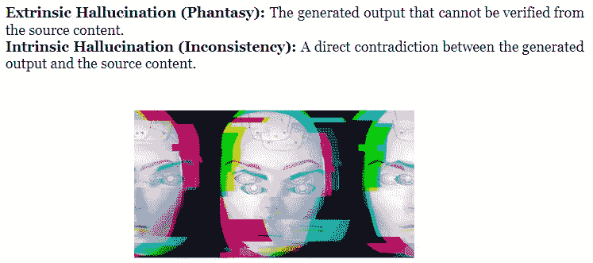

幻觉的问题也暗示了大模型是一个黑匣子（black box），在没有额外保障措施的情况下在现实环境中部署大模型是不切实际的。

## ** 如何解决幻觉问题？**

针对幻觉问题，前人尝试了不同方式去缓解。以下为几种常见的解决方案：

（1）预定义的输入模板（Pre-defined input templates）

创建预定义的模板（例如提示模板和问题模板），让用户以更有利于模型理解的方式构建查询。经证明，这样可以提高查询的精确度。下面是langchain预定义模板的例子：

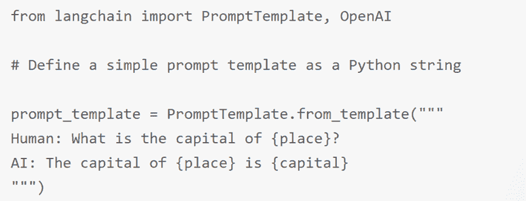

（2）推理（Reasoning）

Chain-of-Thought (CoT)推理是一种用于提高大型语言模型在解决复杂问题上的性能的方法，尤其是那些需要多步骤推理的问题。它通过引导模型生成一系列解释性的中间步骤来解决问题，而不是直接生成最终答案。这种方法不仅可以提高答案的准确性，也可以在一定程度上缓解幻觉问题。

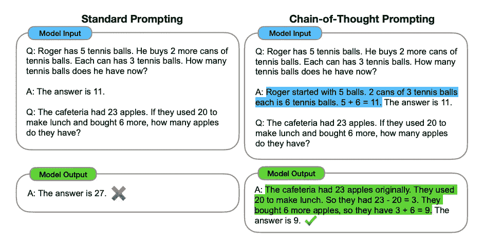

（3）反馈（Feedback）

Reinforcement Learning from Human Feedback (RLHF) 是一种改进大型语言模型性能的方法，通过结合人类反馈和强化学习来微调模型。这个方法可以让人类评估者通过负反馈直接指出错误，对于解决生成模型中的幻觉问题特别有效。

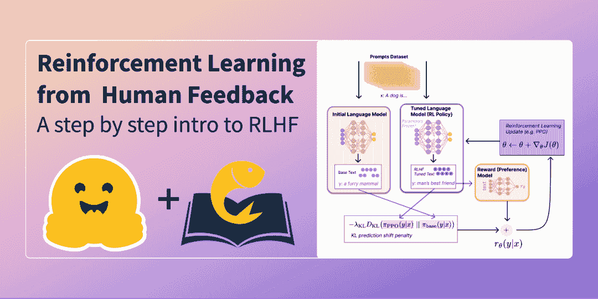

（4）模型配置（Model configuration and behavior）

生成的输出受各种模型参数的影响很大，例如温度、top-p等。较高的温度值可促进随机性和创造性，而较低的温度值可使输出更具确定性。这些参数提供了微调的灵活性，并实现了生成多样化响应和确保准确性之间的平衡。

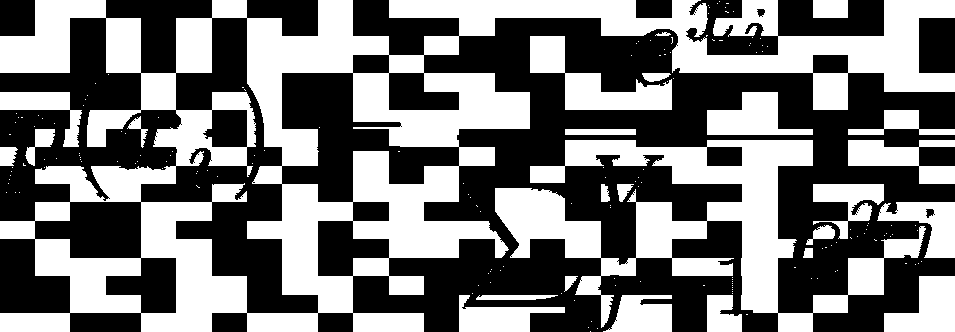

（5）迭代查询（Iteration）

AI代理（agent）会在大语言模型中进行迭代查询。迭代多次可以帮助我们得到最佳答案。当用户提出一个问题，大语言模型会在知识库中查询类似的问题。然后，用所有问题查询向量数据库，总结答案，并检查答案是否看起来合理。如果没有合理答案会重复这些步骤，直到出现为止。

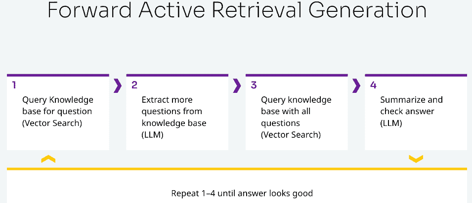

## ** 检索增强生成**

检索增强生成（RAG）是一种使用外部数据源的信息辅助文本生成的技术。它是将检索与生成结合的实践，通过访问外部数据库检索得到有关的信息（通常以chunk形式返回所需信息）。把检索得到的信息与用户源问题合并为提示，让大语言模型从包含外部信息的提示中学习知识（in-context learning）并生成正确答案。[Lewis et al., 2020]

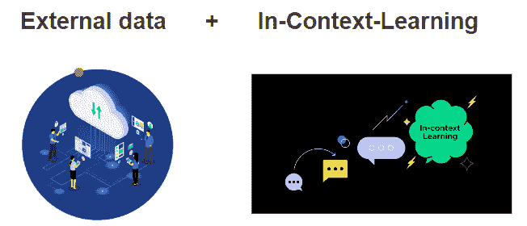

用户向大语言模型询问最近备受瞩目的事件（例如OpenAI和Elon Mask）。由于大模型受其预训练数据的限制，缺乏对近期事件的了解。检索增强生成模型通过从外部知识库检索最新文档摘录弥补了这一差距。例如，它获取到了与调查相关的新闻文章。然后将这些文章与最初的问题合并成一个丰富的提示，使大模型能够综合生成正确的响应。

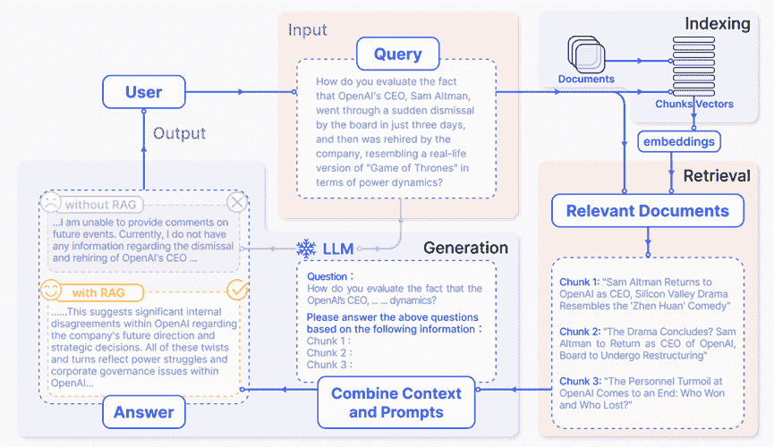

> **图源自论文 **：Gao, Yunfan, Yun Xiong, Xinyu Gao, Kangxiang Jia, Jinliu Pan, Yuxi Bi, Yi Dai, Jiawei Sun, and Haofen Wang. "Retrieval-Augmented Generation for Large Language Models: A Survey." arXiv e-prints (2023): arXiv-2312.

## ** RAG的核心部件**

（1）向量数据库（Vector Database）

向量数据库是一种专门设计用来高效存储和检索向量数据的数据库系统。数据经常以高维向量的形式存在，比如文本、图片或其他类型的数据经过嵌入模型转换成的向量。这些向量代表了原始数据的特征和语义信息，可以用于各种相似性搜索和数据分析任务。向量数据库通过优化这类向量数据的存储结构和检索算法，提供了一种高效率的方式来处理大规模向量集合。检索增强生成模型的一个关键步骤是从大规模数据集中检索相关信息，这些信息随后用于辅助生成模型产生回答。向量数据库能够快速检索到与查询向量最相似的数据向量，从而大大加快了这一过程，提高了信息检索的效率和准确性。

（2）查询检索（Retriever）

在检索增强生成过程中，检索器可以从一个大规模的文档集合或知识库中检索出与给定查询最相关的信息，这个过程是通过比较查询的表示（通常是一个向量）和文档集合中每个文档的表示来完成的，通过检索器，检索增强生成系统能够访问到更广泛的、实时更新的信息，从而扩展了模型处理问题时的知识范围。目标是找到最能帮助生成系统回答查询的信息。

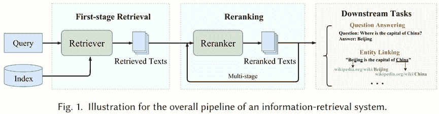

> **图源自论文 **：Zhao, W. X., Liu, J., Ren, R., & Wen, J. R. (2024). Dense text retrieval based on pretrained language models: A survey. ACM Transactions on Information Systems, 42(4), 1-60.

（3）重新排序（Re-ranker）

我们可以在许多文本文档中执行语义搜索，相关文档可能有数万到数百亿个。但由于大语言模型对于传递文本量有限制，我们需要对文档质量进行排序，然后返回top-k文档用于下一步检索生成。在重排器中，给定查询和文档对，将输出相似性得分。我们使用这个分数根据与我们的查询的相关性对文档进行重新排序。

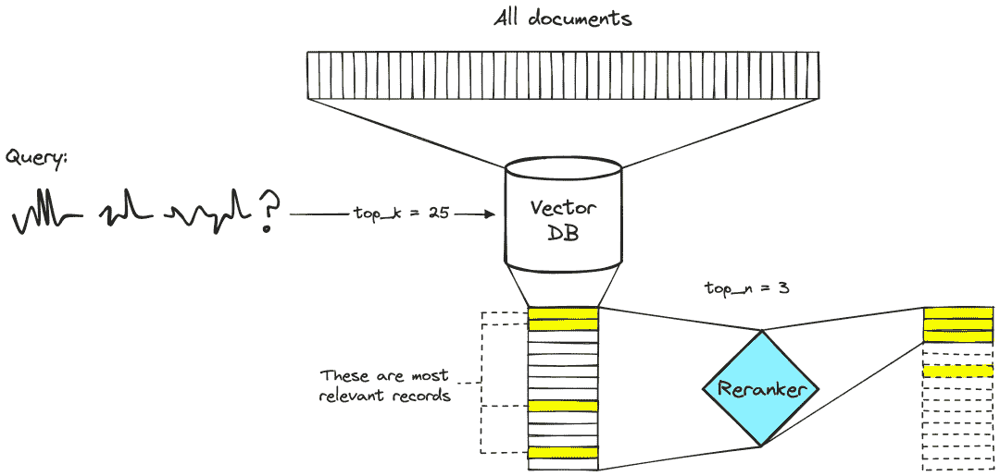

（4）生成回答（Generator）

在整个检索增强生成系统中，生成器是负责将检索到的信息生成最终文本输出的组件，它利用这些检索到的信息来构建回答或完成特定的文本生成任务。生成器将检索到的多个文档或信息片段综合考虑，融合它们的内容来构建一个连贯、逻辑一致的输出。这个过程涉及到语言生成的各个方面，包括词汇选择、语法结构和内容连贯性等。

因为检索增强生成不仅用于事实推理，还可以被用于生成代码、图像等，因此面对不同下游任务，生成器模型已经衍生出多种变体。Transformer模型经常应用于文本生成任务；VisualGPT常用于从图像生成文本描述；Stable Diffusion主要用于根据文本提示生成图像；Codex则专注于从文本描述生成代码。

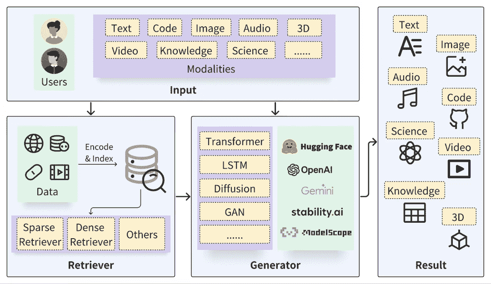

> **图源自论文 **：https://github.com/hymie122/RAG-Survey

## ** 检索增强生成前沿**

（1）RAG + Knowledge Graph

首先，我们可以使用大语言模型从用户问题中提取关键实体。然后基于这些实体来检索子图。最后，大模型用获得的上下文（实体的邻接矩阵信息）中生成答案。

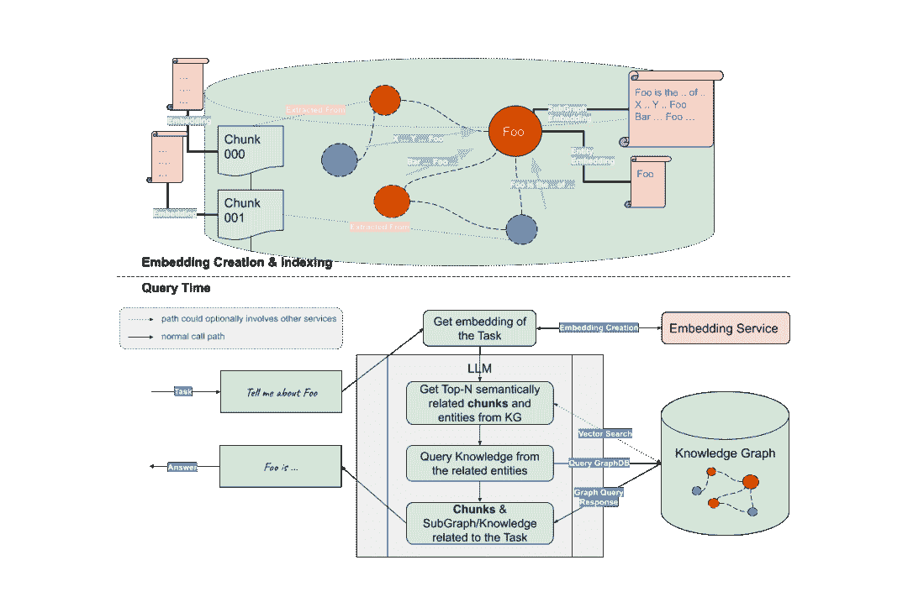

> **参考资料 **：https://siwei.io/graph-rag/

**（2）RAG + Tree**

文章引入了递归嵌入、聚类和总结文本块的新颖方法，从下到上构建具有不同摘要级别的树。最开始，将检索语料库分割成长度为100的短连续文本。然后用SBERT进行句子嵌入。为了对相似的文本块进行分组，可以采用聚类算法。聚类后，语言模型用于总结分组的文本。然后将这些总结的文本重新嵌入。这样的过程不断进行，直到不能进一步聚类。于是我们有了原始文档的结构化、多层树的表示。

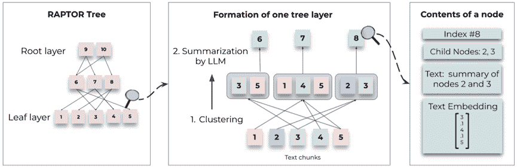

> **图源自论文 **：Sarthi, Parth, Salman Abdullah, Aditi Tuli, Shubh Khanna, Anna Goldie, and Christopher D. Manning. "RAPTOR: Recursive Abstractive Processing for Tree-Organized Retrieval." In The Twelfth International Conference on Learning Representations. 2024.

前天斯坦福大学的Andrew Ng在DeepLearning.AI上开设了一门新课 Knowledge Graphs for RAG ，讲解如何利用知识图谱获取多种类型数据之间的复杂关系辅助更准确的检索增强生成。

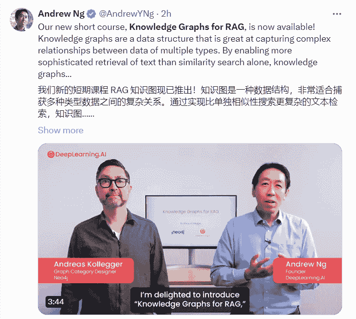

> **课程链接 **：https://www.deeplearning.ai/short-courses/knowledge-graphs-rag/

注：本文部分图片源自网络Google images

> **参考阅读 **：

> (1)https://thenewstack.io/3-ways-to-stop-llm-hallucinations/

> (2)https://www.simform.com/blog/reinforcement-learning-from-human-feedback/

> (3)https://masterofcode.com/blog/hallucinations-in-llms-what-you-need-to-know-before-integration#:~:text=Facilitate%20Domain%20Adaptation%20and%20Augmentation,queries%20and%20generate%20relevant%20responses.

> (4)https://medium.com/@cooper.white_86633/ai-hallucinations-the-ethical-burdens-of-using-chatgpt-5e62dd0f75c7

> (5)https://www.simform.com/blog/llm-hallucinations/

---

备注： 昵称-学校/公司-方向/ 会议(eg.ACL) ，进入技术/投稿群

id：DLNLPer， 记得备注呦