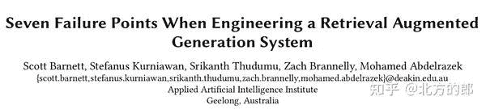
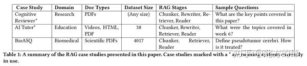
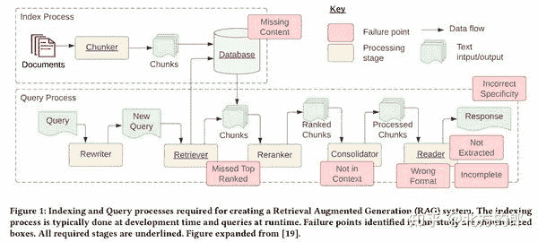

# 探索AI检索增强生成系统（RAG）的7大故障点

> 来源：[https://agijuejin.feishu.cn/docx/AKyedSCLwoFMlJxB8vYcKAk7nHd](https://agijuejin.feishu.cn/docx/AKyedSCLwoFMlJxB8vYcKAk7nHd)

> 作者：北方的郎

> 原文：https://zhuanlan.zhihu.com/p/681360792

随着大语言模型（LLM）在自然语言处理领域的飞速发展，其在问题回答、文档生成等任务上取得了显著成果。然而，LLM也存在一些局限性，如易产生幻觉回答和缺乏最新知识。为了解决这些问题，研究人员提出了一种新的技术——检索增强生成（RAG）系统。

RAG系统结合了信息检索和LLM的生成能力，可以检索相关知识文档，并将检索到的文档提供给LLM作为上下文，以生成更准确、更相关的回答。RAG系统为软件工程师提供了实现语义搜索、问答系统等任务的新方法。然而，在实际开发RAG系统时，工程师们可能会遇到许多挑战。《Seven Failure Points When Engineering a Retrieval Augmented Generation System 》这篇论文针对这些问题进行了研究。

论文地址：https://arxiv.org/abs/2401.05856

以下为论文的关键信息：

---

本文基于三个案例研究，详细分析了RAG系统的七个故障点，并为软件工程师提供了应对这些问题的建议。

## 案例包括：

认知评审员（Cognitive Reviewer）：支持研究人员分析科学文献，包括上传文档并根据研究目标进行排序，并允许直接向所有文档提问。该系统在运行时进行索引，依赖数据处理管道来处理上传的文档，并使用排序算法对上传文档进行排序。

AI导师（AI Tutor）：学生可以就单元内容提出问题，系统从学习内容中获取答案。学生可以查看答案的来源。该系统集成了学习管理系统，索引了所有内容，包括PDF、视频和文本，在索引过程中对视频进行了转录。它还实现了对话接口，将用户与AI导师的对话作为每个问题的上下文，并实现了query重写器。

生物医学问答（BioASQ）：使用BioASQ数据集构建RAG系统，包括4017篇开放获取文档和1000个问题，答案可以是yes/no、文本摘要、事实型或列表型。系统对文档进行了索引，然后使用问题生成器提出问题，并使用GPT-4生成答案，使用OpenAI评估系统进行评价。

## RAG系统中的七个故障点包括：

1.  缺失内容（Missing Content）：当用户提出的问题无法从当前文档中找到答案时，系统可能给出错误回答。这种情况可以通过语义缓存等机制避免。

1.  检索排序问题（Missed the Top Ranked Documents）：答案存在于文档中，但由于检索排序算法的问题，未能被排名至前列，无法返回给用户。这需要不断优化检索排序算法。

1.  上下文不充分（Not in Context - Consolidation strategy）：检索出的文档中包含了答案，但在生成答案时由于上下文整合策略的局限，未能将文档中的答案提取出来。需要改进上下文整合策略。

1.  提取问题（Not Extracted）：上下文中包含答案，但语言模型未能提取出正确的答案。这可能是由于上下文中的噪声或矛盾信息导致。需要优化上下文过滤策略。

1.  格式问题（Wrong Format）：问题要求提取特定格式的信息，但语言模型未能遵循格式要求。需要改进答案格式提取策略。

1.  准确性问题（Incorrect Specificity）：答案内容不具体或过于具体，无法满足用户需求。需要根据用户意图优化答案生成策略。

1.  不完整（Incomplete）：答案不完整，未能涵盖所有相关信息。这可能是由于语言模型未能从上下文中完全提取信息。需要改进信息整合策略。

这七个故障点涉及RAG系统的多个模块，包括检索、上下文整合、答案提取和生成等。

通过对这些故障点的分析，本文为软件工程师提供了开发RAG系统时需要考虑的关键因素，如文档分块、嵌入方法、系统配置、测试和持续校准等。此外，本文还指出了RAG系统领域的一些潜在研究方向，如比较RAG和模型微调的优劣、测试和监控RAG系统的性能等。

## 结论

RAG系统为软件工程师提供了利用LLM实现语义搜索和问答系统的新方法。然而，在实际开发过程中，工程师需要关注并解决这些潜在的问题，以确保系统的稳定性和准确性。本文为软件工程师提供了开发RAG系统的指南，有助于推动RAG系统在各个领域的应用。