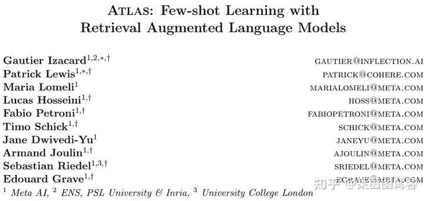
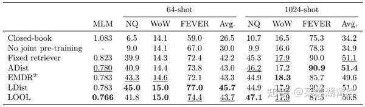
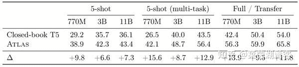
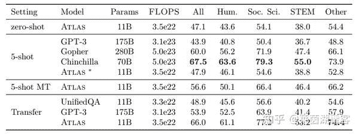
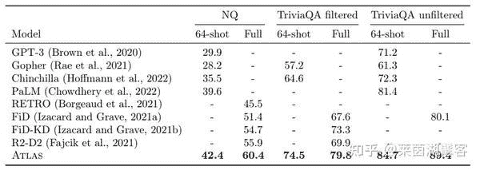

# [RAG大赏] Atlas: (无中生)有监督微调RAG系统

> 来源：[https://agijuejin.feishu.cn/docx/DTHKd8kkooKvZrxarhNcfFzJn5f](https://agijuejin.feishu.cn/docx/DTHKd8kkooKvZrxarhNcfFzJn5f)

> 作者：[咸鱼王](https://www.zhihu.com/people/wow-kong)

> 原文： [https://zhuanlan.z](https://zhuanlan.zhihu.com/p/665455467)hihu.com/p/665455...

Atlas是一种 **需要微调LLM **而非prompt engineering based的RAG方案，其优点是通过Object Function设计，无需有监督预料即可完成模型和Retriever的训练。尽管深度学习领域正在往力大砖飞的方向发展，我们仍可以从这些颇具美感的设计中受益良多。

**论文链接：**

[A](https://link.zhihu.com/?target=https%3A//www.jmlr.org/papers/volume24/23-0037/23-0037.pdf)tlas: Few-shot Learning with Retrieval Augmented Language Models

**开源代码：**

[https:// github.com/face](https://link.zhihu.com/?target=https%3A//github.com/facebookresearch/atlas)bookrese arch/atlas

## 01 背景

引入RAG的目的基本有二：

1.  帮助模型解决/缓解知识密集型任务下的幻觉问题。 哪怕是强如GPT4，在非外挂知识库的情况下，也会情不自禁的“胡言乱语”，给用户带来极大的信任危机。通过引入外部知识，可以限制模型尽量在Reference内进行指令执行，从而避免/缓解模型的幻觉问题。

1.  **帮助模型与真实世界实时交互。 **LLM的预料收集与处理、训练是一个非实时流程，RAG可以帮助模型与真实世界进行实时信息交互。

RAG的引入本质上是 将LLM的部分压力转嫁给了检索系统 ，当检索系统准确率较低、信息质量较差甚至相互矛盾时，反而会产生负面效果。同样的，如果LLM不能合理利用Reference，妥善处理Reference中的虚假信息、冲突信息，即便retriever效果再好，结果也不会理想。

因此笔者认为，能够较好理解复杂instruction的大规模LLM，更适合prompt engineering的RAG方案；无法直接遵循复杂instruction的较小LLM，更适合fine-tune的方案。本篇论文的作者就提供了后者的一个典型应用：11B模型+fine_tune即可“秒杀”千亿级别模型。

## 02 方法

事实**上，RAG**效果的好坏并不仅仅依赖于LLM，不论是prompt engineering还是fine tune，更多只是教会模型合理利用reference进行生成，对于百亿或以上级别的模型而言，这是 一点即通 的事情，很多时候瓶颈反而在于如何更加精准的检索到Reference，也即检索系统或retriever的优化。本篇论文的重点就在于如何不借助有监督数据，（在仅基于src-tgt平行语料训练RAG系统的过程中）自适应的得到一个更加垂域化、效果更好的retriever。

Atlas是典型的 **FiD **（Fusion in decoder）框架，并且LLM与retriever协同训练。LLM选用了体量较小的T5模型，retriever初始化自基于MoCo预训练的Contriver模型，MoCo相关可见笔者之前的文章，此处不再赘述。接下来将着重介绍作者给出的训练retriever的4种Object function。

AttentionDistillation (ADist) 从注意力的角度进行设计，基本思想是LLM对各个documents的“关注”程度，间接体现出了query与各documents的相似度或相关性。“关注”程度显而易见，可以通过cross_attention计算得到。因此ADist的目的，就是以LLM为教师，教会retriever区分query与document的相似度。具体而言，就是通过attention_prob、qd_sim_prob的KL散度，训练retriever。这里的attention_prob。具体公式如下：

KL(p_{ATTN}||p_{RETR})=\Sigma_{k=1}^Kp_{ATTN}(\mathbf{d}_k)log(p_{ATTN}(\mathbf{d}_k)/p_{RETR}(\mathbf{d}_k))\\

**E**nd-to-end training of Multi-Document Reader and Retriever (EMDR2) 启发自EM算法，如下式。该式等同于计算  \Sigma_{k=1}^Kp(\mathbf{d}_k|\mathbf{q},\mathbf{a};\Theta,\Phi) ，即通过最大化该后验来更新retriever的参数。在计算loss时，固化的LLM会依赖各个document分别计算token distribution。

-log[\Sigma_{k=1}^Kp_{LM}(\mathbf{a}|\mathbf{q},\mathbf{d}_k)p_{RETR}(\mathbf{d}_k|\mathbf{q})]\\

**Lik**elihood Distillation (LDist) 通过预估各个document能给LLM预测正确结果带来多少 增益 ，来训练retriever。具体如下式，通过分别依赖于各个document计算ground truth的log prob，并沿documents进行归一化，即可得到  p_{LDist}(\mathbf{d}_k) ，其涵义就是各document  \mathbf{d}_k 对输出groud truth的相对增益，说白了  p_{LDist}(\mathbf{d}_k) 就是评价  \mathbf{d}_k 有多有用、与query有多相关。通过让retriever的相似度拟合该分布，即可训练retriever学会这种相似度判断。

p_{LDist}(\mathbf{d}_k)=exp(logp_{LM}(\mathbf{a}|\mathbf{d}_k,\mathbf{q})/\Sigma_{i=1}^Kexp(logp_{LM}(\mathbf{a}|\mathbf{d}_i,\mathbf{q}))\\

**Leave-one-out Likelihood **D**ist**illation (LOOP) 和LDist的思想十分相似，拟合的是reference去掉  \mathbf{d}_k 后对LLM预测ground truth带来的 减益 ，所以叫leave-one-out，具体如下式。在计算loss时，同样是拟合下式与retriever相似度分布的KL散度来训练retriever。

p_{LOOP}(\mathbf{d}_k)=exp(-logp_{LM}(\mathbf{a}|D_K\backslash\{\mathbf{d}_k\},\mathbf{q})/\Sigma_{i=1}^Kexp(-logp_{LM}(\mathbf{a}|D_K\backslash\{\mathbf{d}_k\},\mathbf{q}))\\

Atlas通过LLM与retriever联合训练，实现了：1. 使LLM适应基于reference进行生成的generation模式；2. 以指导LLM输出正确结果为目标，自适应调教retriever。本篇文章的核心和亮点主要在于retriever的训练方案设计，LLM训练方式不再赘述，主要包括NextTokenPrediction和MLM。

另外，retriever训练时如何妥善处理embedding_table的动态更新，也是老生常谈的一个问题，这里同样不作为本篇文章重点。Atlas的做法是固化document_encoder，只更新query_encoder部分，如此一来embedding table就无需再更新，缺点就是随着query_encoder的不断迭代偏移，二者可能不再处于同一特征空间，对最终索引效果有一定负面影响。

## 03 实验

首**先看下本篇文章重点介绍的**4个Object function到底是真功夫还是花拳绣腿。如下图，经消融实验评测，首先可以看出加入 RAG对模型的显著增益 （15个点以上）；其次，64-shot下各loss相比固化retriever都能带来1个点以上的提升，其中LDist效果最为亮眼；但比较尴尬的是1024-shot下各loss反而基本呈现了负增益，作者将其归因于经过训练后模型掌握了从reference使用、聚合信息的能力。考虑到LDist效果相对最为稳定，作者在后续的实验中只使用了LDist。

作者又在不同量级、不同训练语料数下验证了Atlas的效果（测试集为MMLU）。可以看出，Atlas稳定显著优于非RAG模式。

同样以MMLU为测试集，作者对比了Atlas与其他模型的差异，可以看出Atlas以小博大，在5-shot/transfer下甚至优于GPT-3。

在NQ、triviaQA测试下，Atlas-11B在64-shot和全量微调下取得SOTA。

## 04 总结

**以**指导LLM输出ground truth为目标训练retriever，其目标比仅基于语义相似度的训练方式更加直接、深刻、本质 ，该目标背后的意义可能包含了语义相似，也可能包含了reference是否合理、常规、信息充足等targets。

整体来说，或许retriever的loss计算流程相对复杂、繁琐，难以在一般场景中得到广泛应用，但仍不失为一种值得借鉴与深思的方案。