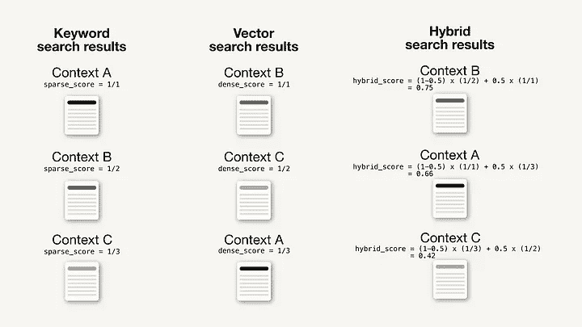

# 通过混合搜索提高RAG管道的检索性能

> 来源：[https://agijuejin.feishu.cn/docx/SvW1ddtrbouxmHxAK5ucDmi7nfg](https://agijuejin.feishu.cn/docx/SvW1ddtrbouxmHxAK5ucDmi7nfg)

> 作者：AI 搜索引擎

> 原文： [https://mp.weixin.](https://mp.weixin.qq.com/s/CEdfJ3vdv3eMXT7r_hmDJg)qq.com/s/CEdfJ3vd...


原文链接：https://towardsdatascience.com/improving-retrieval-performance-in-rag-pipelines-with-hybrid-search-c75203c2f2f5

随着最近人们对检索增强生成（RAG）管道的兴趣不断增加，开发人员已经开始探讨构建具备生产就绪性能的 RAG 管道所面临的挑战。就像生活中的许多方面一样，帕累托原理同样适用于 RAG 管道，其中实现最初的80%相对较为简单，但实现剩余的20%生产准备情况却具有一定的挑战性。一个经常重复的主题是通过混合搜索来改进 RAG 管道的检索组件。那些已经积累了构建 RAG 管道经验的开发人员已经开始分享他们的见解。其中，一个经常讨论的主题是如何通过混合搜索来改进 RAG 管道的检索组件。本文旨在介绍混合搜索的概念，阐述它如何通过提高检索结果的相关性来增强 RAG 管道性能，并介绍这一方法适用于什么场景。具体内容包括：

1.什么是混合搜索

2.混合搜索如何工作？

3.混合搜索如何提高 RAG 管道的性能？

4.何时会使用混合搜索？

# **#1**** **什么是混合搜索

混合搜索是一种结合两种或多种搜索算法以提高搜索结果相关性的先进搜索技术。虽然并没有明确定义要组合哪些算法，但混合搜索通常指的是传统基于关键字的搜索与现代向量搜索的巧妙结合。

传统上，基于关键字的搜索一直是搜索引擎的首选。然而，随着机器学习（ML）算法的崛起，向量嵌入引入了一种新的搜索技术，被称为向量或语义搜索。这使我们能够进行基于数据语义的搜索，但这两种搜索技术都需要权衡考虑：

+   基于关键字的搜索：虽然其在精确的关键字匹配方面对特定术语（如产品名称或行业术语）具有优势，但对拼写错误和同义词较为敏感，可能会错过关键上下文。

+   向量或语义搜索：虽然其语义搜索功能支持基于数据语义的多语言和多模式搜索，且对拼写错误具有一定的鲁棒性，但可能会忽略重要的关键字，并且其效果取决于生成的向量嵌入质量，对域外术语也较为敏感。

通过将基于关键字的搜索和向量搜索融合到混合搜索中，可以充分利用这两种搜索技术的优势，提高搜索结果的相关性，尤其适用于文本搜索用例。

以一个例子来说明，考虑搜索查询“如何使用合并两个 Pandas DataFrame 的 .concat() 方法？”。基于关键字的搜索将有助于找到相关的 .concat() 方法。然而，由于“合并”一词具有同义词如“组合”、“连接”和“连接”，因此如果能够充分利用语义搜索的上下文感知功能，将更有助于提供准确的结果，这一部分在后面会有详细说明。

# **#2**** **混合搜索如何工作

混合搜索通过融合搜索结果并重新排名，将基于关键字的搜索技术和向量搜索技术结合起来。

01

基于关键词的搜索

混合搜索上下文中，基于关键字的搜索通常采用称为稀疏嵌入的表示，这也是为什么它被称为稀疏向量搜索的原因。稀疏嵌入是大部分为零值、仅包含少量非零值的向量，示例如下：

```
[0, 0, 0, 0, 0, 1, 0, 0, 0, 24, 3, 0, 0, 0, 0, ...]
```

生成稀疏嵌入可以使用不同的算法，其中最常用的是 BM25（最佳匹配 25）。BM25 建立在 TF-IDF（词频-逆文档频率）方法的基础上，并对其进行了改进。简而言之，BM25 通过考虑术语在文档中的频率相对于它们在所有文档中的频率，强调了术语的重要性。

02

向量搜索

向量搜索是一种随着机器学习的进步而出现的现代搜索技术。现代机器学习算法，如 Transformers，能够以各种形式（文本、图像等）生成数据对象的数字表示，被称为向量嵌入。

这些向量嵌入通常密集地包含信息，大部分由非零值（即密集向量）组成，示例如下：

+

```
[0.634, 0.234, 0.867, 0.042, 0.249, 0.093, 0.029, 0.123, 0.234, ...]
```

这解释了向量搜索为何也被称为密集向量搜索的原因。

在向量搜索中，搜索查询被嵌入到与数据对象相同的向量空间中。然后，利用查询的向量嵌入，通过指定的相似性度量（例如余弦距离），计算最接近的数据对象。返回的搜索结果列出了最接近的数据对象，按照与搜索查询的相似度进行排序。

03

基于关键字和向量搜索结果的融合

基于关键字的搜索和向量搜索都会返回一组单独的结果，通常是按计算的相关性排序的搜索结果列表。这些单独的搜索结果集必须进行合并。有许多不同的策略可以将两个列表的排名结果合并为一个排名。

一般来说，搜索结果通常首先被评分。这些分数可以根据指定的指标（例如余弦距离）或仅仅根据搜索结果列表中的排名来计算。

然后，计算出的分数使用参数 alpha 进行加权，该参数决定每个算法的权重并影响结果的重新排名。

```
hybrid_score = (1 - alpha) * sparse_score + alpha * dense_score
```

通常，alpha 取0到1之间的值，其中：

+   alpha = 1：纯向量搜索

+   alpha = 0：纯关键词搜索

下面是关键字搜索和向量搜索之间融合的最小示例，并根据排名和参数 alpha = 0.5 进行评分。



# **#3**** **混合搜索如何提高 RAG 管道的性能？

RAG 管道具有多个可调整的参数，以优化其性能。其中之一是提高检索到的上下文的相关性，然后将其输入到 LLM 中。这是因为，如果检索到的上下文与给定问题的回答无关， LLM 也无法生成相关的答案。

根据上下文类型和查询，需要确定在三种搜索技术中，哪一种对 RAG 应用程序最为适用。因此，控制基于关键字的搜索和语义搜索之间的权重参数 alpha 可以被视为需要调整的超参数。

在使用 LangChain 的常见 RAG 管道中，可以通过将检索器组件的 vectorstore 设置为 as_retriever() 来定义所使用的组件，具体方法如下：

```
# Define and populate vector store
# See details here https://towardsdatascience.com/retrieval-augmented-generation-rag-from-theory-to-langchain-implementation-4e9bd5f6a4f2
vectorstore = ...

# Set vectorstore as retriever
retriever = vectorstore.as_retriever()
```

然而，该方法仅支持语义搜索。如果想在LangChain中启用混合搜索，需要定义一个具有混合搜索功能的特定 retriever 组件，例如 WeaviateHybridSearchRetriever：

```
from langchain.retrievers.weaviate_hybrid_search import WeaviateHybridSearchRetriever

retriever = WeaviateHybridSearchRetriever(
    alpha = 0.5,               # defaults to 0.5, which is equal weighting between keyword and semantic search
    client = client,           # keyword arguments to pass to the Weaviate client
    index_name = &quot;LangChain&quot;,  # The name of the index to use
    text_key = &quot;text&quot;,         # The name of the text key to use
    attributes = [],           # The attributes to return in the results
)
```

原始的 RAG 管道的其余部分将保持不变。这个小的代码更改允许我们尝试不同权重下的基于关键字的搜索和向量搜索。请注意，设置 alpha = 1 相当于完全语义搜索，这相当于将 vectorstore 直接从组件定义的检索器中获取（retriever = vectorstore.as_retriever()）的效果。

# **#4**** **何时会使用混合搜索（混合搜索用例）

混合搜索是在希望获得更人性化搜索体验的同时，仍然需要对特定术语（如产品名称或序列号）进行精确短语匹配的理想选择。

Stack Overflow 平台提供了一个很好的例子，最近通过混合搜索扩展了其搜索功能以实现更好的语义搜索。起初，Stack Overflow 使用 TF-IDF 将关键字与文档匹配。然而，对于描述编码问题的词语，这可能导致不同的结果，例如，描述合并两个 Pandas DataFrame 的问题可能以不同的方式（如合并、连接和连接）表达。因此，在这些情况下，更上下文感知的搜索方法（如语义搜索）更为合适。

然而，Stack Overflow 的另一个常见用例是复制粘贴错误消息。在这种情况下，精确关键字匹配是首选的搜索方法。此外，对于方法和参数名称的准确匹配也是必需的，例如，在 Pandas 中的 .read_csv()。

正如我们可能猜测的那样，许多类似的现实用例既需要上下文感知的语义搜索，又依赖于准确的关键字匹配。在这些情况下，实施混合搜索检索器组件将带来很大的好处。

概括

本文介绍了混合搜索的上下文，即基于关键字的搜索和向量搜索的有机结合。混合搜索通过合并单独的搜索算法的结果，并相应地对搜索结果进行重新排序，提供了一种强大的搜索方法。

在混合搜索中，参数 alpha 的调整控制基于关键字的搜索和语义搜索之间的权重。该参数可被视为调整 RAG 管道的超参数，以提高搜索结果的准确性。

通过 Stack Overflow 的案例研究，我们展示了混合搜索在那些语义搜索能够改善搜索体验的用例中的应用。然而，需要注意的是，当特定术语频繁出现时，精确的关键字匹配仍然保持重要。

###### **向量检索实验室**

微信号：VectorSearch

扫码关注 了解更多

