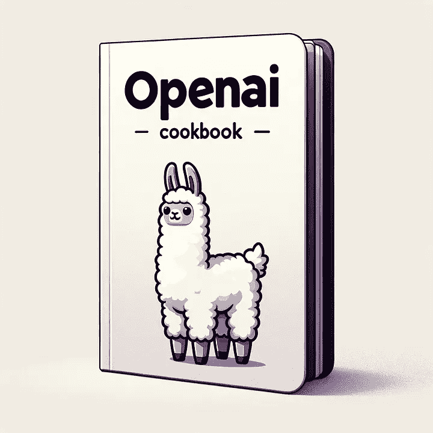
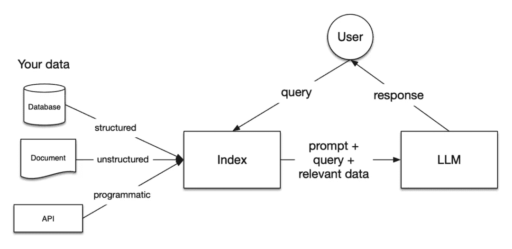
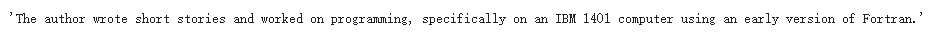
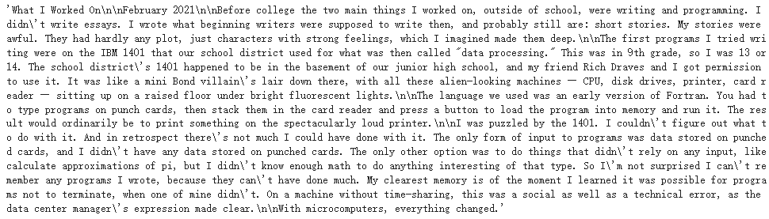
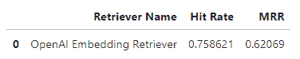
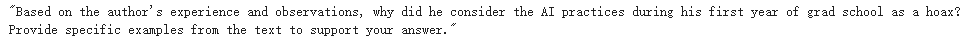
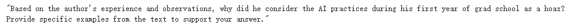

# OpenAI Cookbook：评估RAG系统指导手册

> 来源：[https://agijuejin.feishu.cn/docx/XmhUduixDoPGNixr4g7cKAB9nBd](https://agijuejin.feishu.cn/docx/XmhUduixDoPGNixr4g7cKAB9nBd)

> 作者：AI 搜索引擎

> 原文：[https://mp.weixin.](https://mp.weixin.qq.com/s/WvEdK1WlI1GGR-Caf7SlJQ)qq.com/s/WvEdK1Wl...



cookbook链接：https://github.com/openai/openai-cookbook/blob/main/examples/evaluation/Evaluate_RAG_with_LlamaIndex.ipynb

OpenAI Cookbook 项目新推出了使用 LlamaIndex 评估检索增强生成 (RAG) 系统的指南，编写这本手册的目标是为社区提供必要的资源，以有效评估和增强使用 LlamaIndex 开发的 RAG 系统，对于提高 RAG 系统的效率很有帮助。

OpenAI Cookbook 分为三个部分：

1.了解检索增强生成 (RAG)：提供 RAG 系统的详细概述，包括构建 RAG 系统所涉及的各个阶段。

2.使用 LlamaIndex 构建 RAG：该部分将会深入实践方面，借用 Paul Graham 的论文，利用 VectorStoreIndex 演示如何使用 LlamaIndex 构建 RAG 系统。

3.使用 LlamaIndex 评估 RAG：最后一部分重点评估 RAG 系统在两个关键领域的性能：检索系统和响应生成。

将使用 generate_question_context_pairs 这个独特的合成数据集生成方法 对上述领域进行彻底的评估。

现在我们通过下列内容一起探索 RAG 系统评估的深度，并了解如何通过 LlamaIndex 充分利用 RAG 实施的潜力。

## **01 增****强检索生成（RAG）**

检索增强生成（RAG）大模型是在庞大的数据集上进行训练的，尽管这些数据集不包括具体数据。RAG 通过模型解决了这一问题，以便实时访问和利用您的数据，从而提供更加定制和与上下文相关的响应。在生成的过程中，RAG 会动态地合并数据。这一过程并非通过改变大模型的训练数据来实现，而是通过在 RAG 中允许数据被加载并准备进行查询或“索引”。用户的查询将作用于这个索引，从而将数据过滤到最相关的上下文。然后，该上下文与查询以及提示一起传递到语言模型（LLM），LLM 提供响应。即使你正在构建聊天机器人或代理，也会希望了解将数据引入应用程序中的 RAG 技术。



**RAG的各个阶段**

在RAG中有五个关键阶段，它们将成为构建的任何大型应用程序的一部分。五个阶段包括：

+   加载：这是指从数据存在的地方获取数据到我们的管道中，可以包括文本文件、pdf、另一个网站、数据库和 API。LlamaHub 提供了数百种连接器可供选择。

+   索引：这意味着创建一个允许查询数据的数据结构。对于大模型来说，这几乎总是意味着创建向量嵌入，数据含义的数字表示，以及许多其他元数据策略，以便轻松准确地找到与上下文相关的数据。

+   存储：一旦数据被索引，我们将希望存储这个索引，以及任何其他元数据，以避免需要重新索引它。

+   查询：对于任何给定的索引策略，都有许多方法可以利用 llm 和 llamalindex 数据结构进行查询，包括子查询、多步骤查询和混合策略。

+   评估：任何管道中的一个关键步骤是检查它相对于其他策略的有效性，或者当我们进行更改时。评估提供了客观的衡量标准，以衡量大模型对查询的响应有多准确、可信和快速。

## **02 构建RAG**

通过上部分内容，我们已经了解了 RAG 的重要性，现在开始构建一个简单的 RAG 管道。

```
pip install llama-index
```

```
# nest_asyncio模块允许在已经运行的异步循环中嵌套异步函数。
#这是必要的，因为Jupyter笔记本本质上是在异步循环中运行的。
#通过应用nest_asyncio，我们可以在这个现有循环中运行额外的async函数，而不会产生冲突。

import nest_asyncio

nest_asyncio.apply()

from llama_index.evaluation import generate_question_context_pairs
from llama_index import VectorStoreIndex, SimpleDirectoryReader, ServiceContext
from llama_index.node_parser import SimpleNodeParser
from llama_index.evaluation import generate_question_context_pairs
from llama_index.evaluation import RetrieverEvaluator
from llama_index.llms import OpenAI

import os
import pandas as pd
```

设置 OpenAI API Key

```
os.environ[&#x27;OPENAI_API_KEY&#x27;] = &#x27;YOUR OPENAI API KEY&#x27;
```

接下来使用 Paul Graham 的论文文本来构建 RAG 管道。

**下载数据**

```
mkdir -p &#x27;data/paul_graham/&#x27;curl &#x27;https://raw.githubusercontent.com/run-llama/llama_index/main/docs/examples/data/paul_graham/paul_graham_essay.txt&#x27; -o &#x27;data/paul_graham/paul_graham_essay.txt&#x27;
```

**上传数据&创建索引**

```
documents = SimpleDirectoryReader(&quot;./data/paul_graham/&quot;).load_data()

#定义一个大模型
llm = OpenAI(model=&quot;gpt-4&quot;)

# 构建 chunk_size 为 512 的索引
node_parser = SimpleNodeParser.from_defaults(chunk_size=512)
nodes = node_parser.get_nodes_from_documents(documents)
vector_index = VectorStoreIndex(nodes)
```

构建QueryEngine并开始查询

```
query_engine = vector_index.as_query_engine()
```

```
response_vector = query_engine.query(&quot;What did the author do growing up?&quot;)
```

校验响应

```
response_vector.response
```

输出结果：



默认情况下，LLM 会检索两个相似的节点/块。

在 vector_index.as_query_engine(similarity_top_k=k) 中可以修改它。

接着让我们检查每个检索到的节点中的文本。

```
# First retrieved node
response_vector.source_nodes[0].get_text()
```

输出结果：



```
# Second retrieved node
response_vector.source_nodes[1].get_text()
```

输出结果：


我们已经建立了一个 RAG 管道，现在需要评估它的性能。我们可以使用 LlamaIndex 的核心评估模块来评估我们的 RAG 系统/查询引擎。让我们检验一下如何利用这些工具来量化检索增强生成系统的质量。

## **03 评估**

评估数据应该作为检验您的 RAG 应用程序的主要指标。它决定 RAG 管道是否会根据数据源和查询范围生成准确的响应。

虽然在开始时检查单个查询和响应是有益的，但随着边缘情况和失败数量的增加，这种方法可能变得不切实际。相反，建立一套总结度量标准或自动评估可能更有效。这些工具可以提供对整个系统性能的洞察，并指出可能需要更仔细检查的特定领域。

在 RAG 系统中，评估主要集中在两个关键方面：

+   检索评估：评估系统检索信息的准确性和相关性；

+   响应评估：这将根据检索到的信息度量系统生成的响应的质量和适当性。

**问题&上下文对生成**

对于 RAG 系统的评估，查询必须能够获取正确的上下文并随后生成适当的响应。LlamaIndex 提供了一个 generate_question_context_pairs 模块，专门用于生成问题和上下文对，这些问题和上下文对可用于检索和响应评估的RAG系统的评估。

```
qa_dataset = generate_question_context_pairs(
      nodes,
      llm=llm,
      num_questions_per_chunk=2
)
```

**检索评估**

我们现在准备进行检索评估。我们将使用我们生成的评估数据集执行我们的 retriverevaluator。

我们首先创建 retriver，然后定义两个函数：get_eval_results，它在数据集上操作我们的检索器：display_results，它表示求值的结果。

让我们创建 retriver

```
retriever = vector_index.as_retriever(similarity_top_k=2)
```

定义 RetrieverEvaluator。我们使用 Hit rate和 MRR 指标来评估我们的 retriver。

**Hit rate**

Hit rate 计算在前 k 个检索文档中找到正确答案的查询比例。简单来说，它是关于我们的系统在前几次猜测中正确的频率。

Mean Reciprocal Rank (MRR）

对于每个查询，MRR 通过查看排名最高的相关文档的排名来评估系统的准确性。具体来说，它是所有查询中这些秩的倒数的平均值。因此，如果第一个相关文档是顶部结果，则倒数排名为1；如果是第二个，倒数是1/2，以此类推。

通过上述这些指标来检查我们的 retriver 的性能

```
retriever_evaluator = RetrieverEvaluator.from_metric_names(
    [&quot;mrr&quot;, &quot;hit_rate&quot;], retriever=retriever
)
```

```
# Evaluate
eval_results = await retriever_evaluator.aevaluate_dataset(qa_dataset)
```

定义一个函数，以表格式显示检索计算结果

```
def display_results(name, eval_results)：
    &quot;&quot;&quot;Display results from evaluate.&quot;&quot;&quot;
    
    metric_dicts = []
    for eval_result in eval_results:
        metric_dict = eval_result.metric_vals_dict
        metric_dicts.append(metric_dict)
        
    full_df = pd.DataFrame(metric_dicts)

    hit_rate = full_df[&quot;hit_rate&quot;].mean()
    mrr = full_df[&quot;mrr&quot;].mean()

    metric_df = pd.DataFrame(
        {&quot;Retriever Name&quot;: [name], &quot;Hit Rate&quot;: [hit_rate], &quot;MRR&quot;: [mrr]}
    )

    return metric_df
```

```
display_results(&quot;OpenAI Embedding Retriever&quot;, eval_results)
```

输出结果



**结论**

带有 OpenAI 嵌入的检索器的命中率为0.7586，而 MRR 为0.6206，表明在确保最相关的结果出现在顶部方面还有改进的空间。MRR 小于命中率的观察结果表明，排名靠前的结果并不总是最相关的。增强 MRR 可能涉及到重新排序器的使用，重新排序器可以改进检索文档的顺序。

**响应评估**

1.faithnessevaluator：测量来自查询引擎的响应是否与任何源节点匹配，这对于测量响应是否存在幻觉很有用。

2. Relevancy Evaluator：衡量响应+源节点是否与查询匹配。

```
#从上面创建的数据集中获取查询列表

queries = list(qa_dataset.queries.values())
```

Faithfulness Evaluator

从 FaithinessEvaluator 开始。我们将使用 gpt-3.5-turbo 生成给定查询的响应，并使用 gpt-4 进行评估。让我们为 gpt-3.5-turbo 和 gpt-4 分别创建 service_context。

```
# gpt-3.5-turbo
gpt35 = OpenAI(temperature=0, model=&quot;gpt-3.5-turbo&quot;)
service_context_gpt35 = ServiceContext.from_defaults(llm=gpt35)

# gpt-4
gpt4 = OpenAI(temperature=0, model=&quot;gpt-4&quot;)
service_context_gpt4 = ServiceContext.from_defaults(llm=gpt4)
```

使用 gpt-3.5-turbo service_context 创建 QueryEngine 以生成查询响应。

```
vector_index = VectorStoreIndex(nodes, service_context = service_context_gpt35)
query_engine = vector_index.as_query_engine()
```

创建 FaithfulnessEvaluator

```
from llama_index.evaluation import FaithfulnessEvaluator
faithfulness_gpt4 = FaithfulnessEvaluator(service_context=service_context_gpt4)
```

用一个问题评估一下

```
eval_query = queries[10]
eval_query
```

输出结果：



首先生成并使用 faithfull evaluator

```
response_vector = query_engine.query(eval_query)
```

```
# 计算 faithfulness evaluation

eval_result = faithfulness_gpt4.evaluate_response(response=response_vector)
```

```
#可以在eval_result中检查是否通过了计算。

eval_result.passing
```

Relevancy Evaluator

RelevancyEvaluator 对于测量响应和源节点（检索到的上下文）是否与查询匹配非常有用。对于查看响应是否确实回答了查询很有用。

实例化 RelevancyEvaluator 以使用 gpt-4 进行相关性评估

```
from llama_index.evaluation import RelevancyEvaluator

relevancy_gpt4 = RelevancyEvaluator(service_context=service_context_gpt4)
```

让我们对其中一个查询进行相关性评估。

```
#选择一个查询
query = queries[10]

query
```

输出结果：



```
# 生成响应。
#response_vector 有响应和源节点（检索到的上下文）
response_vector = query_engine.query(query)

# 相关性评估
eval_result = relevancy_gpt4.evaluate_response(
    query=query, response=response_vector
)
```

```
#可以在eval_result中检查是否通过了计算。

eval_result.passing
```

```
#可以得到评估的反馈。

eval_result.feedback
```

**Batch Evaluator**

现在我们已经独立完成了可信度和相关性评估。LlamaIndex 有 BatchEvalRunner 以批处理的方式计算多个评估。

```
from llama_index.evaluation import BatchEvalRunner

#=选择前10个查询进行评估
batch_eval_queries = queries[:10]

# 启动 BatchEvalRunner 来计算可信度和相关性评估。
runner = BatchEvalRunner(
    {&quot;faithfulness&quot;: faithfulness_gpt4, &quot;relevancy&quot;: relevancy_gpt4},
    workers=8,
)

#计算评估
eval_results = await runner.aevaluate_queries(
    query_engine, queries=batch_eval_queries
)
```

```
# 得到忠诚度分数，输出结果为1.0
faithfulness_score = sum(result.passing for result in eval_results[&#x27;faithfulness&#x27;]) / len(eval_results[&#x27;faithfulness&#x27;])
faithfulness_score
```

```
#得到相关度评分，输出结果为1.0
relevancy_score = sum(result.passing for result in eval_results[&#x27;faithfulness&#x27;]) / len(eval_results[&#x27;relevancy&#x27;])
relevancy_score
```

**结论**

可信度得分为1.0表示生成的答案不包含幻觉，并且完全基于检索到的上下文。

相关性评分为1.0表明生成的答案与检索的上下文和查询一致。

总结

本手册探讨了如何使用 LlamaIndex 构建和评估 RAG 管道，并特别关注于评估管道内的检索系统和生成的响应。

LlamaIndex 还提供了各种其他评估模块，可以在这里进一步探索：

https://docs.llamaindex.ai/en/stable/module_guides/evaluating/root.html

**向量检索实验室**

🛰️号：VectorSearch

扫码关注 了解更多

