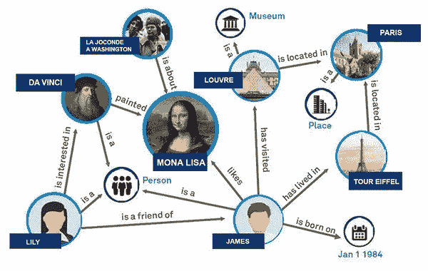
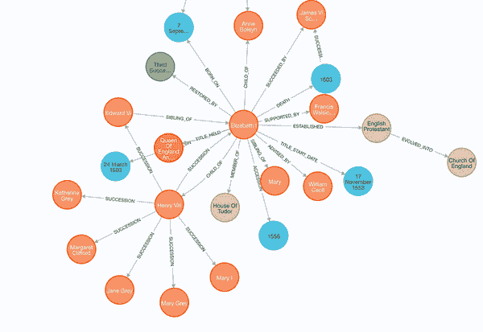
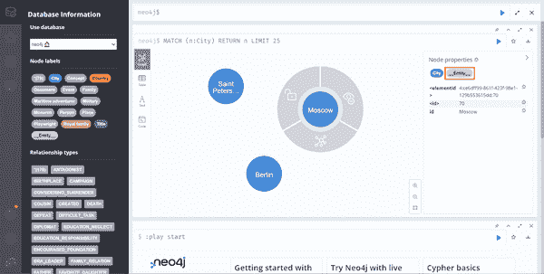
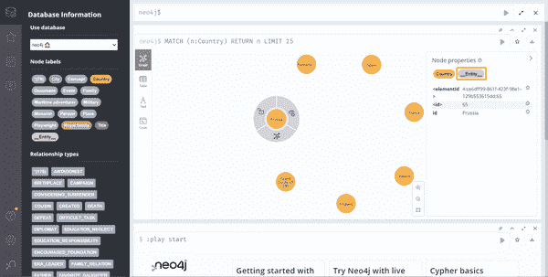
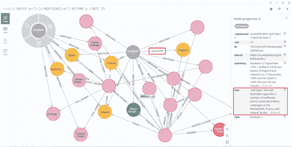
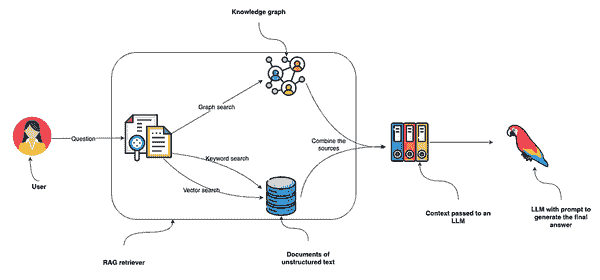
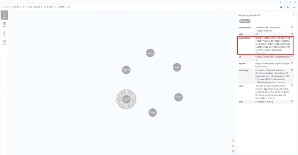
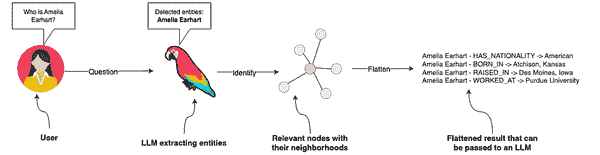

# 利用知识图谱提升RAG应用的准确性

> 来源：[https://agijuejin.feishu.cn/docx/MmYTd5EdgoTBdoxY267cFixCnOg](https://agijuejin.feishu.cn/docx/MmYTd5EdgoTBdoxY267cFixCnOg)

> 作者：lucas大叔

> 原文：[https://zhuanlan.z](https://zhuanlan.zhihu.com/p/692595027)hihu.com/p/692595...

图检索增强生成（GraphRAG）利用图数据库的结构化特性，以节点和关系的方式进行组织数据，增加了检索到信息的深度和关联上下文，是传统向量检索方法的有效补充。



图擅长以结构化的方式表示和存储异构和互连的信息，可以轻松地捕捉不同数据类型之间的复杂关系和属性。相比之下，向量数据库往往难以处理此类结构化信息，因为它们的优势在于通过高维向量处理非结构化数据。在RAG应用中，可以将结构化图数据与非结构化文本的向量搜索相结合，以实现优势互补。

---

虽然知识图谱的概念已经比较普及，但构建知识图还是一项有挑战性的工作。它涉及到数据的收集和结构化，需要对领域和图建模有深入的了解。为了简化图谱构建过程，我们尝试利用LLM来构建。LLM对语言和上下文有着深刻的理解，可以实现[知识图创建过程](https://link.zhihu.com/?target=https%3A//github.com/tomasonjo/blogs/blob/master/llm/enhancing_rag_with_graph.ipynb)重要部分的自动化。通过分析文本数据，LLM可以识别实体，理解实体之间的关系，并建议如何在图结构中最好地表示它们。作为实验的结果，我们在LangChain中添加了图构建模块的第一个版本，并将在这篇博客中进行演示。相关代码可以在 GitHub 获取。

## Neo4j环境配置

首[先创建一个Neo4j实例。最](https://link.zhihu.com/?target=https%3A//neo4j.com/download/)简单的方法是在Neo4j Aura上启动一个免费实例，该实例提供Neo4j数据库的云实例。或者，你也可以下载 Neo4j Desktop 应用并创建Neo4j数据库的本地实例。

```
os.environ[&quot;OPENAI_API_KEY&quot;] = &quot;sk-&quot;
os.environ[&quot;NEO4J_URI&quot;] = &quot;bolt://localhost:7687&quot;
os.environ[&quot;NEO4J_USERNAME&quot;] = &quot;neo4j&quot;
os.environ[&quot;NEO4J_PASSWORD&quot;] = &quot;password&quot;

graph = Neo4jGraph()
```

## 数据摄入

本演示使用 [Elizabeth I ](https://link.zhihu.com/?target=https%3A//en.wikipedia.org/wiki/Elizabeth_I)的维基百科页面，我们用LangChain loader无缝地从维基百科抓取和分割文档。

```
# Read the wikipedia article
raw_documents = WikipediaLoader(query=&quot;Elizabeth I&quot;).load()
# Define chunking strategy
text_splitter = TokenTextSplitter(chunk_size=512, chunk_overlap=24)
documents = text_splitter.split_documents(raw_documents[:3])
```

现在用分割后的文档构建图谱。为此，我们实现了LLMGraphTransformer模块，它大大简化了在图数据库中构建和存储知识图谱。

LLMGraphTransformer类利用LLM将文档转化为图谱文档，允许指定输出图谱中节点和关系类型的约束，不支持抽取节点或者关系的属性。它的参数如下：

+   llm (BaseLanguageModel):支持结构化输出的语言模型实例

+   allowed_nodes (List[str], optional): 指定图谱中包含哪些节点类型，默认是空list，允许所有节点类型

+   allowed_relationships (List[str], optional): 指定图谱中包含哪些关系类型，默认是空list，允许所有关系类型

+   prompt (Optional[ChatPromptTemplate], optional): 传给LLM的带有其他指令的prompt

+   strict_mode (bool, optional): 确定转化是否应该使用筛选以严格遵守`allowed_nodes` 和 `allowed_relationships`，默认为True

本例allowed_nodes和allowed_relationships都采取默认设置，即图谱中允许所有的节点和关系类型。

```
llm=ChatOpenAI(temperature=0, model_name=&quot;gpt-4-0125-preview&quot;)
llm_transformer = LLMGraphTransformer(llm=llm)

# Extract graph data
graph_documents = llm_transformer.convert_to_graph_documents(documents)
# Store to neo4j
graph.add_graph_documents(
  graph_documents, 
  baseEntityLabel=True, 
  include_source=True
)
```

你可以定义知识图谱生成链要使用的LLM。目前，只支持OpenAI和Mistral的function-calling模型。在本例中，我们使用最新的GPT-4。值得注意的是，生成图谱的质量在很大程度上取决于所使用的模型。LLM graph transformer 返回图谱文档，通过add_graph_documents方法导入到Neo4j。baseEntityLabel参数为每个节点分配一个额外的__Entity__标签，从而提高索引和查询性能。include_source参数将节点链接到其原始文档，便于数据跟踪和上下文理解。

在Neo4j浏览器中可以检查生成的图谱。



可以看到，每种类型的节点除了自身的节点类型之外，多了一个__Entity__标签。





同时，节点通过MENTIONS关系与源文档连接。



## RAG混合检索

在生成图谱之后，我们将 **向量索引 **和 **关键字索引 **的混合检索与 **图谱检索 **结合起来用于RAG。



上图展示了从用户提出问题开始的检索过程，问题首先输入到RAG检索器，该检索器采用关键词和向量搜索非结构化文本数据，并与从知识图谱中收集的信息结合。由于neo4j同时具有关键词和向量索引，因此可以使用单个数据库实现全部三种检索方式。从这些数据源收集的数据输入给LLM生成最终答案。

### 非结构化数据检索器

可以用Neo4jVector.from_existing_graph方法为文档添加关键字和向量检索。此方法为混合搜索方法配置关键字和向量搜索索引，目标节点类型为Document。另外，如果文本embedding值缺失，它还会计算创建向量索引。

```
vector_index = Neo4jVector.from_existing_graph(
    OpenAIEmbeddings(),
    search_type=&quot;hybrid&quot;,
    node_label=&quot;Document&quot;,
    text_node_properties=[&quot;text&quot;],
    embedding_node_property=&quot;embedding&quot;
)
```

可以看到，Document节点原来没有embedding属性，创建非结构化数据检索器后，基于Document节点的text属性新创建了embedding。



然后使用similarity_search方法就可以调用向量索引。

### 图谱检索器

另一方面，配置图谱检索更为复杂，但提供了更多的自由度。本示例将使用全文索引识别相关节点并返回其一阶邻居。



图谱检索器首先识别输入中的相关实体。为简单起见，我们让LLM识别人、组织和地点等通用实体，用LCEL和新添加的with_structured_output方法来提取。

```
# Extract entities from text
class Entities(BaseModel):
    &quot;&quot;&quot;Identifying information about entities.&quot;&quot;&quot;

    names: List[str] = Field(
        ...,
        description=&quot;All the person, organization, or business entities that &quot;
        &quot;appear in the text&quot;,
    )

prompt = ChatPromptTemplate.from_messages(
    [
        (
            &quot;system&quot;,
            &quot;You are extracting organization and person entities from the text.&quot;,
        ),
        (
            &quot;human&quot;,
            &quot;Use the given format to extract information from the following &quot;
            &quot;input: {question}&quot;,
        ),
    ]
)

entity_chain = prompt | llm.with_structured_output(Entities)
```

让我们测试一下：

```
entity_chain.invoke({&quot;question&quot;: &quot;Where was Amelia Earhart born?&quot;}).names
# [&#x27;Amelia Earhart&#x27;]
```

现在实现了从问题中检测出实体，接下来用全文索引将它们映射到知识图谱。首先，我们需要定义全文索引和一个函数，该函数将生成允许有些拼写错误的全文查询。

```
graph.query(
    &quot;CREATE FULLTEXT INDEX entity IF NOT EXISTS FOR (e:__Entity__) ON EACH [e.id]&quot;)

def generate_full_text_query(input: str) -&gt; str:
    &quot;&quot;&quot;
    Generate a full-text search query for a given input string.
    This function constructs a query string suitable for a full-text search.
    It processes the input string by splitting it into words and appending a
    similarity threshold (~2 changed characters) to each word, then combines 
    them using the AND operator. Useful for mapping entities from user questions
    to database values, and allows for some misspelings.
    &quot;&quot;&quot;
    full_text_query = &quot;&quot;
    words = [el for el in remove_lucene_chars(input).split() if el]
    for word in words[:-1]:
        full_text_query += f&quot; {word}~2 AND&quot;
    full_text_query += f&quot; {words[-1]}~2&quot;
    return full_text_query.strip()
```

把上面的功能组装在一起实现图谱检索的结构化检索器。

```
# Fulltext index query
def structured_retriever(question: str) -&gt; str:
    &quot;&quot;&quot;
    Collects the neighborhood of entities mentioned
    in the question
    &quot;&quot;&quot;
    result = &quot;&quot;
    entities = entity_chain.invoke({&quot;question&quot;: question})
    for entity in entities.names:
        response = graph.query(
            &quot;&quot;&quot;CALL db.index.fulltext.queryNodes(&#x27;entity&#x27;, $query, {limit:2})
            YIELD node,score
            CALL {
              MATCH (node)-[r:!MENTIONS]-&gt;(neighbor)
              RETURN node.id + &#x27; - &#x27; + type(r) + &#x27; -&gt; &#x27; + neighbor.id AS output
              UNION
              MATCH (node)&lt;-[r:!MENTIONS]-(neighbor)
              RETURN neighbor.id + &#x27; - &#x27; + type(r) + &#x27; -&gt; &#x27; +  node.id AS output
            }
            RETURN output LIMIT 50
            &quot;&quot;&quot;,
            {&quot;query&quot;: generate_full_text_query(entity)},
        )
        result += &quot;\n&quot;.join([el[&#x27;output&#x27;] for el in response])
    return result
```

structured_retriever函数从检测用户问题中的实体开始，迭代检测到的实体，使用Cypher模板来检索相关节点的一阶邻居。

```
print(structured_retriever(&quot;Who is Elizabeth I?&quot;))
# Elizabeth I - BORN_ON -&gt; 7 September 1533
# Elizabeth I - DIED_ON -&gt; 24 March 1603
# Elizabeth I - TITLE_HELD_FROM -&gt; Queen Of England And Ireland
# Elizabeth I - TITLE_HELD_UNTIL -&gt; 17 November 1558
# Elizabeth I - MEMBER_OF -&gt; House Of Tudor
# Elizabeth I - CHILD_OF -&gt; Henry Viii
# and more...
```

### 最终的检索器

如开头所述，我们将结合非结构化和图谱检索器来创建传递给LLM的最终上下文。

```
def retriever(question: str):
    print(f&quot;Search query: {question}&quot;)
    structured_data = structured_retriever(question)
    unstructured_data = [el.page_content for el in vector_index.similarity_search(question)]
    final_data = f&quot;&quot;&quot;Structured data:
{structured_data}
Unstructured data:
{&quot;#Document &quot;. join(unstructured_data)}
    &quot;&quot;&quot;
    return final_data
```

正如处理Python一样，可以简单地使用f-string拼接输出。

## 定义RAG Chain

我们已经成功地实现了RAG的检索组件。首先引入查询重写功能，允许根据对话历史对当前问题进行改写。

```
# Condense a chat history and follow-up question into a standalone question
_template = &quot;&quot;&quot;Given the following conversation and a follow up question, rephrase the follow up question to be a standalone question,
in its original language.
Chat History:
{chat_history}
Follow Up Input: {question}
Standalone question:&quot;&quot;&quot;  # noqa: E501
CONDENSE_QUESTION_PROMPT = PromptTemplate.from_template(_template)

def _format_chat_history(chat_history: List[Tuple[str, str]]) -&gt; List:
    buffer = []
    for human, ai in chat_history:
        buffer.append(HumanMessage(content=human))
        buffer.append(AIMessage(content=ai))
    return buffer

_search_query = RunnableBranch(
    # If input includes chat_history, we condense it with the follow-up question
    (
        RunnableLambda(lambda x: bool(x.get(&quot;chat_history&quot;))).with_config(
            run_name=&quot;HasChatHistoryCheck&quot;
        ),  # Condense follow-up question and chat into a standalone_question
        RunnablePassthrough.assign(
            chat_history=lambda x: _format_chat_history(x[&quot;chat_history&quot;])
        )
        | CONDENSE_QUESTION_PROMPT
        | ChatOpenAI(temperature=0)
        | StrOutputParser(),
    ),
    # Else, we have no chat history, so just pass through the question
    RunnableLambda(lambda x : x[&quot;question&quot;]),
)
```

接下来，引入prompt利用集成混合检索器提供的上下文生成响应，完成RAG链的实现。

```
template = &quot;&quot;&quot;Answer the question based only on the following context:
{context}
Question: {question}
&quot;&quot;&quot;
prompt = ChatPromptTemplate.from_template(template)

chain = (
    RunnableParallel(
        {
            &quot;context&quot;: _search_query | retriever,
            &quot;question&quot;: RunnablePassthrough(),
        }
    )
    | prompt
    | llm
    | StrOutputParser()
)
```

最后，继续测试混合RAG实现。

```
chain.invoke({&quot;question&quot;: &quot;Which house did Elizabeth I belong to?&quot;})
# Search query: Which house did Elizabeth I belong to?
# &#x27;Elizabeth I belonged to the House of Tudor.&#x27;
```

前面实现了查询重写功能，使RAG链能够适配允许后续问题的对话设置。考虑到我们使用向量和关键字搜索，必须重写后续问题以优化搜索过程。

```
chain.invoke(
    {
        &quot;question&quot;: &quot;When was she born?&quot;,
        &quot;chat_history&quot;: [(&quot;Which house did Elizabeth I belong to?&quot;, &quot;House Of Tudor&quot;)],
    }
)
# Search query: When was Elizabeth I born?
# &#x27;Elizabeth I was born on 7 September 1533.&#x27;
```

可以看到 When was she born? 首先被改写为“When was Elizabeth I born?”，然后使用重写后的查询来检索相关上下文并回答问题。

## 参考资料

[E](https://link.zhihu.com/?target=https%3A//neo4j.com/developer-blog/enhance-rag-knowledge-graph/)nhancing the Accuracy of RAG Applications With Knowledge Graphs