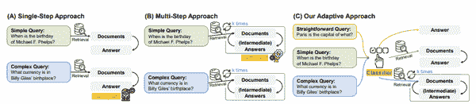
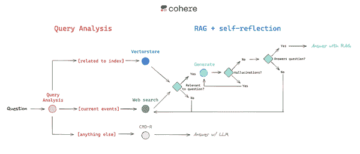

# Adaptive-RAG:基于问题复杂度的自适应RAG

> 来源：https://agijuejin.feishu.cn/docx/Wnt7dXXeYoKc0Vx5mDIc59UNnzg
>
> 作者：lucas大叔
>
> 原文：https://zhuanlan.zhihu.com/p/691008957

[Retrieval-Augmented LLM](https://link.zhihu.com/?target=https%3A//arxiv.org/pdf/2403.14403.pdf)可将外部数据库中的非参数知识融入LLM，从而有效提升诸如问答等任务的回答准确性。然而，尽管处理不同复杂度查询的方法很多，但也存在一定的不足亟待优化。例如，耗费太多的计算资源处理简单查询，不能妥善地解决复杂的多跳问题。而且，并非用户的所有查询都能划分为简单或者复杂。为此，研究人员提出了一种自适应QA框架- `adaptive RAG` ，根据查询复杂度从最简单到最复杂的LLM中动态选择最合适的策略。该框架用小LM训练了一个分类器，预测查询的复杂程度。这一方案在迭代和单步Retrieval-Augmented LLM以及无需检索方法之间实现了无缝自适应响应各种复杂度的查询。



---

## 方案原理

Adaptive-RAG通过判断问题的复杂性自动选择使用哪种RAG策略。作者将问题划分为三类（如上图的C部分）：

+ 开放域问答：这类任务通常涉及两个模块：检索器和阅读器。随着具有千亿参数的超强推理能力的LLM的出现，LLM和检索器之间的协同作用已经取得了显著进展。然而，尽管在单跳检索增强LLM方面取得了进展，但某些查询的复杂性需要更复杂的策略。

+ 多跳问答：多跳问答（Multi-hop QA）是常规开放域问答（Open-domain QA）的扩展，需要系统全面收集和将多个文档的信息作为上下文回答更复杂的查询。首先将多跳查询分解为更简单的单跳查询，重复访问LLM和检索器来解决这些子查询，并合并它们的答案以形成完整答案。这种查询的缺点是：每个查询迭代访问LLM和检索器可能效率极低，因为有些查询可能足够简单，可以通过单一检索步骤甚至仅通过LLM本身来回答。

+ 自适应检索：为了处理不同复杂性的查询，自适应检索策略根据每个查询的复杂性动态决定是否检索文档。根据实体的频率来确定查询的复杂性级别，并建议仅当频率低于一定阈值时才使用检索模块。然而，这种方法仅关注于检索与否的二元决策，可能不足以解决需要多个推理步骤的更复杂的查询。

Adaptive Retrieval-Augmented Generation (Adaptive-RAG) 是一种新颖的问答框架，它能够根据问题的复杂性动态选择最适合的策略来处理Retrieval-Augmented LLM。这三种策略包括：

1. 非检索方法（No Retrieval）：这是最简单的策略，直接使用LLM本身的知识库来生成答案。这种方法适用于那些模型已经知道答案的简单问题，不需要额外的外部信息。

2. 单步检索方法（Single-step Approach）：当问题需要额外的信息时，这种方法会先从外部知识源检索相关信息，然后将检索到的文档作为上下文信息输入到LLM中，帮助模型生成更准确的答案。这种方法适用于需要一次额外信息检索的中等复杂度问题。

3. 多步检索方法（Multi-step Approach）：对于最复杂的问题，需要从多个文档中综合信息并进行多步推理。这种方法通过迭代地访问检索器和LLM，逐步构建起解决问题所需的信息链。这种方法适用于需要多步逻辑推理的复杂问题。

Adaptive-RAG的核心在于它能够通过分类器来评估问题的复杂性，然后根据评估结果选择最合适的处理策略。分类器是一个较小的语言模型，它被训练用来预测`query`的复杂度。通过这种方式，Adaptive-RAG能够灵活地在不同的Retrieval-Augmented LLM策略之间进行切换，从而在处理各种复杂性的问题时，实现更高的效率和准确性。

在Adaptive-RAG模型中，训练分类器以准确评估问题的复杂性是个关键步骤。这个过程涉及以下几个关键步骤：

1. 定义复杂性标签：首先，需要定义问题的复杂性等级。在Adaptive-RAG中，通常有三个类别：简单（`A`）、中等（`B`）和复杂（`C`）。简单问题可以直接由LLM回答，中等复杂度问题需要单步检索，而复杂问题则需要多步检索和推理。

2. 自动收集训练数据：由于没有现成的带有复杂性标签的查询数据集，Adaptive-RAG通过两种策略自动构建训练数据集：

   - 从不同Retrieval-Augmented LLM策略的预测结果中标注查询的复杂性。

     如果非检索方法能够正确生成答案，则对应问题的标签为简单（`A`）；

     如果单步检索方法和多步检索方法都能正确回答，而非检索方法失败，则对应问题的标签为中等（`B`）；

     如果只有多步检索方法能够正确回答，则对应问题的标签为复杂（`C`）。

   - 利用基准数据集中的固有偏差来标注未标记的查询。

     例如，如果一个查询在单步数据集中未被标记，则自动分配标签为中等（`B`）；

     如果在多步数据集中未被标记，则自动分配标签为复杂（`C`）。

3. 训练分类器：使用自动收集的查询-复杂性对数据集，训练一个较小的语言模型作为分类器。这个分类器的目标是根据 `query` 预测其复杂性级别。训练过程中，使用交叉熵损失函数，并选择在验证集上表现最佳的迭代次数。

4. 评估和优化分类器：在训练完成后，评估分类器的性能，包括准确率和其他相关指标。如果分类器的性能不足，可能需要进一步优化，例如通过调整模型结构、增加训练数据或改进数据标注策略。

5. 集成到Adaptive-RAG框架：将训练好的分类器集成到Adaptive-RAG框架中。在推理阶段，分类器用于预测新问题的复杂性，然后根据这个预测结果选择最合适的问答策略。

通过这种方法，Adaptive-RAG能够动态地调整其查询处理策略，以适应不同复杂性的问题，从而提高问答系统的整体效率和准确性。

---

## 基于`langchain`的代码实现

[`Adaptive RAG`](https://link.zhihu.com/?target=https%3A//blog.langchain.dev/query-construction/) 是将 `query analysis` 和 `active / self-corrective RAG` 相结合的一种RAG策略。

基于adaptive-RAG论文中的思想，执行`query analysis`以遍历一些更有趣的案例：

+ 无检索（LLM回答）

+ Web搜索

+ 迭代RAG

我们将使用`Cohere`最近发布的 `Command R`：

+ 在RAG和Tool Use方面有较高的准确性

+ 128k上下文

+ 低延迟



### 准备环境

```bash
pip install --quiet langchain langchain_cohere langchain-openai tiktoken langchainhub chromadb langgraph
```

### 配置cohere api key

```python
### LLMs
import os
os.environ['COHERE_API_KEY'] = <your-api-key>
```

### 创建索引

```python
### Build Index

from langchain.text_splitter import RecursiveCharacterTextSplitter
from langchain_community.document_loaders import WebBaseLoader
from langchain_community.vectorstores import Chroma
from langchain_cohere import CohereEmbeddings

# Set embeddings
embd = CohereEmbeddings()

# Docs to index
urls = [
    "https://lilianweng.github.io/posts/2023-06-23-agent/",
    "https://lilianweng.github.io/posts/2023-03-15-prompt-engineering/",
    "https://lilianweng.github.io/posts/2023-10-25-adv-attack-llm/",
]

# Load
docs = [WebBaseLoader(url).load() for url in urls]
docs_list = [item for sublist in docs for item in sublist]

# Split
text_splitter = RecursiveCharacterTextSplitter.from_tiktoken_encoder(
    chunk_size=512, chunk_overlap=0
)
doc_splits = text_splitter.split_documents(docs_list)

# Add to vectorstore
vectorstore = Chroma.from_documents(
    documents=doc_splits,
    embedding=embd,
)

retriever = vectorstore.as_retriever()
```

### LLM使用

我们使用`router`在工具之间进行选择。`Cohere`模型决定调用哪个工具，以及如何查询它们。

```python
### Router
from typing import Literal

from langchain_core.prompts import ChatPromptTemplate
from langchain_core.pydantic_v1 import BaseModel, Field
from langchain_cohere import ChatCohere

# Data model
class web_search(BaseModel):
    """
    The internet. Use web_search for questions that are related to anything else than agents, prompt engineering, and adversarial attacks.
    """
    query: str = Field(description="The query to use when searching the internet.")

class vectorstore(BaseModel):
    """
    A vectorstore containing documents related to agents, prompt engineering, and adversarial attacks. Use the vectorstore for questions on these topics.
    """
    query: str = Field(description="The query to use when searching the vectorstore.")

# Preamble
preamble = """You are an expert at routing a user question to a vectorstore or web search.
The vectorstore contains documents related to agents, prompt engineering, and adversarial attacks.
Use the vectorstore for questions on these topics. Otherwise, use web-search."""

# LLM with tool use and preamble
llm = ChatCohere(model="command-r", temperature=0)
structured_llm_router = llm.bind_tools(tools=[web_search, vectorstore], preamble=preamble)

# Prompt
route_prompt = ChatPromptTemplate.from_messages(
    [
        ("human", "{question}"),
    ]
)

question_router = route_prompt | structured_llm_router
response = question_router.invoke({"question": "Who will the Bears draft first in the NFL draft?"})
print(response.response_metadata['tool_calls'])
response = question_router.invoke({"question": "What are the types of agent memory?"})
print(response.response_metadata['tool_calls'])
response = question_router.invoke({"question": "Hi how are you?"})
print('tool_calls' in response.response_metadata)
```

打印内容

```text
[{'id': 'f811e3b9-052e-49db-a234-5fc3efbcc5ba', 'function': {'name': 'web_search', 'arguments': '{"query": "NFL draft bears first pick"}', 'type': 'function'}}]
[{'id': '4bc53113-8f32-4d6d-ac9b-c07ef9aae9fd', 'function': {'name': 'vectorstore', 'arguments': '{"query": "types of agent memory"}', 'type': 'function'}}]
False
```

### 检索内容评估

评估检索到的内容与用户问题是否相关


## Retrieval Grader

### Data model

```
class GradeDocuments(BaseModel):
    """Binary score for relevance check on retrieved documents."""

    binary_score: str = Field(description="Documents are relevant to the question, 'yes' or 'no'")
```

### Prompt

```
preamble = """You are a grader assessing relevance of a retrieved document to a user question. \n
If the document contains keyword(s) or semantic meaning related to the user question, grade it as relevant. \n
Give a binary score 'yes' or 'no' score to indicate whether the document is relevant to the question."""
```

### LLM with function call

```
llm = ChatCohere(model="command-r", temperature=0)
structured_llm_grader = llm.with_structured_output(GradeDocuments, preamble=preamble)

grade_prompt = ChatPromptTemplate.from_messages(
    [
        ("human", "Retrieved document: \n\n {document} \n\n User question: {question}"),
    ]
)

retrieval_grader = grade_prompt | structured_llm_grader
question = "types of agent memory"
docs = retriever.invoke(question)
doc_txt = docs[1].page_content
response = retrieval_grader.invoke({"question": question, "document": doc_txt})
print(response)
```

打印结果

```
binary_score='yes'
```

## 答案生成

基于检索到的上下文回答

### Generate

```
from langchain import hub
from langchain_core.output_parsers import StrOutputParser
import langchain
from langchain_core.messages import HumanMessage


# Preamble
preamble = """You are an assistant for question-answering tasks. Use the following pieces of retrieved context to answer the question. If you don't know the answer, just say that you don't know. Use three sentences maximum and keep the answer concise."""

# LLM
llm = ChatCohere(model_name="command-r", temperature=0).bind(preamble=preamble)

# Prompt
prompt = lambda x: ChatPromptTemplate.from_messages(
    [
        HumanMessage(
            f"Question: {x['question']} \nAnswer: ",
            additional_kwargs={"documents": x["documents"]},
        )
    ]
)

# Chain
rag_chain = prompt | llm | StrOutputParser()

# Run
generation = rag_chain.invoke({"documents": docs, "question": question})
print(generation)
```

打印结果

```
There are three types of agent memory: sensory memory, short-term memory, and long-term memory.
```

## LLM回退

基于LLM知识回答问题

### LLM fallback

```
from langchain import hub
from langchain_core.output_parsers import StrOutputParser
import langchain
from langchain_core.messages import HumanMessage


# Preamble
preamble = """You are an assistant for question-answering tasks. Answer the question based upon your knowledge. Use three sentences maximum and keep the answer concise."""

# LLM
llm = ChatCohere(model_name="command-r", temperature=0).bind(preamble=preamble)

# Prompt
prompt = lambda x: ChatPromptTemplate.from_messages(
    [
        HumanMessage(
            f"Question: {x['question']} \nAnswer: "
        )
    ]
)

# Chain
llm_chain = prompt | llm | StrOutputParser()

# Run
question = "Hi how are you?"
generation = llm_chain.invoke({"question": question})
print(generation)
```

打印结果

```
I don't have feelings as an AI chatbot, but I'm here to assist you with any queries or concerns you may have. How can I help you today?
```

## 幻觉评估

评估LLM生成结果是否是基于已检索的事实

### Hallucination Grader

#### Data model

```
class GradeHallucinations(BaseModel):
    """Binary score for hallucination present in generation answer."""

    binary_score: str = Field(description="Answer is grounded in the facts, 'yes' or 'no'")
```

#### Preamble

```
preamble = """You are a grader assessing whether an LLM generation is grounded in / supported by a set of retrieved facts. \n
Give a binary score 'yes' or 'no'. 'Yes' means that the answer is grounded in / supported by the set of facts."""
```

#### LLM with function call

```
llm = ChatCohere(model="command-r", temperature=0)
structured_llm_grader = llm.with_structured_output(GradeHallucinations, preamble=preamble)
```

#### Prompt

```
hallucination_prompt = ChatPromptTemplate.from_messages(
    [
        # ("system", system),
        ("human", "Set of facts: \n\n {documents} \n\n LLM generation: {generation}"),
    ]
)

hallucination_grader = hallucination_prompt | structured_llm_grader
hallucination_grader.invoke({"documents": docs, "generation": generation})
```

打印结果

```
GradeHallucinations(binary_score='yes')
```

## 答案评估

评估答案是否解决用户问题

### Answer Grader

#### Data model

```
class GradeAnswer(BaseModel):
    """Binary score to assess answer addresses question."""

    binary_score: str = Field(description="Answer addresses the question, 'yes' or 'no'")
```

#### Preamble

```
preamble = """You are a grader assessing whether an answer addresses / resolves a question \n
Give a binary score 'yes' or 'no'. Yes' means that the answer resolves the question."""
```

#### LLM with function call

```
llm = ChatCohere(model="command-r", temperature=0)
structured_llm_grader = llm.with_structured_output(GradeAnswer, preamble=preamble)
```

#### Prompt

```
answer_prompt = ChatPromptTemplate.from_messages(
    [
        ("human", "User question: \n\n {question} \n\n LLM generation: {generation}"),
    ]
)

answer_grader = answer_prompt | structured_llm_grader
answer_grader.invoke({"question": question, "generation": generation})
```

打印结果

```
GradeAnswer(binary_score='yes')
```

## 网页搜索工具

### Search

```
# os.environ['TAVILY_API_KEY'] = <your-api-key>

from langchain_community.tools.tavily_search import TavilySearchResults
web_search_tool = TavilySearchResults()
```

## 构建Graph

把整个流程用图表示。

### Graph state

表示图的状态：`question`、`generation`、`documents`。

```
from typing_extensions import TypedDict
from typing import List

class GraphState(TypedDict):
    """|
    Represents the state of our graph.
    Attributes:
        question: question
        generation: LLM generation
        documents: list of documents
    """
    question : str
    generation : str
    documents : List[str]
```

### Graph Flow


# 图检索与生成

## 节点函数

```
from langchain.schema import Document

def retrieve(state):
    """
    Retrieve documents
    Args:
        state (dict): The current graph state
    Returns:
        state (dict): New key added to state, documents, that contains retrieved documents
    """
    print("---RETRIEVE---")
    question = state["question"]

    # Retrieval
    documents = retriever.invoke(question)
    return {"documents": documents, "question": question}

def llm_fallback(state):
    """
    Generate answer using the LLM w/o vectorstore
    Args:
        state (dict): The current graph state
    Returns:
        state (dict): New key added to state, generation, that contains LLM generation
    """
    print("---LLM Fallback---")
    question = state["question"]
    generation = llm_chain.invoke({"question": question})
    return {"question": question, "generation": generation}

def generate(state):
    """
    Generate answer using the vectorstore
    Args:
        state (dict): The current graph state
    Returns:
        state (dict): New key added to state, generation, that contains LLM generation
    """
    print("---GENERATE---")
    question = state["question"]
    documents = state["documents"]
    if not isinstance(documents, list):
      documents = [documents]

    # RAG generation
    generation = rag_chain.invoke({"documents": documents, "question": question})
    return {"documents": documents, "question": question, "generation": generation}

def grade_documents(state):
    """
    Determines whether the retrieved documents are relevant to the question.
    Args:
        state (dict): The current graph state
    Returns:
        state (dict): Updates documents key with only filtered relevant documents
    """

    print("---CHECK DOCUMENT RELEVANCE TO QUESTION---")
    question = state["question"]
    documents = state["documents"]

    # Score each doc
    filtered_docs = []
    for d in documents:
        score = retrieval_grader.invoke({"question": question, "document": d.page_content})
        grade = score.binary_score
        if grade == "yes":
            print("---GRADE: DOCUMENT RELEVANT---")
            filtered_docs.append(d)
        else:
            print("---GRADE: DOCUMENT NOT RELEVANT---")
            continue
    return {"documents": filtered_docs, "question": question}

def web_search(state):
    """
    Web search based on the re-phrased question.
    Args:
        state (dict): The current graph state
    Returns:
        state (dict): Updates documents key with appended web results
    """

    print("---WEB SEARCH---")
    question = state["question"]

    # Web search
    docs = web_search_tool.invoke({"query": question})
    web_results = "\n".join([d["content"] for d in docs])
    web_results = Document(page_content=web_results)

    return {"documents": web_results, "question": question}

### Edges ###

def route_question(state):
    """
    Route question to web search or RAG.
    Args:
        state (dict): The current graph state
    Returns:
        str: Next node to call
    """

    print("---ROUTE QUESTION---")
    question = state["question"]
    source = question_router.invoke({"question": question})
    
    # Fallback to LLM or raise error if no decision
    if "tool_calls" not in source.additional_kwargs:
        print("---ROUTE QUESTION TO LLM---")
        return "llm_fallback" 
    if len(source.additional_kwargs["tool_calls"]) == 0:
      raise "Router could not decide source"

    # Choose datasource
    datasource = source.additional_kwargs["tool_calls"][0]["function"]["name"]
    if datasource == 'web_search':
        print("---ROUTE QUESTION TO WEB SEARCH---")
        return "web_search"
    elif datasource == 'vectorstore':
        print("---ROUTE QUESTION TO RAG---")
        return "vectorstore"
    else: 
        print("---ROUTE QUESTION TO LLM---")
        return "vectorstore"

def decide_to_generate(state):
    """
    Determines whether to generate an answer, or re-generate a question.
    Args:
        state (dict): The current graph state
    Returns:
        str: Binary decision for next node to call
    """

    print("---ASSESS GRADED DOCUMENTS---")
    question = state["question"]
    filtered_documents = state["documents"]

    if not filtered_documents:
        # All documents have been filtered check_relevance
        # We will re-generate a new query
        print("---DECISION: ALL DOCUMENTS ARE NOT RELEVANT TO QUESTION, WEB SEARCH---")
        return "web_search"
    else:
        # We have relevant documents, so generate answer
        print("---DECISION: GENERATE---")
        return "generate"

def grade_generation_v_documents_and_question(state):
    """
    Determines whether the generation is grounded in the document and answers question.
    Args:
        state (dict): The current graph state
    Returns:
        str: Decision for next node to call
    """

    print("---CHECK HALLUCINATIONS---")
    question = state["question"]
    documents = state["documents"]
    generation = state["generation"]

    score = hallucination_grader.invoke({"documents": documents, "generation": generation})
    grade = score.binary_score

    # Check hallucination
    if grade == "yes":
        print("---DECISION: GENERATION IS GROUNDED IN DOCUMENTS---")
        # Check question-answering
        print("---GRADE GENERATION vs QUESTION---")
        score = answer_grader.invoke({"question": question,"generation": generation})
        grade = score.binary_score
        if grade == "yes":
            print("---DECISION: GENERATION ADDRESSES QUESTION---")
            return "useful"
        else:
            print("---DECISION: GENERATION DOES NOT ADDRESS QUESTION---")
            return "not useful"
    else:
        pprint("---DECISION: GENERATION IS NOT GROUNDED IN DOCUMENTS, RE-TRY---")
        return "not supported"
```

## 创建Graph

根据检索逻辑创建graph。


## LangGraph 工作流构建

```
import pprint

from langgraph.graph import END, StateGraph

workflow = StateGraph(GraphState)

# Define the nodes
workflow.add_node("web_search", web_search) # web search
workflow.add_node("retrieve", retrieve) # retrieve
workflow.add_node("grade_documents", grade_documents) # grade documents
workflow.add_node("generate", generate) # rag
workflow.add_node("llm_fallback", llm_fallback) # llm

# Build graph
workflow.set_conditional_entry_point(
    route_question,
    {
        "web_search": "web_search",
        "vectorstore": "retrieve",
        "llm_fallback": "llm_fallback",
    },
)
workflow.add_edge("web_search", "generate")
workflow.add_edge("retrieve", "grade_documents")
workflow.add_conditional_edges(
    "grade_documents",
    decide_to_generate,
    {
        "web_search": "web_search",
        "generate": "generate",
    },
)
workflow.add_conditional_edges(
    "generate",
    grade_generation_v_documents_and_question,
    {
        "not supported": "generate", # Hallucinations: re-generate 
        "not useful": "web_search", # Fails to answer question: fall-back to web-search 
        "useful": END,
    },
)
workflow.add_edge("llm_fallback", END)

# Compile
app = workflow.compile()
```

## 测试

分别测试三种复杂度`query`检索的情况。

### 网页检索

```
# Run
inputs = {"question": "What player are the Bears expected to draft first in the 2024 NFL draft?"}
for output in app.stream(inputs):
    for key, value in output.items():
        # Node
        pprint.pprint(f"Node '{key}':")
        # Optional: print full state at each node
    pprint.pprint("\n---\n")

# Final generation
pprint.pprint(value["generation"])
```

打印结果

```
---ROUTE QUESTION---
---ROUTE QUESTION TO WEB SEARCH---
---WEB SEARCH---
"Node 'web_search':"
'\n---\n'
---GENERATE---
---CHECK HALLUCINATIONS---
---DECISION: GENERATION IS GROUNDED IN DOCUMENTS---
---GRADE GENERATION vs QUESTION---
---DECISION: GENERATION ADDRESSES QUESTION---
"Node 'generate':"
'\n---\n'
'The Bears are expected to draft Caleb Williams with their first pick.'
```

### RAG

```
# Run
inputs = {"question": "What are the types of agent memory?"}
for output in app.stream(inputs):
    for key, value in output.items():
        # Node
        pprint.pprint(f"Node '{key}':")
        # Optional: print full state at each node
        # pprint.pprint(value["keys"], indent=2, width=80, depth=None)
    pprint.pprint("\n---\n")

# Final generation
pprint.pprint(value["generation"])
```

打印结果

```
---ROUTE QUESTION---
---ROUTE QUESTION TO RAG---
---RETRIEVE---
"Node 'retrieve':"
'\n---\n'
---CHECK DOCUMENT RELEVANCE TO QUESTION---
---GRADE: DOCUMENT RELEVANT---
---GRADE: DOCUMENT RELEVANT---
---GRADE: DOCUMENT RELEVANT---
---GRADE: DOCUMENT RELEVANT---
---ASSESS GRADED DOCUMENTS---
---DECISION: GENERATE---
"Node 'grade_documents':"
'\n---\n'
---GENERATE---
---CHECK HALLUCINATIONS---
---DECISION: GENERATION IS GROUNDED IN DOCUMENTS---
---GRADE GENERATION vs QUESTION---
---DECISION: GENERATION ADDRESSES QUESTION---
"Node 'generate':"
'\n---\n'
'Sensory, short-term, and long-term memory.'
```

### LLM直接回答

```
# Run
inputs = {"question": "Hello, how are you today?"}
for output in app.stream(inputs):
    for key, value in output.items():
        # Node
        pprint.pprint(f"Node '{key}':")
        # Optional: print full state at each node
        # pprint.pprint(value["keys"], indent=2, width=80, depth=None)
    pprint.pprint("\n---\n")

# Final generation
pprint.pprint(value["generation"])
```

打印结果

```
---ROUTE QUESTION---
---ROUTE QUESTION TO LLM---
---LLM Fallback---
"Node 'llm_fallback':"
'\n---\n'
("I don't have feelings as an AI assistant, but I'm here to help you with your "
 'queries. How can I assist you today?')
```

---

## 基于LlamaIndex的代码实现

这里将展示与`Adaptive-RAG`类似的方法实现，使用`MistralAI`的`RouterQueryEngine`和`FunctionCalling`功能，根据查询的复杂性调用不同的工具或索引。

+ 复杂查询：利用多个工具，这些工具需要来自多个文档的上下文。

+ 简单查询：使用需要单文档上下文的单个工具，或者直接用`LLM`来提供答案。

方法按以下步骤实现：

+ 下载数据

+ 加载数据

+ 为3个文档创建索引

+ 用文档和`LLM`创建查询引擎

+ 为复杂查询初始化`FunctionCallingAgentWorker`。

+ 创建工具

+ 创建`RouterQueryEngine`-根据查询复杂性路由

+ 查询

### 准备环境

```
pip install llama-index
pip install llama-index-llms-mistralai
pip install llama-index-embeddings-mistralai
```

#### 设置api key

```
import os
os.environ['MISTRAL_API_KEY'] = '<YOUR MISTRAL API KEY>'
```

### 配置LLM和embedding模型

```
import nest_asyncio
nest_asyncio.apply()


from llama_index.core import SimpleDirectoryReader, VectorStoreIndex
from llama_index.llms.mistralai import MistralAI
from llama_index.embeddings.mistralai import MistralAIEmbedding
from llama_index.core import Settings

from llama_index.core.tools import QueryEngineTool, ToolMetadata
from llama_index.core.query_engine.router_query_engine import RouterQueryEngine
from llama_index.core.selectors.llm_selectors import LLMSingleSelector

# Note: Only `mistral-large-latest` supports function calling
llm = MistralAI(model='mistral-large-latest') 
embed_model = MistralAIEmbedding()

Settings.llm = llm
Settings.embed_model = embed_model
```

### 日志配置

```
# NOTE: This is ONLY necessary in jupyter notebook.
# Details: Jupyter runs an event-loop behind the scenes.
#          This results in nested event-loops when we start an event-loop to make async queries.
#          This is normally not allowed, we use nest_asyncio to allow it for convenience.
import nest_asyncio

nest_asyncio.apply()

import logging
import sys

# Set up the root logger
logger = logging.getLogger()
logger.setLevel(logging.INFO)  # Set logger level to INFO

# Clear out any existing handlers
logger.handlers = []

# Set up the StreamHandler to output to sys.stdout (Colab's output)
handler = logging.StreamHandler(sys.stdout)
handler.setLevel(logging.INFO)  # Set handler level to INFO

# Add the handler to the logger
logger.addHandler(handler)

from IPython.display import display, HTML
```

### 下载数据

下载Lyft在2020年、2021年和2022年向美国证券交易委员会提交的1万份文件。

```
!wget "https://www.dropbox.com/scl/fi/ywc29qvt66s8i97h1taci/lyft-10k-2020.pdf?rlkey=d7bru2jno7398imeirn09fey5&dl=0" -q -O ./lyft_10k_2020.pdf
!wget "https://www.dropbox.com/scl/fi/lpmmki7a9a14s1l5ef7ep/lyft-10k-2021.pdf?rlkey=ud5cwlfotrii6r5jjag1o3hvm&dl=0" -q -O ./lyft_10k_2021.pdf
!wget "https://www.dropbox.com/scl/fi/iffbbnbw9h7shqnnot5es/lyft-10k-2022.pdf?rlkey=grkdgxcrib60oegtp4jn8hpl8&dl=0" -q -O ./lyft_10k_2022.pdf
```

### 加载数据

```
# Lyft 2020 docs
lyft_2020_docs = SimpleDirectoryReader(input_files=["./lyft_10k_2020.pdf"]).load_data()

# Lyft 2021 docs
lyft_2021_docs = SimpleDirectoryReader(input_files=["./lyft_10k_2021.pdf"]).load_data()

# Lyft 2022 docs
lyft_2022_docs = SimpleDirectoryReader(input_files=["./lyft_10k_2022.pdf"]).load_data()
```

### 创建索引

```
# Index on Lyft 2020 Document
lyft_2020_index = VectorStoreIndex.from_documents(lyft_2020_docs)

# Index on Lyft 2021 Document
lyft_2021_index = VectorStoreIndex.from_documents(lyft_2021_docs)

# Index on Lyft 2022 Document
lyft_2022_index = VectorStoreIndex.from_documents(lyft_2022_docs)
```

### 创建query引擎


## Query Engine on Lyft 2020 Docs Index

```python
lyft_2020_query_engine = lyft_2020_index.as_query_engine(similarity_top_k=5)
```

## Query Engine on Lyft 2021 Docs Index

```python
lyft_2021_query_engine = lyft_2021_index.as_query_engine(similarity_top_k=5)
```

## Query Engine on Lyft 2022 Docs Index

```python
lyft_2022_query_engine = lyft_2022_index.as_query_engine(similarity_top_k=5)
```

LLM的查询引擎，用LLM来回答查询。

```python
from llama_index.core.query_engine import CustomQueryEngine

class LLMQueryEngine(CustomQueryEngine):
    """RAG String Query Engine."""

    llm: llm

    def custom_query(self, query_str: str):

        response = self.llm.complete(query_str)

        return str(response)

llm_query_engine = LLMQueryEngine(llm=llm)
```

## 初始化 `FunctionCallingAgentWorker`

```python
# These tools are used to answer complex queries involving multiple documents.
query_engine_tools = [
    QueryEngineTool(
        query_engine=lyft_2020_query_engine,
        metadata=ToolMetadata(
            name="lyft_2020_10k_form",
            description="Annual report of Lyft's financial activities in 2020",
        ),
    ),
    QueryEngineTool(
        query_engine=lyft_2021_query_engine,
        metadata=ToolMetadata(
            name="lyft_2021_10k_form",
            description="Annual report of Lyft's financial activities in 2021",
        ),
    ),
    QueryEngineTool(
        query_engine=lyft_2022_query_engine,
        metadata=ToolMetadata(
            name="lyft_2022_10k_form",
            description="Annual report of Lyft's financial activities in 2022",
        ),
    )
]

from llama_index.core.agent import FunctionCallingAgentWorker
from llama_index.core.agent import AgentRunner

agent_worker = FunctionCallingAgentWorker.from_tools(
    query_engine_tools,
    llm=llm,
    verbose=True,
    allow_parallel_tool_calls=True,
)
agent = AgentRunner(agent_worker)
```

## 创建工具

用 `QueryEngines` 和 `FunctionCallingAgentWorker` 创建工具。

```python
query_engine_tools = [
    QueryEngineTool(
        query_engine=lyft_2020_query_engine,
        metadata=ToolMetadata(
            name="lyft_2020_10k_form",
            description="Queries related to only 2020 Lyft's financial activities.",
        ),
    ),
    QueryEngineTool(
        query_engine=lyft_2021_query_engine,
        metadata=ToolMetadata(
            name="lyft_2021_10k_form",
            description="Queries related to only 2021 Lyft's financial activities.",
        ),
    ),
    QueryEngineTool(
        query_engine=lyft_2022_query_engine,
        metadata=ToolMetadata(
            name="lyft_2022_10k_form",
            description="Queries related to only 2022 Lyft's financial activities.",
        ),
    ),
    QueryEngineTool(
        query_engine=agent,
        metadata=ToolMetadata(
            name="lyft_2020_2021_2022_10k_form",
            description=(
                "Useful for queries that span multiple years from 2020 to 2022 for Lyft's financial activities."

            )
        )
    ),
    QueryEngineTool(
        query_engine=llm_query_engine,
        metadata=ToolMetadata(
            name="general_queries",
            description=(
                "Provides information about general queries other than lyft."
            )
        )
    )
]
```

## 创建 `RouterQueryEngine`

`RouterQueryEngine` 将根据查询的复杂性对用户查询进行路由，以选择其中一个工具。

```python
from llama_index.core.query_engine import RouterQueryEngine
from llama_index.core.selectors import LLMSingleSelector

query_engine = RouterQueryEngine(
    selector=LLMSingleSelector.from_defaults(),
    query_engine_tools=query_engine_tools,
    verbose = True
)
```

## 查询

### 简单查询

```python
response = query_engine.query("What is the capital of France?")
display(HTML(f'<p style="font-size:20px">{response.response}</p>'))
```

查询结果

```
HTTP Request: POST https://api.mistral.ai/v1/chat/completions "HTTP/1.1 200 OK"
Selecting query engine 4: This option is the most relevant as it mentions 'general queries other than Lyft'. The question about the capital of France is not related to Lyft's financial activities..
Selecting query engine 4: This option is the most relevant as it mentions 'general queries other than Lyft'. The question about the capital of France is not related to Lyft's financial activities..
HTTP Request: POST https://api.mistral.ai/v1/chat/completions "HTTP/1.1 200 OK"
The capital of France is Paris. Known as the "City of Light," Paris is famous for its iconic landmarks like the Eiffel Tower, Louvre Museum, Notre-Dame Cathedral, and more. It is a global center for art, fashion, gastronomy, and culture.
```

### 复杂查询

```python
response = query_engine.query("What did Lyft do in R&D in 2022 vs 2020?")
display(HTML(f'<p style="font-size:20px">{response.response}</p>'))
```

查询结果

```
HTTP Request: POST https://api.mistral.ai/v1/chat/completions "HTTP/1.1 200 OK"
Selecting query engine 3: This choice is most relevant as it spans multiple years from 2020 to 2022, which would allow for a comparison of Lyft's R&D activities in 2022 versus 2020..
Selecting query engine 3: This choice is most relevant as it spans multiple years from 2020 to 2022, which would allow for a comparison of Lyft's R&D activities in 2022 versus 2020..
Added user message to memory: What did Lyft do in R&D in 2022 vs 2020?
HTTP Request: POST https://api.mistral.ai/v1/chat/completions "HTTP/1.1 200 OK"
=== Calling Function ===
Calling function: lyft_2020_10k_form with args: {"input": "R&D expenses"}
HTTP Request: POST https://api.mistral.ai/v1/embeddings "HTTP/1.1 200 OK"
HTTP Request: POST https://api.mistral.ai/v1/chat/completions "HTTP/1.1 200 OK"
=== Calling Function ===
Calling function: lyft_2022_10k_form with args: {"input": "R&D expenses"}
HTTP Request: POST https://api.mistral.ai/v1/embeddings "HTTP/1.1 200 OK"
HTTP Request: POST https://api.mistral.ai/v1/chat/completions "HTTP/1.1 200 OK"
HTTP Request: POST https://api.mistral.ai/v1/chat/completions "HTTP/1.1 200 OK"
assistant: In 2020, Lyft's Research and Development expenses were 
37,082 million and severance and other employee costs of 
856,777 thousand, a decrease of $55.2 million, or 6%. This decrease was primarily due to a reduction in personnel-related costs and stock-based compensation, driven by reduced headcount following a transaction with Woven Planet in Q3 2021. There were also decreases in Level 5 costs, web hosting fees, autonomous vehicle research costs, and consulting and advisory costs. However, these decreases were partially offset by restructuring costs related to an event in Q4 2022.
```

---

作为一种最新提出的 RAG 策略，adaptive-RAG 的核心思想通俗易懂，判断 query 的复杂性，从而进行有针对性的引擎调用，避免了大材小用或者小材大用的尴尬，使得问答系统更加精细化、智能化。本文借鉴 adaptive-RAG 论文思想，分别介绍了基于 `langgraph` 和 `llamaindex` 的代码实现，希望帮助大家对 RAG 有更深入的了解和掌握。

## 参考资料

他山之石丨Adaptive-RAG：性能提升50%以上的高效RAG策略

[Adaptive-RAG LangGraph 示例](https://github.com/langchain-ai/langgraph/blob/main/examples/rag/langgraph_adaptive_rag_cohere.ipynb)

[Adaptive-RAG LlamaIndex 示例](https://github.com/mistralai/cookbook/blob/main/third_party/LlamaIndex/Adaptive_RAG.ipynb)
